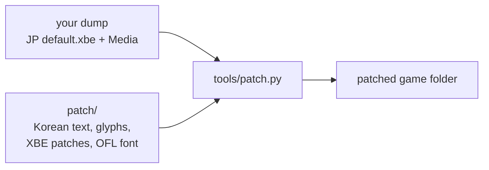

# JSRF-kr-patch

Xbox 게임 **Jet Set Radio Future** 일본판의 **한국어 패치**를 만드는 프로젝트입니다. 화면 문장(메뉴, 미션, 대사 자막)을 한국어로 바꾸고, 음성은 일본어 그대로 둡니다.

> **준비 중입니다.** 아직 패치 도구와 번역이 없습니다. 진행 계획은 [docs/PLAN.md](docs/PLAN.md)에 있습니다.

## 게임 데이터는 포함되지 않습니다

이 저장소와 배포물에는 게임의 실행 파일, 자산, 원문 문장이 들어 있지 않으며 앞으로도 넣지 않습니다. 결과물은 **패치 도구와 패치 데이터**이고, 직접 소유한 디스크의 덤프에 도구를 돌려 패치된 게임 폴더를 만듭니다.

## 필요한 덤프

| 파일 | 조건 |
|---|---|
| `default.xbe` | 일본판, MD5 `d8490cdb75bd47b36c62effdf1461ae0` |
| `Media/` | 같은 디스크의 `Media` 폴더 전체 |

덤프는 `roms/` 아래에 두면 Git이 무시합니다. 다른 판(US, PAL)의 XBE는 지원하지 않습니다. 도구는 입력의 MD5를 검사하고 다르면 멈춥니다.

## 사용법

도구가 생기면 적습니다. 예정된 형태는 다음과 같습니다.

```
python tools/patch.py <덤프 폴더> <출력 폴더>
```



## 관련 프로젝트

[reJSRF](https://github.com/nworkers/reJSRF)(JSRF의 정적 재컴파일 포팅)가 이 저장소의 결과를 참고해 같은 한국어 문장을 실행 중에 적용하는 방식으로 다시 구현합니다. 두 저장소는 코드를 공유하지 않습니다.

## 권리 고지

Jet Set Radio Future와 그 대본, 그림, 음성의 권리는 SEGA에 있습니다. 이 프로젝트는 SEGA와 관계가 없는 비공식 팬 번역입니다. 번역문은 원작의 2차적 저작물입니다. 패치 도구의 코드는 [MIT License](LICENSE)이고, 서드파티 글꼴과 코드는 [THIRD_PARTY_NOTICES.md](THIRD_PARTY_NOTICES.md)에 적습니다.

---

# JSRF-kr-patch

A **Korean patch** for the Japanese release of the Xbox game **Jet Set Radio Future**. On-screen text (menus, missions, dialogue subtitles) becomes Korean; voice stays Japanese.

> **In preparation.** There is no patcher or translation yet. The plan is in [docs/PLAN.md](docs/PLAN.md).

## No game data included

This repository and its releases contain no game executable, assets or original text, and never will. The deliverable is **a patcher and patch data**: run the tool on a dump of a disc you own to make a patched game folder.

## Dump needed

| File | Requirement |
|---|---|
| `default.xbe` | Japanese release, MD5 `d8490cdb75bd47b36c62effdf1461ae0` |
| `Media/` | the whole `Media` folder from the same disc |

Git ignores a dump kept under `roms/`. Other releases' XBEs (US, PAL) are not supported; the tool checks the input's MD5s and stops on a mismatch.

## Usage

To be written once the tool exists. The planned form:

```
python tools/patch.py <dump folder> <output folder>
```

## Related project

[reJSRF](https://github.com/nworkers/reJSRF) (a static-recompilation port of JSRF) takes this repository's results as reference and reimplements the same Korean text as a run-time replacement. The two repositories share no code.

## Rights notice

Jet Set Radio Future and its script, art and voice belong to SEGA. This is an unofficial fan translation, not affiliated with SEGA. The translation is a derivative of the original work. The patcher's code is under the [MIT License](LICENSE); third-party fonts and code are listed in [THIRD_PARTY_NOTICES.md](THIRD_PARTY_NOTICES.md).
