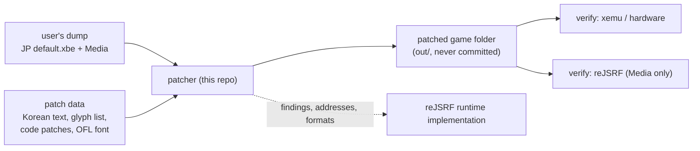

# JSRF-kr-patch 작업 계획서

작성: 2026-10-20, reJSRF 세션에서 작성해 이 저장소의 첫 작업 세션에 넘긴다.

근거: reJSRF의 한국어 패치 검토([design i105](https://github.com/nworkers/reJSRF/blob/main/docs/design/20261020-i105-korean-patch-review.md)), 분석 [text-and-font](https://github.com/nworkers/reJSRF/blob/main/docs/analysis/text-and-font.md)와 [language](https://github.com/nworkers/reJSRF/blob/main/docs/analysis/language.md). 로컬에서는 `C:\workspace\git\reJSRF\docs\`에 있다.

## 1. 목적과 범위

* Jet Set Radio Future의 `default.xbe`와 그 `Media`에 적용하는 **한국어 패치**를 만든다. 처음(P0~P6-1)에는 일본판 `default.xbe`(MD5 `d8490cdb75bd47b36c62effdf1461ae0`)를 대상으로 했고, P6-2(issue #20)부터 덤프의 US판 `default.xbe`(MD5 `f4e366bfdceee551a09f42219c90d84e`)를 바탕으로 영어 모드로 동작한다.
* 결과물은 **패치 도구와 패치 데이터**다. 사용자가 자기 덤프에 도구를 돌려 패치된 게임 폴더를 만든다. 원본 바이트는 저장소와 배포물에 넣지 않는다.
* 이 저장소의 결과(바꾼 주소, 데이터 형식, 글꼴 방식)를 reJSRF가 참고해 런타임 방식으로 다시 구현한다(§8). 두 저장소는 코드를 공유하지 않고 문서로 넘긴다.
* 범위 밖: 한국어 음성. 음성은 바꾸지 않고(영어 모드라 영어 음성) 자막(화면 문장)만 번역한다.

## 2. 저장소 초기 설정 (첫 작업, issue #1)

reJSRF의 작업 규칙과 라이선스를 그대로 가져와 이 저장소에 맞게 고친다.

| 파일 | 내용 |
|---|---|
| `AGENTS.md` | reJSRF `AGENTS.md`를 복사한다. 바꾸는 곳은 아래 표 |
| `CLAUDE.md` | `./AGENTS.md의 규칙을 따를 것` 한 줄(reJSRF와 같다) |
| `LICENSE` | MIT License. 저작권 줄은 `Copyright (c) 2026 JSRF-kr-patch contributors` |
| `THIRD_PARTY_NOTICES.md` | 처음에는 비어 있는 표. 글꼴(OFL)을 넣을 때 채운다 |
| `.gitignore` | reJSRF의 게임 데이터 줄(`roms/`, `*.iso`, `*.xbe`, `*.xiso`) + `out/`, `work/`(추출한 원문), `__pycache__/`, `*.pyc` |
| `README.md` | 한국어 먼저, 영어 번역. 목적, 필요한 덤프(일본판 MD5), 사용법(도구가 생기면), 권리 고지 |
| `VERSION` | `0.0.1` |
| `docs/` | `design/`, `work-orders/`, `work-logs/`, `analysis/`(+ `README.md` 색인), `kb/`, `guides/`, `release-notes/` |

`AGENTS.md`에서 바꿀 곳:

| reJSRF 절 | 이 저장소에서 |
|---|---|
| 프로젝트 개요, 핵심 설계 목표 | §1의 목적. 원본 게임 동작은 바꾸지 않고 문장·글꼴·글자 그림만 바꾼다. 코드 패치는 최소로 한다 |
| 참조 문서 | `PROJECT_CHARTER.md`, `XBE_DESIGN.*`, `ARCHITECTURE.md` 대신 `docs/PLAN.md`(이 문서), `docs/analysis/`, `docs/design/` |
| 레이어와 의존 규칙, 아키텍처 규칙 | 삭제하고 "도구 구조" 절로 바꾼다: `tools/`(파이썬, 표준 라이브러리 우선), `patch/`(패치 데이터), 도구는 입력을 읽기만 하고 `out/`에만 쓴다 |
| 구현 규칙 중 `GuestAddress`, 플랫폼 디렉터리 | 삭제. 대신 "주소는 일본판 XBE의 가상 주소로 적고, US판 대응 주소를 함께 적는다"(§8) |
| 게임 데이터와 생성 코드 규칙 | 그대로 두고 더한다: 덤프에서 **추출한 원문 문장**(일본어·영어)과 **패치된 결과물**도 커밋하지 않는다(`work/`, `out/`). 코드 패치에 원본 명령 바이트를 넣지 않는다(검증은 해시로) |
| 라이선스 규칙 | 그대로. 에뮬레이터(xemu 등)는 검증용 외부 도구로만 쓰고 코드는 가져오지 않는다 |
| 작업 단위, Git 규칙, 문서 규칙, 응답 태도 | 그대로(issue 번호, `YYYYMMDD-i###-slug.md`, squash merge, 버전·태그, 한국어 먼저) |

## 3. reJSRF에서 이어받는 사실

| 사실 | 값 | 상태(reJSRF 기준) |
|---|---|---|
| 일본판 언어 전역 | `0x251F58`(bss, 0 = 일본어). US판은 `0x1FC724` = 1 | 확인됨 |
| US→일본판 주소 대응 | `.data`는 대부분 `-0x20`/`-0x18`/`-0x8`, 언어 전역만 `+0x55834`. `.text`는 거의 같고 일부 함수만 옮겨졌다(예: US `0x694A0` = JP `0x69690`) | 확인됨 |
| 문장 위치 | `Media/Event/Event/e###.dat`(대사), `Media/Mission/mssn####.bin`(미션), `Media/Event/TalkEvent/TE###.bin`, `default.xbe`(메뉴·시스템·이름, 585개 문자열) | 확인됨 |
| 문장 형식 | Shift-JIS, NUL 종료, `NORM` 레코드(머리에 시작·끝 오프셋과 크기). `$n` 줄바꿈, `$r` 페이지, `$e` 메시지 끝(`$r$e$r`), 그 밖에 `$p $b $c $a $g $s` | `$n $e` 확인됨, 나머지 추정·미확정 |
| 분량 | 일본어 약 27,000자, 서로 다른 글자 800자(XBE 제외) | 확인됨 |
| 글꼴 | `Media/Font/jetfont.dat`: `NORM` 머리 0x40바이트 + DXT3 512×2304, 흰색 + alpha, 26픽셀 간격 약 88줄, 글리프 약 1,500개, 아래 약 24줄 빈 공간 | 확인됨. **P2에서 고침**: 텍스처 6장(512×512 네 장에 2바이트 1,390칸, 256×256 두 장에 1바이트 156자). [text-renderer §3](analysis/text-renderer.md) |
| 글리프 순서 | JIS 순서가 아니고 순서표가 파일에 없다. 코드 안의 표나 계산 | **P2에서 확인**: XBE `.data` `0x1F7088`의 코드표, 표 순번 = 칸 번호(일본판·US판 같은 주소). [text-renderer §4](analysis/text-renderer.md) |
| `TNRoman.bin` | 16바이트 항목 352개. 영문 비례 글꼴 표로 보인다. US판 `sub_0005F350`이 연다 | **P2에서 고침**: 개발용 디버그 글꼴(`Fps=%d` 등). 영어 문장은 `jetfont` 1바이트 페이지. [text-renderer §7](analysis/text-renderer.md) |
| 글자 그림 | `Title/LogoJ.dat`, `Title/Title.dat`, `Disp/SprNorm.*`, `Ending/tex_Jpn.dat`, `Mark/*_jpn.*` | 파일 확인, 내용 추정 |
| 분석 스크립트 | reJSRF `scripts/analysis/text/`(`find_text.py`, `text_records.py`), `scripts/analysis/language/`(`code_diff.py`, `data_diff.py` 등). MIT라 복사해 써도 된다 | - |

## 4. 결과물 형식 (issue #2에서 확정)

> **확정(2026-10-21)**: [설계 i002](design/20261021-i002-patcher.md). 아래는 처음 계획이고, 달라진 점은 설계 §3.4에 있다: `glyphs` 파일은 두지 않고 문장에서 계산한다, 입력 MD5는 `patch/manifest.json`에 둔다, `text/`는 TSV이고 자리를 `off:`·`va:`·`norm:`으로 적는다, `--iso`로 xiso도 만든다.

* **도구**: `tools/patch.py <덤프 폴더> <출력 폴더>`
  1. 입력 검증: 일본판 `default.xbe` MD5, 바꿀 `Media` 파일마다 MD5. 다르면 멈춘다.
  2. 출력 폴더에 게임 폴더를 복사하고, 바꿀 파일만 새로 만든다.
  3. 끝에 출력 파일의 MD5 목록을 낸다(재현성 확인).
* **패치 데이터**(`patch/`, 커밋함):
  * `text/*.tsv` 또는 `*.json`: 문장 위치(파일, 레코드, 메시지 번호) → 한국어. 원문은 넣지 않는다(위치와 원문 해시만).
  * `glyphs`: 쓰는 한글 음절 목록과 글리프 칸 배치(도구가 번역문에서 자동 생성).
  * `xbe/*.json`: XBE 패치. 일본판 가상 주소, 원래 바이트의 해시, 새 바이트(우리가 쓴 코드·자료만). 왜 바꾸는지 설명.
  * `font/`: 한글 글꼴(SIL OFL 등 재배포 가능한 것)과 그 라이선스.
* 결과물 형태(xdelta 차분이 아니라 **재생성**)를 고른 이유: 차분은 원본 바이트를 담을 수 있다. 재생성은 사용자 덤프와 우리 데이터만으로 만든다.

## 5. 단계 (각 단계는 GitHub issue 하나, 설계 → 작업 지시 → 구현 → 작업 로그)

| 단계 | issue(예정) | 할 일 | 완료 기준 |
|---|---|---|---|
| P0 | #1 | §2 초기 설정 | 규칙·라이선스·`.gitignore`·README가 커밋되고, `git status`에 `roms/`가 보이지 않는다 |
| P1 | #2 | 결과물 형식 설계(§4), 도구 뼈대: XBE 섹션 읽기, `NORM` 레코드 읽기·다시 쓰기, MD5 검증 | 원문을 바꾸지 않고 다시 쓴 파일이 원본과 바이트 단위로 같다(왕복 시험) |
| P2 | #3 | **텍스트 렌더러 분석(일본판 XBE)**: 문장을 그리는 함수, 글리프 대응(코드→칸), `$` 코드의 뜻, 한 줄 최대 폭, 글리프 크기 | `docs/analysis/text-renderer.md`에 주소(일본판·US판), 대응 방식, 확인/추정 구분 |
| P3 | #4 | **글꼴 방식 결정과 생성**: (a) 기존 Shift-JIS 코드 칸을 한글로 다시 그리기(코드 패치 없음) 또는 (b) 렌더러를 고쳐 한글 전용 코드와 새 아틀라스를 쓰기. P2 결과로 고른다. OFL 글꼴로 DXT3 아틀라스를 만드는 도구 | 설계 문서에 선택과 이유. 생성한 아틀라스를 alpha 이미지로 확인 |
| P4 | #5 | **개념 증명**: 미션 목표 한 줄(예: 첫 미션)과 메뉴 한 줄을 한국어로 바꾼 패치 | xemu에서 해당 화면에 한글이 나온 캡처. reJSRF(US XBE + Language=Japanese + 패치된 `Media`)에서도 같은 문장 확인 |
| P5 | #6 | 문장 파이프라인 전체: 추출(`work/`로, 커밋 안 함) → 번역 파일 → 재삽입. 이벤트·미션·대화·XBE 문자열. 길이가 늘면 레코드 크기와 오프셋을 다시 계산, XBE는 빈 공간이나 새 섹션으로 옮기고 참조를 고친다. **진행**: 앞 절반(형식 분석·추출·번역 뼈대·[가이드](guides/text-pipeline.md))은 issue #11([설계 i011](design/20261021-i011-text-extract.md)), 재삽입(원문보다 긴 문장)은 issue #13([설계 i013](design/20261021-i013-text-reinsert.md), 화면 확인 남음) | 모든 문장을 원문 그대로 넣은 왕복이 원본과 같다. 길이가 다른 시험 문장이 깨지지 않는다 |
| P6 | #7~ | 번역. **P6-0 준비**(issue #15): 용어집 `docs/kb/glossary.md`, 검사 도구 `tools/check_text.py`, 번역 지침 [guides/translation.md](guides/translation.md), 뼈대를 `patch/text/`에, XBE 기능 문구(메뉴·안내·이름) 초벌. **P6-1 전체 텍스트 번역**(issue #17): 미션(목표·안내 495), 대화(733), 이벤트(397), XBE(651) 총 2,276행 전수 번역 완료(`patch/text/*.tsv`). `check_text.py` 오류·경고 0. **P6-2 영문 모드 기반**(issue #20): 같은 디스크의 US판 XBE(언어 1)를 바탕으로 하고, 한국어를 영어 자리(메시지 스크립트 언어 1 구간, 미션 칸 1, XBE 영어 칸 695개)에도 쓴다. 음성·그림 자산은 영어판 | 묶음(필요하면 파일 범위) 단위로 issue를 나눈다. `check_text.py` 오류 0 |
| P7 | #8 | 글자 그림(로고 경고문, 타이틀, 메뉴 스프라이트, 엔딩): 목록과 우선순위, 새로 그린 그림만 패치 데이터로 | 선택 사항. 목록 문서부터 |
| P8 | 수시 | reJSRF 인계 문서(§8) | 단계마다 갱신 |
| P9 | #9 | 배포: 도구 사용법 가이드, 권리 고지, 릴리스. **P9-1**(issue #22): GitHub Actions 릴리스 — Windows·Linux 단독 실행 파일(Nuitka 2.8.10)과 Python판 묶음, 사용 설명서·출처, 해결된 issue가 든 릴리스 노트. **P9-2**(issue #23): 소개 페이지(`docs/sites/`) | 공개 여부는 사용자 결정(§7) |

## 6. 검증 방법

* **xemu**(GPL, 외부 도구로만 사용): 패치된 출력 폴더를 xiso로 묶거나 폴더로 실행. 화면 캡처로 확인한다.
* **reJSRF**: US XBE만 실행할 수 있다. 그래도 `Media`의 패치(문장 파일, 글꼴)는 reJSRF에서 시험할 수 있다. 출력 폴더의 `Media`에 US `default.xbe`를 두고 `REJSRF_LANGUAGE=Japanese`로 실행한다(렌더러가 두 빌드에서 같다는 전제, P2에서 확인). XBE 문자열·코드 패치는 US 대응 주소가 필요하므로 P8 이후다.
* **왕복 시험**: 도구가 원문을 그대로 다시 쓰면 원본과 바이트 단위로 같아야 한다.
* 커밋 전 `git status`로 `roms/`, `out/`, `work/`가 빠졌는지 본다.

## 7. 권리와 공개 (사용자 결정)

* 번역문은 원작 대본의 2차적 저작물이다. 저장소는 지금 private이다. 공개 여부와 방식은 사용자가 정한다.
* 원문(일본어·영어)과 원본 자산은 공개 여부와 상관없이 커밋하지 않는다.
* 글꼴은 재배포가 허용된 것만 쓰고 `THIRD_PARTY_NOTICES.md`에 적는다.

## 8. reJSRF 인계

reJSRF는 일본판 XBE를 실행하지 않고, US 빌드에서 언어 인덱스 0으로 일본어를 실행한다(v0.0.44). 그래서 이 저장소의 결과는 다음 형태로 넘긴다(`docs/handoff-rejsrf.md`).

| 이 저장소 | reJSRF에서 |
|---|---|
| `Media` 파일 패치(문장, 글꼴) | `rexbox` 파일 계층의 대체 또는 디컴파일한 문장 접근 함수가 번역 파일을 읽는다(reJSRF 검토 §4 방안 B) |
| XBE 문자열 패치 | US판 대응 주소의 문자열을 런타임에 바꾸거나, 그 문자열을 쓰는 함수를 디컴파일 |
| XBE 코드 패치(렌더러) | 같은 함수를 reJSRF에서 디컴파일해 바꾼다. 일본판 주소와 US판 주소를 함께 적는다 |
| 한글 아틀라스 생성 방식 | 같은 글꼴·같은 배치 규칙을 reJSRF에서 실행 시 생성 |

* 주소를 적을 때는 일본판 주소, US판 주소, 대응을 확인한 방법(코드 비교, 바이트 패턴)을 함께 적는다.
* reJSRF 쪽 작업은 reJSRF에 새 issue로 만든다(언어 설정에 `Korean` 추가 등).

## 9. 첫 세션에서 할 일

1. `docs/PLAN.md`(이 문서)를 읽는다.
2. GitHub issue #1(P0 초기 설정)을 만들고 브랜치를 판 뒤 §2대로 설정한다. 이 문서도 함께 커밋한다.
3. issue #2(P1)와 #3(P2)을 만든다. P2(텍스트 렌더러 분석)가 전체를 막는 일이므로 P1과 함께 일찍 시작한다.

---

# JSRF-kr-patch work plan

Written 2026-10-20 in a reJSRF session, handed to this repository's first working session.

Grounds: reJSRF's Korean patch review ([design i105](https://github.com/nworkers/reJSRF/blob/main/docs/design/20261020-i105-korean-patch-review.md)) and the analyses [text-and-font](https://github.com/nworkers/reJSRF/blob/main/docs/analysis/text-and-font.md) and [language](https://github.com/nworkers/reJSRF/blob/main/docs/analysis/language.md); locally under `C:\workspace\git\reJSRF\docs\`.

## 1. Purpose and scope

* Make a **Korean patch** for Jet Set Radio Future's `default.xbe` and its `Media`. At first (P0–P6-1) the target was the Japanese `default.xbe` (MD5 `d8490cdb75bd47b36c62effdf1461ae0`); from P6-2 (issue #20) the dump's US `default.xbe` (MD5 `f4e366bfdceee551a09f42219c90d84e`) is the base and the game runs in English mode.
* The deliverable is **a patcher and patch data**: users run the tool on their own dump to make a patched game folder. No original bytes go into the repository or a release.
* reJSRF takes this repository's results (changed addresses, data formats, the font approach) as reference and reimplements them at run time (§8). The two repositories share no code; results pass through documents.
* Out of scope: Korean voice. Voice is not changed (English in English mode); only on-screen text (subtitles) is translated.

## 2. Repository setup (the first task, issue #1)

Take reJSRF's working rules and license as they are and adapt them.

| File | Content |
|---|---|
| `AGENTS.md` | a copy of reJSRF's `AGENTS.md`, changed as in the table below |
| `CLAUDE.md` | one line, `./AGENTS.md의 규칙을 따를 것` (as in reJSRF) |
| `LICENSE` | MIT License, `Copyright (c) 2026 JSRF-kr-patch contributors` |
| `THIRD_PARTY_NOTICES.md` | an empty table at first, filled when a font (OFL) comes in |
| `.gitignore` | reJSRF's game-data lines (`roms/`, `*.iso`, `*.xbe`, `*.xiso`) plus `out/`, `work/` (extracted original text), `__pycache__/`, `*.pyc` |
| `README.md` | Korean first, then English: purpose, the dump needed (Japanese MD5), usage (once the tool exists), a rights notice |
| `VERSION` | `0.0.1` |
| `docs/` | `design/`, `work-orders/`, `work-logs/`, `analysis/` (with a `README.md` index), `kb/`, `guides/`, `release-notes/` |

Changes to `AGENTS.md`:

| reJSRF section | Here |
|---|---|
| Project overview, primary design goals | the purpose of §1: game behaviour stays as it is; only text, font and lettering pictures change; code patches are kept minimal |
| Reference documents | instead of `PROJECT_CHARTER.md`, `XBE_DESIGN.*`, `ARCHITECTURE.md`: `docs/PLAN.md` (this document), `docs/analysis/`, `docs/design/` |
| Layer and dependency rules, architecture rules | removed, replaced by a "tool structure" section: `tools/` (Python, standard library first), `patch/` (patch data); tools only read their input and write only to `out/` |
| Implementation rules on `GuestAddress` and platform directories | removed; instead "addresses are written as virtual addresses of the Japanese XBE, with the US counterpart beside them" (§8) |
| Game data and generated code rules | kept, with additions: **original text extracted** from the dump (Japanese and English) and **patched output** are never committed either (`work/`, `out/`); code patches carry no original instruction bytes (checks use hashes) |
| License rules | kept; emulators (xemu and the like) are used only as external verification tools and none of their code is taken |
| Task units, Git rules, documentation rules, response tone | kept (issue numbers, `YYYYMMDD-i###-slug.md`, squash merges, versions and tags, Korean first) |

## 3. Facts carried over from reJSRF

| Fact | Value | Status (in reJSRF) |
|---|---|---|
| Japanese language global | `0x251F58` (bss, 0 = Japanese); the US build's is `0x1FC724` = 1 | confirmed |
| US → Japanese address map | `.data` mostly `-0x20`/`-0x18`/`-0x8`, the language global `+0x55834`; `.text` nearly the same with a few functions moved (US `0x694A0` = JP `0x69690`) | confirmed |
| Where text lives | `Media/Event/Event/e###.dat` (dialogue), `Media/Mission/mssn####.bin` (missions), `Media/Event/TalkEvent/TE###.bin`, `default.xbe` (menus, system, names; 585 strings) | confirmed |
| Text format | Shift-JIS, NUL-terminated, in `NORM` records (headers with start and end offsets and a size); `$n` line, `$r` page, `$e` end of message (`$r$e$r`), and `$p $b $c $a $g $s` | `$n $e` confirmed, the rest inferred or unresolved |
| Volume | about 27,000 Japanese characters, 800 distinct (XBE not counted) | confirmed |
| Font | `Media/Font/jetfont.dat`: a 0x40-byte `NORM` header + DXT3 512×2304, white with alpha, about 88 rows at a 26-pixel pitch, about 1,500 glyphs, about 24 empty rows at the bottom | confirmed. **Corrected in P2**: six textures (1,390 double-byte cells on four 512×512, 156 single-byte glyphs on two 256×256). [text-renderer §3](analysis/text-renderer.md) |
| Glyph order | not JIS order, and no order table in the files; a table or computation in the code | **confirmed in P2**: a code table at XBE `.data` `0x1F7088`; table index = cell number (same address in the JP and US builds). [text-renderer §4](analysis/text-renderer.md) |
| `TNRoman.bin` | 352 entries of 16 bytes; looks like a proportional Latin font table; the US build's `sub_0005F350` opens it | **corrected in P2**: a developer debug font (`Fps=%d` ...); English text uses `jetfont`'s single-byte pages. [text-renderer §7](analysis/text-renderer.md) |
| Lettering pictures | `Title/LogoJ.dat`, `Title/Title.dat`, `Disp/SprNorm.*`, `Ending/tex_Jpn.dat`, `Mark/*_jpn.*` | files confirmed, content inferred |
| Analysis scripts | reJSRF `scripts/analysis/text/` (`find_text.py`, `text_records.py`) and `scripts/analysis/language/` (`code_diff.py`, `data_diff.py` ...); MIT, so they can be copied | - |

## 4. Deliverable format (settled in issue #2)

> **Settled (2026-10-21)**: [design i002](design/20261021-i002-patcher.md). Below is the original plan; the differences are in design §3.4: no `glyphs` file (computed from the text), input MD5s in `patch/manifest.json`, `text/` is TSV with places written as `off:`, `va:` or `norm:`, and `--iso` also builds an xiso.

* **Tool**: `tools/patch.py <dump folder> <output folder>`
  1. Checks the input: the Japanese `default.xbe` MD5 and the MD5 of every `Media` file it changes; stops on a mismatch.
  2. Copies the game folder to the output and writes only the changed files anew.
  3. Prints the output files' MD5s at the end (reproducibility).
* **Patch data** (`patch/`, committed):
  * `text/*.tsv` or `*.json`: text place (file, record, message number) → Korean. No original text (only the place and a hash of the original).
  * `glyphs`: the Hangul syllables used and their glyph-cell layout (generated by the tool from the translation).
  * `xbe/*.json`: XBE patches: Japanese virtual address, hash of the original bytes, new bytes (only code and data we wrote), and why.
  * `font/`: a Hangul font that allows redistribution (SIL OFL and the like) and its license.
* Why the output is **regenerated** rather than an xdelta diff: a diff can carry original bytes; regeneration uses only the user's dump and our data.

## 5. Phases (one GitHub issue each; design → work order → implementation → work log)

| Phase | Issue (planned) | Work | Done when |
|---|---|---|---|
| P0 | #1 | the setup of §2 | rules, license, `.gitignore` and README are committed, and `git status` does not show `roms/` |
| P1 | #2 | design the deliverable format (§4); tool skeleton: read XBE sections, read and rewrite `NORM` records, MD5 checks | files rewritten without changes equal the originals byte for byte (round trip) |
| P2 | #3 | **analyse the text renderer (Japanese XBE)**: the function that draws text, the glyph mapping (code → cell), the `$` codes' meaning, the maximum line width, glyph size | `docs/analysis/text-renderer.md` with addresses (Japanese and US), the mapping, confirmed vs inferred |
| P3 | #4 | **choose and build the font approach**: (a) redraw existing Shift-JIS code cells with Hangul (no code patch) or (b) change the renderer to use Hangul codes and a new atlas; chosen from P2. A tool that builds the DXT3 atlas from an OFL font | the choice and reasons in a design document; the built atlas checked as an alpha image |
| P4 | #5 | **proof of concept**: a patch turning one mission objective line (the first mission, say) and one menu line into Korean | an xemu capture with Hangul on that screen; the same line in reJSRF (US XBE + Language=Japanese + patched `Media`) |
| P5 | #6 | the full text pipeline: extract (to `work/`, never committed) → translation file → reinsert, for events, missions, talk and XBE strings. Longer text recomputes record sizes and offsets; XBE strings move to free space or a new section with their references fixed. **Progress**: the first half (format analysis, extraction, translation skeleton, [guide](guides/text-pipeline.md)) is issue #11 ([design i011](design/20261021-i011-text-extract.md)); reinsertion (text longer than the original) is issue #13 ([design i013](design/20261021-i013-text-reinsert.md); screen check pending) | a round trip with the original text equals the original; test lines of other lengths do not break |
| P6 | #7+ | translation. **P6-0 preparation** (issue #15): the glossary `docs/kb/glossary.md`, the check tool `tools/check_text.py`, the guide [guides/translation.md](guides/translation.md), skeletons in `patch/text/`, a first pass of the XBE's functional strings. **P6-1 full text translation** (issue #17): missions (495), talk (733), events (397), XBE (651) - all 2,276 rows fully translated (`patch/text/*.tsv`); `check_text.py` 0 errors and warnings. **P6-2 English-mode base** (issue #20): the same disc's US XBE (language 1) is the base, and the Korean also goes into the English places (message-script language 1, mission slot 1, 695 XBE English slots); voices and picture assets are English | issues split by group (by file range if needed); `check_text.py` with 0 errors |
| P7 | #8 | lettering pictures (logo warning, title, menu sprites, ending): list and priorities; only newly drawn pictures as patch data | optional; starts with the list |
| P8 | ongoing | the reJSRF handoff document (§8) | updated each phase |
| P9 | #9 | release: usage guide, rights notice, release. **P9-1** (issue #22): GitHub Actions releases — Windows and Linux standalone executables (Nuitka 2.8.10) and a Python edition, with user guide and sources, release notes with resolved issues. **P9-2** (issue #23): introduction page (`docs/sites/`) | publication is the user's decision (§7) |

## 6. Verification

* **xemu** (GPL, used only as an external tool): run the patched output folder, as an xiso or a folder, and check with screen captures.
* **reJSRF**: it runs only the US XBE, yet it can test the `Media` patches (text files, font): put the US `default.xbe` next to the output folder's `Media` and run with `REJSRF_LANGUAGE=Japanese` (assuming the renderer is the same in both builds, checked in P2). XBE string and code patches need US addresses and come after P8.
* **Round trip**: the tool rewriting the original text must reproduce the original byte for byte.
* Before committing, check with `git status` that `roms/`, `out/` and `work/` are left out.

## 7. Rights and publication (the user's decision)

* A translation is a derivative of the original script. The repository is private for now; whether and how to publish is the user's call.
* Original text (Japanese and English) and original assets are never committed, published or not.
* Only fonts that allow redistribution are used, listed in `THIRD_PARTY_NOTICES.md`.

## 8. Handoff to reJSRF

reJSRF does not run the Japanese XBE; it runs Japanese from the US build with language index 0 (v0.0.44). Results pass over in this form (`docs/handoff-rejsrf.md`):

| Here | In reJSRF |
|---|---|
| `Media` file patches (text, font) | an override in `rexbox`'s file layer, or a decompiled text-access function reading the translation file (reJSRF review §4, option B) |
| XBE string patches | replace the strings at the US counterpart addresses at run time, or decompile the functions that use them |
| XBE code patches (renderer) | decompile and replace the same function in reJSRF; write both the Japanese and the US address |
| How the Hangul atlas is built | the same font and layout rule, generated at run time in reJSRF |

* Every address comes with the Japanese address, the US address and how the match was established (code comparison, byte pattern).
* reJSRF-side work becomes new reJSRF issues (adding `Korean` to the language setting and so on).

## 9. First session

1. Read `docs/PLAN.md` (this document).
2. Create GitHub issue #1 (P0 setup), branch, and set up as in §2, committing this document with it.
3. Create issues #2 (P1) and #3 (P2). P2 (text renderer analysis) blocks everything else, so start it early alongside P1.
