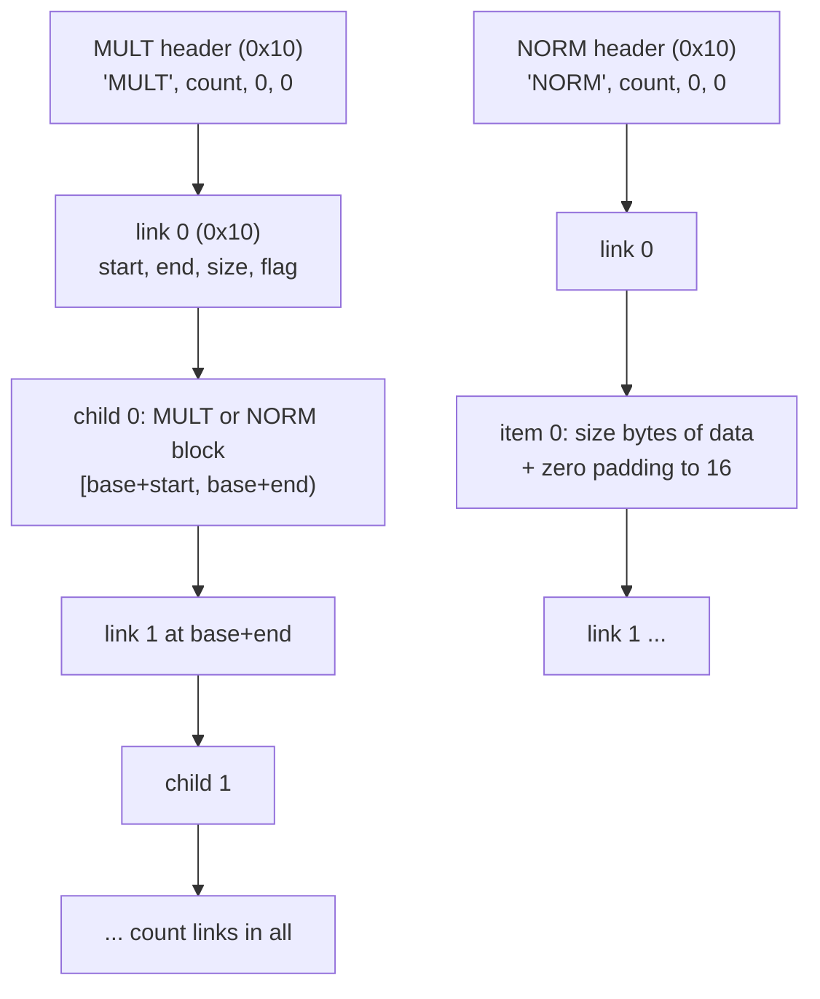

# `MULT`/`NORM` 컨테이너

issue #2(P1)에서 확인한 사실이다. 입력은 일본판 덤프의 `Media`(파일 3,224개 가운데 `MULT`나 `NORM`으로 시작하는 1,056개)다. 작업 증거는 [작업 로그 i002](../work-logs/20261021-i002-patcher.md)에 있다.

* 근거는 바이트 구조 조사와 **왕복 시험**이다. 1,056개 파일을 모두 이 형식으로 읽고, 읽은 항목만으로(패딩과 깃발은 계산해서) 다시 만들면 원본과 바이트 단위로 같다.
* 게임 코드가 이 형식을 어떻게 읽는지는 보지 않았다. 필드의 뜻 가운데 코드로 확인하지 않은 것은 **추정**으로 적었다.



## 1. 형식 (확인됨, 왕복 시험)

* **머리** 16바이트: 마법값 4바이트(`MULT` 또는 `NORM`), `u32` 개수, `u32` 0, `u32` 0.
* **연결** 16바이트, 모두 `u32`이고 그 컨테이너의 머리 위치를 기준으로 한 상대값이다: `start`, `end`, `size`, `flag`.
  * 첫 연결은 머리 바로 뒤(+`0x10`)에 있다. 항목은 `[start, end)`에 있고 `start`는 늘 연결 바로 뒤(연결 위치 + `0x10`)다.
  * 다음 연결은 앞 항목이 끝나는 자리(`end`)에 있다. 연결은 `개수`만큼 이어지고, 마지막 항목의 `end`가 컨테이너의 끝이다.
* **`MULT`**: 항목은 블록(`MULT` 또는 `NORM`)이다. `size = end − start`, `flag = 0`.
* **`NORM`**: 항목은 날 데이터다. `size`는 데이터 길이이고, `end`까지는 0으로 채운다. 항목은 16바이트 경계(컨테이너 기준)에서 끝나고, 패딩은 늘 16바이트보다 짧다. `flag`는 데이터 길이가 0일 때 1, 아닐 때 0이다.
  * 개수 0인 `NORM`은 머리 16바이트뿐이다.
* 파일 전체는 맨 위 블록 하나다. 맨 위 블록 뒤에 남는 바이트는 없다.
* 이벤트 문장이 든 `e###.dat`에서 reJSRF가 "레코드 머리의 시작·끝 오프셋과 크기"로 적은 값(예: `e105.dat`의 `0x3540`/`0x3650`/`0x110`)은 이 연결이다. 맨 위 `MULT`가 파일 처음에 있어서 상대값이 파일 위치와 같다.

## 2. 통계 (확인됨)

| 항목 | 수 |
|---|---|
| `MULT`·`NORM`으로 시작하는 파일 | 1,056 (`MULT` 958, `NORM` 98) |
| `MULT` 연결 | 9,509 |
| `NORM` 항목(데이터 있음 / 길이 0) | 21,073 / 19,689 |
| 개수 0인 `NORM` | 5,263 |
| 0이 아닌 패딩 | 0 |

* `MULT`·`NORM`이 아닌 파일: `.adx`(음악), 미션 `mssn####.bin/.dat`, 대화 이벤트 `TE###.bin`, `Stage/stg##_##.dat`, `Mark` 아래 그래피티 자료, 캐시 표 등. 미션과 대화 이벤트의 문장 구조는 [text-files.md](text-files.md).

## 3. 문장과의 관계

* 이벤트 문장은 `Media/Event/Event/e###.dat` 안의 `NORM` 항목에 있다(확인됨). 문장이 있는 117개 항목은 모두 맨 위 `MULT`의 항목 2 안의 항목 0(경로 `2/0`)이다. `e###.bin`(300개)에는 문장이 없다.
* 그 항목은 앞쪽이 `u32` 값들이고(예: `e000.dat`은 100바이트), 그 뒤에 문장 한 줄(`$` 코드와 `$e`를 포함)이 **항목 데이터의 끝까지** 이어진다(확인됨, 117개 모두). NUL 종료는 항목 길이에 들어가지 않는다. 112개는 패딩의 0이 바로 뒤에 오지만, 5개는 데이터 길이가 16의 배수라 패딩이 없고 바로 다음 연결이 온다. 그러므로 게임은 NUL이 아니라 항목 길이(또는 앞쪽 값)로 문장의 끝을 아는 것으로 보인다(**추정**). 앞쪽 값들의 뜻은 **미확정**이고 P5에서 다룬다.
* `tools/jsrfkr/textpatch.py`는 이 관찰에 맞춰 `norm:` 자리에서 문장이 항목 끝까지 가면 뒤의 NUL을 요구하지 않는다.
* 그 밖의 파일에서 `$e`가 들어간 바이트열(효과, 적, 플레이어 파일 등)은 2진 자료가 우연히 같은 바이트가 된 것이다(문장 아님).
* 컨테이너는 항목 길이가 바뀌어도 연결만 다시 계산하면 된다(§1의 규칙). 문장 길이를 바꾸는 재삽입(P5)은 항목 안의 형식만 풀면 된다.

## 4. 미확정

* 머리의 두 0 필드와 연결의 `flag`를 게임이 읽는지. 지금은 관측대로 쓴다.
* 블록 종류(텍스처, 모델, 스크립트)를 무엇으로 구별하는지. 컨테이너 층에는 종류 표시가 없다.
* 이벤트 스크립트 항목의 형식(P5).

## 5. 재현

```bash
python -I tools/check_roundtrip.py "roms/Jet Set Radio Future"
```

`MULT`/`NORM` 파일 전부를 읽고 다시 써서 비교한다(파일이 캐시되어 있으면 몇 초). 원문은 출력하지 않는다.

---

# The `MULT`/`NORM` containers

Facts confirmed in issue #2 (P1). Input: the Japanese dump's `Media` (1,056 of its 3,224 files start with `MULT` or `NORM`). The evidence is in the [work log i002](../work-logs/20261021-i002-patcher.md).

* The basis is a byte-structure survey and a **round trip**: all 1,056 files read in this format and rebuilt from the items alone (padding and flags computed) equal the originals byte for byte.
* How the game code reads the format was not examined; field meanings not checked against code are marked **inferred**.

(The diagram above shows a `MULT` chaining links to child blocks and a `NORM` chaining links to data items.)

## 1. Format (confirmed, round trip)

* **Header**, 16 bytes: a 4-byte magic (`MULT` or `NORM`), `u32` count, `u32` 0, `u32` 0.
* **Link**, 16 bytes, all `u32`, relative to the container's header: `start`, `end`, `size`, `flag`.
  * The first link sits right after the header (+`0x10`). The item is `[start, end)`, and `start` is always right after its link (link + `0x10`).
  * The next link sits where the previous item ends (`end`). There are `count` links; the last item's `end` is the container's end.
* **`MULT`**: items are blocks (`MULT` or `NORM`); `size = end − start`, `flag = 0`.
* **`NORM`**: items are raw data; `size` is the data length, and the rest up to `end` is zero. Items end on a 16-byte boundary (relative to the container), so the padding is always shorter than 16 bytes. `flag` is 1 when the data length is 0, else 0.
  * A `NORM` with count 0 is just the 16-byte header.
* A file is one top-level block, with no bytes left after it.
* In the event files `e###.dat`, what reJSRF recorded as "record headers with start and end offsets and a size" (for example `0x3540`/`0x3650`/`0x110` in `e105.dat`) are these links; the top-level `MULT` is at the start of the file, so its relative values equal file offsets.

## 2. Statistics (confirmed)

| Item | Count |
|---|---|
| files starting with `MULT` or `NORM` | 1,056 (`MULT` 958, `NORM` 98) |
| `MULT` links | 9,509 |
| `NORM` items (with data / length 0) | 21,073 / 19,689 |
| `NORM`s with count 0 | 5,263 |
| non-zero padding | 0 |

* Files that are neither: `.adx` (music), the mission files `mssn####.bin/.dat`, the talk events `TE###.bin`, `Stage/stg##_##.dat`, the graffiti data under `Mark`, the cache tables and so on. The text structure of missions and talk events is in [text-files.md](text-files.md).

## 3. Relation to text

* Event text sits in `NORM` items inside `Media/Event/Event/e###.dat` (confirmed). All 117 items with text are item 0 inside item 2 of the top-level `MULT` (path `2/0`). The `e###.bin` files (300) hold no text.
* Such an item starts with `u32` values (100 bytes in `e000.dat`, for example), followed by one line of text (with `$` codes and `$e`) that runs **to the end of the item's data** (confirmed, all 117). The NUL terminator is not counted in the item length: in 112 items the padding's zeros follow at once, but in 5 the data length is a multiple of 16, so there is no padding and the next link follows directly. The game therefore seems to find the end of the text by the item length (or the leading values), not by a NUL (**inferred**). The leading values' meaning is **unresolved** and handled in P5.
* Following this, `tools/jsrfkr/textpatch.py` does not require a NUL after a string that runs to the end of a `norm:` item.
* Byte runs containing `$e` in other files (effects, enemies, players and so on) are binary data that happen to match (not text).
* When an item's length changes, the container only needs its links recomputed (the rules of §1); reinsertion with changed lengths (P5) only has to solve the item's internal format.

## 4. Unresolved

* Whether the game reads the header's two zero fields and the link `flag`; for now they are written as observed.
* How block kinds (textures, models, scripts) are told apart; the container layer carries no kind marker.
* The format of event script items (P5).

## 5. Reproducing

The command above reads and rewrites every `MULT`/`NORM` file and compares them (seconds once the files are cached); it prints no original text.
