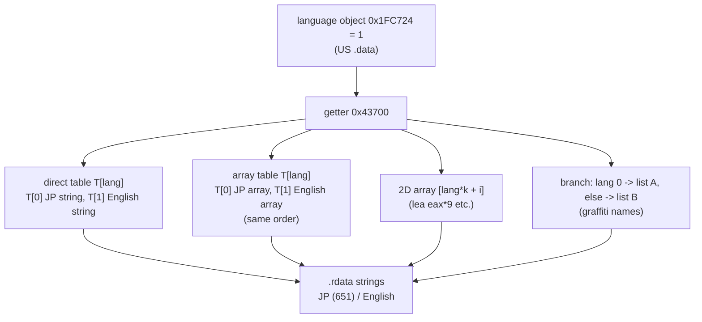

# 영어 모드: 언어 값, 영어 문장 자리, XBE 언어 표

issue #20(P6-2) 분석 단계의 결과다. 입력은 같은 디스크의 US판 `default_eng.xbe`(MD5 `f4e366bfdceee551a09f42219c90d84e`)와 `Media`다. 설계는 [design i020](../design/20261023-i020-english-base.md), 작업 증거는 [작업 로그 i020](../work-logs/20261023-i020-english-base.md)에 있다.

* 근거는 정적 분석(바이트 조사, capstone 디스어셈블리)이다. 화면은 아직 보지 않았다.
* 주소는 **US판 가상 주소**다(설계 안 B: US판 XBE를 바탕으로 한다). `.rdata`와 코드는 일본판과 같은 주소이고, `.data` 표는 대부분 일본판보다 −0x20·−0x18·−0x8 앞에 있다(reJSRF language §5).

## 1. 언어 값 (확인됨)

* US판 `0x1FC724` = 1(파일 자료), 앞 dword `0x1FC720` = 0, 뒤 필드 `0x1FC728` = 0. reJSRF language §4와 같다.
* 일본판의 같은 객체 `0x251F58`은 `.data`의 bss(파일 자료 끝 `0x22FCB4` 뒤)라 0이다.
* US판과 일본판의 `.rdata`는 같은 크기(`0x277F0`)이고 같은 주소에서 7바이트만 다르다. `.text`는 14,381바이트가 다르다(재배치된 피연산자, reJSRF §5).
* 언어 값을 읽는 곳(`mov ecx, 0x1FC724`)은 191곳이다(reJSRF와 같은 수). 쓰임: 표 인덱스 147곳, 비교·분기 28곳, 다른 함수에 넘김 14곳, 곱한 뒤 인덱스 2곳.

## 2. 미디어의 영어 자리 (확인됨)

| 파일 | 영어 자리 | 관찰 |
|---|---|---|
| 이벤트 `e###.dat` `2/0`, 대화 `TE###.bin` | 메시지 스크립트의 언어 1 구간([message-script.md](message-script.md)) | 368개 모두 언어 2개. 영어 구간과 일본어 구간의 페이지 수가 같은 것은 이벤트 57/117, 대화 147/251 |
| 미션 `mssn####.bin` | 문장 명령의 언어 칸 1([mission-files.md](mission-files.md)) | 문장 명령 674개 모두 칸 1 포인터가 0이 아니다. 칸 1이 빈 문자열인 114개는 칸 0도 비어 있다. `$r` 수가 칸 0과 다른 명령 63개 |

* 영어와 일본어의 페이지 구조가 다르므로, 한국어(일본어 구조를 따름)를 영어 구간의 원래 구조에 맞춰 넣을 수는 없다. 영어 구간을 일본어 구조로 다시 만든다(설계 §4.1).

## 3. XBE 언어 표 (확인됨, 정적)

언어 값을 인덱스로 쓰는 표의 모양은 네 가지다.

| 모양 | 수 | 짝 정하는 규칙 |
|---|---|---|
| 직접 표 `T[lang]` | 17 | `T[0]`(일본어) ↔ `T[1]`(영어) |
| 배열 표 `T[lang]` → 언어별 문자열 배열 | 36(코드) + 1(모양) | 배열 길이 = `T[1] − T[0]`, `T[0][i]` ↔ `T[1][i]`. 언어 5개(일·영·불·독·서)가 같은 순서·같은 길이 |
| 2차원 배열 `[lang×k + i]`, 레코드 안 언어 칸 | 1(모양) + `0x22D7E0`(k = 9, 코드 `0x1386F6`) + `0x22D7B8`(`[lang×8 + T]`, 코드 `0x138738`) | 언어 0 덩어리의 i번째 ↔ 언어 1 덩어리의 i번째 |
| 분기 | 그래피티 이름(코드 `0x1249A0`) | 언어 0이면 `0x226F40[i]`, 1~5면 `0x227170[i]`(140개) |

* 일본어 문자열을 가리키는 언어 0 칸 **695개**가 모두 영어 칸 하나와 짝지어지고, 한 영어 칸이 두 일본어 칸의 짝이 되는 일은 없다. 영어 칸 쪽은 1바이트 문자열 663, 2바이트 기호가 든 문자열 30(영어 배열에서도 쓰는 기호 문자열), 빈 문자열로 보이는 칸 2(`0x227CC4`, `0x22739C`).
* 일본어 배열 안에도 1바이트 문자열이 있다(7칸). 일본어판에서도 영어로 나오는 짧은 말로 보인다.
* 일본어 문자열 651개의 참조 맥락:

| 맥락 | 문자열 수 | 영어 모드에서 |
|---|---|---|
| 언어 0 칸(다른 맥락이 섞인 것 포함) | 579 | 짝인 영어 칸이 쓰인다 → 영어 칸을 한국어로 돌린다 |
| 다른 언어 칸에서만(영어 배열 등의 2바이트 기호 문자열) | 26 | 그 문자열 자체가 쓰인다 → 문자열 자리의 한국어가 나온다 |
| 표 밖 `.data` 칸에서만 | 25 | 7개 구역. 접근 코드 근처에 언어 읽기가 없어 언어와 무관한 것으로 보인다(**추정**) → 문자열 자리의 한국어가 나온다 |
| `push`로만(+다른 언어 칸 1) | 21 | 16곳은 근처에 언어 읽기가 없고, 3곳은 언어를 읽고, 4곳은 근처에 영어 문자열 `push`가 있다. 상위 함수에서 언어로 갈릴 수 있어 **미확정** |

## 4. 영어 모드의 그리기 차이 (확인됨, 일부)

* 그래피티 이름은 언어 0일 때 글자 배율 (0.8, 0.8), 그 밖의 언어일 때 (0.9, 0.8)로 그린다(코드 `0x1249B7`~`0x1249D6`). 영어 모드에서는 한국어도 가로로 조금 넓게 그려진다.
* 다른 곳의 언어별 배율·줄바꿈 차이는 아직 다 보지 않았다(비교·분기 28곳, **미확정**).

## 5. 결론

* 영어 칸을 한국어 문자열로 돌리는 방식으로, 일본어 문자열 651개 가운데 579개의 언어 0 참조가 영어 모드에서도 한국어가 된다. 나머지 72개 중 51개는 언어와 무관하게 그 문자열 자체를 쓰므로 지금처럼 문자열 자리의 한국어가 나온다. `push` 21개는 화면으로 확인한다.
* 그러려면 **일본어 문자열 자리의 한국어(지금 방식)를 그대로 두고**, 그 위에 영어 칸을 돌려야 한다. 일본어 자리를 원문으로 되돌리면 언어와 무관한 참조가 일본어로 남는다.

## 6. 미확정

* `push`로만 참조되는 21개가 영어 모드에서 어떤 문자열로 바뀌는지.
* 표 밖 7개 구역이 정말 언어와 무관한지.
* 영어 모드의 그리기 차이(배율, 줄 폭) 전체.
* 영어에만 있는 문장(일본어 짝이 없는 영어 문자열)이 화면에 나오는지.

---

# English mode: the language value, English text places, XBE language tables

Findings of the issue #20 (P6-2) analysis step. Inputs: the same disc's US `default_eng.xbe` (MD5 `f4e366bfdceee551a09f42219c90d84e`) and `Media`. The design is [design i020](../design/20261023-i020-english-base.md); the evidence is in the [work log i020](../work-logs/20261023-i020-english-base.md).

* The basis is static analysis (byte surveys, capstone disassembly); the screen has not been looked at yet.
* Addresses are **US virtual addresses** (design option B: the US XBE is the base). `.rdata` and code sit at the same addresses as in the Japanese build; `.data` tables mostly sit −0x20, −0x18 or −0x8 before the Japanese ones (reJSRF language §5).

(The diagram above shows the language object feeding the four table shapes that select JP or English strings.)

## 1. The language value (confirmed)

* US `0x1FC724` = 1 (file data), the dword before it `0x1FC720` = 0, the next field `0x1FC728` = 0; as in reJSRF language §4.
* The Japanese build's same object `0x251F58` is in `.data`'s bss (past the file data end `0x22FCB4`), so 0.
* The US and Japanese `.rdata` are the same size (`0x277F0`) and differ in only 7 bytes at the same addresses; `.text` differs in 14,381 bytes (relocated operands, reJSRF §5).
* There are 191 language reads (`mov ecx, 0x1FC724`), as in reJSRF: 147 use it as a table index, 28 compare or branch, 14 pass it to another function, 2 scale it first.

## 2. English places in Media (confirmed)

(Table above: events and talk use the language-1 block of the message script, all 368 having two languages, with equal page counts in 57/117 events and 147/251 talk scripts; missions use slot 1 of the text commands, nonzero in all 674, empty in 114 where slot 0 is empty too, with a different `$r` count from slot 0 in 63.)

* Since the English and Japanese page structures differ, Korean (which follows the Japanese structure) cannot be fitted into the English block's own structure; the English block is rebuilt with the Japanese structure (design §4.1).

## 3. XBE language tables (confirmed, static)

Tables indexed by the language come in four shapes.

| Shape | Count | Pairing rule |
|---|---|---|
| direct table `T[lang]` | 17 | `T[0]` (Japanese) ↔ `T[1]` (English) |
| array table `T[lang]` → per-language string arrays | 36 (code) + 1 (shape) | array length = `T[1] − T[0]`, `T[0][i]` ↔ `T[1][i]`; five languages (JP, EN, FR, DE, ES) in the same order and length |
| 2D array `[lang×k + i]`, language slots inside records | 1 (shape) + `0x22D7E0` (k = 9, code `0x1386F6`) + `0x22D7B8` (`[lang×8 + T]`, code `0x138738`) | i-th of the language-0 block ↔ i-th of the language-1 block |
| branch | the graffiti names (code `0x1249A0`) | language 0 → `0x226F40[i]`, 1–5 → `0x227170[i]` (140) |

* All **695** language-0 slots that point to Japanese strings pair with exactly one English slot, and no English slot pairs with two Japanese slots. On the English side: 663 single-byte strings, 30 strings with double-byte symbols (symbol strings English arrays also use), 2 slots that look like empty strings (`0x227CC4`, `0x22739C`).
* Japanese arrays hold single-byte strings too (7 slots), apparently short words shown in English even in the Japanese build.
* The reference context of the 651 Japanese strings:

| Context | Strings | In English mode |
|---|---|---|
| a language-0 slot (possibly with other contexts) | 579 | the paired English slot is used → repoint it to the Korean |
| only other-language slots (double-byte symbol strings in English arrays and so on) | 26 | the string itself is used → the Korean in its place shows |
| only `.data` slots outside tables | 25 | seven regions; no language read near the access code, so apparently language-independent (**inferred**) → the Korean in its place shows |
| only `push` (+1 other-language slot) | 21 | 16 sites with no language read nearby, 3 that read it, 4 with an English string `push` nearby; a caller may choose by language, so **unresolved** |

## 4. Drawing differences in English mode (confirmed, partly)

* Graffiti names are drawn at a glyph scale of (0.8, 0.8) in language 0 and (0.9, 0.8) in other languages (code `0x1249B7`–`0x1249D6`); in English mode Korean is drawn slightly wider there.
* Other per-language scales or wrapping have not all been examined (28 compare/branch sites, **unresolved**).

## 5. Conclusion

* Repointing English slots to Korean strings makes the language-0 references of 579 of the 651 Japanese strings Korean in English mode too. Of the other 72, 51 use the string itself regardless of language, so the Korean in its place shows as now; the 21 `push` ones are checked on screen.
* That requires **keeping the Korean in the Japanese string places (the current method)** and repointing English slots on top of it; restoring the Japanese places to the original would leave language-independent references Japanese.

## 6. Unresolved

* Which strings the 21 `push`-only references become in English mode.
* Whether the seven out-of-table regions really are language-independent.
* All English-mode drawing differences (scales, line width).
* Whether English-only text (English strings with no Japanese partner) appears on screen.
