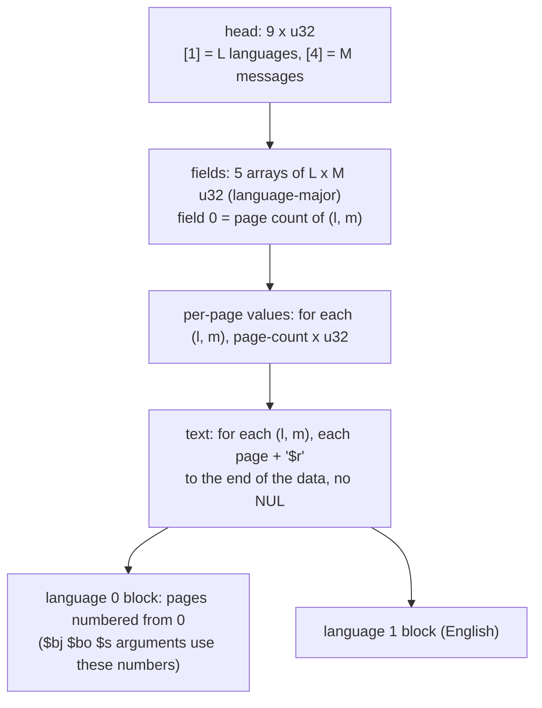

# 메시지 스크립트: 이벤트 대사(`e###.dat` 항목 `2/0`)와 대화 이벤트(`TE###.bin`)

issue #11(P5-1)에서 확인한 사실이다. 입력은 일본판 덤프의 `Media/Event/Event/e###.dat`(300개 중 문장이 있는 117개)와 `Media/Event/TalkEvent/TE###.bin`(251개, `TalkCam.bin` 제외)이다. 작업 증거는 [작업 로그 i011](../work-logs/20261021-i011-text-extract.md), 읽는 코드는 [tools/jsrfkr/msgscript.py](../../tools/jsrfkr/msgscript.py)다.

* 근거는 바이트 구조 조사와 **왕복 시험**이다. 368개(117 + 251)를 모두 아래 형식으로 읽고 다시 쓰면 원본과 바이트 단위로 같다. 머리의 페이지 수만으로 문장이 정확히 끝까지 나뉜다.
* 게임 코드가 이 머리를 읽는 곳은 보지 않았다(페이지를 나누는 쪽은 [text-renderer §2](text-renderer.md)의 `0xF9090`). 필드의 뜻 가운데 코드로 확인하지 않은 것은 **추정**이나 **미확정**으로 적었다.
* 이벤트 대사와 대화 이벤트는 **같은 형식**이다. 이벤트는 `MULT`/`NORM` 컨테이너의 항목 `2/0`([containers §3](containers.md))이고, 대화 이벤트는 파일 전체다.

## 1. 형식 (확인됨, 왕복 368/368)

모두 리틀엔디언 `u32`다.

| 위치 | 내용 | 상태 |
|---|---|---|
| 머리 `[0]` | 이벤트 18·20·21·30, 대화 늘 20 | 값 확인됨, 뜻 미확정 |
| 머리 `[1]` | **언어 수 L**. 368개 모두 2(일본어, 영어) | 확인됨 |
| 머리 `[2]` `[3]` | 이벤트 `[2]` = 2, `[3]` = 1 또는 3. 대화 `[2]` = 1 또는 2, `[3]` = 1 또는 3 | 값 확인됨, 뜻 미확정 |
| 머리 `[4]` `[5]` | **메시지 수 M**(두 값이 늘 같다). 이벤트 1~3, 대화 1~2 | 확인됨 |
| 머리 `[6]`~`[8]` | 늘 0 | 확인됨 |
| 필드 5개 | 각각 L × M개, 언어 순서대로(언어 0의 메시지들, 언어 1의 메시지들). **필드 0 = 그 (언어, 메시지)의 페이지 수** | 확인됨 |
| 필드 1~4 | 필드 2·3은 368개 모두 언어끼리 같은 값, 필드 1·4는 대부분 같다. 작은 수(필드 1: 19, 24, 40…, 필드 2: 0/1/3/4, 필드 3: 0/1, 필드 4: 30, 60…) | 값 확인됨, 뜻 미확정(화자·창 위치·지연 같은 연출 값으로 보인다) |
| 페이지별 값 | (언어, 메시지)마다 페이지 수만큼. 이벤트에서는 `$e` 페이지 278개와 **그 페이지만** 0이고, 나머지는 30~800. 대화는 대부분 30 | 배치 확인됨, 뜻 추정(페이지 표시 시간, 프레임) |
| 문장 | (언어, 메시지) 순서로 페이지마다 "페이지 바이트 + `$r`". 데이터 끝까지 이어지고 NUL이 없다 | 확인됨 |

* **페이지** = 두 `$r` 사이의 바이트다. 토큰은 렌더러 규칙대로 센다: 첫 바이트 `0x80`~`0x9F`는 다음 바이트와 한 글자다(예: `ビ` `0x83 0x72`의 둘째 바이트가 `r`이라 바이트열 검색으로 `$r`을 찾으면 틀린다). `$` 코드는 인자 바이트를 함께 먹는다([text-renderer §6](text-renderer.md)).
* 메시지 하나는 "문장 페이지들 + `$e` 페이지"다(대화 이벤트는 그 안에도 `$e` 페이지가 있다, §2).
* 368개 모두 메시지마다 마지막 페이지가 `$e` 페이지다. 필드 배열이 "언어 먼저"라는 것은 메시지가 둘 이상인 29개로 확인했다: 언어 먼저로 읽으면 29개 모두 메시지가 `$e` 페이지에서 끝나고, 메시지 먼저로 읽으면 20개가 어긋난다. 이벤트의 페이지별 값 목록도 모두 `$e` 페이지 자리에서 0으로 끝난다.

## 2. 대화 이벤트의 분기 (형식 확인됨, 인자의 뜻 추정)

* 대화 이벤트는 언어마다 메시지가 하나(242개) 또는 둘(9개)이고, 한 메시지 안이 `$e$r`로 여러 **부분**으로 나뉜다.
* 언어 구간의 첫 페이지는 **분기 페이지**다: `$p` 다음에 `$bc` N `$bj` N 짝이 0개 이상, 끝에 `$bo` N. `$b?` 다음 1바이트는 문자가 아니라 **2진값**이다. P4에서 본 `0x01` 바이트와, 5개 파일의 `0x00` 바이트가 이것이다.
* `$s` X Y(1바이트 둘)는 **선택지 페이지**다(32곳).
* `$bj`·`$bo`·`$s`의 인자는 **같은 언어 구간 안의 페이지 번호**(0부터)로 보인다(**추정**, 정황 강함):
  * `$bj` 170곳 중 167곳, `$bo` 100곳 중 99곳이 메시지 시작 페이지(첫 문장 페이지나 `$e` 페이지 바로 뒤)를 가리킨다. 나머지 4곳도 그 언어 구간 안의 페이지(선택지 뒤 부분의 시작)다.
  * 같은 파일에서 일본어와 영어의 인자 값이 다르고, 각 언어의 페이지 배치에 맞는다.
  * `$bc` 인자는 조건 번호로 보인다(**미확정**).
* 대화 이벤트는 251개 모두 마지막 언어 구간이 파일 끝에서 끝난다(NUL·여백 없음).

## 3. 길이가 바뀔 때

| 바뀌는 것 | 다시 계산할 것 |
|---|---|
| 페이지 바이트 길이만(페이지 수 같음) | 없음. 이벤트는 컨테이너 연결([containers §1](containers.md)), 대화는 파일 크기만 바뀐다 |
| 한 (언어, 메시지)의 페이지 수 | 필드 0의 그 값, 그 (언어, 메시지)의 페이지별 값 목록(머리 길이가 바뀐다) |
| 대화 이벤트 언어 구간의 페이지 번호 | 그 구간의 `$bj` `$bo` `$s` 인자 |

* 영어 구간(언어 1)은 바꾸지 않는다. 일본판은 늘 언어 0을 쓴다([text-files §5](text-files.md)).
* 구현(issue #13, `tools/jsrfkr/reinsert.py`): 페이지 바이트만 바꾸고 페이지 수는 바꾸지 않는다(§3 표의 첫 줄). 368개 모두 원문 그대로 다시 넣으면 원본과 같다. 길어진 페이지의 화면 확인은 남았다(**미확정**).
* 렌더러에는 자동 줄바꿈이 없고 페이지는 0x100바이트 버퍼에 복사된다([text-renderer §5](text-renderer.md)). 페이지 수를 바꾸지 않더라도 이 제한은 지켜야 한다.

## 4. 2,933개 레코드와의 관계

text-renderer.md의 레코드 2,933개(정규식)에서 이벤트 134개는 진짜 문장 117개(= 항목 `2/0` 117개)와 2진 자료 17개다. 대화 5개는 분기 인자에 `0x00`이 있어 정규식에 걸린 5개 파일이고, 형식으로는 251개다.

## 5. 언어마다 다른 시간 값 (확인됨, 정적, issue #26)

이벤트 117개(메시지 139개)에서 일본어 구간(언어 0)과 영어 구간(언어 1)을 비교했다.

| 항목 | 영어 ≠ 일본어 |
|---|---|
| 페이지 수(필드 0) | 62개(영어가 많음 58, 적음 4) |
| 페이지별 값의 합 | 영어/일본어 비율 중앙값 0.89, 범위 0.12~2.49 |
| 필드 4(30·60 단위) | 21개(예: `e024` 메시지 1: 37 대 80) |
| 필드 1 | 7개 |
| 필드 2·3 | 0개 |

* "필드 4 + 페이지별 값 합"이 일본어 쪽에서 60 이상 짧은 메시지가 15개다. 가장 큰 차이는 `e119`(2,123 대 4,090), `e281`(1,019 대 2,493), `e280`(985 대 2,139)이다.
* 그래서 영어 모드에서 일본어 값을 쓰면 자막이 영어 음성보다 먼저 끝나거나 늦게 시작한다. 사용자가 이 증상을 보고했다(2026-10-23). 페이지별 값 = 페이지 표시 시간(프레임), 필드 4 = 시작 지연이라는 뜻은 **추정**이다(증상, `$e` 페이지 값 0과 맞음, 코드는 보지 않음).
* 대화 이벤트도 언어별로 다르다(페이지 수 104개, 페이지별 값 107개). 다만 값이 대부분 30이고 버튼으로 넘기는 대화다.
* `Z_ADX/MUSEN/ev###.adx`(영어)와 `MUSENJ/ev###.adx`(일본어) 116개씩은 번호가 이벤트 `e###`와 짝이 맞지 않는다. 길이와 페이지별 값 합의 비가 고르지 않아 무전 음성으로 보인다(**추정**). 이벤트 대사 음성 파일은 아직 찾지 않았다.
* 패치는 영어 구간에 영어 시간 값을 쓰고, 페이지 수가 다른 메시지는 한국어를 영어 페이지 수로 다시 나눈다([design i026](../design/20261023-i026-subtitle-timing.md), `tools/jsrfkr/resplit.py`).

## 6. 미확정

* 머리 `[0]` `[2]` `[3]`, 필드 1~4, 페이지별 값의 정확한 뜻(§5의 추정을 코드나 화면으로 확인). 페이지를 나누거나 합칠 때 새 페이지의 값을 정하는 규칙(다음 issue에서 화면 확인).
* `$bc` 인자(조건)와 분기 인자가 페이지 번호라는 것의 화면 확인.
* 이 머리를 읽는 게임 코드의 주소(일본판·US판).

---

# Message scripts: event dialogue (`e###.dat` item `2/0`) and talk events (`TE###.bin`)

Facts confirmed in issue #11 (P5-1). Inputs: the Japanese dump's `Media/Event/Event/e###.dat` (the 117 of 300 that hold text) and `Media/Event/TalkEvent/TE###.bin` (251, `TalkCam.bin` excluded). The evidence is in the [work log i011](../work-logs/20261021-i011-text-extract.md); the reading code is [tools/jsrfkr/msgscript.py](../../tools/jsrfkr/msgscript.py).

* The basis is a byte-structure survey and a **round trip**: all 368 (117 + 251) read in the format below and written back equal the originals byte for byte, and the header's page counts alone split the text exactly to its end.
* The game code that reads this header was not examined (the page-splitting side is `0xF9090` in [text-renderer §2](text-renderer.md)); field meanings not checked against code are **inferred** or **unresolved**.
* Event dialogue and talk events share **the same format**: for events it is item `2/0` of the `MULT`/`NORM` container ([containers §3](containers.md)); for talk events it is the whole file.

(The diagram above: the head gives L and M, five field arrays follow with field 0 = page counts, then per-page values, then the text; page numbers inside a language block are what the branch arguments use.)

## 1. Format (confirmed, round trip 368/368)

All values are little-endian `u32`.

| Place | Content | Status |
|---|---|---|
| head `[0]` | events 18, 20, 21, 30; talk always 20 | values confirmed, meaning unresolved |
| head `[1]` | **language count L**; 2 (Japanese, English) in all 368 | confirmed |
| head `[2]` `[3]` | events: `[2]` = 2, `[3]` = 1 or 3; talk: `[2]` = 1 or 2, `[3]` = 1 or 3 | values confirmed, meaning unresolved |
| head `[4]` `[5]` | **message count M** (always equal); events 1–3, talk 1–2 | confirmed |
| head `[6]`–`[8]` | always 0 | confirmed |
| five fields | L × M each, language-major (language 0's messages, then language 1's); **field 0 = page count of that (language, message)** | confirmed |
| fields 1–4 | fields 2 and 3 are equal across languages in all 368, fields 1 and 4 mostly; small numbers (field 1: 19, 24, 40…; field 2: 0/1/3/4; field 3: 0/1; field 4: 30, 60…) | values confirmed, meaning unresolved (they look like staging values: speaker, window place, delay) |
| per-page values | one per page of each (language, message); in events the 278 `$e` pages, and **only those**, are 0, the rest 30–800; talk mostly 30 | layout confirmed, meaning inferred (page display time in frames) |
| text | per (language, message), each page as "page bytes + `$r`"; runs to the end of the data, no NUL | confirmed |

* A **page** is the bytes between two `$r`s. Tokens are counted as the renderer does: a lead byte `0x80`–`0x9F` takes the next byte (the second byte of `ビ`, `0x83 0x72`, is `r`, so a byte search for `$r` goes wrong), and `$` codes take their argument bytes ([text-renderer §6](text-renderer.md)).
* A message is "text pages + a `$e` page" (talk events also have `$e` pages inside, §2).
* In all 368 the last page of every message is a `$e` page. The field arrays being language-major is confirmed by the 29 with more than one message: read language-major, all 29 end every message at a `$e` page; read message-major, 20 do not. Every per-page value list in events also ends with 0 at its `$e` page.

## 2. Branches in talk events (format confirmed, argument meaning inferred)

* A talk event has one message per language (242) or two (9); inside a message, `$e$r` splits it into **parts**.
* The first page of a language block is a **branch page**: `$p`, zero or more `$bc` N `$bj` N pairs, then `$bo` N. The byte after `$b?` is a **binary value**, not a character: these are the `0x01` bytes seen in P4 and the `0x00` bytes of five files.
* `$s` X Y (two bytes) is a **choice page** (32 places).
* The arguments of `$bj`, `$bo` and `$s` appear to be **page numbers inside the same language block** (from 0) (**inferred**, strong evidence):
  * 167 of 170 `$bj` and 99 of 100 `$bo` point at a page that starts a message (the first text page, or right after a `$e` page); the other 4 also point inside the block (the start of a part after a choice).
  * In the same file the Japanese and English values differ, each matching its own language's page layout.
  * The `$bc` argument looks like a condition number (**unresolved**).
* In all 251 talk events the last language block ends at the end of the file (no NUL, no padding).

## 3. When a length changes

| What changes | What to recompute |
|---|---|
| only a page's byte length (same page count) | nothing; events get their container links recomputed ([containers §1](containers.md)), talk events just change file size |
| the page count of one (language, message) | that value of field 0, and that (language, message)'s per-page value list (the header length changes) |
| page numbers in a talk event's language block | that block's `$bj` `$bo` `$s` arguments |

* The English block (language 1) is not changed; the Japanese build always uses language 0 ([text-files §5](text-files.md)).
* Implemented (issue #13, `tools/jsrfkr/reinsert.py`): only page bytes change, never page counts (the first row of the §3 table). All 368 put back unchanged equal the originals; a screen check of longer pages is pending (**unresolved**).
* The renderer never wraps lines and copies each page into a 0x100-byte buffer ([text-renderer §5](text-renderer.md)); these limits hold even when the page count stays.

## 4. Relation to the 2,933 records

Of text-renderer.md's 2,933 (regex) records, the 134 event ones are 117 real texts (= the 117 `2/0` items) and 17 pieces of binary data. The 5 talk ones are the five files whose branch arguments contain `0x00`, which the regex caught; by format there are 251.

## 5. Timing values differ by language (confirmed, static, issue #26)

The Japanese (language 0) and English (language 1) blocks of the 117 events (139 messages) compared:

| Item | English ≠ Japanese |
|---|---|
| page count (field 0) | 62 (English more 58, fewer 4) |
| sum of per-page values | median English/Japanese 0.89, range 0.12–2.49 |
| field 4 (30/60 steps) | 21 (for example `e024` message 1: 37 vs 80) |
| field 1 | 7 |
| fields 2, 3 | 0 |

* In 15 messages "field 4 + sum of per-page values" is at least 60 shorter in Japanese; the largest differences are `e119` (2,123 vs 4,090), `e281` (1,019 vs 2,493) and `e280` (985 vs 2,139).
* So with the Japanese values in English mode, subtitles end before the English voice or start late, as the user reported (2026-10-23). Per-page value = page display time (frames) and field 4 = start delay are **inferred** (they fit the symptom and the `$e` pages' 0; code not examined).
* Talk events differ by language too (page counts 104, per-page values 107), but the values are mostly 30 and the pages advance by button.
* The 116 `Z_ADX/MUSEN/ev###.adx` (English) and `MUSENJ/ev###.adx` (Japanese) files do not pair with the events `e###` by number; their lengths do not track the per-page sums, so they look like radio voices (**inferred**). The event dialogue voice files have not been located.
* The patch writes the English timing into the English block, and re-splits the Korean into the English page count where the counts differ ([design i026](../design/20261023-i026-subtitle-timing.md), `tools/jsrfkr/resplit.py`).

## 6. Unresolved

* The exact meaning of head `[0]` `[2]` `[3]`, fields 1–4 and the per-page values (confirming §5's inference by code or screen); the rule for a new page's value when pages are split or merged (a screen check in the next issue).
* The `$bc` argument (condition), and a screen check that branch arguments are page numbers.
* The address of the game code that reads this header (Japanese and US builds).
