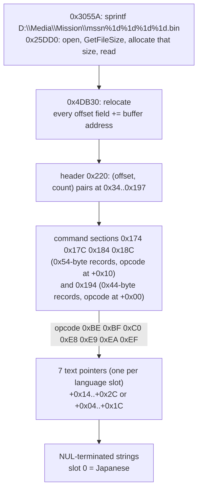

# 미션 파일 `Media/Mission/mssn####.bin`: 구역 표, 명령 레코드, 문장 포인터

issue #11(P5-1)에서 확인한 사실이다. 입력은 일본판 덤프의 `mssn####.bin` 311개와 `default.xbe`(MD5 `d8490cdb75bd47b36c62effdf1461ae0`)다. 작업 증거는 [작업 로그 i011](../work-logs/20261021-i011-text-extract.md), 읽는 코드는 [tools/jsrfkr/mission.py](../../tools/jsrfkr/mission.py)다. P4에서 본 것(목표 문장 짝, NUL 채움)은 [text-files §2](text-files.md)에 있다.

* 근거는 정적 분석(파일을 읽은 뒤 오프셋을 주소로 바꾸는 함수의 디스어셈블리)과 311개 파일 전체의 바이트 조사다.
* 주소는 일본판 가상 주소다. **아래 코드 주소는 US판에서도 같은 주소, 같은 바이트다**(대응 방법: 같은 주소의 바이트 비교, `0x25DD0`~`0x25FE0`, `0x30500`~`0x30618`, `0x4DB30`~`0x4E930` 모두 다른 바이트 0개).
* `mssn####.dat`(311개)에는 문장이 없다. text-renderer.md가 센 18개 레코드는 2진 자료다.

## 1. 읽기와 재배치 (확인됨, 정적)

| 주소 | 하는 일 |
|---|---|
| `0x30500`~`0x30617` | 미션 번호로 경로 `"D:\Media\Mission\mssn%1d%1d%1d%1d.bin"`(`0x1C753C`)을 만들고(`0x3055A`), 파일을 읽은 뒤 `0x4DB30`을 부른다(`0x305A7`) |
| `0x25DD0` | 공용 파일 로더. HDD 캐시(`Z:`)를 먼저 보고, 파일을 열어 `GetFileSize`(`0x1463C6`)로 크기를 얻고 섹터 단위로 올린 크기만큼 버퍼를 잡아(`0x145A2F`) 읽는다. **버퍼 크기는 파일 크기에서 나온다** |
| `0x4DB30`~`0x4E7FF` | 재배치: 머리의 구역 오프셋과 레코드 안의 오프셋 필드에 버퍼 주소를 더한다. 0인 필드는 그대로 둔다(`test`/`jbe`) |
| `0x4E40B`~`0x4E7FA` | 명령 구역 5개(§3) 처리. 레코드마다 `+0`, `+8`(0x54바이트 레코드)을 고치고, opcode − `0xBE`가 0~`0x31`이면 점프 표(`0x4E800`/`0x4E808`, `0x4E83C`/`0x4E844`, `0x4E878`/`0x4E880`, `0x4E8B4`/`0x4E8BC`, `0x4E8F0`/`0x4E8F8`)로 **문장 포인터 7칸**을 고친다 |

* 다섯 점프 표 모두 같은 7개 opcode(`0xBE 0xBF 0xC0 0xE8 0xE9 0xEA 0xEF`)에서만 7칸을 고친다. 이것이 **문장 명령**이다.
* 따라서 파일 안의 오프셋은 모두 **파일 시작 기준 위치**이고, 게임은 읽은 뒤에 주소로 바꾼다. 파일이 커져도 버퍼가 따라 커진다.

## 2. 머리 (확인됨)

* 머리는 `0x220`바이트다. 첫 구역은 늘 `0x220`에서 시작한다.
* `0x34`~`0x197`: `u32` 쌍(구역 파일 위치, 항목 수) 45개. 위치 0은 구역 없음. `0x198` 이후(`0x19C`~`0x21F`)는 쌍이 아니다(다른 값).
* 재배치 함수는 머리의 `0x34`~`0x198`만 고친다. 그러므로 `0x00`~`0x33`과 `0x19C` 이후의 값은 파일 위치가 아니다(뜻 **미확정**). 문장 길이·위치와 맞는 값도 보이지 않아, 재삽입에서 고칠 필요는 없는 것으로 본다(**추정**).

## 3. 명령 구역과 문장 명령 (확인됨)

| 구역(머리 위치) | 레코드 | opcode | 문장 포인터 | 이 덤프의 문장 명령 |
|---|---|---|---|---|
| `0x174` | 0x54바이트 | `+0x10` | `+0x14`~`+0x2C` | `0xEF` 268, `0xC0` 15, `0xBF` 4 |
| `0x17C` | 0x54바이트 | `+0x10` | `+0x14`~`+0x2C` | 없음 |
| `0x184` | 0x54바이트 | `+0x10` | `+0x14`~`+0x2C` | `0xBF` 257, `0xC0` 130 |
| `0x18C` | 0x54바이트 | `+0x10` | `+0x14`~`+0x2C` | 없음 |
| `0x194` | 0x44바이트 | `+0x00` | `+0x04`~`+0x1C` | 없음 |

* 문장 명령이 있는 파일 248개, 문장 명령 674개, 포인터 4,718개(674 × 7). **0인 포인터는 없고, 모든 포인터가 NUL 바로 뒤의 문자열 시작을 가리키며, 같은 문자열을 두 포인터가 가리키는 일은 없다.**
* 7칸은 언어 자리다. 칸 0 = 일본어(일본판은 늘 언어 0을 쓴다, [text-files §5](text-files.md)), 칸 1 = 영어. 칸 2~6은 대부분 영어 같은 1바이트 문장이고 일부는 비어 있다(유럽 언어 자리로 보인다, **추정**).
* 칸 0의 내용: 2바이트 글자가 있는 문자열 493, 빈 문자열 115, 1바이트만 66(`$r$e$r`만 있는 자리표시 등).
* opcode의 뜻(**추정**): `0xEF`는 목표 문장(P4에서 화면 확인한 첫 미션 목표가 `0xEF`), `0xBF`·`0xC0`은 `$r`·`$e`가 든 안내 메시지.
* 문장은 대개 파일 끝쪽에 모여 있지만, 그 뒤에 다른 자료(명령 인자 배열)가 오는 파일도 있다. 그래서 "끝의 문자열 풀"로 다루지 않고 포인터로 다룬다.

## 4. 길이가 바뀔 때

| 경우 | 할 일 |
|---|---|
| 한국어가 원래 길이 이하 | 제자리에 쓰고 남는 바이트를 NUL로(P4에서 화면 확인) |
| 한국어가 더 김 | **파일 끝에 NUL 종료 문자열로 붙이고, 그 명령의 칸 0 포인터를 새 위치로 고친다.** 다른 포인터·자료는 그대로다 |

* 붙인 문자열 뒤에도 파일이 끝나므로 다른 구역의 위치는 바뀌지 않는다. 로더가 파일 크기만큼 버퍼를 잡으므로 커진 파일도 다 읽힌다(정적 확인, 화면 확인은 다음 issue).
* 원래 자리는 남겨 두어도 된다(아무 포인터도 가리키지 않게 된다).
* HDD 캐시는 파일 전체를 복사하므로 커진 파일도 같은 방식이다([text-files §6](text-files.md)). 시험 전에 캐시를 지운다.
* 구현(issue #13, `tools/jsrfkr/reinsert.py`): 위 표대로. 미션 문자열 495개를 일부러 모두 파일 끝에 붙여도 모든 칸 0 포인터가 원래 바이트의 문자열로 이어지고, 포인터 밖의 바이트는 원본과 같다(`check_reinsert.py`). 커진 파일의 화면 확인은 남았다(**미확정**).

## 5. 2,933개 레코드와의 관계

text-renderer.md의 미션 `.bin` 레코드 2,776개(정규식) = 칸 0 문자열 406 + 다른 칸 문자열 2,352 + 다른 칸 문자열의 조각 13(Latin-1 바이트 때문에 정규식이 문자열 중간에서 시작) + 어느 포인터도 가리키지 않는 `$e` 5. 포인터로 보면 `$e`가 든 문자열은 칸 0에 406개, 모든 칸에 2,771개다. 일본어 문장만 따지면 **칸 0의 406개**가 비교할 수이고 같다.

## 6. 미확정

* opcode `0xEF` `0xBF` `0xC0`이 화면 어디에 나오는지(목표 한 곳만 확인).
* 칸 2~6의 언어.
* 커진 미션 파일의 실제 동작(화면, HDD 캐시).

---

# Mission files `Media/Mission/mssn####.bin`: section table, command records, text pointers

Facts confirmed in issue #11 (P5-1). Inputs: the Japanese dump's 311 `mssn####.bin` and `default.xbe` (MD5 `d8490cdb75bd47b36c62effdf1461ae0`). The evidence is in the [work log i011](../work-logs/20261021-i011-text-extract.md); the reading code is [tools/jsrfkr/mission.py](../../tools/jsrfkr/mission.py). What P4 saw (objective pairs, NUL fill) is in [text-files §2](text-files.md).

* The basis is static analysis (disassembly of the function that turns offsets into addresses after loading) and a byte survey of all 311 files.
* Addresses are Japanese virtual addresses. **The code addresses below are at the same addresses with the same bytes in the US build** (matched by comparing bytes at the same address: `0x25DD0`–`0x25FE0`, `0x30500`–`0x30618` and `0x4DB30`–`0x4E930` all have 0 differing bytes).
* `mssn####.dat` (311) holds no text; the 18 records text-renderer.md counted there are binary data.

(The diagram above: the loader reads the file into a buffer of its size, `0x4DB30` relocates every offset field, the header's pairs locate the sections, and text commands carry 7 pointers to NUL-terminated strings, slot 0 being Japanese.)

## 1. Loading and relocation (confirmed, static)

| Address | What it does |
|---|---|
| `0x30500`–`0x30617` | builds the path `"D:\Media\Mission\mssn%1d%1d%1d%1d.bin"` (`0x1C753C`) from the mission number (`0x3055A`), reads the file, then calls `0x4DB30` (`0x305A7`) |
| `0x25DD0` | the shared file loader: looks at the HDD cache (`Z:`) first, opens the file, gets its size with `GetFileSize` (`0x1463C6`), allocates that size rounded up to sectors (`0x145A2F`) and reads it. **The buffer size comes from the file size** |
| `0x4DB30`–`0x4E7FF` | relocation: adds the buffer address to the header's section offsets and to the offset fields inside records; zero fields are left alone (`test`/`jbe`) |
| `0x4E40B`–`0x4E7FA` | the five command sections (§3): per record it fixes `+0` and `+8` (0x54-byte records) and, when opcode − `0xBE` is 0–`0x31`, uses a jump table (`0x4E800`/`0x4E808`, `0x4E83C`/`0x4E844`, `0x4E878`/`0x4E880`, `0x4E8B4`/`0x4E8BC`, `0x4E8F0`/`0x4E8F8`) to fix the **7 text pointers** |

* All five jump tables fix the 7 slots for the same 7 opcodes only (`0xBE 0xBF 0xC0 0xE8 0xE9 0xEA 0xEF`); these are the **text commands**.
* So every offset in the file is a **position from the start of the file**, which the game turns into an address after reading; when the file grows, the buffer grows with it.

## 2. Header (confirmed)

* The header is `0x220` bytes; the first section always starts at `0x220`.
* `0x34`–`0x197`: 45 `u32` pairs (section file offset, item count); offset 0 means no section. From `0x198` on (`0x19C`–`0x21F`) the values are not pairs.
* The relocation function only touches header `0x34`–`0x198`, so the values at `0x00`–`0x33` and from `0x19C` on are not file positions (meaning **unresolved**); none matches a text length or position either, so reinsertion is taken not to need them (**inferred**).

## 3. Command sections and text commands (confirmed)

| Section (header slot) | Record | Opcode | Text pointers | Text commands in this dump |
|---|---|---|---|---|
| `0x174` | 0x54 bytes | `+0x10` | `+0x14`–`+0x2C` | `0xEF` 268, `0xC0` 15, `0xBF` 4 |
| `0x17C` | 0x54 bytes | `+0x10` | `+0x14`–`+0x2C` | none |
| `0x184` | 0x54 bytes | `+0x10` | `+0x14`–`+0x2C` | `0xBF` 257, `0xC0` 130 |
| `0x18C` | 0x54 bytes | `+0x10` | `+0x14`–`+0x2C` | none |
| `0x194` | 0x44 bytes | `+0x00` | `+0x04`–`+0x1C` | none |

* 248 files have text commands; 674 text commands, 4,718 pointers (674 × 7). **No pointer is 0, every pointer points at a string start right after a NUL, and no two pointers share a string.**
* The 7 slots are language places: slot 0 = Japanese (the Japanese build always uses language 0, [text-files §5](text-files.md)), slot 1 = English; slots 2–6 are mostly English-like single-byte text, some empty (apparently European-language places, **inferred**).
* Slot 0 holds 493 strings with double-byte characters, 115 empty strings and 66 single-byte-only ones (placeholders holding only `$r$e$r` and the like).
* Opcode meanings (**inferred**): `0xEF` is an objective (the first mission objective checked on screen in P4 is an `0xEF`), `0xBF` and `0xC0` are guidance messages with `$r` and `$e`.
* Strings mostly gather towards the end of the file, but in some files other data (command argument arrays) follows them; so they are handled through their pointers, not as "a string pool at the end".

## 4. When a length changes

| Case | What to do |
|---|---|
| the Korean fits in the original length | write it in place and fill the rest with NUL (checked on screen in P4) |
| the Korean is longer | **append it at the end of the file as a NUL-terminated string and point that command's slot 0 at it**; all other pointers and data stay |

* The appended string sits after everything else, so no other section moves. The loader allocates the file's size, so a grown file is read whole (static; the screen check is the next issue's).
* The old place may stay as it is (no pointer refers to it any more).
* The HDD cache copies whole files, so a grown file is handled the same way ([text-files §6](text-files.md)); clear the cache before testing.
* Implemented (issue #13, `tools/jsrfkr/reinsert.py`) as in the table: appending all 495 mission strings on purpose keeps every slot-0 pointer leading to the original bytes, with no other byte changed (`check_reinsert.py`); a screen check of grown files is pending (**unresolved**).

## 5. Relation to the 2,933 records

text-renderer.md's 2,776 mission `.bin` records (regex) = 406 slot-0 strings + 2,352 other-slot strings + 13 fragments of other-slot strings (the regex starts mid-string because of Latin-1 bytes) + 5 `$e` strings no pointer refers to. By pointers, strings holding `$e` number 406 in slot 0 and 2,771 over all slots. For Japanese text the comparable number is **slot 0's 406**, and it matches.

## 6. Unresolved

* Where on screen opcodes `0xEF`, `0xBF`, `0xC0` appear (only one objective checked).
* The languages of slots 2–6.
* How a grown mission file actually behaves (screen, HDD cache).
