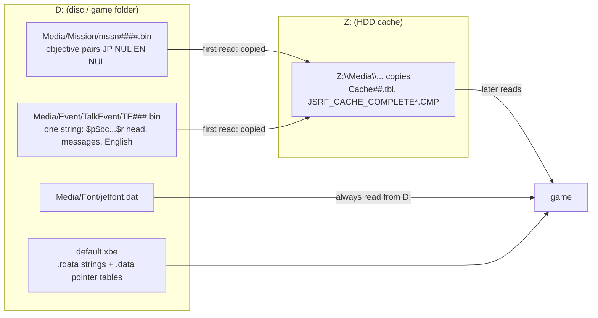

# 문장이 들어 있는 곳: 미션 파일, 대화 이벤트, XBE 메뉴 표, HDD 캐시

issue #8(P4) 개념 증명에서 확인한 사실이다. 입력은 일본판 `default.xbe`(MD5 `d8490cdb75bd47b36c62effdf1461ae0`)와 그 `Media`다. 작업 증거는 [작업 로그](../work-logs/20261020-i008-poc.md), 문장을 그리는 쪽은 [text-renderer.md](text-renderer.md)에 있다.

* 화면 확인은 Cxbx-Reloaded(585c49a)와 xemu 0.8.138에서 했다. 바꾼 자리는 [patch/poc/lines.tsv](../../patch/poc/lines.tsv)에 있다.
* 미션·대화 이벤트 파일 구조는 시험 문장을 넣을 만큼만 봤다. 전체 형식은 P5(문장 추출·재삽입)에서 정한다.

## 1. 요약

| 결론 | 상태 |
|---|---|
| 미션 파일에는 `NORM` 머리가 없고, 목표 문장은 "일본어 NUL 영어 NUL" 짝이다. 첫 미션 목표는 `mssn0110.bin` 한 곳에만 있다 | 확인됨(바이트, 화면) |
| 대화 이벤트 파일은 한 문자열 안에 머리·메시지·영어가 이어진다. 메시지 하나를 같은 길이로 바꾸면(남는 자리 공백) 그대로 나온다 | 확인됨(화면) |
| XBE 메뉴 문자열은 `.rdata`에 있고 `.data`의 언어별 포인터 표가 가리킨다. 제자리 교체로 바뀐다 | 확인됨(정적, 화면: "セーブ") |
| 일본판은 언어 전역 `0x251F58`에 쓰지 않으므로 늘 일본어다 | 확인됨(정적) |
| 게임은 `Media` 파일을 HDD에 캐시하고 그 뒤로는 캐시를 읽는다. `jetfont.dat`는 캐시하지 않는다 | 확인됨(Cxbx-Reloaded) |
| 미션 문장의 남는 바이트를 NUL로 채워도 잘림·깨짐이 없다 | 확인됨(화면) |
| 새 표에 없는 2바이트 코드(번역하지 않은 한자)는 칸 위에 작은 얼룩으로 나온다 | 확인됨(화면, [text-renderer §4.1](text-renderer.md)) |

## 2. 미션 파일 `Media/Mission/mssn####.bin` (확인됨)

* `NORM` 머리가 없다(`e###.dat` 같은 문장 레코드와 다르다).
* 목표 문장은 일본어 문자열, NUL, 영어 문자열, NUL의 짝으로 들어 있다. 앞쪽에 오프셋 표로 보이는 값들(`…0800` 꼴)이 있다. 그 표의 구조는 **미확정**이다.
* 첫 미션(도겐자카) 목표 "“ドーゲン坂”をグラフィティで…"는 `mssn0110.bin` 파일 위치 `0x2228C`(42바이트) 한 곳에만 있다. "ドーゲン坂"가 들어간 `mssn0112`·`0721`·`0921`의 문장은 다른 미션(레이스)이다.
* 이 자리를 34바이트 한국어로 바꾸고 남는 8바이트를 NUL로 채웠다. 일시정지 지도 화면 위쪽의 목표 줄에 "“도겐자카”를 그래피티로 칠해라！"가 나왔다(Cxbx-Reloaded). 따옴표가 있는 문장은 이 파일뿐이라(XBE의 같은 목표 `0x1D35F4`는 따옴표가 없다) 화면 문장이 미션 파일에서 왔음을 알 수 있다. 문장 뒤에 길이를 따로 쓰는 값은 없거나, 있어도 짧아진 문장에 영향이 없다.

## 3. 대화 이벤트 `Media/Event/TalkEvent/TE###.bin` (확인됨)

* 한 문자열 안에 `$p$bc…$r` 머리, 메시지들(`$r$e$r`로 구분), 이어서 영어가 들어 있다. `$` 코드의 뜻은 [text-renderer §6](text-renderer.md).
* 문자열 안에 `0x01` 바이트가 있다. 그래서 "NUL 사이 문자열"로 찾으면 시작을 잘못 잡는다. 문장을 추출할 때는 이 파일 형식을 따로 읽어야 한다.
* 차고의 로보이 첫 대사(`TE014.bin` 파일 위치 `0x88`, 18바이트)를 17바이트 한국어로 바꾸고 남는 1바이트를 공백 `0x20`으로 채웠다(`pad=space`). Cxbx-Reloaded와 xemu에서 "뭐야、무슨 볼일？"이 나왔다. `、` `？`와 1바이트 공백도 정상이다. 화자 이름 "ロボィ"는 이 문자열 밖에 있고 가나라서 그대로 나온다.

## 4. XBE 메뉴 문자열 (확인됨)

* 메뉴 문자열은 `.rdata`에 있고, `.data`의 포인터 표가 언어 순서(일본어, 영어, 프랑스어 자리표시자 등)로 가리킨다.

| 표 (`.data`) | 내용 |
|---|---|
| `0x221948` | 일시정지 메뉴: キャラクターチェンジ, セーブ, ＧＧ手帳を見る, ゲームにもどる, マップきりかえ, マップ回転, 이어서 영어 |
| `0x2216DC` | 리트라이 메뉴 |
| `0x2221D8` | B 버튼 안내 |
| `0x221B70` 근처 | 트라이얼 목표 |
| `0x227C50` 근처 | 그래피티 편집기 메뉴 |

* "セーブ"(`.rdata` `0x1D29E0`, 6바이트)를 "저장"(4바이트)으로 바꾸면 일시정지 지도 화면 오른쪽 아래에 나온다(Cxbx-Reloaded). XBE는 서명을 고치지 않았는데도 Cxbx-Reloaded와 xemu 모두 실행한다. 바꾼 섹션의 SHA-1 요약값은 다시 계산했다.
* 함께 바꾼 `0x1D2C8C`(Ｂ…モドる), `0x1D24C8`(ガレージに…), `0x1D24DC`(タイトルに…？), `0x1D35F4`(도겐자카 목표, 따옴표 없음)는 어느 화면에 나오는지 아직 보지 못했다(**미확정**).
* 이 표들의 US판 주소는 아직 대응시키지 않았다(**미확정**). US판 메뉴 문자열 주소는 일본판과 다르다.

## 5. 언어 (확인됨, 정적)

* 일본판 `.text`에는 언어 전역 `0x251F58`(US판 `0x1FC724`)에 쓰는 명령이 없다. 참조 191곳 모두 읽기다. 그러므로 일본판은 대시보드 언어와 상관없이 늘 일본어 자리(언어 0)의 문장을 쓴다.
* 다른 XBE(`default_eng.xbe`)를 띄우는 문자열도 없다. 디스크의 `default_eng.xbe`는 일본판 XBE가 부르지 않는다.

## 6. HDD 캐시 (확인됨, Cxbx-Reloaded)

* 게임은 `Media` 파일을 처음 읽을 때 `Z:\Media\…`로 복사하고, 그 뒤로는 캐시를 읽는다. 캐시 관리 파일은 `Z:\Media\Cache\Cache##.tbl`, `DmCache##.tbl`, `JSRF_CACHE_COMPLETE*.CMP`다.
* 캐시 사본은 2048바이트 단위로 채워져 있어 원본과 MD5가 다르다(예: `TE014.bin` 원본 256바이트 → 캐시 2048바이트).
* 그러므로 **패치한 `Media`를 시험하기 전에 캐시에 남은 원본을 지워야 한다.** 파일 하나만 지워도 게임이 원본 경로(`D:`)에서 다시 읽는다(`TE014.bin`, `mssn0110.bin`으로 확인). `.tbl`을 고칠 필요는 없었다.
* `jetfont.dat`는 캐시하지 않고 늘 `D:\Media\Font\jetfont.dat`에서 읽는다. XBE 문자열도 캐시와 상관없다.
* xemu는 같은 캐시를 HDD 이미지(qcow2) 안에 만든다(**추정**). 이번 xemu 확인에서는 한국어가 나왔으므로, 그 HDD에 `TE014.bin` 캐시가 없었거나 패치한 파일이 캐시됐다. 출력을 다시 만들면 그 캐시가 낡는다.
* 사용자용 절차: [guides/emulator-check.md](../guides/emulator-check.md).

## 7. 화면에 보인 것

* 한글 잉크 폭이 약 18픽셀이고 2바이트 글자 간격이 24픽셀이라 글자 사이가 조금 넓어 보인다. 칸 밖 번짐이나 잘림은 없다. 크기(`BOX_*`)나 간격을 맞출지는 나중에 정한다.
* 번역하지 않은 가나는 그대로 나온다. 새 표에 없는 한자는 칸 위에 작은 얼룩으로 나온다(표에 없는 코드 = 페이지 0 전체를 한 칸에 그림).

## 8. 미확정

* 미션 파일 앞쪽 오프셋 표의 구조. 문장 길이를 바꾸는 재삽입(P5)에 필요하다.
* 대화 이벤트 파일의 전체 형식(`0x01` 바이트의 뜻, 메시지 수).
* XBE 문자열 4개(§4)가 나오는 화면. 메뉴 표들의 US판 주소.
* xemu의 HDD 캐시를 지우는 방법.

---

# Where the text lives: mission files, talk events, XBE menu tables, the HDD cache

Facts confirmed in the issue #8 (P4) proof of concept. Inputs: the Japanese `default.xbe` (MD5 `d8490cdb75bd47b36c62effdf1461ae0`) and its `Media`. The evidence is in the [work log](../work-logs/20261020-i008-poc.md); the drawing side is in [text-renderer.md](text-renderer.md).

* The screen was checked in Cxbx-Reloaded (585c49a) and xemu 0.8.138. The changed places are in [patch/poc/lines.tsv](../../patch/poc/lines.tsv).
* The mission and talk-event structures were examined only as far as needed to place the test lines; the full formats are settled in P5 (text extraction and reinsertion).

(The diagram above shows the files on `D:`, the HDD cache on `Z:` and which reads go where.)

## 1. Summary

| Conclusion | Status |
|---|---|
| Mission files have no `NORM` header; objectives are "Japanese NUL English NUL" pairs; the first mission's objective is only in `mssn0110.bin` | confirmed (bytes, screen) |
| A talk-event file holds a head, messages and the English in one string; a same-length replacement of one message (rest filled with spaces) shows as it is | confirmed (screen) |
| XBE menu strings are in `.rdata`, pointed to by per-language pointer tables in `.data`; in-place replacement works | confirmed (static; screen: "セーブ") |
| The Japanese build never writes the language global `0x251F58`, so it is always Japanese | confirmed (static) |
| The game caches `Media` files on the HDD and reads the cache afterwards; `jetfont.dat` is not cached | confirmed (Cxbx-Reloaded) |
| Filling a mission string's leftover bytes with NUL causes no clipping or garbage | confirmed (screen) |
| Double-byte codes missing from the new table (untranslated kanji) appear as small smudges over the cell | confirmed (screen, [text-renderer §4.1](text-renderer.md)) |

## 2. Mission files `Media/Mission/mssn####.bin` (confirmed)

* No `NORM` header (unlike text records such as `e###.dat`).
* Objectives sit as pairs: a Japanese string, NUL, an English string, NUL. Earlier in the file are what look like offset tables (`…0800` patterns); their structure is **unresolved**.
* The first mission's (Dogenzaka) objective "“ドーゲン坂”をグラフィティで…" is only at file offset `0x2228C` (42 bytes) of `mssn0110.bin`. The "ドーゲン坂" lines of `mssn0112`, `0721` and `0921` belong to other missions (races).
* Replacing it with 34 bytes of Korean and filling the remaining 8 bytes with NUL shows "“도겐자카”를 그래피티로 칠해라！" in the objective line at the top of the pause map screen (Cxbx-Reloaded). Only this file has the quoted form (the XBE's copy of the objective at `0x1D35F4` has no quotes), so the line on screen comes from the mission file. Either no separate length follows the string, or one does not affect a shorter string.

## 3. Talk events `Media/Event/TalkEvent/TE###.bin` (confirmed)

* One string holds a `$p$bc…$r` head, the messages (separated by `$r$e$r`), then the English. The `$` codes are in [text-renderer §6](text-renderer.md).
* The string contains a `0x01` byte, so "string between NULs" scanning finds the wrong start; extraction has to read this file format on its own terms.
* Roboy's first line in the garage (`TE014.bin` file offset `0x88`, 18 bytes) was replaced with 17 bytes of Korean, the last byte filled with a space `0x20` (`pad=space`). Cxbx-Reloaded and xemu show "뭐야、무슨 볼일？"; `、`, `？` and the single-byte space are fine. The speaker name "ロボィ" is outside this string and is kana, so it is unchanged.

## 4. XBE menu strings (confirmed)

* Menu strings are in `.rdata`, pointed to by pointer tables in `.data` in language order (Japanese, English, French placeholders, ...).

| Table (`.data`) | Content |
|---|---|
| `0x221948` | pause menu: キャラクターチェンジ, セーブ, ＧＧ手帳を見る, ゲームにもどる, マップきりかえ, マップ回転, then English |
| `0x2216DC` | retry menu |
| `0x2221D8` | B-button hint |
| near `0x221B70` | trial objectives |
| near `0x227C50` | graffiti editor menu |

* Replacing "セーブ" (`.rdata` `0x1D29E0`, 6 bytes) with "저장" (4 bytes) shows it at the bottom right of the pause map screen (Cxbx-Reloaded). The XBE signature was not fixed, yet both Cxbx-Reloaded and xemu run it; the changed sections' SHA-1 digests were recomputed.
* Which screens show the other changed strings, `0x1D2C8C` (Ｂ…モドる), `0x1D24C8` (ガレージに…), `0x1D24DC` (タイトルに…？) and `0x1D35F4` (the Dogenzaka objective without quotes), has not been seen (**unresolved**).
* The US addresses of these tables have not been matched (**unresolved**); the US menu strings sit at other addresses than the Japanese ones.

## 5. Language (confirmed, static)

* The Japanese `.text` has no instruction writing the language global `0x251F58` (US `0x1FC724`); all 191 references read it. So the Japanese build always uses the Japanese slot (language 0), whatever the dashboard language.
* Nor is there a string that launches another XBE; the Japanese XBE never calls the disc's `default_eng.xbe`.

## 6. HDD cache (confirmed, Cxbx-Reloaded)

* The game copies a `Media` file to `Z:\Media\…` the first time it reads it and reads the cache afterwards. The bookkeeping files are `Z:\Media\Cache\Cache##.tbl`, `DmCache##.tbl` and `JSRF_CACHE_COMPLETE*.CMP`.
* Cached copies are padded to 2048-byte units, so their MD5s differ from the originals (for example `TE014.bin`: 256 bytes originally, 2048 in the cache).
* So **stale originals must be removed from the cache before testing a patched `Media`**. Removing one file is enough: the game reads it again from the original path (`D:`) (confirmed with `TE014.bin` and `mssn0110.bin`). The `.tbl` files needed no change.
* `jetfont.dat` is never cached; it is always read from `D:\Media\Font\jetfont.dat`. XBE strings are unaffected by the cache too.
* xemu builds the same cache inside the HDD image (qcow2) (**inferred**). The xemu check showed Korean, so that HDD either had no cached `TE014.bin` or cached the patched one; rebuilding the output makes such a cache stale.
* The user procedure: [guides/emulator-check.md](../guides/emulator-check.md).

## 7. What the screen showed

* Hangul ink is about 18 px wide and the double-byte advance is 24 px, so the letters look slightly spread; no ink outside cells, no clipping. Size (`BOX_*`) or advance tuning is decided later.
* Untranslated kana show as before. Kanji missing from the new table appear as small smudges over the cell (a missing code draws the whole of page 0 into one cell).

## 8. Unresolved

* The structure of the offset tables at the front of mission files; needed for reinsertion with changed lengths (P5).
* The full talk-event format (the meaning of the `0x01` byte, the message count).
* The screens that show the four XBE strings of §4; the US addresses of the menu tables.
* How to clear xemu's HDD cache.
