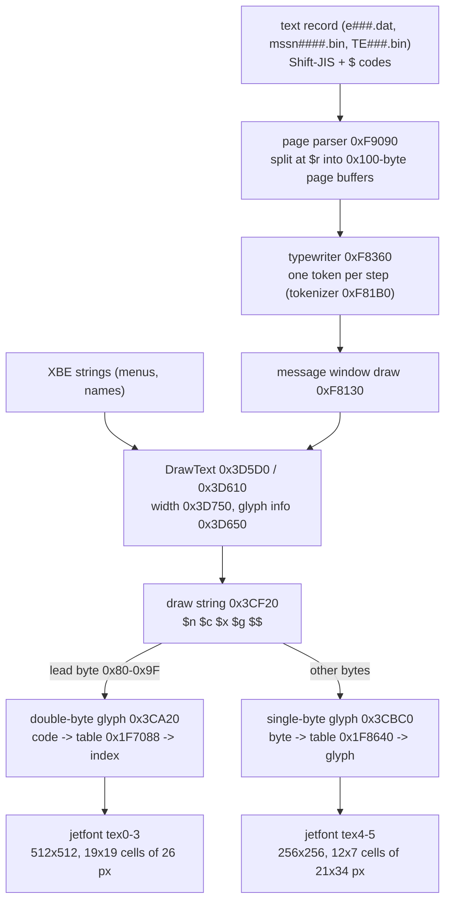
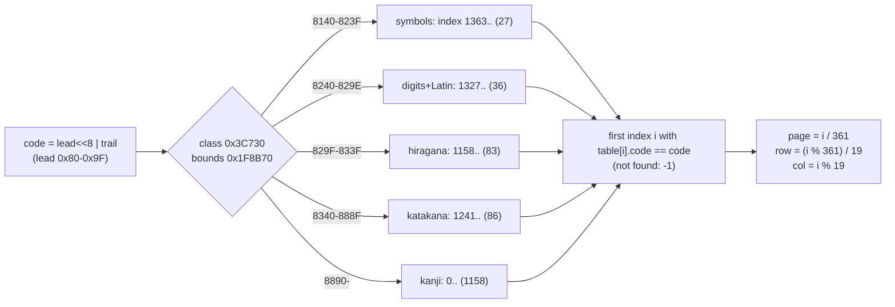
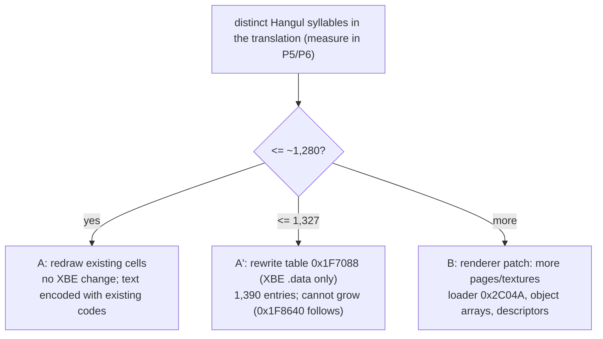

# 텍스트 렌더러: 문장을 그리는 함수, 글리프 대응, `$` 코드, 크기 제한

issue #3(P2)의 분석 결과다. 입력은 일본판 `default.xbe`(MD5 `d8490cdb75bd47b36c62effdf1461ae0`), US판 `default_eng.xbe`(MD5 `f4e366bfdceee551a09f42219c90d84e`), `Media/Font/jetfont.dat`(MD5 `bc566ef593dbf603e5332a7af346e2c8`), `Media/Font/TNRoman.bin`(MD5 `8f2593685f21573197580b07b0350f0e`)이다. 스크립트는 [tools/analysis/](../../tools/analysis/README.md)에 있다. 작업 증거는 [작업 로그](../work-logs/20261020-i003-text-renderer.md)에 있다.

* 주소는 일본판 가상 주소다. **이 문서의 코드와 글꼴 표는 US판에서도 같은 주소에 있다**(§8, `renderer_compare.py`의 바이트 비교로 확인). 다른 주소는 `.data`·bss 전역뿐이고, 그런 곳은 US 주소를 따로 적었다.
* 근거는 정적 분석(디스어셈블리, 표 해독, 텍스처 해독)이다. 화면 결과는 아직 xemu로 보지 않았다. 화면에 어떻게 보이는지에 관한 문장은 **추정**으로 적었다.



## 1. 요약

| 결론 | 상태 |
|---|---|
| 화면 문장은 글꼴 객체(작업 ID `0x1166`, 코드 `0x3C000`~`0x3D790`) 하나가 그린다. 메뉴 문자열과 대사·미션 문장이 같은 함수(`0x3CF20`)를 지난다 | 확인됨(정적) |
| **글리프 순서표는 XBE `.data`에 있다**: `0x1F7088`, 4바이트 항목 1,390개(`u16` 코드 + `u16` 순번). 렌더러는 코드를 표에서 찾고 **표 순번이 곧 칸 번호**다. reJSRF는 Shift-JIS 바이트열로 찾아서 못 찾았다(표는 리틀엔디언 `u16`, 4바이트 간격) | 확인됨 |
| 칸 번호 → 위치: 페이지 = 번호 ÷ 361, 줄 = 나머지 ÷ 19, 칸 = 나머지 mod 19. 칸은 26×26픽셀 | 확인됨(텍스처를 해독해 표와 맞춤) |
| `jetfont.dat`는 512×2304 그림 하나가 아니라 **텍스처 6장**(512×512 네 장 = 2바이트 글자, 256×256 두 장 = 1바이트 글자)의 연결 목록이다 | 확인됨 |
| 2바이트 글자로 읽는 첫 바이트는 **`0x80`~`0x9F`뿐**이다. `0xA0`~`0xFF`는 1바이트 Latin-1 글자(유럽 언어용 비례 글꼴)로 그린다. 따라서 Shift-JIS 첫 바이트 `0xE0`~`0xEF` 글자는 쓸 수 없다 | 확인됨 |
| 렌더러는 줄을 자동으로 바꾸지 않는다. 줄은 `$n`, 페이지는 `$r`로만 나뉜다 | 확인됨 |
| 2바이트 글자 간격은 배율 1에서 24픽셀(칸 26 − 2), 줄 간격 26픽셀. 화면은 640×480. 가장 긴 일본어 줄은 581픽셀(2바이트 글자 약 24자) | 확인됨(코드·집계), 화면 추정 |
| 한 페이지는 0x100바이트 버퍼에 복사되며 길이 검사가 없다. 가장 긴 일본어 페이지는 135바이트 | 확인됨 |
| `TNRoman.bin`은 개발용 디버그 글꼴이다(`Fps=%d`, `Object=%d`, 키 설정 화면). 게임 문장(영어 포함)에는 쓰이지 않는다. 영어 문장은 `jetfont`의 1바이트 페이지로 그린다 | 확인됨(호출처), reJSRF 추정을 고침 |
| **렌더러는 일본판과 US판에서 같은 코드, 같은 주소다.** 글꼴 표도 바이트 단위로 같다. PLAN §6의 전제(US XBE + 패치된 `Media`로 시험)는 정적으로 성립한다 | 확인됨(정적), 실행 확인 남음 |

## 2. 함수

모든 코드 주소는 US판에서도 같다(대응 방법: 같은 주소의 바이트 비교, 다른 바이트는 모두 재배치된 `.data` 주소 피연산자, §8).

| 주소 | 하는 일 | 상태 |
|---|---|---|
| `0x2C040` | `jetfont.dat` 로더(상태 기계). 파일 표 `0x1EDE3C` → `"D:\Media\Font\jetfont.dat"`(`0x1C5B50`). 노드 6개를 고정 횟수(`0x2C04A`의 즉치 6)로 따라가 텍스처 6장을 만든다 | 확인됨 |
| `0x3C1FB`~`0x3C280` | 글꼴 객체 초기화 고리: 글꼴 서술자 두 개(`0x1F8B20`, `0x1F8B48`)마다 "첫 텍스처 + 페이지" 번호로 텍스처를 잡는다 | 확인됨 |
| `0x3C730` | 2바이트 코드의 부류(0~4) 판정 | 확인됨 |
| `0x3C790` | 부류 0~3: 부류 시작 순번부터 표를 순차 검색 | 확인됨 |
| `0x3C830` | 부류 4(한자): 순번 0부터 `[0x1F8B88]`(1,158)개 순차 검색 | 확인됨 |
| `0x3C860` | 1바이트 표 검색(추정 위치에서 앞뒤로) | 확인됨 |
| `0x3C8D0` | `$c` 색 바꾸기 | 확인됨 |
| `0x3CA20` | 2바이트 글리프 하나를 사각형 목록에 넣는다 | 확인됨 |
| `0x3CBC0` | 1바이트 글리프 하나를 넣고 너비를 돌려준다 | 확인됨 |
| `0x3CE10` | `$g` 두 자리 수 그리기 | 확인됨 |
| `0x3CF20` | **문자열 그리기**: 바이트를 읽어 2바이트·1바이트·공백·`$` 코드로 나눈다 | 확인됨 |
| `0x3D170` / `0x3D210` | 상태(위치, 깊이, 색, 배율)를 정하고 `0x3CF20`을 부른다. `0x3D210`은 2번 슬롯에 그리고 바로 내보낸다 | 확인됨 |
| `0x3D2D0` | 1바이트 글자 너비 | 확인됨 |
| `0x3D370` | 문자열 첫 글자의 글리프 정보(페이지, UV, 크기)를 돌려준다. 사각형을 직접 그리는 호출자용 | 확인됨 |
| `0x3D5D0` | `DrawText(x, y, z, ARGB, sx, sy, str)` 포장 함수(일반 슬롯). 호출 53곳 | 확인됨 |
| `0x3D610` | 같은 인자, 즉시 내보내기(`0x3D210`). 호출 146곳 | 확인됨 |
| `0x3D650` | `0x3D370` 포장 함수. 호출 6곳(`0x110456` 등) | 확인됨 |
| `0x3D680` / `0x3D750` | 문자열 너비(픽셀) / 그 포장 함수. 호출 33곳 | 확인됨 |
| `0xF81B0` | 메시지 토큰 분류기: 0 = 1바이트, 1 = 2바이트, 그 밖은 `$` 코드 종류(§6) | 확인됨 |
| `0xF8360` | 타자기 한 걸음: 토큰 하나를 표시 버퍼(`[obj+0x54]`)로 옮긴다 | 확인됨 |
| `0xF8130` | 메시지 창 그리기: `0x3D5D0`(z = 1.1, 배율 1.0) | 확인됨 |
| `0xF9090` | 페이지 분석기: `$r` 개수만큼 `0x114`바이트 칸을 잡고 페이지를 나눈다 | 확인됨 |
| `0xF8700`, `0xF87D0`, `0xF8890` | `$b` 블록 검사, `$v` 수 넣기, `$g` 수 넣기 | 확인됨(동작), 뜻은 §6 |
| `0xFA7F0` | `$p`(`$P`)만 남기고 지운 뒤 마지막 `$p`가 뒤쪽 절반에 있는지 본다 | 확인됨(동작), 뜻 미확정 |
| `0xFE690` | 다음 `$r` 뒤로 건너뛴다 | 확인됨 |
| `0x5F350` | 그래픽 초기화(640×480). 이 안에서 `"D:\Media\Font\TNRoman.bin"`(`0x1CAF74`)을 연다. 호출처 `0x1227B` 한 곳 | 확인됨 |

글꼴 객체는 작업 관리자 `[0x22FCC0]`(US `[0x22FCE0]`)에서 ID `0x1166`으로 찾는다(`0x128C0`). 언어 전역 `0x251F58`(US `0x1FC724`)은 이 범위에서 `$g` 숫자 모양(`0x3CE6D`, `0xF8896`)과 `$v`(`0xF87DA`)에서만 읽는다. 글리프 대응 자체는 언어에 따라 바뀌지 않는다.

## 3. `jetfont.dat` 구조 (확인됨, `jetfont.py`)

`NORM` 머리 뒤 `0x10`부터 노드 연결 목록이 있다. 노드는 16바이트(`u32` 서술자 위치, `u32` 다음 노드 위치, `u16` 서술자에서 픽셀까지 거리 `0x20`, `u16` 크기(64 KiB 단위), `u32` 0)이고, 서술자는 32바이트(`u32` ID, …, `+0x14` 너비, `+0x18` `0x106`)다. 마지막 노드의 "다음" 값은 파일 끝(`0x120130`)이다.

| 텍스처 | 픽셀 위치 | 크기 | 쓰임 |
|---|---|---|---|
| tex0 | `0x000040` | 512×512 DXT3 | 2바이트 페이지 0 (칸 0~360) |
| tex1 | `0x040070` | 512×512 | 페이지 1 (361~721) |
| tex2 | `0x0800A0` | 512×512 | 페이지 2 (722~1082) |
| tex3 | `0x0C00D0` | 512×512 | 페이지 3 (1083~1443, 1,390번부터는 표에 없음) |
| tex4 | `0x100100` | 256×256 | 1바이트 페이지 0 (글리프 1~84) |
| tex5 | `0x110130` | 256×256 | 1바이트 페이지 1 (85~156) |

* reJSRF가 이 파일을 512×2304 그림 하나로 읽은 것은 노드 머리(0x30바이트)를 픽셀로 읽은 것이다. 그래서 아래쪽 페이지가 조금씩 밀려 보였고 "88줄, 약 1,500자"라는 추정이 나왔다.
* DXT3: 4×4 블록마다 4비트 alpha 8바이트 + 색 8바이트, 블록은 선형 순서. 색은 모두 흰색이고 글자 모양은 alpha에 있다.

## 4. 글리프 대응 (확인됨, `font_tables.py`)

### 4.1 2바이트 글자



* 표 `0x1F7088`: `0x56E`(1,390)개 항목, 각 `u16 code, u16 i+1`. 둘째 값은 렌더러가 쓰지 않는다.
* 부류 경계 `0x1F8B70`(`u16` 0, `0x8240`, `0x829F`, `0x8340`, `0x8890`)와 부류 시작 순번 `0x1F8B80`~`0x1F8B8C`(1363, 1327, 1158, 1241)는 `.data` 값이다. 부류 0의 항목 수만은 코드 즉치 `0x56E`(`0x3C7AC`) − 시작 순번으로 계산한다.
* 서술자 `0x1F8B20`: 페이지 4, 첫 텍스처 0, 텍스처 512, 페이지당 칸 361, 칸 26×26, 19열×19줄, UV 간격 26/512. 페이지 수 4는 `0x3CA8E`·`0x3D548`에서 상한으로 쓴다.
* 실제로 쓸 수 있는 칸: 4×361 = 1,444칸 중 표가 1,390칸을 덮는다. 그중 41개(순번 1117~1157, 페이지 3)는 코드 0인 빈 칸, 6개는 앞에 같은 코드가 있거나(한자 4개 중복) 부류가 맞지 않아(`ヶ` `0x8396`, `ー` `0x815B`이 한자 구역에 있음) 찾을 수 없는 칸이다. **찾을 수 있는 서로 다른 코드는 1,343개**다.
* 첫 바이트 범위: 표의 코드는 `0x81`~`0x9C`로 시작한다. `0xA0` 이상으로 시작하는 코드는 없다.
* 특수 처리: 전각 공백 `0x8140`은 그리지 않고 한 칸만큼 나아간다(`0x3CF58`). 표에 없는 코드는 순번 −1이 되어 UV (0,0)~(1,1), 즉 페이지 0 전체를 한 칸 크기로 그린다(`0x3CB85`). 화면에서는 뭉개진 덩어리로 보일 것이다(**추정**).
* 일본어 문장 레코드 2,933개의 2바이트 글자는 `0x8140`을 빼면 모두 표에 있다(`text_codes.py`).
* 레코드 안에서 1바이트로 읽히는 `0xA0` 이상 바이트는 6개뿐이고 모두 `mssn0514.bin`의 Latin-1 글자(`0xE1` `0xE2` `0xE9` = á â é)다. 그 레코드의 첫 구간은 유럽 언어 문장으로 보인다(**추정**).

### 4.2 1바이트 글자 (유럽 언어용)

* 표 `0x1F8640`: `0x9C`(156)개 항목, 각 `u16 code, u16 glyph+1, s16 src_x, s16 width`. 코드는 `0x21`~`0x7A`(백슬래시 등 일부 없음)와 Latin-1 `0xA1`~`0xFC`다.
* 검색 시작 위치: 바이트 < `0x80`이면 바이트 − `0x21`(`0x1F8B7A`), 아니면 바이트 − `0xA1` + 89(`0x1F8B7C`, `0x1F8B98`). 그 자리에서 앞뒤로 156칸 안을 찾는다.
* 서술자 `0x1F8B48`: 페이지 2, 첫 텍스처 4, 텍스처 256, 페이지당 84칸, 칸 21×34, 12열×7줄.
* 비례 글꼴: `src_x`가 −1이면 칸 너비 21픽셀, 아니면 그 줄에서 `src_x`부터 `width`픽셀을 쓴다(10개 글자: `! ' 1 : ; I f i j l`).
* 공백 `0x20`은 표에 없고 따로 처리한다.

## 5. 그리기 규칙과 크기 제한

| 항목 | 값 | 근거 | 상태 |
|---|---|---|---|
| 2바이트 칸 | 26×26 픽셀(텍스처), 배율 `sx`·`sy` | 서술자 | 확인됨 |
| 2바이트 간격 | `26·sx − 2·sx` = 배율 1에서 24픽셀 | `0x3CF66`~`0x3CF96` | 확인됨 |
| 1바이트 간격 | `width·0.76·sx − 4·sx`(기본 width 21 → 약 12픽셀) | `0x3CBC0`, `0x3D0A2` | 확인됨 |
| 공백 `0x20` | `21·0.532·sx` ≈ 11.2픽셀 | `0x3D0C2` | 확인됨 |
| 줄바꿈 `$n` | x = 줄 시작, y += `26·sy` | `0x3CFE0` | 확인됨 |
| 자동 줄바꿈 | 없음 | `0x3CF20`에 너비 검사가 없다 | 확인됨 |
| 화면 | 640×480 | `0x5F3A4`의 장치 설정 | 확인됨 |
| 가운데 맞춤(메시지 창 플래그 `0x80000000`) | 줄마다 x = 320 − 너비/2를 `$x%03d`로 줄 앞에 넣는다 | `0xF927F`~`0xF9332`, `0xF946A` | 확인됨 |
| 세로 가운데(플래그 `0x40000000`) | y = 240 − 줄 수·13 | `0xF9212`~`0xF9251` | 확인됨 |
| 가장 긴 일본어 줄 | 581픽셀(2바이트 약 24.2자), `mssn3405.bin` | `text_codes.py` | 확인됨(집계) |
| 한 줄 최대 폭 | 화면 폭 640픽셀이 상한. 일본어는 24자 안팎으로 맞췄다. 창마다 실제 경계는 화면 확인 필요 | 위 둘 | 추정 |
| 페이지 버퍼 | 0x100바이트(칸 `0x114` 중 `+0x100`부터는 종류·연결 필드). 분석기에 길이 검사 없음. 가운데 맞춤이면 줄마다 5바이트(`$xNNN`)가 더해진다 | `0xF9090` | 확인됨 |
| 가장 긴 일본어 페이지 | 135바이트, `mssn0515.bin` | `text_codes.py` | 확인됨 |
| 한 프레임 사각형 수 | 슬롯·페이지마다 `0x13F`(319)개를 넘으면 버린다 | `0x3CAAF`, `0x3CC54` | 확인됨 |

## 6. `$` 코드

`$` 다음 한 글자(`$b`는 두 글자)다. 문자열 그리기(`0x3CF20`), 타자기(`0xF8360`), 페이지 분석기(`0xF9090`)가 각자 처리한다. "레코드 수"는 이벤트·대화·미션 문장 레코드 2,933개에서 센 수다(`text_codes.py`).

| 코드 | 문자열 그리기 `0x3CF20` | 타자기 `0xF8360` | 페이지 분석기 `0xF9090` | 레코드 수 | 뜻 | 상태 |
|---|---|---|---|---|---|---|
| `$n` | 줄바꿈 | 복사, 쉬지 않음 | 복사, 줄 수 + 1 | 2,022 | 줄바꿈 | 확인됨 |
| `$r` | 무시 | 멈춤 | 페이지 끝(NUL), 다음 칸 | 7,208 | 페이지 나눔 | 확인됨 |
| `$e` | 무시 | 멈춤 | 페이지 종류 4, 끝 페이지 번호를 `[obj+0x164]`에 | 3,098 | 메시지(언어 구간) 끝 | 확인됨 |
| `$c`N | 색: 0 검정, 1 흰색, 2 빨강, 3 초록, 4 파랑, 5 노랑, 6 자홍, 7 청록, 그 밖 흰색(alpha 유지) | 3바이트 복사 | 복사 | 1,188 | 글자색 | 확인됨(값), 화면 추정 |
| `$x`NNN | x = NNN(픽셀, 세 자리) | 5바이트 복사 | 가운데 맞춤 때 분석기가 직접 넣는다 | 0 | 가로 위치 | 확인됨 |
| `$$` | `$` 글자 하나 | 2바이트 복사 | 복사 | 0 | `$` 그대로 | 확인됨 |
| `$g`NN | NN − 카운터(`0x1EFFB0` 객체, `0x39FD0`), 0 미만은 0, 두 자리. 일본어면 전각 숫자(`0x824F`+d), 그 밖은 ASCII | 처리 없음 | `0xF8890`이 같은 규칙으로 숫자로 바꾼다 | 10 | 남은 개수 같은 수 | 확인됨(동작), 무엇의 수인지 추정 |
| `$a` | 무시 | 멈춤 | 페이지 종류 3 | 494 | 자동 넘김(음성·시간)으로 보임 | 추정 |
| `$p` | 무시 | 멈춤 | 페이지 종류 2. `0xFA7F0`이 위치를 검사 | 5 | 미확정 | 미확정 |
| `$s`XY | 무시 | 멈춤 | 페이지 종류 1, 갈 곳 둘(X, Y) | 0 | 선택지 분기로 보임 | 추정 |
| `$j`X | 무시 | 멈춤 | 다음 페이지 연결 = X | 0 | 페이지 이동으로 보임 | 추정 |
| `$v`X | 무시 | 멈춤 | `0xF87D0`이 수를 넣는다(값은 `0xFE650` 표) | 0 | 변수 값 | 추정 |
| `$bc` `$bj` `$bo` | 무시 | 멈춤 | 그대로 복사. `0xF8700`이 `0x21C430`(US `0x21C450`) 표와 비교하는 블록 | `$bc` 5 | 조건 블록으로 보임 | 미확정 |
| `$f`N `$m`N `$h`N `$o`NN | 무시 | 사건 `0x193`/`0x195`/`0x194`/`0x196`과 인자를 `[0x22FCC0]` 객체로 보낸다(`0x127C0`), 쉬지 않음 | 그대로 복사 | 0 | 연출 신호(표정·동작 등)로 보임 | 추정 |

* 레코드에 실제로 나오는 코드는 `$r $e $n $c $a $g $p $bc`뿐이다. 번역문은 이 코드를 원문 자리에 그대로 둔다.
* **`$g`는 일본어 빌드에서 전각 숫자 코드 `0x824F`~`0x8258`을 직접 만든다**(`0x3CE84`, `0xF8902`). 한국어 글꼴에서도 이 열 칸은 숫자로 두어야 한다.

## 7. `TNRoman.bin` (확인됨)

* `0x5F350`(그래픽 초기화)이 장치 객체(`[0x251D4C]`, US `[0x251D6C]`)의 가상 함수로 이 파일을 읽어 글꼴 객체 `[0x251D48]`(US `[0x251D68]`)을 만든다.
* 이 객체를 쓰는 곳은 개발용 화면뿐이다: `0x13E25`~`0x13EC8`(`Object=%d`, `Fps=%d`, `Tps=%d`, `Tpf=%d`), `0x4F9D0`~`0x4FBA1`(`Player %d`, `Key%02d`, `Cancel`, `Disable`의 키 설정 화면).
* 파일은 16바이트 항목 352개(= `0x20`~`0x17F`, Latin-1과 Latin Extended-A로 보인다)이고 앞부분은 `f32 u, 0, f32 width, 0` 꼴이다. 뒷부분은 이 꼴이 아니며 뜻은 확인하지 않았다(필요 없음).
* 따라서 reJSRF의 "영어 경로는 TNRoman 비례 글꼴" 추정은 틀렸다. 영어 문장도 `jetfont`의 1바이트 페이지(tex4·tex5)로 그린다. 한국어 패치에는 이 파일이 관계없다.

## 8. US판과의 대응 (확인됨, `renderer_compare.py`)

| 범위 | 결과 |
|---|---|
| `0x2C040`~`0x2C1D0`(로더) | 다른 바이트 1개: `.data` 주소 피연산자(US = JP + `0x18`) |
| `0x3C000`~`0x3D790`(글꼴 객체) | 22바이트: 피연산자 20개(+`0x20` 17, +`0x18` 2, 언어 전역 −`0x55834` 1) |
| `0x5F350`~`0x5F500`(`TNRoman`) | 17바이트: 피연산자(+`0x20`) |
| `0xF81B0`~`0xF9660`(메시지) | 17바이트: 피연산자(+`0x20` 11, 언어 전역 2) |
| `0xFA7F0`~, `0xFE690`~ | 같음 |
| 표 `0x1F7088`~`0x1F8BA0`, 경로 문자열, 파일 표 `0x1EDE3C` | 바이트 단위로 같음 |

* 결론: 렌더러는 두 빌드에서 같다. 다른 것은 재배치된 전역 주소뿐이다(작업 관리자 `0x22FCC0`↔`0x22FCE0`, 언어 전역 `0x251F58`↔`0x1FC724` 등). 언어 전역이 0이면 US판도 같은 글리프 대응과 같은 숫자 모양(`$g` 전각)을 쓴다.
* 그러므로 `Media`만 고친 패치(문장 파일, `jetfont.dat`)는 US XBE + 언어 0(reJSRF `REJSRF_LANGUAGE=Japanese`)에서 같은 결과를 낼 것이다(**추정**, 실행 확인은 P4). XBE의 표(`0x1F7088`)를 고치는 패치도 US판의 같은 주소에 그대로 적용된다(표가 같은 주소, 같은 바이트).

## 9. 한국어 글꼴 방식(P3)에 주는 뜻



* 2바이트 칸은 최대 1,444개다. 이 수는 페이지 4장(서술자 값)과 텍스처 6장(로더 즉치), 글꼴 객체 안 고정 크기 배열이 함께 정한다. 다만 **표는 1,390개보다 늘릴 수 없다**: `0x1F7088 + 0x56E×4`가 정확히 1바이트 표 `0x1F8640`의 시작이다. 표를 옮기려면 표 주소를 쓰는 명령(`0x3C7F5`, `0x3C845`, `0x3CA44` 등)을 고쳐야 한다(issue #6에서 고침).
* **A. 기존 칸 다시 그리기(코드·XBE 수정 없음)**: 한글 음절마다 지금 표에 있는 코드 하나를 배정하고, 그 칸에 한글을 그린다. 번역문은 그 코드로 쓴다. 찾을 수 있는 코드 1,343개 중 숫자 10개(`$g`가 직접 씀), 영대문자·기호 약 50개를 남기면 **한글 약 1,280자**까지 된다. 가나·한자 칸을 모두 쓰므로 번역하지 않은 일본어(XBE 문자열 포함)는 깨진다.
* **A′. 표만 고치기(XBE `.data` 수정, 코드 수정 없음)**: `0x1F7088` 표와 부류 시작 순번(`0x1F8B80`~)을 다시 쓴다. 빈 칸 41개와 못 찾는 칸 6개를 살려 1,390칸을 모두 쓴다(기호·숫자 63칸을 빼면 한글 최대 1,327자, 가나도 남기면 1,158자). 한글을 부류 4(코드 `0x8890` 이상)에 몰아 두면 순차 검색 하나로 찾는다. 코드 배정을 우리가 정하므로 번역 파일과 도구가 단순해진다.
* **B. 렌더러 수정(새 코드·새 아틀라스)**: 페이지를 늘리려면 로더의 고정 6장, 글꼴 객체의 페이지별 배열(크기 고정), 서술자, 1바이트 페이지 번호(첫 텍스처 4)를 함께 고쳐야 한다. 코드 패치가 크고, reJSRF도 같은 함수를 고쳐야 한다.
* 두 방식 모두의 제약: 코드는 첫 바이트 `0x81`~`0x9F`여야 한다. 칸은 26×26이고 간격이 24픽셀이므로 글자 그림 폭을 24픽셀 안에 둔다. 띄어쓰기는 1바이트 공백 `0x20`(11.2픽셀)이 싸다. 자동 줄바꿈이 없으므로 번역문에 `$n`을 직접 넣고, 줄은 24자 안팎, 페이지는 0x100바이트보다 넉넉히 짧게 둔다.
* **권장 입력(P3)**: A′를 기본으로 한다(코드 수정 없이 데이터만, 1,390칸). 번역문의 서로 다른 음절 수를 세어 1,327자를 넘으면 B를 검토한다. P4 개념 증명은 A(표도 안 고침)로 바로 할 수 있다.

## 10. 미확정

* 화면 확인: 칸에 그린 한글이 xemu에서 어떻게 보이는지, 표에 없는 코드가 실제로 어떻게 보이는지, 창마다 줄 폭의 실제 경계.
* `$a` `$p` `$s` `$j` `$v` `$b?` `$f` `$m` `$h` `$o`의 정확한 뜻(페이지 종류 1~3을 쓰는 표시 코드는 따라가지 않았다).
* `$g` 카운터(`0x1EFFB0` 객체)가 무엇을 세는지.
* `0x110456` 등 `0x3D650`(글리프 정보)을 쓰는 화면이 무엇인지(같은 표를 쓰므로 대응에는 영향 없음).
* XBE 문자열 585개가 어느 함수로 그려지는지 하나하나 확인하지 않았다(모두 `0x3D5D0`·`0x3D610` 계열로 보인다, **추정**).

## 11. 재현

```bash
python -I tools/analysis/font_tables.py "roms/Jet Set Radio Future/default.xbe"
```

```bash
python -I tools/analysis/jetfont.py "roms/Jet Set Radio Future/Media/Font/jetfont.dat" --png work/jetfont --grid
```

```bash
python -I tools/analysis/renderer_compare.py "roms/Jet Set Radio Future/default.xbe" "roms/Jet Set Radio Future/default_eng.xbe"
```

```bash
python -I tools/analysis/text_codes.py "roms/Jet Set Radio Future" "roms/Jet Set Radio Future/default.xbe"
```

---

# Text renderer: the functions that draw text, the glyph mapping, `$` codes, size limits

Findings of issue #3 (P2). Inputs: the Japanese `default.xbe` (MD5 `d8490cdb75bd47b36c62effdf1461ae0`), the US `default_eng.xbe` (MD5 `f4e366bfdceee551a09f42219c90d84e`), `Media/Font/jetfont.dat` (MD5 `bc566ef593dbf603e5332a7af346e2c8`) and `Media/Font/TNRoman.bin` (MD5 `8f2593685f21573197580b07b0350f0e`). The scripts are in [tools/analysis/](../../tools/analysis/README.md); the evidence is in the [work log](../work-logs/20261020-i003-text-renderer.md).

* Addresses are Japanese virtual addresses. **Every piece of code and every font table in this document sits at the same address in the US build** (§8, a byte comparison by `renderer_compare.py`). Only `.data`/bss globals move; their US addresses are given where they appear.
* The basis is static analysis (disassembly, table decoding, texture decoding). The screen has not been checked in xemu yet; statements about what appears on screen are marked **inferred**.

## 1. Summary

| Conclusion | Status |
|---|---|
| On-screen text is drawn by one font object (task ID `0x1166`, code `0x3C000`–`0x3D790`). Menu strings and dialogue/mission text pass through the same function (`0x3CF20`) | confirmed (static) |
| **The glyph order table is in the XBE `.data`**: `0x1F7088`, 1,390 entries of 4 bytes (`u16` code + `u16` serial). The renderer looks the code up and **the table index is the cell number**. reJSRF searched for it as a Shift-JIS byte string and missed it (the table holds little-endian `u16`s at a 4-byte stride) | confirmed |
| Cell number → place: page = number / 361, row = remainder / 19, column = remainder mod 19; cells are 26×26 px | confirmed (textures decoded and matched to the table) |
| `jetfont.dat` is not one 512×2304 image but a linked list of **six textures** (four 512×512 for double-byte characters, two 256×256 for single-byte characters) | confirmed |
| **Only lead bytes `0x80`–`0x9F`** start a double-byte character. `0xA0`–`0xFF` are drawn as single-byte Latin-1 characters (a proportional font for the European languages), so Shift-JIS characters with lead bytes `0xE0`–`0xEF` cannot be used | confirmed |
| The renderer never wraps lines. Lines break only at `$n`, pages only at `$r` | confirmed |
| The double-byte advance is 24 px at scale 1 (cell 26 − 2), the line pitch 26 px, the screen 640×480. The longest Japanese line is 581 px (about 24 double-byte characters) | confirmed (code, counts); screen inferred |
| Each page is copied into a 0x100-byte buffer with no length check. The longest Japanese page is 135 bytes | confirmed |
| `TNRoman.bin` is a developer debug font (`Fps=%d`, `Object=%d`, a key-configuration screen). Game text, English included, does not use it; English text is drawn from `jetfont`'s single-byte pages | confirmed (callers); corrects reJSRF's inference |
| **The renderer is the same code at the same addresses in the Japanese and US builds**, and the font tables are byte-identical. The premise of PLAN §6 (testing with the US XBE and patched `Media`) holds statically | confirmed (static); a run is still to come |

## 2. Functions

Every code address is the same in the US build (match: byte comparison at the same address; every differing byte is a relocated `.data` address operand, §8).

| Address | What it does | Status |
|---|---|---|
| `0x2C040` | `jetfont.dat` loader (state machine). File table `0x1EDE3C` → `"D:\Media\Font\jetfont.dat"` (`0x1C5B50`). Follows a fixed six nodes (immediate 6 at `0x2C04A`) and creates six textures | confirmed |
| `0x3C1FB`–`0x3C280` | font object init loop: for each of two font descriptors (`0x1F8B20`, `0x1F8B48`) takes texture "first texture + page" | confirmed |
| `0x3C730` | class (0–4) of a double-byte code | confirmed |
| `0x3C790` | classes 0–3: linear search from the class's first index | confirmed |
| `0x3C830` | class 4 (kanji): linear search of `[0x1F8B88]` (1,158) entries from index 0 | confirmed |
| `0x3C860` | single-byte table search (both directions from a guessed index) | confirmed |
| `0x3C8D0` | `$c` colour change | confirmed |
| `0x3CA20` | adds one double-byte glyph to the quad list | confirmed |
| `0x3CBC0` | adds one single-byte glyph and returns its width | confirmed |
| `0x3CE10` | `$g` two-digit number | confirmed |
| `0x3CF20` | **draw string**: reads bytes and splits them into double-byte, single-byte, space and `$` codes | confirmed |
| `0x3D170` / `0x3D210` | set the state (position, depth, colour, scale) and call `0x3CF20`; `0x3D210` draws into slot 2 and flushes at once | confirmed |
| `0x3D2D0` | width of a single-byte character | confirmed |
| `0x3D370` | glyph info (page, UV, size) of a string's first character, for callers that build quads themselves | confirmed |
| `0x3D5D0` | `DrawText(x, y, z, ARGB, sx, sy, str)` wrapper (normal slot); 53 callers | confirmed |
| `0x3D610` | same arguments, immediate flush (`0x3D210`); 146 callers | confirmed |
| `0x3D650` | wrapper of `0x3D370`; 6 callers (`0x110456` ...) | confirmed |
| `0x3D680` / `0x3D750` | string width in pixels / its wrapper; 33 callers | confirmed |
| `0xF81B0` | message tokenizer: 0 = single byte, 1 = double byte, otherwise the `$` code kind (§6) | confirmed |
| `0xF8360` | one typewriter step: moves one token into the display buffer (`[obj+0x54]`) | confirmed |
| `0xF8130` | message window draw: `0x3D5D0` (z = 1.1, scale 1.0) | confirmed |
| `0xF9090` | page parser: allocates one `0x114`-byte slot per `$r` and splits the pages | confirmed |
| `0xF8700`, `0xF87D0`, `0xF8890` | `$b` block scan, `$v` number insertion, `$g` number insertion | confirmed (behaviour); meaning in §6 |
| `0xFA7F0` | strips every code but `$p` (`$P`) and tests whether the last `$p` lies in the second half | confirmed (behaviour); meaning unresolved |
| `0xFE690` | skips past the next `$r` | confirmed |
| `0x5F350` | graphics init (640×480); opens `"D:\Media\Font\TNRoman.bin"` (`0x1CAF74`); one caller, `0x1227B` | confirmed |

The font object is fetched from the task manager `[0x22FCC0]` (US `[0x22FCE0]`) by ID `0x1166` (`0x128C0`). In these ranges the language global `0x251F58` (US `0x1FC724`) is read only for the shape of `$g` digits (`0x3CE6D`, `0xF8896`) and for `$v` (`0xF87DA`). The glyph mapping itself does not depend on the language.

## 3. The structure of `jetfont.dat` (confirmed, `jetfont.py`)

After the `NORM` header, a linked list of nodes starts at `0x10`. A node is 16 bytes (`u32` descriptor offset, `u32` next node offset, `u16` distance from descriptor to pixels `0x20`, `u16` size in 64 KiB, `u32` 0); a descriptor is 32 bytes (`u32` ID, …, width at `+0x14`, `0x106` at `+0x18`). The last node's "next" is the end of the file (`0x120130`).

| Texture | Pixels at | Size | Use |
|---|---|---|---|
| tex0 | `0x000040` | 512×512 DXT3 | double-byte page 0 (cells 0–360) |
| tex1 | `0x040070` | 512×512 | page 1 (361–721) |
| tex2 | `0x0800A0` | 512×512 | page 2 (722–1082) |
| tex3 | `0x0C00D0` | 512×512 | page 3 (1083–1443; from 1,390 on, not in the table) |
| tex4 | `0x100100` | 256×256 | single-byte page 0 (glyphs 1–84) |
| tex5 | `0x110130` | 256×256 | single-byte page 1 (85–156) |

* reJSRF read this file as one 512×2304 image, taking the node headers (0x30 bytes each) for pixels; the lower pages looked slightly shifted, which led to the estimate of "88 rows, about 1,500 glyphs".
* DXT3: per 4×4 block, 8 bytes of 4-bit alpha plus 8 bytes of colour, blocks in linear order. The colour is white throughout; the glyph shapes are in alpha.

## 4. Glyph mapping (confirmed, `font_tables.py`)

### 4.1 Double-byte characters

* Table `0x1F7088`: `0x56E` (1,390) entries, each `u16 code, u16 i+1`; the renderer does not use the second value.
* The class bounds `0x1F8B70` (`u16` 0, `0x8240`, `0x829F`, `0x8340`, `0x8890`) and the class first indexes `0x1F8B80`–`0x1F8B8C` (1363, 1327, 1158, 1241) are `.data` values. Only class 0's entry count comes from a code immediate: `0x56E` (`0x3C7AC`) minus its first index.
* Descriptor `0x1F8B20`: 4 pages, first texture 0, texture size 512, 361 cells per page, 26×26 cells, 19 columns × 19 rows, UV step 26/512. The page count 4 is the upper bound checked at `0x3CA8E` and `0x3D548`.
* Usable cells: of the 4×361 = 1,444, the table covers 1,390. Of those, 41 (indexes 1117–1157, page 3) are empty with code 0, and 6 cannot be found, because the same code comes earlier (4 duplicated kanji) or the class does not match (`ヶ` `0x8396` and `ー` `0x815B` sit in the kanji range). **1,343 distinct codes can be found.**
* Lead bytes: the table's codes start with `0x81`–`0x9C`; none starts with `0xA0` or above.
* Special cases: the full-width space `0x8140` is not drawn but advances one cell (`0x3CF58`). A code missing from the table gets index −1 and UV (0,0)–(1,1), i.e. the whole of page 0 drawn into one cell (`0x3CB85`); on screen this should look like a smudge (**inferred**).
* In the 2,933 Japanese text records, every double-byte character except `0x8140` is in the table (`text_codes.py`).
* Only 6 bytes of `0xA0` or above are read as single bytes inside records, all Latin-1 letters in `mssn0514.bin` (`0xE1` `0xE2` `0xE9` = á â é); that record's first section looks like European-language text (**inferred**).

### 4.2 Single-byte characters (for the European languages)

* Table `0x1F8640`: `0x9C` (156) entries, each `u16 code, u16 glyph+1, s16 src_x, s16 width`. Codes `0x21`–`0x7A` (a few such as backslash missing) and Latin-1 `0xA1`–`0xFC`.
* Search start: byte − `0x21` (`0x1F8B7A`) for bytes below `0x80`, otherwise byte − `0xA1` + 89 (`0x1F8B7C`, `0x1F8B98`); from there it searches both ways within the 156 entries.
* Descriptor `0x1F8B48`: 2 pages, first texture 4, texture size 256, 84 cells per page, 21×34 cells, 12 columns × 7 rows.
* Proportional: with `src_x` = −1 the glyph is the 21 px cell; otherwise it takes `width` pixels from `src_x` in its row (10 characters: `! ' 1 : ; I f i j l`).
* The space `0x20` is not in the table; it is handled separately.

## 5. Drawing rules and size limits

| Item | Value | Basis | Status |
|---|---|---|---|
| Double-byte cell | 26×26 px (texture), scaled by `sx`, `sy` | descriptor | confirmed |
| Double-byte advance | `26·sx − 2·sx` = 24 px at scale 1 | `0x3CF66`–`0x3CF96` | confirmed |
| Single-byte advance | `width·0.76·sx − 4·sx` (default width 21 → about 12 px) | `0x3CBC0`, `0x3D0A2` | confirmed |
| Space `0x20` | `21·0.532·sx` ≈ 11.2 px | `0x3D0C2` | confirmed |
| Line break `$n` | x = line start, y += `26·sy` | `0x3CFE0` | confirmed |
| Automatic wrapping | none | `0x3CF20` has no width check | confirmed |
| Screen | 640×480 | device setup at `0x5F3A4` | confirmed |
| Centring (message window flag `0x80000000`) | puts x = 320 − width/2 before each line as `$x%03d` | `0xF927F`–`0xF9332`, `0xF946A` | confirmed |
| Vertical centring (flag `0x40000000`) | y = 240 − lines·13 | `0xF9212`–`0xF9251` | confirmed |
| Longest Japanese line | 581 px (about 24.2 double-byte characters), `mssn3405.bin` | `text_codes.py` | confirmed (count) |
| Maximum line width | bounded by the 640 px screen; the Japanese text keeps to about 24 characters; each window's real bounds need a screen check | the two rows above | inferred |
| Page buffer | 0x100 bytes (from `+0x100` the `0x114` slot holds kind and link fields); the parser has no length check; with centring, 5 bytes (`$xNNN`) are added per line | `0xF9090` | confirmed |
| Longest Japanese page | 135 bytes, `mssn0515.bin` | `text_codes.py` | confirmed |
| Quads per frame | beyond `0x13F` (319) per slot and page, glyphs are dropped | `0x3CAAF`, `0x3CC54` | confirmed |

## 6. `$` codes

A code is `$` plus one character (`$b` plus two). The draw-string function (`0x3CF20`), the typewriter (`0xF8360`) and the page parser (`0xF9090`) each handle them. "Records" counts the 2,933 event, talk and mission text records (`text_codes.py`).

| Code | Draw string `0x3CF20` | Typewriter `0xF8360` | Page parser `0xF9090` | Records | Meaning | Status |
|---|---|---|---|---|---|---|
| `$n` | line break | copied, no pause | copied, line count + 1 | 2,022 | line break | confirmed |
| `$r` | ignored | stops | ends the page (NUL), next slot | 7,208 | page break | confirmed |
| `$e` | ignored | stops | page kind 4, end page number to `[obj+0x164]` | 3,098 | end of a message (language section) | confirmed |
| `$c`N | colour: 0 black, 1 white, 2 red, 3 green, 4 blue, 5 yellow, 6 magenta, 7 cyan, others white (alpha kept) | 3 bytes copied | copied | 1,188 | text colour | confirmed (values); screen inferred |
| `$x`NNN | x = NNN (pixels, three digits) | 5 bytes copied | inserted by the parser itself when centring | 0 | horizontal position | confirmed |
| `$$` | one `$` character | 2 bytes copied | copied | 0 | a literal `$` | confirmed |
| `$g`NN | NN − counter (object `0x1EFFB0`, `0x39FD0`), floored at 0, two digits; full-width digits (`0x824F`+d) in Japanese, ASCII otherwise | not handled | `0xF8890` turns it into digits by the same rule | 10 | a number such as a remaining count | confirmed (behaviour); what it counts inferred |
| `$a` | ignored | stops | page kind 3 | 494 | looks like automatic page advance (voice, time) | inferred |
| `$p` | ignored | stops | page kind 2; `0xFA7F0` tests its position | 5 | unresolved | unresolved |
| `$s`XY | ignored | stops | page kind 1, two targets (X, Y) | 0 | looks like a choice branch | inferred |
| `$j`X | ignored | stops | next-page link = X | 0 | looks like a page jump | inferred |
| `$v`X | ignored | stops | `0xF87D0` inserts a number (value from the `0xFE650` table) | 0 | a variable's value | inferred |
| `$bc` `$bj` `$bo` | ignored | stops | copied as is; a block that `0xF8700` compares with the table `0x21C430` (US `0x21C450`) | `$bc` 5 | looks like a conditional block | unresolved |
| `$f`N `$m`N `$h`N `$o`NN | ignored | sends event `0x193`/`0x195`/`0x194`/`0x196` with the argument to the object `[0x22FCC0]` (`0x127C0`), no pause | copied as is | 0 | looks like staging signals (expression, motion ...) | inferred |

* The codes that actually occur in records are only `$r $e $n $c $a $g $p $bc`. Translations keep them where the original has them.
* **In the Japanese build `$g` produces the full-width digit codes `0x824F`–`0x8258` directly** (`0x3CE84`, `0xF8902`). A Korean font must keep those ten cells as digits.

## 7. `TNRoman.bin` (confirmed)

* `0x5F350` (graphics init) reads the file through a virtual method of the device object (`[0x251D4C]`, US `[0x251D6C]`) and creates the font object `[0x251D48]` (US `[0x251D68]`).
* Only developer screens use that object: `0x13E25`–`0x13EC8` (`Object=%d`, `Fps=%d`, `Tps=%d`, `Tpf=%d`) and `0x4F9D0`–`0x4FBA1` (the key-configuration screen with `Player %d`, `Key%02d`, `Cancel`, `Disable`).
* The file is 352 entries of 16 bytes (= `0x20`–`0x17F`, apparently Latin-1 and Latin Extended-A); the first part has the shape `f32 u, 0, f32 width, 0`, the rest does not, and its meaning was not pursued (not needed).
* reJSRF's inference "the English path uses the TNRoman proportional font" is therefore wrong: English text is drawn from `jetfont`'s single-byte pages (tex4, tex5). This file does not matter to the Korean patch.

## 8. Correspondence with the US build (confirmed, `renderer_compare.py`)

| Range | Result |
|---|---|
| `0x2C040`–`0x2C1D0` (loader) | 1 differing byte: a `.data` address operand (US = JP + `0x18`) |
| `0x3C000`–`0x3D790` (font object) | 22 bytes: 20 operands (+`0x20` ×17, +`0x18` ×2, the language global −`0x55834` ×1) |
| `0x5F350`–`0x5F500` (`TNRoman`) | 17 bytes: operands (+`0x20`) |
| `0xF81B0`–`0xF9660` (messages) | 17 bytes: operands (+`0x20` ×11, the language global ×2) |
| `0xFA7F0`–, `0xFE690`– | identical |
| tables `0x1F7088`–`0x1F8BA0`, path strings, file table `0x1EDE3C` | byte-identical |

* Conclusion: the renderer is the same in both builds; only relocated global addresses differ (task manager `0x22FCC0`↔`0x22FCE0`, language global `0x251F58`↔`0x1FC724`, ...). With the language global at 0, the US build uses the same glyph mapping and the same digit shape (full-width `$g`).
* So a patch that changes only `Media` (text files, `jetfont.dat`) should give the same result on the US XBE with language 0 (reJSRF `REJSRF_LANGUAGE=Japanese`) (**inferred**; run check in P4). A patch to the XBE table (`0x1F7088`) applies unchanged at the same US address (same address, same bytes).

## 9. What this means for the Korean font approach (P3)

* At most 1,444 double-byte cells exist. The four pages (descriptor value), the six textures (loader immediate) and fixed-size arrays inside the font object set that number together. However, **the table cannot grow beyond 1,390 entries**: `0x1F7088 + 0x56E×4` is exactly where the single-byte table `0x1F8640` begins. Moving the table means changing the instructions that use its address (`0x3C7F5`, `0x3C845`, `0x3CA44` ...) (corrected in issue #6).
* **A. Redraw existing cells (no code or XBE change)**: give each Hangul syllable one code already in the table and draw Hangul in that cell; the translation is written with those codes. Of the 1,343 findable codes, keeping the 10 digits (`$g` writes them directly) and about 50 capitals and symbols leaves room for **about 1,280 Hangul syllables**. All kana and kanji cells are used, so any untranslated Japanese (XBE strings included) turns into garbage.
* **A′. Rewrite the table only (XBE `.data` change, no code change)**: rewrite the table `0x1F7088` and the class first indexes (`0x1F8B80`–). Reviving the 41 empty and 6 unfindable cells uses all 1,390 (minus the 63 symbol and digit cells, at most 1,327 Hangul; 1,158 if the kana stay too). With all Hangul in class 4 (codes `0x8890` and up) one linear search finds them. Since we choose the codes, the translation files and the tool get simpler.
* **B. Change the renderer (new codes, new atlas)**: more pages means changing the loader's fixed six, the font object's fixed-size per-page arrays, the descriptors and the single-byte page numbers (first texture 4) together. A large code patch, and reJSRF would have to change the same functions.
* Constraints for every option: codes must have lead bytes `0x81`–`0x9F`. Cells are 26×26 with a 24 px advance, so glyph drawings should stay within 24 px. Spaces are cheapest as the single-byte `0x20` (11.2 px). There is no automatic wrapping, so translations carry their own `$n`; keep lines to about 24 characters and pages well under 0x100 bytes.
* **Recommended input for P3**: take A′ as the default (data only, no code change, 1,390 cells). Count the distinct syllables of the translation and consider B only if they exceed 1,327. The P4 proof of concept can be done right away with A (not even the table changes).

## 10. Unresolved

* Screen checks: how Hangul drawn into the cells looks in xemu, how a code missing from the table really looks, and each window's real line bounds.
* The exact meaning of `$a` `$p` `$s` `$j` `$v` `$b?` `$f` `$m` `$h` `$o` (the display code that uses page kinds 1–3 was not followed).
* What the `$g` counter (object `0x1EFFB0`) counts.
* Which screens use `0x3D650` (glyph info), such as `0x110456` (same table, so the mapping is unaffected).
* Which function draws each of the 585 XBE strings was not checked one by one (all appear to go through the `0x3D5D0`/`0x3D610` family, **inferred**).

## 11. Reproducing

The commands are listed in §11 of the Korean section above; run them from the repository root with the dump under `roms/`.
