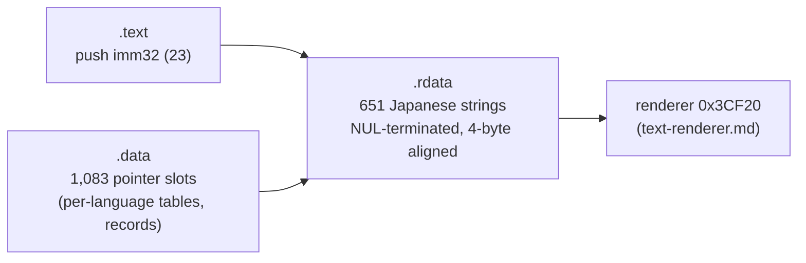

# XBE 문자열: `.rdata`의 일본어 문자열과 그 참조

issue #11(P5-1)에서 확인한 사실이다. 입력은 일본판 `default.xbe`(MD5 `d8490cdb75bd47b36c62effdf1461ae0`)다. 작업 증거는 [작업 로그 i011](../work-logs/20261021-i011-text-extract.md), 찾는 코드는 [tools/jsrfkr/xbetext.py](../../tools/jsrfkr/xbetext.py)다. P4에서 화면으로 확인한 메뉴 표는 [text-files §4](text-files.md)에 있다.

* 근거는 정적 분석(섹션 전체 바이트 조사, 참조 검색, `push` 명령 확인은 capstone 디스어셈블리)이다.
* 주소는 일본판 가상 주소다. **US판 대응 주소는 아직 맞추지 않았다**(**미확정**, P8). US판 메뉴 문자열은 일본판과 다른 주소에 있다.

## 1. 문자열 (확인됨)

* 일본어 문자열은 **`.rdata`에만 있다**: 651개, 14,189바이트(NUL 제외). 모두 4바이트 정렬된 주소에서 시작하고 NUL로 끝난다.
* 고르는 규칙: 앞이 NUL, 4바이트 정렬, Shift-JIS 2바이트 글자(첫 바이트 `0x81`~`0x9F`, `0xE0`~`0xEF`)와 1바이트 `0x09` `0x0A` `0x20`~`0x7E`로만 되어 있고 cp932로 읽힌다, 가나·한자·전각 글자(첫 바이트 `0x82`~`0x9F`)가 있다, 2바이트 글자가 둘 이상이거나 그 하나뿐이다.
* 규칙에서 빠지는 후보는 모두 2진 자료다.
  * `.rdata`: 정렬되지 않은 위치의 1~2글자(다른 자료의 바이트), 2바이트 하나 + 기호 꼴 5개(`0x1CA480` 등의 float 상수. 코드가 즉치로 쓰지만 `push`가 아니다).
  * `.data`: 글리프 표 `0x1F7088`의 항목(4바이트마다 2바이트 코드가 문자처럼 보인다), float 배열 등. **`.data`에는 화면 문장이 없다.**
* 92개 문자열에 `$n` 같은 `$` 코드가 있고, 9개에 `%`가 있다(형식 문자열로 보인다). 게임이 실행 중에 채우는 자리의 공백도 문자열의 일부다.

## 2. 참조 (확인됨)

| 참조 | 수 | 내용 |
|---|---|---|
| `.data`의 정렬된 `u32` 칸 | 1,083 | 629개 문자열은 이것만으로 참조된다. 한 문자열을 여러 칸이 가리키기도 한다(1칸 444개, 2~6칸 179개, 7~12칸 8개) |
| `.text`의 `push imm32` | 23 | 20개 문자열은 코드만으로(저장·불러오기 안내, 컨트롤러 안내 등), 2개는 `.data`와 코드 둘 다로 참조된다 |
| 그 밖의 바이트 일치 | 1 | `0x1375FD`: `push 1; push 0x1DEC`의 바이트가 우연히 한 문자열 주소와 같다. 명령 피연산자가 아니다 |
| 참조 없음 | 0 | |

* **문자열 중간을 가리키는 참조는 없다**(`.data`·`.rdata`의 모든 정렬 칸 검사).
* `.data` 참조 칸은 연속 포인터 묶음 324개에 있다. 266개는 한 칸짜리(다른 필드가 섞인 레코드 안의 칸), 나머지는 일본어 칸들 뒤에 영어 칸들이 오는 언어별 표(`J…J E…E` 꼴, [text-files §4](text-files.md)의 `0x221948` 일시정지 메뉴 등)와 일본어·영어가 번갈아 오는 꼴이다. 표의 모양은 재삽입에 필요 없다(칸마다 그 문자열의 주소만 바꾼다).

## 3. 남는 자리 (확인됨)

* 문자열 뒤 NUL 다음의 0바이트(다음 문자열의 4바이트 정렬 여백)는 모두 1,343바이트다. 문자열마다 0~7바이트, 대부분 1바이트(315개)나 3바이트(291개)다. 한국어가 원문 길이 + 여백 안이면 제자리에 쓸 수 있다(NUL 하나는 남긴다).
* `.rdata` 섹션 끝에는 여백이 거의 없다(원시 크기 `0x277F0` 끝의 0바이트 1개, 가상 크기 `0x27800`).

## 4. 길이가 바뀔 때

| 경우 | 할 일 |
|---|---|
| 한국어 ≤ 원문 + 여백 | 제자리에 쓰고 NUL로 채운다(P4에서 "セーブ" → "저장" 화면 확인) |
| 더 김 | 새 자리(새 섹션 등)에 쓰고 **그 문자열을 가리키는 `.data` 칸과 `push` 즉치를 모두** 새 주소로 바꾼다. 바뀐 섹션의 SHA-1 요약값을 다시 계산한다 |

* 새 섹션을 더하려면 XBE 머리(섹션 수, 섹션 머리 표, 머리 크기, 이미지 크기)를 고쳐야 한다. 서명은 고치지 않아도 Cxbx-Reloaded·xemu가 실행한다(P4). 방법은 다음 issue에서 정한다.
* `push` 즉치는 주소 4바이트만 바꾸며 원래 명령 바이트를 담지 않는다. 바꾸기 전 값이 원래 주소인지 확인한다.
* 구현(issue #13, `tools/jsrfkr/xbeedit.py`, `reinsert.py`): 섹션 머리 표를 머리 여유 자리 `0x988`로 옮겨 12개로 늘리고, 새 섹션 `KRTEXT`를 VA `0x289000`, 원시 위치 `0x22D000`, 깃발 `0x06`으로 더한다(이름과 공유 페이지 참조 수 둘은 표 뒤, 머리 크기 `0xC34`). 651개 문자열을 일부러 모두 옮겨도 모든 `.data` 칸과 `push` 즉치가 새 섹션의 원래 바이트로 이어지고, 머리·참조 밖의 바이트는 원본과 같다(`check_reinsert.py`). 섹션 요약값은 모두 맞다. **섹션을 더한 XBE가 에뮬레이터에서 실행되는지는 아직 확인하지 않았다(미확정).**

## 5. 미확정

* US판 대응 주소(P8). 문자열과 표가 같은 순서인지.
* 각 문자열이 나오는 화면(P4에서 확인한 몇 개 외).
* `%`가 든 9개가 형식 문자열인지, 실행 중에 문자열을 복사·조합하는 코드가 있는지. 번역할 때 `%` 지정자는 그대로 둔다.

---

# XBE strings: Japanese strings in `.rdata` and their references

Facts confirmed in issue #11 (P5-1). Input: the Japanese `default.xbe` (MD5 `d8490cdb75bd47b36c62effdf1461ae0`). The evidence is in the [work log i011](../work-logs/20261021-i011-text-extract.md); the finding code is [tools/jsrfkr/xbetext.py](../../tools/jsrfkr/xbetext.py). The menu tables checked on screen in P4 are in [text-files §4](text-files.md).

* The basis is static analysis (a byte survey of whole sections, a reference search, `push` instructions checked by capstone disassembly).
* Addresses are Japanese virtual addresses. **The US counterparts are not matched yet** (**unresolved**, P8); the US menu strings sit at other addresses.

(The diagram above: 23 `push` immediates in `.text` and 1,083 pointer slots in `.data` refer to the 651 Japanese strings in `.rdata`, which the renderer draws.)

## 1. Strings (confirmed)

* Japanese strings are **only in `.rdata`**: 651 strings, 14,189 bytes (NULs excluded), all starting at 4-byte aligned addresses and ending with a NUL.
* The rule: follows a NUL; 4-byte aligned; made only of Shift-JIS double-byte characters (lead `0x81`–`0x9F`, `0xE0`–`0xEF`) and the single bytes `0x09` `0x0A` `0x20`–`0x7E`, decoding as cp932; has a kana, kanji or full-width character (lead `0x82`–`0x9F`); has at least two double-byte characters, or only that one.
* Every candidate the rule leaves out is binary data:
  * `.rdata`: one or two characters at unaligned places (bytes of other data), and five "one double-byte character + symbols" (float constants such as `0x1CA480`, used by code as immediates but not by `push`).
  * `.data`: entries of the glyph table `0x1F7088` (a double-byte code every 4 bytes looks like text), float arrays and the like. **`.data` holds no on-screen text.**
* 92 strings carry `$` codes such as `$n`, and 9 contain `%` (apparently format strings). Spaces holding a place the game fills at run time are part of the string.

## 2. References (confirmed)

| Reference | Count | Content |
|---|---|---|
| aligned `u32` slots in `.data` | 1,083 | 629 strings are referenced only this way; several slots may point at one string (1 slot: 444 strings; 2–6: 179; 7–12: 8) |
| `push imm32` in `.text` | 23 | 20 strings are referenced by code only (save/load notices, controller notices and so on), 2 by both `.data` and code |
| other byte matches | 1 | `0x1375FD`: the bytes of `push 1; push 0x1DEC` happen to equal a string's address; not an operand |
| no reference | 0 | |

* **No reference points into the middle of a string** (all aligned slots of `.data` and `.rdata` checked).
* The `.data` slots sit in 324 runs of consecutive pointers: 266 single slots (a field in a record mixed with other fields); the rest are per-language tables, Japanese slots followed by English ones (`J…J E…E`, such as the pause menu `0x221948` of [text-files §4](text-files.md)), or Japanese and English alternating. The table shapes are not needed for reinsertion (each slot just gets its string's new address).

## 3. Slack (confirmed)

* The zero bytes after each string's NUL (alignment padding before the next string) add up to 1,343 bytes: 0–7 per string, mostly 1 (315 strings) or 3 (291). Korean up to the original length plus this slack can be written in place (one NUL kept).
* The end of `.rdata` has almost no slack (one zero byte at the end of the raw size `0x277F0`; virtual size `0x27800`).

## 4. When a length changes

| Case | What to do |
|---|---|
| Korean ≤ original + slack | write in place and fill with NUL (checked on screen in P4: "セーブ" → "저장") |
| longer | write it in new space (a new section and the like) and change **every `.data` slot and `push` immediate referring to that string** to the new address; recompute the changed sections' SHA-1 digests |

* Adding a section means changing the XBE header (section count, section header table, header size, image size). Cxbx-Reloaded and xemu run it without a fixed signature (P4). The method is settled in the next issue.
* A `push` immediate change replaces only the 4 address bytes and carries no original instruction bytes; the old value is checked to be the original address first.
* Implemented (issue #13, `tools/jsrfkr/xbeedit.py`, `reinsert.py`): the section header table moves into the free header space at `0x988` and grows to 12 entries; the new section `KRTEXT` sits at VA `0x289000`, raw `0x22D000`, flags `0x06` (its name and two shared page reference counts follow the table; header size `0xC34`). Moving all 651 strings on purpose keeps every `.data` slot and `push` immediate leading to the original bytes in the new section, with no byte changed outside the header and references (`check_reinsert.py`); all section digests check. **Whether emulators run the XBE with the added section is not checked yet (unresolved).**

## 5. Unresolved

* The US counterpart addresses (P8), and whether strings and tables keep the same order there.
* The screen each string appears on (beyond the few checked in P4).
* Whether the 9 strings with `%` are format strings, and whether code copies or assembles strings at run time; translations keep `%` specifiers as they are.
