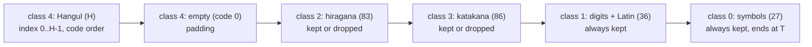

# 설계: 한국어 글꼴 — 글리프 표 데이터 패치(A′)와 아틀라스 생성 (issue #6, P3)

근거: [analysis/text-renderer.md](../analysis/text-renderer.md)(특히 §4, §9), [PLAN §5 P3](../PLAN.md).

## 1. 결정

**A′ 방식**을 쓴다. 렌더러 코드는 고치지 않는다.

1. XBE `.data`의 2바이트 글리프 표 `0x1F7088`(1,390 × 4바이트)과 부류 시작 순번 `0x1F8B80`~`0x1F8B8F`를 새로 쓴다.
2. 한글 음절은 **고정 규칙**으로 2바이트 코드에 배정한다(§3). 모두 부류 4(코드 `0x8890` 이상)라 렌더러의 한자 검색 하나로 찾는다.
3. `jetfont.dat`의 2바이트 페이지(tex0~3)를 새 표 순서대로 다시 만든다. 남기는 칸(기호·숫자·영대문자·가나)은 사용자 덤프의 원래 칸을 옮겨 오고, 한글 칸은 OFL 글꼴로 그린다. 1바이트 페이지(tex4·5)와 파일 구조는 그대로 둔다.

고른 이유:

| 방식 | 코드 패치 | 칸 | 판단 |
|---|---|---|---|
| A 기존 칸 다시 그리기 | 없음 | 한글 약 1,280 | 코드 배정이 원래 표에 묶여 번역 도구가 복잡하다. 일본어 칸을 모두 잃는다 |
| **A′ 표 데이터 패치** | **없음** | 1,390(한글 최대 1,327) | 코드 배정을 우리가 정한다. 가나를 남길 수 있다. reJSRF는 US판 같은 주소의 표를 바꾸면 된다 |
| B 렌더러 수정 | 큼 | 제한 없음 | 로더·객체 배열·서술자를 함께 고쳐야 한다. 칸이 모자랄 때만 |

## 2. 칸 배치

새 표의 순서(앞에서부터)와 부류 시작 순번:

* `T`(표 전체 칸 수) = `0x56E`(1,390), 고정. 부류 0의 끝은 코드 즉치 `0x56E`(`0x3C7AC`)로 정해지므로 표 끝에 기호를 둔다.
* 기호 27개와 숫자·영대문자 36개는 늘 남긴다. `$g`가 전각 숫자 `0x824F`~`0x8258`을 직접 쓰기 때문이다(text-renderer §6). 원래 표의 이 항목들을 그대로 옮긴다(코드와 그림 모두 사용자 덤프에서).
* 가나 169개(히라가나 83, 가타카나 86)는 칸이 남으면 남긴다(번역되지 않은 가나가 깨지지 않게). 한글이 `T − 63 − 169` = **1,158자**를 넘으면 가나를 빼고, 그 경우 한글은 **1,327자**까지 된다.
* 한자는 남기지 않는다. 표에 없는 코드는 렌더러가 뭉개진 칸으로 그린다(text-renderer §4.1). 번역 검사기(P5)가 번역문에 표에 없는 코드가 없는지 확인한다.
* **표는 늘릴 수 없다.** 처음에는 즉치 `0x3C7AC`를 바꿔 `T` = 1,444로 늘리는 선택지를 두었으나, `0x1F7088 + 0x56E×4`가 정확히 1바이트 표 `0x1F8640`의 시작이라 표가 그 표를 덮는다(구현 중 확인). 1,327자를 넘으면 표를 옮기는 코드 패치(B 쪽)가 필요하다.
* 부류 시작 순번: 히라가나 `[0x1F8B88]` = 한자 수(= H + 빈 칸), 가타카나 `[0x1F8B8C]`, 영숫자 `[0x1F8B84]`, 기호 `[0x1F8B80]`. 가나를 빼면 `[0x1F8B88]` = `[0x1F8B8C]` = `[0x1F8B84]`로 두 부류를 비운다.
* 둘째 필드(`u16` 순번 + 1)는 렌더러가 쓰지 않지만 원래와 같은 규칙으로 채운다.

## 3. 한글 코드 배정 (고정 규칙)

* 대상: KS X 1001 한글 2,350자(표준 라이브러리 `euc_kr`로 2바이트로 인코딩되는 음절). 그 밖의 음절(예: `똠`)은 쓰지 않는다. 번역 검사기가 막는다.
* 코드 열: `0x8890`부터 증가하며, 둘째 바이트가 `0x40`~`0x7E`, `0x80`~`0xFC`인 값만 쓴다. KS 순서 k번째 음절 → 이 열의 k번째 코드. 첫 음절 `가` = `0x8890`, 마지막 `힝` = `0x94ED`.
* 번역에 쓰인 음절만 표에 넣는다(코드 순서로). 코드는 번역이 바뀌어도 변하지 않는다. reJSRF도 같은 규칙으로 계산할 수 있다.
* 이 코드들은 Shift-JIS 한자 자리라 일반 편집기로 보면 무의미한 한자로 보인다. 번역 파일에는 한글(UTF-8)로 쓰고, 도구가 넣을 때 바꾼다.

## 4. 글리프 그리기

* 글꼴: **Do Hyeon(도현) Regular**(우아한형제들, SIL OFL 1.1, google/fonts `ofl/dohyeon`, 커밋 `47d54ca`). 사용자가 골랐다(§8). 각진 굵은 고딕이라 JSRF 일본어 글꼴과 분위기가 비슷하고, 정적 `glyf` TTF이며 KS X 1001 2,350자를 모두 담는다. `patch/font/`에 TTF, `OFL.txt`, `METADATA.pb`를 두고 `THIRD_PARTY_NOTICES.md`에 적는다.
* 래스터라이저: **표준 라이브러리만 쓰는 TrueType(`glyf`) 래스터라이저**를 직접 쓴다(`tools/font/ttf.py`). `cmap`(형식 4·12), `loca`, `glyf`(단순·복합 글리프), 2차 베지어를 직선으로 나눈 뒤 칸마다 부분 표본(예: 8×8)으로 덮인 비율을 계산한다. 같은 글꼴 파일에서 항상 같은 비트맵이 나온다(부동소수 사칙연산만 씀). Pillow(FreeType)를 쓰지 않는 이유: 외부 패키지이고 버전에 따라 안티앨리어싱이 달라져 재현성이 깨진다.
* 변수 글꼴(`gvar`)과 CFF(`.otf`) 글꼴은 지원하지 않는다. 정적 `glyf` TTF만 받는다.
* 칸 규칙: 26×26 칸 안에 글자 몸통을 약 22픽셀로, 가로 가운데·세로는 글꼴의 ascender/descender 기준으로 맞춘다. 간격이 24픽셀이므로 잉크는 가로 24픽셀 안에 둔다. 굵기 보정(선택): 덮인 비율에 감마를 주어 4비트로 줄였을 때 획이 흐려지지 않게 한다. 정확한 값은 원래 일본어 글리프의 잉크 범위를 재서 맞춘다.
* alpha는 16단계(DXT3 4비트)로 양자화한다.

## 5. `jetfont.dat` 다시 만들기

* 사용자 덤프의 `jetfont.dat`를 읽어(MD5 `bc566ef593dbf603e5332a7af346e2c8` 확인) tex0~3의 alpha를 푼다.
* 새 표 순서대로 칸을 채운다: 남기는 칸은 원래 위치의 26×26 alpha를 옮기고, 한글 칸은 래스터라이저 결과, 빈 칸은 0.
* DXT3로 다시 압축한다. alpha 블록은 그대로 4비트, 색 블록은 원본 전체와 같은 흰색 블록(`0000ffff55555555`)이다. 이 블록은 손실이 없어 원래 배치로 다시 만들면 원본과 바이트 단위로 같아야 한다(**왕복 시험**).
* 노드·서술자·tex4·5 바이트는 사용자 덤프에서 그대로 복사한다. 파일 크기와 위치는 변하지 않는다.

## 6. XBE 패치

* `.data`의 파일 위치(일본판 `.data` raw `0x1DC000`, VA `0x1EB760`)로 `0x1F7088`~`0x1F863F`와 `0x1F8B80`~`0x1F8B8F`를 쓴다. 새 표는 사용자 덤프의 원래 표(남기는 항목)와 §3의 규칙으로 패치 때 계산한다. 패치 데이터에는 원본 바이트를 넣지 않는다.
* 고치기 전에 두 범위의 원래 바이트 해시를 확인한다.
* XBE 섹션 머리(+`0x24`)의 SHA-1 요약값은 `SHA-1(u32 raw 크기 + raw 데이터)`다(일본판 11개 섹션 모두 일치, **확인됨**). 패치 뒤 `.data` 요약값을 다시 계산해 넣는다. 머리 서명(RSA)은 고칠 수 없으므로 실기는 서명 검사를 끈 환경이 필요하다. xemu는 서명을 검사하지 않는 것으로 알려져 있다(**추정**, P4에서 확인).
* US판(reJSRF)도 같은 주소, 같은 바이트이므로 같은 패치가 그대로 맞는다(text-renderer §8).

## 7. 도구 구성과 P1과의 경계

| 파일 | 하는 일 |
|---|---|
| `tools/font/ttf.py` | TrueType `glyf` 읽기와 래스터라이저(표준 라이브러리) |
| `tools/font/hangul.py` | KS X 1001 음절 목록, 음절 ↔ 코드 고정 대응, 텍스트에서 음절 모으기 |
| `tools/font/dxt3.py` | DXT3 alpha 풀기·압축(흰색 색 블록) |
| `tools/font/glyph_table.py` | 원래 표 읽기, 새 표·부류 시작 순번 만들기(§2) |
| `tools/font/build_font.py` | 명령줄: `<덤프> <음절 목록 또는 텍스트> <출력 폴더(work/…)>` → 새 `jetfont.dat`, 새 표 바이트, 미리보기 PNG |

* `tools/analysis/xbe.py`, `jetfont.py`의 읽기 코드를 쓴다(필요하면 공용 모듈로 옮긴다).
* 패치 도구 전체(`tools/patch.py`, MD5 검증, 출력 폴더 구성, 패치 데이터 형식)는 P1(issue #2)에서 정한다. P3는 위 모듈과 `work/`에 쓰는 명령줄만 만든다. P4(개념 증명)에서 두 쪽을 잇는다.

## 8. 사용자 결정

* **글꼴**: Do Hyeon으로 정했다(2026-10-20). 후보는 Do Hyeon, Gothic A1 Bold, Nanum Gothic ExtraBold, Black Han Sans였다(모두 google/fonts의 OFL 정적 TTF).

## 9. 검증

1. 왕복 시험: 원래 표·원래 칸으로 다시 만든 `jetfont.dat`가 원본과 같다(MD5).
2. 새 표: `font_tables.py`로 읽어 부류 범위가 맞고, 모든 한글 코드가 한 번씩만 있다.
3. 아틀라스: 새 tex0~3을 alpha PNG(`work/`)로 써서 눈으로 본다. 칸 경계를 넘는 잉크가 없는지 자동으로도 센다.
4. 재현성: 같은 입력으로 두 번 돌려 출력 MD5가 같다.
5. 화면 확인(xemu, reJSRF)은 P4.

---

# Design: Korean font — glyph-table data patch (A′) and atlas building (issue #6, P3)

Basis: [analysis/text-renderer.md](../analysis/text-renderer.md) (§4 and §9 in particular), [PLAN §5 P3](../PLAN.md).

## 1. Decision

Use **option A′**; the renderer code is not changed.

1. Rewrite the double-byte glyph table `0x1F7088` (1,390 × 4 bytes) and the class first indexes `0x1F8B80`–`0x1F8B8F` in the XBE `.data`.
2. Hangul syllables get double-byte codes by a **fixed rule** (§3). All are class 4 (codes `0x8890` and up), so the renderer's kanji search finds them.
3. Rebuild `jetfont.dat`'s double-byte pages (tex0–3) in the new table order. Kept cells (symbols, digits, capitals, kana) are moved from the user's dump; Hangul cells are drawn from an OFL font. The single-byte pages (tex4, tex5) and the file structure stay as they are.

Why:

| Option | Code patch | Cells | Judgement |
|---|---|---|---|
| A redraw existing cells | none | about 1,280 Hangul | codes tied to the original table make the translation tooling complex; every Japanese cell is lost |
| **A′ table data patch** | **none** | 1,390 (at most 1,327 Hangul) | we choose the codes; kana can stay; reJSRF replaces the table at the same US address |
| B renderer change | large | unlimited | loader, object arrays and descriptors change together; only if cells run out |

## 2. Cell layout

* `T` (total table entries) = `0x56E` (1,390), fixed. Class 0 ends at the code immediate `0x56E` (`0x3C7AC`), so the symbols go at the end of the table.
* The 27 symbols and 36 digits/capitals always stay, because `$g` writes the full-width digits `0x824F`–`0x8258` directly (text-renderer §6). These entries are moved as they are (codes and pictures from the user's dump).
* The 169 kana (83 hiragana, 86 katakana) stay when there is room, so untranslated kana do not break. If Hangul exceeds `T − 63 − 169` = **1,158**, the kana go, and Hangul can then reach **1,327**.
* No kanji stay. A code missing from the table is drawn as a smudged cell (text-renderer §4.1); the translation checker (P5) makes sure the translation uses no such code.
* **The table cannot grow.** An earlier draft allowed changing the immediate at `0x3C7AC` for `T` = 1,444, but `0x1F7088 + 0x56E×4` is exactly where the single-byte table `0x1F8640` begins, so a longer table would overwrite it (found during implementation). Beyond 1,327 syllables the table must move, which needs code patches (option B territory).
* Class first indexes: hiragana `[0x1F8B88]` = kanji count (= H + padding), katakana `[0x1F8B8C]`, digits/Latin `[0x1F8B84]`, symbols `[0x1F8B80]`. Without kana, `[0x1F8B88]` = `[0x1F8B8C]` = `[0x1F8B84]` empties both classes.
* The second field (`u16` index + 1) is unused by the renderer but filled by the original rule.

## 3. Hangul code assignment (fixed rule)

* Set: the 2,350 KS X 1001 Hangul syllables (those the standard-library `euc_kr` codec encodes in two bytes). Other syllables (such as `똠`) are not used; the translation checker rejects them.
* Code sequence: from `0x8890` upward, only values whose second byte is `0x40`–`0x7E` or `0x80`–`0xFC`. The k-th syllable in KS order → the k-th code in this sequence: first `가` = `0x8890`, last `힝` = `0x94ED`.
* Only the syllables the translation uses go into the table (in code order). Codes do not change when the translation changes, and reJSRF can compute them by the same rule.
* These codes sit on Shift-JIS kanji, so an ordinary editor shows meaningless kanji. Translation files are written in Hangul (UTF-8); the tool converts on insertion.

## 4. Drawing glyphs

* Font: **Do Hyeon Regular** (Woowahan Brothers, SIL OFL 1.1, google/fonts `ofl/dohyeon`, commit `47d54ca`), chosen by the user (§8). A squared bold gothic close in mood to the JSRF Japanese font, a static `glyf` TTF covering all 2,350 KS X 1001 syllables. `patch/font/` holds the TTF, `OFL.txt` and `METADATA.pb`; `THIRD_PARTY_NOTICES.md` lists it.
* Rasterizer: a **standard-library-only TrueType (`glyf`) rasterizer** written here (`tools/font/ttf.py`): `cmap` (formats 4 and 12), `loca`, `glyf` (simple and composite glyphs), quadratic Béziers flattened to lines, then per-pixel coverage from sub-samples (8×8, say). The same font file always gives the same bitmaps (only basic floating-point arithmetic). Why not Pillow (FreeType): it is an external package and its antialiasing changes between versions, which breaks reproducibility.
* Variable fonts (`gvar`) and CFF (`.otf`) fonts are not supported; static `glyf` TTFs only.
* Cell rule: glyph body about 22 px inside the 26×26 cell, centred horizontally and placed vertically by the font's ascender/descender. With the 24 px advance, ink stays within 24 px horizontally. Optional weight correction: a gamma on the coverage so strokes do not fade when reduced to 4 bits. Exact values are tuned against the measured ink box of the original Japanese glyphs.
* Alpha is quantised to 16 levels (DXT3 4-bit).

## 5. Rebuilding `jetfont.dat`

* Read the user's `jetfont.dat` (check MD5 `bc566ef593dbf603e5332a7af346e2c8`) and decode the alpha of tex0–3.
* Fill cells in the new table order: kept cells copy the 26×26 alpha from their original place, Hangul cells come from the rasterizer, empty cells are 0.
* Re-compress to DXT3: alpha blocks stay 4-bit; colour blocks are the white block the whole original uses (`0000ffff55555555`). This is lossless, so rebuilding with the original layout must reproduce the original byte for byte (**round trip**).
* Nodes, descriptors and the tex4/tex5 bytes are copied from the user's dump; size and offsets do not change.

## 6. XBE patch

* Write `0x1F7088`–`0x1F863F` and `0x1F8B80`–`0x1F8B8F` at their `.data` file offsets (Japanese `.data` raw `0x1DC000`, VA `0x1EB760`). The new table is computed at patch time from the user's original table (the kept entries) and the §3 rule; patch data carries no original bytes.
* Check the hashes of the original bytes of both ranges before writing.
* The SHA-1 digest in the XBE section header (+`0x24`) is `SHA-1(u32 raw size + raw data)` (all 11 sections of the Japanese build match, **confirmed**). After patching, the `.data` digest is recomputed. The header signature (RSA) cannot be fixed, so real hardware needs signature checks disabled; xemu is said not to check it (**inferred**, checked in P4).
* The US build (reJSRF) has the same addresses and bytes, so the same patch applies unchanged (text-renderer §8).

## 7. Tools, and the boundary with P1

| File | What it does |
|---|---|
| `tools/font/ttf.py` | TrueType `glyf` reading and the rasterizer (standard library) |
| `tools/font/hangul.py` | the KS X 1001 syllable list, the fixed syllable ↔ code map, collecting syllables from text |
| `tools/font/dxt3.py` | DXT3 alpha decode and encode (white colour blocks) |
| `tools/font/glyph_table.py` | read the original table; build the new table and class first indexes (§2) |
| `tools/font/build_font.py` | command line: `<dump> <syllable list or text> <output folder (work/…)>` → new `jetfont.dat`, new table bytes, preview PNGs |

* Reuses the reading code of `tools/analysis/xbe.py` and `jetfont.py` (moved to a shared module if needed).
* The patcher as a whole (`tools/patch.py`, MD5 checks, output folder, patch-data formats) is settled in P1 (issue #2). P3 only provides the modules above and a command line that writes to `work/`; P4 (proof of concept) joins the two.

## 8. User decision

* **Font**: Do Hyeon, decided 2026-10-20. The candidates were Do Hyeon, Gothic A1 Bold, Nanum Gothic ExtraBold and Black Han Sans (all OFL static TTFs from google/fonts).

## 9. Verification

1. Round trip: `jetfont.dat` rebuilt with the original table and cells equals the original (MD5).
2. New table: read back with `font_tables.py`; class ranges are right and every Hangul code occurs once.
3. Atlas: write the new tex0–3 as alpha PNGs (`work/`) and check by eye; also count ink crossing cell borders automatically.
4. Reproducibility: two runs with the same input give the same output MD5s.
5. Screen checks (xemu, reJSRF) are P4.
