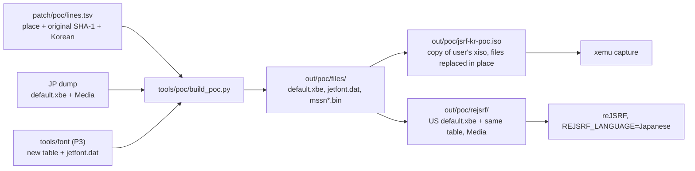

# 설계: 개념 증명 — 미션 한 줄과 메뉴 한 줄 한국어 (issue #8, P4)

근거: [PLAN §5 P4](../PLAN.md), [analysis/text-renderer.md](../analysis/text-renderer.md), [design i006](20261020-i006-korean-font.md)(A′ 글꼴).

## 1. 목표와 범위

* P2·P3의 결과(글리프 표 `0x1F7088` 데이터 패치, 새 `jetfont.dat`)로 **한글이 실제 화면에 나오는지** 확인한다.
* 문장은 **제자리 교체**만 한다. 한국어 바이트열이 원문 문자열보다 짧거나 같고, 남는 바이트는 NUL로 채운다. 파일 크기·오프셋·참조는 바뀌지 않는다. 길이가 바뀌는 재삽입은 P5다.
* 패치 도구 전체(`tools/patch.py`, 패치 데이터 형식 확정)는 P1(issue #2)이다. P4는 그 재료가 될 모듈(XDVDFS 읽기·제자리 교체, 한국어 인코더)과 개념 증명 명령줄만 만든다.

## 2. 바꿀 문장

미션 목표(확인됨, 이번 조사): 미션 파일 `Media/Mission/mssn####.bin`에는 `NORM` 머리가 없다. 목표 문장은 일본어 문자열 NUL, 영어 문자열 NUL의 짝으로 들어 있고, 앞쪽에 오프셋 표로 보이는 값들이 있다. 첫 미션 목표 "“ドーゲン坂”をグラフィティで…"는 `mssn0110.bin` 한 곳에만 있다("ドーゲン坂"가 들어간 `mssn0112`·`0721`·`0921`의 문장은 다른 미션(레이스)이다). 이 파일이 첫 미션에서 읽히는지는 화면으로 확인한다(**미확정**). 영어 문자열은 그대로 둔다.

메뉴(XBE `.rdata`): 화면에 어느 것이 나오는지 아직 모르므로(**미확정**) 짧은 후보 몇 개를 함께 바꾸고 화면에서 확인한다.

| 위치 | 원문 길이 | 한국어(시험 문장) | 바이트 |
|---|---|---|---|
| `mssn0110.bin` 목표(파일 위치 `0x2228C`) | 42 | “도겐자카”를 그래피티로 칠해라！ | 34 |
| XBE `.rdata` VA `0x1D35F4`(도겐자카 목표, 따옴표 없음) | 38 | 도겐자카를 그래피티로 칠해라！ | 30 |
| XBE VA `0x1D2C8C` "Ｂ…モドる" | 16 | Ｂ로 돌아가기 | 13 |
| XBE VA `0x1D29E0` "セーブ" | 6 | 저장 | 4 |
| XBE VA `0x1D24C8` "ガレージに…" | 16 | 차고로 돌아가기 | 15 |
| XBE VA `0x1D24DC` "タイトルに…？" | 18 | 타이틀로 갈까？ | 15 |

* 한글은 P3 고정 규칙(`가` = `0x8890` …)으로 2바이트 코드가 된다. 띄어쓰기는 1바이트 공백 `0x20`(약 11픽셀)을 쓴다. `“ ” ！ Ｂ`는 원래 표에 남겨 둔 기호·영문 칸이다.
* 표에 없는 코드가 나오지 않는지 인코더가 검사한다(KS X 1001 밖 음절, 표에서 뺀 한자·기호는 거부).

## 3. 패치 데이터 `patch/poc/lines.tsv`

열: `file`(덤프 기준 경로), `where`(`off:0x…` 파일 위치 또는 `va:0x…` XBE 가상 주소), `orig_len`(원문 바이트 수, NUL 제외), `orig_sha1`(원문 바이트의 SHA-1), `korean`(UTF-8). 원문은 넣지 않는다. 도구는 그 자리의 바이트가 해시와 같고 바로 뒤가 NUL일 때만 바꾼다. 이 형식은 P1에서 정식 형식을 정할 때 참고안이다.

## 4. 만드는 과정 (`tools/poc/build_poc.py <JP 덤프> <JP xiso> <US XBE> <출력 out/poc>`)

1. 입력 검증: JP `default.xbe`(`d8490cdb…`), `jetfont.dat`(`bc566ef5…`), US XBE(`f4e366bf…`) MD5. xiso 안의 `default.xbe`·`jetfont.dat`·바꿀 미션 파일이 덤프의 같은 파일과 MD5가 같은지 확인한다.
2. 글꼴: `lines.tsv`의 한국어에서 음절을 모아 P3 모듈로 새 표와 `jetfont.dat`를 만든다.
3. 문장: 미션 파일과 XBE `.rdata`에 제자리 교체한다. XBE는 바꾼 섹션(`.data`, `.rdata`)의 SHA-1 요약값을 다시 계산한다(P3에서 확인한 규칙).
4. xemu용: 사용자 xiso를 `out/poc/`로 복사하고, XDVDFS 디렉터리에서 파일을 찾아 **같은 크기로** 내용만 덮어쓴다. 크기가 다르면 멈춘다.
5. reJSRF용: US XBE에 같은 글리프 표·부류 시작 순번(같은 VA)을 쓰고 `.data` 요약값을 고친다. US판 표의 원래 바이트가 JP판과 같은지 해시로 확인한다. `Media`는 바꾼 파일만 새로 쓰고 나머지는 하드링크로 둔다(디스크 절약, reJSRF는 게임 폴더에 쓰지 않는다고 본다(**추정**)). US XBE의 메뉴 문자열은 주소가 달라 이번에는 바꾸지 않는다(P8 이후). 대신 reJSRF에 일본판 빌드(`build/win32_x86_jp`, reJSRF #108)가 생겼으므로, 패치한 일본판 XBE를 같은 폴더에 `default_jpn.xbe`로 두고 그 빌드에서 `--xbe default_jpn.xbe`로 실행하면 메뉴 문자열까지 볼 수 있다. reJSRF는 XBE를 MD5가 아니라 인증서 값으로 알아보므로 패치한 XBE도 받는다(reJSRF `IdentifyXbe`).
6. 출력 파일 MD5 목록을 낸다. 같은 입력이면 같은 MD5다.

`tools/poc/xiso.py`(XDVDFS 읽기, 파일 찾기, 같은 크기 덮어쓰기)와 `tools/poc/encode.py`(한국어 → 게임 바이트열, 검사)는 표준 라이브러리만 쓰고, P1에서 패치 도구로 옮긴다.

## 5. 검증

1. 왕복: 문장 없이(`--identity`) 만들면 모든 출력 파일이 원본과 같다. 복사한 xiso의 MD5도 원본과 같다.
2. 바꾼 바이트 범위: 출력과 원본의 차이가 `lines.tsv`의 자리, 글리프 표·부류 순번, 섹션 요약값, `jetfont.dat` tex0~3 안에만 있다.
3. **xemu**(사용자 설치, `C:\emul\xbox\xemu-0.8.138-windows-x86_64`): `xemu.exe -dvd_path out/poc/jsrf-kr-poc.iso`로 실행해, 서명하지 않은 XBE가 뜨는지, 도겐자카 미션 시작과 메뉴에서 한글이 나오는지 캡처한다. 미션까지 진행은 사용자가 한다.
4. **reJSRF**: US 빌드는 `REJSRF_LANGUAGE=Japanese`로, 일본판 빌드는 `--xbe default_jpn.xbe`로 `out/poc/rejsrf`를 실행해 같은 문장을 본다.
5. `git status`에 `roms/`, `out/`, `work/`가 없다.

## 6. 위험

* XBE 서명: 머리 서명은 고칠 수 없다. xemu가 검사하지 않는다는 것은 **추정**이다. 막히면 xemu 설정이나 다른 방법을 찾는다.
* 미션 문장 뒤에 길이를 따로 쓰는 값이 있다면 NUL 채움이 문제가 될 수 있다(**미확정**). 화면에서 잘림이나 깨짐을 본다.
* 메뉴 후보가 글꼴이 아니라 그림(`SprNorm`)으로 그려지면 바뀌지 않는다. 그 경우 다른 후보를 고른다.

---

# Design: proof of concept — one mission line and one menu line in Korean (issue #8, P4)

Grounds: [PLAN §5 P4](../PLAN.md), [analysis/text-renderer.md](../analysis/text-renderer.md), [design i006](20261020-i006-korean-font.md) (font option A′).

## 1. Goal and scope

* Check that the P2 and P3 results (the glyph-table data patch at `0x1F7088`, the new `jetfont.dat`) **really put Hangul on screen**.
* Text is replaced **in place** only: the Korean bytes are no longer than the original string, and the rest is filled with NUL. File sizes, offsets and references do not change. Length-changing reinsertion is P5.
* The full patcher (`tools/patch.py`, the settled patch-data format) is P1 (issue #2). P4 builds the modules it will reuse (XDVDFS reading and in-place replacement, a Korean encoder) and a proof-of-concept command.

## 2. Lines changed

Mission objective (confirmed in this survey): mission files `Media/Mission/mssn####.bin` have no `NORM` header. Objectives sit as pairs of a Japanese string, NUL, an English string, NUL, with what look like offset tables before them. The first mission's objective "“ドーゲン坂”をグラフィティで…" is only in `mssn0110.bin` (the "ドーゲン坂" lines in `mssn0112`, `0721` and `0921` belong to other missions, races). Whether the first mission reads this file is checked on screen (**unresolved**). The English strings stay.

Menu (XBE `.rdata`): which of them appear on screen is not known yet (**unresolved**), so a few short candidates change together and the screen decides.

| Place | Original length | Korean (test line) | Bytes |
|---|---|---|---|
| objective in `mssn0110.bin` (file offset `0x2228C`) | 42 | “도겐자카”를 그래피티로 칠해라！ | 34 |
| XBE `.rdata` VA `0x1D35F4` (Dogenzaka objective, no quotes) | 38 | 도겐자카를 그래피티로 칠해라！ | 30 |
| XBE VA `0x1D2C8C` "Ｂ…モドる" | 16 | Ｂ로 돌아가기 | 13 |
| XBE VA `0x1D29E0` "セーブ" | 6 | 저장 | 4 |
| XBE VA `0x1D24C8` "ガレージに…" | 16 | 차고로 돌아가기 | 15 |
| XBE VA `0x1D24DC` "タイトルに…？" | 18 | 타이틀로 갈까？ | 15 |

* Hangul becomes two-byte codes by the fixed P3 rule (`가` = `0x8890` …). Word spaces are the single-byte space `0x20` (about 11 px). `“ ” ！ Ｂ` are symbol and Latin cells kept from the original table.
* The encoder checks that no code outside the table appears (syllables outside KS X 1001, and kanji or symbols dropped from the table, are refused).

## 3. Patch data `patch/poc/lines.tsv`

Columns: `file` (path in the dump), `where` (`off:0x…` file offset or `va:0x…` XBE virtual address), `orig_len` (original byte count, NUL excluded), `orig_sha1` (SHA-1 of the original bytes), `korean` (UTF-8). No original text. The tool replaces only when the bytes there match the hash and a NUL follows. This format is a draft for P1's settled format.

## 4. Build (`tools/poc/build_poc.py <JP dump> <JP xiso> <US XBE> <out/poc>`)

1. Input checks: MD5 of the JP `default.xbe` (`d8490cdb…`), `jetfont.dat` (`bc566ef5…`) and the US XBE (`f4e366bf…`). The xiso's `default.xbe`, `jetfont.dat` and changed mission files must match the dump's by MD5.
2. Font: collect the syllables of the Korean in `lines.tsv` and build the new table and `jetfont.dat` with the P3 modules.
3. Text: replace in place in the mission files and the XBE `.rdata`. In the XBE, recompute the SHA-1 digests of the changed sections (`.data`, `.rdata`) by the rule confirmed in P3.
4. For xemu: copy the user's xiso to `out/poc/`, find the files in the XDVDFS directory and overwrite their contents **at the same size**; stop if a size differs.
5. For reJSRF: write the same glyph table and class bases (same VAs) into the US XBE and fix its `.data` digest, after checking by hash that the US table's original bytes equal the JP ones. In `Media`, only changed files are written; the rest are hard links (saves disk; reJSRF is assumed not to write into the game folder (**inferred**)). The US XBE's menu strings sit at other addresses and are not changed this time (after P8). Instead, since reJSRF now has a Japanese build (`build/win32_x86_jp`, reJSRF #108), the patched Japanese XBE goes into the same folder as `default_jpn.xbe`, and that build run with `--xbe default_jpn.xbe` shows the menu strings too. reJSRF identifies an XBE by its certificate values rather than its MD5, so it accepts a patched one (reJSRF `IdentifyXbe`).
6. Print the output files' MD5s; the same input gives the same MD5s.

`tools/poc/xiso.py` (XDVDFS reading, file lookup, same-size overwrite) and `tools/poc/encode.py` (Korean → game bytes, with checks) use only the standard library and move into the patcher in P1.

## 5. Verification

1. Round trip: built without text (`--identity`), every output file equals the original, and the copied xiso's MD5 equals the original.
2. Changed byte ranges: the output differs from the original only at the `lines.tsv` places, the glyph table and class bases, the section digests, and tex0–3 of `jetfont.dat`.
3. **xemu** (installed by the user, `C:\emul\xbox\xemu-0.8.138-windows-x86_64`): run `xemu.exe -dvd_path out/poc/jsrf-kr-poc.iso`; capture whether the unsigned XBE boots and whether Hangul appears at the Dogenzaka mission start and in menus. The user plays up to the mission.
4. **reJSRF**: run `out/poc/rejsrf` with the US build and `REJSRF_LANGUAGE=Japanese`, or with the Japanese build and `--xbe default_jpn.xbe`, and look for the same lines.
5. `git status` shows no `roms/`, `out/` or `work/`.

## 6. Risks

* XBE signature: the header signature cannot be fixed. That xemu does not check it is **inferred**; if it blocks, look for an xemu setting or another way.
* If a separate length value follows a mission string, NUL padding could matter (**unresolved**); watch for truncation or garbage on screen.
* If a menu candidate is drawn as a picture (`SprNorm`) rather than with the font, it will not change; then pick another candidate.
