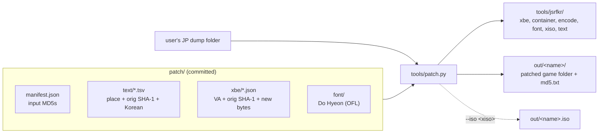

# 설계: 결과물 형식과 패치 도구 뼈대 (issue #2, P1)

근거: [PLAN §4, §5 P1](../PLAN.md), [analysis/containers.md](../analysis/containers.md)(이번 조사), [design i008](20261020-i008-poc.md)(개념 증명 도구), [design i006](20261020-i006-korean-font.md)(A′ 글꼴).

## 1. 목표와 범위

* 사용자가 자기 덤프에 돌려 패치된 게임 폴더를 만드는 **정식 패치 도구** `tools/patch.py`와, 그 입력인 **패치 데이터 형식**을 정한다.
* 도구 뼈대: XBE 읽기·쓰기(섹션 요약값 포함), `MULT`/`NORM` 컨테이너 읽기·다시 쓰기, 입력 MD5 검증, xiso 출력.
* 완료 기준(PLAN P1): 원문을 바꾸지 않고 다시 쓴 파일이 원본과 바이트 단위로 같다(왕복 시험).
* 범위 밖(P5): 이벤트 스크립트 항목·미션 파일·대화 이벤트 **안의** 문장 형식, 길이가 바뀌는 재삽입, 문장 추출. P1의 문장 패치는 P4와 같은 **제자리 교체**만 한다. 다만 자리를 `NORM` 항목 기준으로도 적을 수 있게 해서, P5가 같은 형식 위에 길이 변경을 더하게 한다.

## 2. 구조



### 2.1 공용 모듈 `tools/jsrfkr/` (새 패키지)

지금 흩어진 모듈을 한 패키지로 모은다. 분석·글꼴·개념 증명 도구는 이 패키지를 가져다 쓰고, 같은 코드를 두 벌 두지 않는다.

| 모듈 | 내용 | 출처 |
|---|---|---|
| `xbe.py` | XBE 읽기, VA ↔ 파일 위치, 섹션 SHA-1 요약값 다시 계산 | `tools/analysis/xbe.py` + `build_font.fix_digests` |
| `container.py` | `MULT`/`NORM` 읽기(트리), 다시 쓰기(연결·패딩·깃발 계산), 항목 경로로 찾기 | 새로 |
| `encode.py` | 한국어 → 게임 바이트열 | `tools/poc/encode.py` |
| `xiso.py` | XDVDFS 읽기, 같은 크기 덮어쓰기 | `tools/poc/xiso.py` |
| `textpatch.py` | `text/*.tsv` 읽기와 제자리 교체(`off:`, `va:`, `norm:` 자리) | `tools/poc/build_poc.py`의 `read_lines`·`apply_lines` |
| `digest.py` | MD5·SHA-1 도우미, `manifest.json` 검증 | 새로 |

* 글꼴 모듈(`tools/font/*.py`)은 자리를 옮기지 않는다. 지금도 독립된 패키지 역할을 하고, 옮기면 P3 기록과 경로가 어긋난다. `tools/patch.py`가 `tools/font`를 가져다 쓴다.
* `tools/analysis/xbe.py`, `tools/poc/encode.py`, `tools/poc/xiso.py`는 지우고, 쓰는 곳의 `import`를 `jsrfkr`로 바꾼다. 바꾼 뒤 `build_font.py`, `build_poc.py`, 분석 스크립트의 출력 MD5가 그대로인지 확인한다.

### 2.2 컨테이너 모듈 (`container.py`)

[analysis/containers.md](../analysis/containers.md) §1의 형식을 그대로 구현한다.

* `parse(data) -> Block`: `Block(magic, items)`. `MULT`의 항목은 `Block`, `NORM`의 항목은 `bytes`. 형식에 맞지 않으면(연결이 어긋남, 끝이 맞지 않음, 0이 아닌 패딩) 예외로 멈춘다.
* `build(block) -> bytes`: 연결의 `start`/`end`/`size`, `NORM` 패딩(16바이트 경계까지 0), `flag`(길이 0이면 1)를 계산해서 쓴다. 원본 바이트를 보관하지 않는다.
* 항목 경로: `2/0`은 "맨 위 블록의 항목 2(블록) 안의 항목 0". 경로 끝은 `NORM` 항목(데이터)이다.

### 2.3 도구 `tools/patch.py`

```text
python -I tools/patch.py <덤프 폴더> <출력 폴더(out/ 아래)>
    [--text <파일 또는 폴더>]   기본 patch/text
    [--iso <사용자 xiso>]       출력 폴더 옆에 <출력>.iso를 만든다
    [--copy]                    바뀌지 않은 파일을 하드링크 대신 복사
    [--identity]                원래 글리프 표, 문장·XBE 패치 없이(왕복 시험)
```

1. **검증**: 출력 폴더가 저장소 `out/` 아래인지, 비어 있거나 없는지 확인한다. `manifest.json`의 MD5(일본판 `default.xbe`, `jetfont.dat`, 문장 패치가 건드리는 파일 전부)를 덤프와 비교한다. 하나라도 다르면 아무것도 쓰지 않고 멈춘다.
2. **글꼴**: 문장 패치의 한국어에서 음절을 모아 P3 모듈로 새 글리프 표와 `jetfont.dat`를 만든다.
3. **문장**: 자리마다 원문 SHA-1을 확인하고 제자리 교체한다. `norm:` 자리는 컨테이너를 읽어 항목 안에서 바꾸고 다시 쓴다(P1에서는 길이가 같으므로 결과는 그 자리 바이트만 바뀐다).
4. **XBE**: 글리프 표·부류 순번, `xbe/*.json` 패치(있으면), 문장 패치의 `va:` 자리를 쓰고, 바뀐 섹션의 요약값을 다시 계산한다.
5. **출력**: 덤프 폴더 전체를 출력 폴더로 옮겨 만든다. 바뀐 파일은 새로 쓰고, 나머지는 하드링크(기본, 같은 드라이브일 때) 또는 복사(`--copy`, 하드링크가 안 되면 자동)다. `--iso`이면 P4처럼 xiso를 복사해 바뀐 파일을 같은 크기로 덮어쓴다(크기가 다르면 멈춘다).
6. **목록**: 바뀐 파일과 그 MD5를 화면과 `<출력>/md5.txt`에 쓴다. 같은 입력이면 같은 MD5다.

* 입력 폴더에는 쓰지 않는다. 하드링크는 같은 파일을 가리키므로, 출력 폴더의 바뀌지 않은 파일을 고치면 덤프도 바뀐다. 이 점을 사용법에 적고, 걱정되면 `--copy`를 쓰게 한다.
* 개념 증명 도구 `build_poc.py`는 남긴다(reJSRF용 US XBE 폴더를 만드는 기능이 있다). 내부는 `jsrfkr`를 쓰도록 고친다.

## 3. 패치 데이터 형식 (`patch/`)

| 경로 | 형식 | 내용 |
|---|---|---|
| `manifest.json` | JSON | 형식 버전, 대상(일본판 `default.xbe` MD5), 입력 파일별 MD5(덤프 기준 경로 → MD5) |
| `text/*.tsv` | UTF-8 TSV | 문장 패치. 여러 파일을 파일 이름 순서로 읽는다 |
| `xbe/*.json` | JSON | XBE 바이트 패치(코드·자료). 지금은 없다. 형식만 정한다 |
| `font/` | TTF + 라이선스 | 지금 그대로(Do Hyeon, OFL) |
| `poc/lines.tsv` | `text/*.tsv`와 같은 형식 | P4 시험 문장. 정식 패치가 아니므로 `text/`에 두지 않는다 |

### 3.1 `text/*.tsv`

P4의 `lines.tsv`를 그대로 정식 형식으로 삼고 자리 표기 하나를 더한다.

| 열 | 뜻 |
|---|---|
| `file` | 덤프 기준 경로(`default.xbe`, `Media/...`) |
| `where` | `off:0x…`(파일 위치), `va:0x…`(XBE 가상 주소), `norm:<항목 경로>+0x…`(컨테이너 항목 안 위치, 새로) |
| `orig_len` | 원문 바이트 수(NUL 제외) |
| `orig_sha1` | 원문 바이트의 SHA-1. 원문은 넣지 않는다 |
| `korean` | 한국어(UTF-8) |
| `pad` | `nul`(기본) 또는 `space` |

* `#`로 시작하는 줄은 설명이다. 같은 자리를 두 번 적으면 멈춘다.
* `norm:` 자리는 컨테이너 파일(`e###.dat` 등)에서 쓰고, `off:`는 컨테이너가 아닌 파일(미션, 대화 이벤트)과 예외적인 경우에 쓴다. P5에서 문장 추출이 생기면 "레코드·메시지 번호" 자리를 더할 수 있다(이 표에 열을 더하지 않고 `where` 표기를 늘린다).

### 3.2 `manifest.json`

```json
{
  "format": 1,
  "target": {"file": "default.xbe", "md5": "d8490cdb75bd47b36c62effdf1461ae0"},
  "inputs": {
    "default.xbe": "d8490cdb75bd47b36c62effdf1461ae0",
    "Media/Font/jetfont.dat": "bc566ef593dbf603e5332a7af346e2c8"
  }
}
```

* 문장 패치가 건드리는 파일은 `inputs`에 반드시 있어야 한다. 없으면 도구가 멈추고 그 파일 이름을 알린다. `tools/patch.py --update-manifest`가 덤프에서 MD5를 읽어 빠진 항목을 채운다(일본판 `default.xbe` MD5가 맞을 때만).
* MD5는 원본 파일을 알아보는 값일 뿐 원본 바이트가 아니다.

### 3.3 `xbe/*.json`

```json
{
  "reason": "why this change is needed",
  "patches": [
    {"va": "0x001F7088", "orig_sha1": "…", "bytes": "…hex…"}
  ]
}
```

* 우리가 쓴 바이트만 넣는다. 원래 바이트는 SHA-1로만 확인한다. 같은 자리를 두 파일이 바꾸면 멈춘다.
* 글리프 표는 도구가 문장에서 계산하므로 여기 넣지 않는다.

### 3.4 PLAN §4와 다른 점

* `glyphs`(음절 목록과 칸 배치)는 파일로 두지 않는다. P3에서 배치가 문장의 음절 집합만으로 정해지도록 했으므로(같은 입력 → 같은 표), 파일로 두면 두 곳이 어긋날 수 있다.
* 출력은 "게임 폴더 복사"가 기본이 아니라 하드링크가 기본이다(2.4GB를 매번 복사하지 않기 위해). 복사는 `--copy`.

## 4. 검증

1. **단위 시험**(게임 자료 없이, `tests/`, 표준 `unittest`): 컨테이너 왕복(합성 데이터: 빈 `NORM`, 길이 0 항목, 중첩 `MULT`, 길이를 바꾼 항목의 연결 재계산), 형식 오류 검출, `text` TSV 읽기(중복·잘못된 자리), 인코더.
2. **덤프 왕복** `tools/check_roundtrip.py <덤프>`: `MULT`/`NORM` 파일 1,056개 읽기 → 다시 쓰기가 원본과 같은지, XBE 요약값을 다시 계산해도 같은지. 원문은 출력하지 않는다.
3. **도구 왕복** `tools/patch.py --identity`: 출력 폴더의 모든 파일이 덤프와 MD5가 같다. `--iso`의 xiso 사본도 같다.
4. **P4 재현**: `tools/patch.py --text patch/poc/lines.tsv`의 출력 `default.xbe`, `jetfont.dat`, `mssn0110.bin`, `TE014.bin` MD5가 P4 로그 값과 같다. 같은 패치를 `norm:` 표기로 적은 시험 줄 하나(이벤트 파일)를 단위 시험이 아니라 이 단계에서 확인한다.
5. **모듈 이동**: `build_font.py`(P3 로그 MD5), `build_poc.py`(P4 로그 MD5), `font_tables.py` 등 분석 스크립트 출력이 이동 전과 같다.
6. `git status`에 `roms/`, `out/`, `work/`가 없다.

화면 확인은 P1의 완료 기준이 아니다. 출력이 P4와 같은 MD5이면 P4의 화면 결과가 그대로 적용된다.

## 5. 위험

* 하드링크 출력을 사용자가 고치면 덤프도 바뀐다(§2.3). 사용법에 적고 `--copy`를 둔다.
* 컨테이너 필드 중 게임 코드로 확인하지 않은 것(머리의 0 필드, `flag`)은 관측대로 쓴다. P1에서는 길이가 바뀌지 않으므로 영향이 없다. P5에서 길이를 바꿀 때 화면으로 확인한다.
* `manifest.json`에 파일을 빠뜨리면 검증 없이 쓰게 되므로, 도구가 문장 패치의 파일이 `inputs`에 모두 있는지 먼저 본다.

---

# Design: deliverable format and patcher skeleton (issue #2, P1)

Basis: [PLAN §4, §5 P1](../PLAN.md), [analysis/containers.md](../analysis/containers.md) (this survey), [design i008](20261020-i008-poc.md) (proof-of-concept tool), [design i006](20261020-i006-korean-font.md) (the A′ font).

## 1. Goal and scope

* Settle the **patcher** `tools/patch.py`, which users run on their own dump to make a patched game folder, and the **patch data format** it reads.
* Tool skeleton: XBE reading and writing (with section digests), `MULT`/`NORM` container reading and rewriting, input MD5 checks, xiso output.
* Done when (PLAN P1): files rewritten without changes equal the originals byte for byte (round trip).
* Out of scope (P5): the text format **inside** event script items, mission files and talk events; reinsertion with changed lengths; text extraction. P1's text patches are **in-place replacement** as in P4, but places can also be written relative to a `NORM` item, so P5 adds length changes on the same format.

## 2. Structure

(The diagram above shows `patch/` data and the user's dump feeding `tools/patch.py`, which uses `tools/jsrfkr/` and writes the output folder and optionally an xiso.)

### 2.1 Shared modules `tools/jsrfkr/` (a new package)

The scattered modules move into one package; the analysis, font and proof-of-concept tools import it, with no second copy of any code.

| Module | Content | From |
|---|---|---|
| `xbe.py` | XBE reading, VA ↔ file offset, recomputing section SHA-1 digests | `tools/analysis/xbe.py` + `build_font.fix_digests` |
| `container.py` | `MULT`/`NORM` reading (tree), rewriting (links, padding, flags computed), lookup by item path | new |
| `encode.py` | Korean → game bytes | `tools/poc/encode.py` |
| `xiso.py` | XDVDFS reading, same-size overwrite | `tools/poc/xiso.py` |
| `textpatch.py` | reading `text/*.tsv` and in-place replacement (`off:`, `va:`, `norm:` places) | `read_lines` and `apply_lines` of `tools/poc/build_poc.py` |
| `digest.py` | MD5 and SHA-1 helpers, `manifest.json` checks | new |

* The font modules (`tools/font/*.py`) stay where they are: they already work as a self-contained package, and moving them would break paths in the P3 record. `tools/patch.py` imports `tools/font`.
* `tools/analysis/xbe.py`, `tools/poc/encode.py` and `tools/poc/xiso.py` are removed and their users import `jsrfkr` instead; afterwards the output MD5s of `build_font.py`, `build_poc.py` and the analysis scripts are checked unchanged.

### 2.2 Container module (`container.py`)

Implements the format of [analysis/containers.md](../analysis/containers.md) §1 as it is.

* `parse(data) -> Block`: `Block(magic, items)`; `MULT` items are `Block`s, `NORM` items are `bytes`. Anything off-format (mismatched link, wrong end, non-zero padding) raises and stops.
* `build(block) -> bytes`: computes the links' `start`/`end`/`size`, `NORM` padding (zeros to a 16-byte boundary) and `flag` (1 for length 0); keeps no original bytes.
* Item paths: `2/0` is "item 0 inside item 2 (a block) of the top-level block"; a path ends at a `NORM` item (data).

### 2.3 Tool `tools/patch.py`

(Usage above.)

1. **Checks**: the output folder is under the repository's `out/` and empty or absent; the MD5s in `manifest.json` (the Japanese `default.xbe`, `jetfont.dat`, every file the text patches touch) match the dump. Any mismatch stops it before anything is written.
2. **Font**: collect the syllables of the text patches' Korean and build the new glyph table and `jetfont.dat` with the P3 modules.
3. **Text**: check each place's original SHA-1 and replace in place. A `norm:` place reads the container, replaces inside the item and rewrites it (in P1 the length is the same, so only the bytes at that place change).
4. **XBE**: write the glyph table and class first indexes, any `xbe/*.json` patches and the text patches' `va:` places, then recompute the changed sections' digests.
5. **Output**: build the output folder from the whole dump folder; changed files are written anew, the rest hard-linked (the default, on the same drive) or copied (`--copy`, or automatically when hard links fail). With `--iso`, copy the xiso and overwrite the changed files at the same size as in P4 (a size change stops it).
6. **List**: print the changed files and their MD5s and write them to `<output>/md5.txt`; the same input gives the same MD5s.

* The input folder is never written. A hard link is the same file, so editing an unchanged file in the output also changes the dump; the usage says so and offers `--copy`.
* The proof-of-concept `build_poc.py` stays (it builds the reJSRF folder with the US XBE) and is changed to use `jsrfkr` inside.

## 3. Patch data format (`patch/`)

| Path | Format | Content |
|---|---|---|
| `manifest.json` | JSON | format version, target (the Japanese `default.xbe` MD5), MD5 per input file (dump path → MD5) |
| `text/*.tsv` | UTF-8 TSV | text patches; several files are read in file-name order |
| `xbe/*.json` | JSON | XBE byte patches (code and data); none yet, only the format is settled |
| `font/` | TTF + license | as now (Do Hyeon, OFL) |
| `poc/lines.tsv` | the format of `text/*.tsv` | the P4 test lines; not a real patch, so not under `text/` |

### 3.1 `text/*.tsv`

P4's `lines.tsv` becomes the format as it is, with one more kind of place.

| Column | Meaning |
|---|---|
| `file` | path in the dump (`default.xbe`, `Media/...`) |
| `where` | `off:0x…` (file offset), `va:0x…` (XBE virtual address), `norm:<item path>+0x…` (offset inside a container item; new) |
| `orig_len` | original byte count (NUL excluded) |
| `orig_sha1` | SHA-1 of the original bytes; the original text is not stored |
| `korean` | Korean (UTF-8) |
| `pad` | `nul` (the default) or `space` |

* Lines starting with `#` are comments; a place written twice stops the tool.
* `norm:` places are for container files (`e###.dat` and the like); `off:` is for non-container files (missions, talk events) and exceptions. When P5 brings text extraction, a "record and message number" place can be added (by extending the `where` notation, not by adding columns).

### 3.2 `manifest.json`

(Example above.)

* Every file the text patches touch must be in `inputs`; otherwise the tool stops and names the file. `tools/patch.py --update-manifest` fills missing entries with MD5s read from the dump (only when the Japanese `default.xbe` MD5 matches).
* An MD5 only identifies the original file; it is not original bytes.

### 3.3 `xbe/*.json`

(Example above.)

* Only bytes we wrote go in; the original bytes are checked by SHA-1 only. Two files changing the same place stop the tool.
* The glyph table is computed by the tool from the text and does not go here.

### 3.4 Differences from PLAN §4

* `glyphs` (the syllable list and cell layout) is not kept as a file: P3 made the layout depend only on the text's syllable set (same input → same table), so a file could drift from it.
* The output defaults to hard links rather than "copying the game folder" (to avoid copying 2.4 GB each time); `--copy` copies.

## 4. Verification

1. **Unit tests** (no game data, `tests/`, standard `unittest`): container round trips on synthetic data (empty `NORM`, length-0 items, nested `MULT`, link recomputation after an item's length changes), malformed-input detection, `text` TSV reading (duplicates, bad places), the encoder.
2. **Dump round trip** `tools/check_roundtrip.py <dump>`: reading and rewriting the 1,056 `MULT`/`NORM` files equals the originals, and recomputing the XBE digests changes nothing; no original text is printed.
3. **Tool round trip** `tools/patch.py --identity`: every file in the output folder has the dump's MD5, and so does the `--iso` xiso copy.
4. **P4 reproduction**: the output `default.xbe`, `jetfont.dat`, `mssn0110.bin` and `TE014.bin` of `tools/patch.py --text patch/poc/lines.tsv` have the MD5s of the P4 log; one test line written with a `norm:` place (an event file) is checked at this step.
5. **Module move**: the outputs of `build_font.py` (P3 log MD5s), `build_poc.py` (P4 log MD5s), `font_tables.py` and the other analysis scripts are unchanged by the move.
6. `git status` shows no `roms/`, `out/` or `work/`.

A screen check is not part of P1's done criterion: output with P4's MD5s carries P4's screen results.

## 5. Risks

* Editing hard-linked output also edits the dump (§2.3); the usage says so and offers `--copy`.
* Container fields not checked against game code (the header's zero fields, `flag`) are written as observed; P1 changes no lengths, so this has no effect yet. P5 checks on screen when lengths change.
* A file missing from `manifest.json` would be written unchecked, so the tool first checks that every file of the text patches is in `inputs`.
