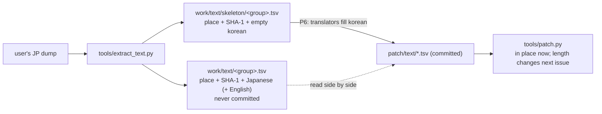
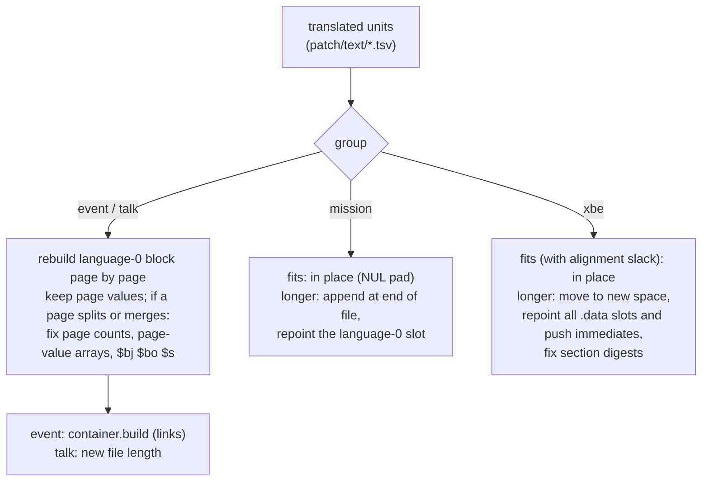

# 설계: 문장 형식 분석과 추출 (issue #11, P5-1)

근거: [PLAN §5 P5](../PLAN.md), [design i002](20261021-i002-patcher.md)(패치 데이터 형식, `text/*.tsv`), [analysis/containers.md](../analysis/containers.md), [analysis/text-files.md](../analysis/text-files.md), [analysis/text-renderer.md](../analysis/text-renderer.md). 이번 조사 결과는 새 분석 문서 세 개([message-script.md](../analysis/message-script.md), [mission-files.md](../analysis/mission-files.md), [xbe-strings.md](../analysis/xbe-strings.md))에 둔다.

## 1. 목표와 범위

* P5(문장 파이프라인)의 앞 절반이다. **문장 형식 분석**과 **추출**만 하고, 길이가 바뀌는 재삽입은 다음 issue에서 한다.
* 분석의 목표: 문장 하나의 길이가 바뀔 때 **무엇을 다시 계산해야 하는지** 정확히 안다(§2).
* 추출 도구: 화면에 나오는 일본어 문장 전부를 자리(`off:`/`va:`/`norm:`)와 SHA-1과 함께 `work/`(커밋 안 함)에 쓴다. 원문 없이 자리·해시·한국어만 담는 **번역 파일 뼈대**를 함께 만든다(§3).
* 범위 밖: 재삽입(§4에 필요한 것만 적는다), 번역(P6), 글자 그림(P7), US판 XBE 문자열 주소(P8).

## 2. 분석 결과: 길이가 바뀔 때 다시 계산할 것

자세한 근거는 분석 문서에 있다. 여기서는 재삽입이 의존하는 결론만 모은다.

| 묶음 | 파일 | 문장의 형식 | 길이가 바뀌면 | 상태 |
|---|---|---|---|---|
| 이벤트 | `Media/Event/Event/e###.dat` 항목 `2/0` (117개) | **메시지 스크립트**: `u32` 머리 9개, (언어 × 메시지)마다 필드 5개(첫 필드 = 페이지 수), 페이지마다 `u32` 값 하나, 이어서 문장이 항목 끝까지(NUL 없음) | 페이지 수가 같으면 머리는 그대로이고 컨테이너 연결만 다시 계산(`container.build`). 페이지 수가 바뀌면 그 (언어, 메시지)의 페이지 수와 페이지별 값 배열(머리 길이가 바뀜) | 확인됨(117/117) |
| 대화 | `Media/Event/TalkEvent/TE###.bin` (251개) | 같은 메시지 스크립트가 파일 전체. 언어마다 메시지가 하나이고 그 안이 `$e$r`로 나뉜다. 첫 페이지는 분기 페이지(`$p$bc N$bj N…$bo N`), `$s X Y`는 선택지 페이지. `$bj` `$bo` `$s`의 인자는 **같은 언어 구간 안의 페이지 번호**(1바이트 2진값, 그래서 `0x01`·`0x00`이 나온다) | 페이지 수가 같으면 파일 크기만 바뀐다. 페이지 수가 바뀌면 위의 머리 값과 함께 그 언어 구간의 `$bj` `$bo` `$s` 인자 | 형식 확인됨(251/251), 인자 = 페이지 번호는 추정(정황 강함) |
| 미션 | `Media/Mission/mssn####.bin` (248개에 문장) | 머리 `0x220`(구역 표: 오프셋·개수 쌍)와 구역들. 문장은 **명령 레코드**(구역 `0x174` `0x17C` `0x184` `0x18C`: 0x54바이트, 구역 `0x194`: 0x44바이트) 가운데 문장 명령(`0xBE 0xBF 0xC0 0xE8 0xE9 0xEA 0xEF`)의 **언어별 포인터 7칸**이 가리키는 NUL 종료 문자열. 포인터는 파일 위치이고 게임이 읽은 뒤 `0x4DB30`에서 주소로 바꾼다 | 원래 자리에 들어가면(NUL로 채움) 그대로. 길면 **파일 끝에 붙이고 언어 0 포인터만 고친다**. 로더(`0x25DD0`)가 파일 크기만큼 버퍼를 잡으므로 파일이 커져도 된다 | 확인됨(정적, 4,718개 포인터) |
| XBE | `default.xbe` `.rdata` (651개) | NUL 종료 Shift-JIS. `.data`의 포인터 칸 1,083개와 `.text`의 `push` 즉치 23곳이 가리킨다. 문자열 중간을 가리키는 참조는 없다 | 원래 자리 + 뒤의 정렬 여백(모두 1,343바이트)에 들어가면 그대로. 길면 새 자리(새 섹션 등)로 옮기고 **그 문자열의 참조 전부**(포인터 칸, `push` 즉치)를 고친다 | 확인됨(정적) |

* 네 곳 밖의 `Media`에는 화면 문장이 없다(가나가 연속으로 나오는 다른 파일은 `Effect/ptcl*.dat`의 개발자 경로 문자열과 2진 자료뿐).
* 코드 주소(`0x25DD0`, `0x3055A`, `0x4DB30`과 점프 표)는 US판에서도 같은 주소, 같은 바이트다(같은 주소 바이트 비교).

## 3. 추출 도구

### 3.1 모듈

[AGENTS 구현 규칙](../../AGENTS.md)대로 형식마다 모듈을 나눈다.

| 모듈 | 내용 |
|---|---|
| `tools/jsrfkr/msgscript.py` | 메시지 스크립트 읽기·다시 쓰기: 머리, 필드, 페이지별 값, `$` 코드 토큰(`$b?`·`$s`의 2진 인자 포함), 언어 → 메시지 → 페이지 나누기(바이트 위치 포함). `build()`는 읽은 값으로 원래 바이트를 다시 만든다(왕복). |
| `tools/jsrfkr/mission.py` | 미션 파일: 구역 표, 명령 레코드, 문장 명령의 포인터 7칸과 그 문자열 |
| `tools/jsrfkr/xbetext.py` | XBE `.rdata`의 일본어 문자열 찾기(§3.3 규칙)와 참조(`.data` 포인터 칸, `push` 즉치) |
| `tools/jsrfkr/extract.py` | 위 셋으로 **문장 단위**(§3.2) 목록을 만든다. 자리, 길이, SHA-1, 채움 방식, 종류, 위치 설명, 일본어, 영어 |
| `tools/extract_text.py` | 명령줄 도구: `work/text/`에 쓰고 묶음별 개수를 출력한다 |

### 3.2 문장 단위와 자리

| 묶음 | 단위 | 자리(`where`) | `pad` | 제외 |
|---|---|---|---|---|
| `event` | 언어 0의 **페이지**(`$r` 사이, `$r` 제외) | `norm:2/0+0x…` | `space` | 글자가 없는 페이지(`$e` 페이지 등) |
| `talk` | 언어 0의 페이지 | `off:0x…` | `space` | 분기·선택지 페이지(`$p` `$b?` `$s`), 글자 없는 페이지 |
| `mission` | 문장 명령의 언어 0 문자열 전체 | `off:0x…` | `nul` | 빈 문자열, 글자 없는 문자열(`$r$e$r`만 있는 것 등) |
| `xbe` | `.rdata` 문자열 전체 | `va:0x…` | `nul` | 없음 |

* 페이지를 단위로 고른 이유: 이벤트·대화의 머리는 페이지마다 값이 있고, 분기 인자도 페이지 번호다. 페이지 단위면 번역문을 다시 넣을 때 그 구조를 그대로 다시 만들 수 있다. 자막 한 화면이 한 페이지이기도 하다.
* "글자가 있다" = `$` 코드와 공백을 빼고 1바이트 이상 남는다.
* 모든 단위는 지금의 `tools/patch.py` 자리 문법으로 그대로 쓸 수 있다(제자리 교체는 지금도 된다). 추출 도구는 끝에 각 단위를 `textpatch`의 자리 해석으로 다시 읽어 SHA-1이 맞는지 스스로 검사한다.

### 3.3 XBE 문자열을 고르는 규칙

`.rdata` 안에서 앞이 NUL이고 4바이트 정렬된 NUL 종료 문자열 가운데, cp932로 읽히고, 2바이트 글자(첫 바이트 `0x82`~`0x9F`)가 하나 이상 있고, 2바이트 글자가 둘 이상이거나 2바이트 글자 하나만으로 된 것. 이 규칙으로 651개가 나오고 모두 참조가 있다. 규칙에서 빠지는 `.rdata`·`.data`의 후보(글리프 표 항목, float 상수 등)는 모두 2진 자료다(분석 문서에 근거).

### 3.4 출력 (`work/text/`, 커밋하지 않음)

* `work/text/<group>.tsv`(UTF-8, LF, 정해진 순서): `file`, `where`, `orig_len`, `orig_sha1`, `pad`, `kind`, `ref`, `japanese`, `english`.
  * `kind`: `page`(이벤트·대화), `objective`(`0xEF`, 추정)·`message`(`0xBF` `0xC0`, 추정), `string`(XBE).
  * `ref`: 구조 위치. 이벤트·대화 `part 0 page 1`(부분 = 앞에 있는 `$e` 페이지 수, 페이지 = 언어 구간 안 번호로 분기 인자와 같은 번호), 미션 `sec 0x174 rec 5 op 0xef`, XBE `refs 2 data + 0 code`.
  * `japanese`: cp932로 푼 원문(`$` 코드 그대로). `english`: 대응하는 영어(미션은 언어 1 칸, 이벤트·대화는 같은 부분 번호의 영어 페이지를 `$r`로 이은 것, XBE는 비움).
  * 탭·줄바꿈·백슬래시는 `\t` `\n` `\\`로 쓴다(지금 덤프에는 없을 것으로 보이며, 나오면 개수를 보고한다).
* `work/text/skeleton/<group>.tsv`: **패치 형식 그대로**(`file`, `where`, `orig_len`, `orig_sha1`, `korean`, `pad`), `korean`은 비어 있다. 원문은 없다. `work/text/<group>.tsv`와 `file`+`where`로 맞춘다.
* `work/text/summary.txt`와 표준 출력: 묶음별 파일 수, 레코드 수, 단위 수, 바이트 수, 그리고 text-renderer.md의 레코드 2,933개와 비교하는 수(§5).

### 3.5 `textpatch`의 바뀌는 점

* **`korean`이 빈 줄은 건너뛴다**(번역하지 않음 = 원문 그대로). 그래야 뼈대 파일을 채우는 중에도 `patch.py`에 그대로 넣을 수 있다. 지금은 빈 `korean`이 원문을 지워 버린다. `patch/text/README.md`와 설계 i002 §3.1에 적는다.
* 뼈대를 `patch/text/`에 커밋하는 것은 이번 issue에서 하지 않는다. 다음 issue(재삽입)에서 단위나 자리 규칙이 바뀔 수 있으므로, 번역을 시작할 때(P6) 다시 만들어 넣는다.

### 3.6 단계별 가이드 (사용자 요구, 2026-10-21)

* 패치는 나중에 AI 도움 없이 **가이드와 저장소 도구만으로** 끝까지 만들 수 있어야 한다. 그래서 문장 파이프라인 전체(① 추출 → ② 번역 → ③ 재조합)를 `docs/guides/text-pipeline.md`에 단계별로 적는다: 정확한 명령, 입력과 출력 파일, 성공을 확인하는 법(개수, 해시, 자체 검사), 오류 메시지의 뜻, 번역 TSV를 채우는 규칙(`$` 코드, 쓸 수 있는 글자, 빈 칸 = 원문 유지).
* 아직 안 되는 단계(길이가 바뀌는 재삽입)는 "다음 issue에서 생긴다"고 적고, 지금 되는 방법(제자리 교체, 원문 길이 이하)을 함께 적는다. 단계가 생기는 issue마다 이 가이드를 갱신한다.
* 도구의 `--help`와 오류 메시지는 가이드가 그대로 가리킬 수 있게 쓴다.
* 이 원칙을 `AGENTS.md` 문서 작성 규칙에도 더한다(도구나 사용자 단계를 바꾸는 작업은 같은 작업에서 가이드를 갱신한다).

## 4. 재삽입(다음 issue)이 필요로 할 것

* **메시지 스크립트**: `msgscript.build()`가 머리를 값에서 다시 계산하게 한다. 번역문에 `$r`을 더 넣어 페이지를 나누는 것을 허용할지, 나눈 페이지의 값(표시 시간으로 보이는 값)을 어떻게 정할지(나눈 비율, 같은 값) 정한다. 페이지 수가 바뀌는 언어 구간에서는 분기 인자를 새 페이지 번호로 고친다. 영어 구간(언어 1)은 건드리지 않는다.
* **미션**: 붙인 문자열의 정렬(필요 없음으로 보임), 원래 자리를 비울지(남겨도 무방), HDD 캐시가 커진 파일을 다루는지 화면 확인이 필요하다.
* **XBE**: 새 자리 후보(섹션 끝 여백은 거의 없다 — `.rdata` 끝 0바이트 1개뿐 — 그래서 새 섹션이 유력), 섹션 추가 때 XBE 머리(섹션 수, 머리 크기, 이미지 크기)를 고치는 방법, 서명은 여전히 고치지 않는다(P4에서 Cxbx-Reloaded·xemu가 실행). `push` 즉치를 고치는 것은 원본 명령 바이트를 담지 않는 4바이트 주소 교체로 `xbe/*.json`과 같은 해시 검사를 거친다.
* **화면 폭**: 렌더러에 자동 줄바꿈이 없다(text-renderer §5). 재삽입 도구가 줄 폭(2바이트 24픽셀)과 페이지 길이(0x100바이트 버퍼)를 검사해 경고한다.
* **왕복**: 모든 단위를 원문 그대로 넣으면 원본과 바이트 단위로 같아야 한다(PLAN P5 완료 기준). 이번 issue의 `msgscript` 왕복이 그 바탕이다.

## 5. 2,933개 레코드와의 비교

text-renderer.md의 2,933개는 "NUL로 끝나고 `$e`가 든 문자열"을 정규식으로 센 수다(`text_codes.py`). 이번 형식 분석으로 그 수를 나누면 다음과 같다(조사 스크립트 값, 도구가 다시 센다).

| 묶음 | 정규식 레코드 | 형식으로 본 내용 |
|---|---|---|
| `Event/Event/*.dat` | 134 | 진짜 문장 117(항목 `2/0` 117개 = 이벤트 117개와 같다) + 2진 자료 17 |
| `Event/TalkEvent/*.bin` | 5 | 251개 파일 가운데 분기 인자에 `0x00`이 있어 정규식에 걸린 5개. 형식으로는 251개 |
| `Mission/*.bin` | 2,776 | 언어 0 문자열 406 + 다른 언어 칸 2,352 + 다른 언어 칸 문자열의 조각 13 + 참조 없는 `$e` 5. 포인터로 본 `$e` 문자열은 언어 0 406, 전체 2,771 |
| `Mission/*.dat` | 18 | 모두 2진 자료 |

* 비교할 수 있는 수: 이벤트 117(같음), 미션 언어 0의 `$e` 문자열 406(같음). 추출 도구가 이 두 수를 다시 세어 보고한다.

## 6. 검증

1. 단위 시험(게임 자료 없음): 합성한 메시지 스크립트의 읽기·왕복·페이지 위치, 2진 인자 토큰, 합성한 미션 파일의 포인터 찾기, 합성 XBE 바이트열의 문자열 규칙, `textpatch`의 빈 `korean` 건너뛰기.
2. 덤프: 이벤트 117개·대화 251개 메시지 스크립트가 모두 읽히고 `build()` 왕복이 원본과 같다. 미션 248개 파일의 포인터가 모두 문자열 시작을 가리킨다.
3. 덤프: 추출한 모든 단위가 `textpatch` 자리 해석으로 같은 SHA-1을 낸다(도구 자체 검사).
4. 덤프: 뼈대(빈 `korean`)로 `patch.py --text work/text/skeleton`을 돌리면 문장 파일이 하나도 바뀌지 않는다.
5. §5의 비교 수가 맞는다. 같은 덤프로 두 번 돌린 출력이 같다(재현성).
6. 커밋 전 `git status`에 `work/`, `out/`, `roms/`가 없다.
7. 가이드(`docs/guides/text-pipeline.md`)의 명령을 적힌 그대로 차례로 실행해 같은 결과가 나온다.

## 7. 위험

* 메시지 스크립트 머리의 나머지 값(머리 0·2·3번, 필드 2~5, 페이지별 값)의 뜻은 모른다. 머리 배치만으로 문장 시작이 정확히 맞고, 값들은 길이로 보이지 않지만(필드 2·3은 117개 모두 언어끼리 같다, 페이지별 값은 30·60 같은 값이고 메시지 마지막 페이지는 늘 0), 페이지를 나눌 때 값을 정하는 규칙은 화면 확인이 필요하다.
* 분기 인자가 페이지 번호라는 것은 정황(가리키는 페이지가 메시지 시작, 언어마다 다른 값)이다. 재삽입에서 페이지 수를 바꿀 때 화면으로 확인한다.
* XBE 문자열 규칙은 휴리스틱이다. 지금 덤프에서는 참조 없는 일본어 문자열이 없어 빠진 것이 없다고 보지만, 화면에서 번역되지 않은 문자열을 찾으면 규칙을 고친다.

---

# Design: text-format analysis and extraction (issue #11, P5-1)

Grounds: [PLAN §5 P5](../PLAN.md), [design i002](20261021-i002-patcher.md) (patch data format, `text/*.tsv`), [analysis/containers.md](../analysis/containers.md), [analysis/text-files.md](../analysis/text-files.md), [analysis/text-renderer.md](../analysis/text-renderer.md). This investigation's results go into three new analysis documents ([message-script.md](../analysis/message-script.md), [mission-files.md](../analysis/mission-files.md), [xbe-strings.md](../analysis/xbe-strings.md)).

## 1. Goal and scope

* The first half of P5 (the text pipeline): **text-format analysis** and **extraction** only; reinsertion with changed lengths is the next issue.
* The analysis aims to know exactly **what must be recomputed** when a string's length changes (§2).
* The extraction tool writes every on-screen Japanese string with its place (`off:`/`va:`/`norm:`) and SHA-1 to `work/` (never committed), together with a **translation skeleton** that carries only place, hash and Korean, no original text (§3).
* Out of scope: reinsertion (§4 records only what it needs), translation (P6), lettering pictures (P7), US addresses of XBE strings (P8).

(The diagram above: the dump goes through `tools/extract_text.py` into `work/text/<group>.tsv` and a skeleton; translators fill the skeleton into `patch/text/`, which `tools/patch.py` applies.)

## 2. Analysis results: what to recompute when a length changes

The evidence is in the analysis documents; only the conclusions reinsertion relies on are gathered here.

| Group | File | Text format | When a length changes | Status |
|---|---|---|---|---|
| event | `Media/Event/Event/e###.dat` item `2/0` (117) | a **message script**: 9 `u32` header values, 5 fields per (language × message) (the first = page count), one `u32` per page, then the text to the end of the item (no NUL) | same page count: the header stays and only the container links are recomputed (`container.build`); a changed page count changes that (language, message)'s page count and its per-page value array (the header length changes) | confirmed (117/117) |
| talk | `Media/Event/TalkEvent/TE###.bin` (251) | the same message script as the whole file; one message per language, split inside by `$e$r`; the first page is a branch page (`$p$bc N$bj N…$bo N`), `$s X Y` a choice page; the arguments of `$bj` `$bo` `$s` are **page numbers inside the same language block** (one binary byte each, hence the `0x01`/`0x00` bytes) | same page count: only the file size changes; a changed page count changes the header values above and that language block's `$bj` `$bo` `$s` arguments | format confirmed (251/251); arguments = page numbers inferred (strong evidence) |
| mission | `Media/Mission/mssn####.bin` (248 with text) | a `0x220` header (section table of offset/count pairs) and sections; the text is NUL-terminated strings pointed to by the **7 per-language pointer slots** of text commands (`0xBE 0xBF 0xC0 0xE8 0xE9 0xEA 0xEF`) in the **command records** (sections `0x174` `0x17C` `0x184` `0x18C`: 0x54 bytes; section `0x194`: 0x44 bytes); pointers are file offsets the game turns into addresses after loading (`0x4DB30`) | fits in place (NUL fill): unchanged; longer: **append at the end of the file and repoint only the language-0 slot**; the loader (`0x25DD0`) allocates the file's size, so the file may grow | confirmed (static, 4,718 pointers) |
| xbe | `default.xbe` `.rdata` (651) | NUL-terminated Shift-JIS, pointed to by 1,083 pointer slots in `.data` and 23 `push` immediates in `.text`; no reference points into the middle of a string | fits in place plus the alignment slack behind it (1,343 bytes in all): unchanged; longer: move to new space (a new section and the like) and fix **every reference of that string** (pointer slots, `push` immediates) | confirmed (static) |

* No other `Media` file holds on-screen text (the only other files with kana runs are `Effect/ptcl*.dat`, whose runs are developer path strings, and binary data).
* The code addresses (`0x25DD0`, `0x3055A`, `0x4DB30` and its jump tables) are at the same addresses with the same bytes in the US build (byte comparison at the same address).

## 3. The extraction tool

### 3.1 Modules

One module per format, as the [AGENTS implementation rules](../../AGENTS.md) ask.

| Module | Content |
|---|---|
| `tools/jsrfkr/msgscript.py` | message scripts: header, fields, per-page values, `$` code tokens (including the binary arguments of `$b?` and `$s`), language → message → page split with byte offsets; `build()` remakes the original bytes from the parsed values (round trip) |
| `tools/jsrfkr/mission.py` | mission files: section table, command records, the 7 pointer slots of text commands and their strings |
| `tools/jsrfkr/xbetext.py` | Japanese strings in the XBE's `.rdata` (rule of §3.3) and their references (`.data` pointer slots, `push` immediates) |
| `tools/jsrfkr/extract.py` | builds the list of **text units** (§3.2) from the three above: place, length, SHA-1, fill mode, kind, structural position, Japanese, English |
| `tools/extract_text.py` | the command-line tool: writes `work/text/` and prints counts per group |

### 3.2 Text units and places

| Group | Unit | Place (`where`) | `pad` | Left out |
|---|---|---|---|---|
| `event` | a language-0 **page** (between `$r`s, `$r` excluded) | `norm:2/0+0x…` | `space` | pages without letters (`$e` pages and so on) |
| `talk` | a language-0 page | `off:0x…` | `space` | branch and choice pages (`$p` `$b?` `$s`), pages without letters |
| `mission` | the whole language-0 string of a text command | `off:0x…` | `nul` | empty strings, strings without letters (only `$r$e$r` and the like) |
| `xbe` | the whole `.rdata` string | `va:0x…` | `nul` | none |

* Why pages: the event and talk headers carry a value per page, and the branch arguments are page numbers; with page units reinsertion can rebuild that structure. A page is also one subtitle screen.
* "Has letters" = at least one byte left after removing `$` codes and spaces.
* Every unit is usable as it is with today's `tools/patch.py` place syntax (in-place replacement already works). At the end the tool reads every unit back through `textpatch`'s place resolution and checks its SHA-1.

### 3.3 Rule for XBE strings

In `.rdata`: NUL-terminated strings that follow a NUL, are 4-byte aligned, decode as cp932, contain at least one double-byte character (lead byte `0x82`–`0x9F`), and have at least two double-byte characters or consist of a single one. The rule gives 651 strings, all referenced. The candidates it leaves out in `.rdata` and `.data` (glyph-table entries, float constants and so on) are all binary data (evidence in the analysis document).

### 3.4 Output (`work/text/`, never committed)

* `work/text/<group>.tsv` (UTF-8, LF, fixed order): `file`, `where`, `orig_len`, `orig_sha1`, `pad`, `kind`, `ref`, `japanese`, `english`.
  * `kind`: `page` (event, talk), `objective` (`0xEF`, inferred) or `message` (`0xBF` `0xC0`, inferred), `string` (XBE).
  * `ref`: structural position: `part 0 page 1` for events and talk (part = the number of `$e` pages before it; page = the number inside the language block, the same numbering branch arguments use), `sec 0x174 rec 5 op 0xef` for missions, `refs 2 data + 0 code` for the XBE.
  * `japanese`: the original decoded as cp932 (`$` codes kept). `english`: the English counterpart (the language-1 slot for missions; the English pages of the same part number joined with `$r` for events and talk; empty for the XBE).
  * Tabs, newlines and backslashes are written as `\t` `\n` `\\` (none expected in this dump; any found are counted).
* `work/text/skeleton/<group>.tsv`: **exactly the patch format** (`file`, `where`, `orig_len`, `orig_sha1`, `korean`, `pad`) with `korean` empty and no original text; matched to `work/text/<group>.tsv` by `file`+`where`.
* `work/text/summary.txt` and standard output: files, records, units and bytes per group, plus the numbers compared with text-renderer.md's 2,933 records (§5).

### 3.5 Change to `textpatch`

* **Rows with an empty `korean` are skipped** (untranslated = original kept), so a skeleton can go into `patch.py` while it is being filled; today an empty `korean` would blank the original. Recorded in `patch/text/README.md` and design i002 §3.1.
* The skeleton is not committed to `patch/text/` in this issue: the next issue (reinsertion) may change the unit or place rules, so it is regenerated when translation starts (P6).

### 3.6 Step-by-step guide (user requirement, 2026-10-21)

* The patch must later be completable **with the guides and the repository's tools alone**, without AI help. So the whole text pipeline (① extract → ② translate → ③ reassemble) is written step by step in `docs/guides/text-pipeline.md`: exact commands, input and output files, how to check success (counts, hashes, the self-check), what error messages mean, and the rules for filling the translation TSV (`$` codes, usable characters, empty = original kept).
* Steps not available yet (reinsertion with changed lengths) are marked as coming in the next issue, alongside what works now (in-place replacement up to the original length). Each issue that adds a step updates the guide.
* Tool `--help` texts and error messages are written so the guide can point at them as they are.
* The principle is added to the documentation rules of `AGENTS.md` (a task that changes a tool or a user step updates the guide in the same task).

## 4. What reinsertion (the next issue) needs

(The diagram above: event/talk units rebuild the language-0 block page by page; missions go in place or are appended and repointed; XBE strings go in place or move with every reference fixed.)

* **Message scripts**: `msgscript.build()` recomputes the header from values. Decide whether a translation may add `$r` to split a page and how the split page's value (apparently a display time) is set (by proportion, or copied). In a language block whose page count changes, branch arguments are renumbered. The English block (language 1) is left alone.
* **Missions**: alignment of appended strings (apparently unneeded), whether to clear the old place (harmless to keep), and a screen check that the HDD cache handles a grown file.
* **XBE**: where new space comes from (section-end slack is nearly nil — one zero byte at the end of `.rdata` — so a new section is likely), how the XBE header (section count, header size, image size) changes when a section is added; the signature stays unfixed (Cxbx-Reloaded and xemu ran it in P4). Fixing a `push` immediate is a 4-byte address change carrying no original instruction bytes, checked by hash like `xbe/*.json`.
* **Screen width**: the renderer never wraps (text-renderer §5); reinsertion warns on line width (24 px per double-byte character) and page length (the 0x100-byte buffer).
* **Round trip**: putting every unit back unchanged must equal the original byte for byte (PLAN P5's done criterion); this issue's `msgscript` round trip is its base.

## 5. Comparison with the 2,933 records

text-renderer.md's 2,933 are regex counts of "NUL-terminated strings containing `$e`" (`text_codes.py`). The format analysis splits them as follows (investigation-script values; the tool recounts them).

| Group | Regex records | What they are by format |
|---|---|---|
| `Event/Event/*.dat` | 134 | 117 real (the 117 `2/0` items = 117 events) + 17 binary |
| `Event/TalkEvent/*.bin` | 5 | the 5 of 251 files whose branch arguments contain `0x00`, which the regex caught; 251 by format |
| `Mission/*.bin` | 2,776 | 406 language-0 strings + 2,352 other-language slots + 13 fragments of other-language strings + 5 unreferenced `$e`; by pointers there are 406 `$e` strings in language 0 and 2,771 in all |
| `Mission/*.dat` | 18 | all binary |

* Comparable numbers: events 117 (equal) and language-0 mission strings with `$e` 406 (equal); the tool recounts and reports both.

## 6. Verification

1. Unit tests (no game data): parsing, round trip and page offsets of a synthetic message script; binary-argument tokens; pointer lookup in a synthetic mission file; the string rule on synthetic XBE bytes; `textpatch` skipping empty `korean`.
2. Dump: all 117 event and 251 talk message scripts parse and `build()` round-trips to the original; every pointer in the 248 mission files points at a string start.
3. Dump: every extracted unit gives the same SHA-1 through `textpatch`'s place resolution (the tool's self-check).
4. Dump: `patch.py --text work/text/skeleton` with the empty skeleton changes no text file.
5. The §5 numbers match; two runs on the same dump give the same output (reproducibility).
6. Before committing, `git status` shows no `work/`, `out/` or `roms/`.
7. The commands of the guide (`docs/guides/text-pipeline.md`), run exactly as written and in order, give the same results.

## 7. Risks

* The meaning of the remaining message-script values (header 0, 2, 3, fields 2–5, per-page values) is unknown. The header layout alone lands exactly on the start of the text, and the values do not look like lengths (fields 2 and 3 are equal across languages in all 117; per-page values are numbers like 30 and 60, and the last page of a message is always 0), but the rule for a split page's value needs a screen check.
* Branch arguments being page numbers rests on circumstance (the target pages start messages; the values differ by language). It is checked on screen when reinsertion changes page counts.
* The XBE string rule is a heuristic. This dump has no unreferenced Japanese string, so nothing appears missed; if an untranslated string turns up on screen, the rule is fixed.
