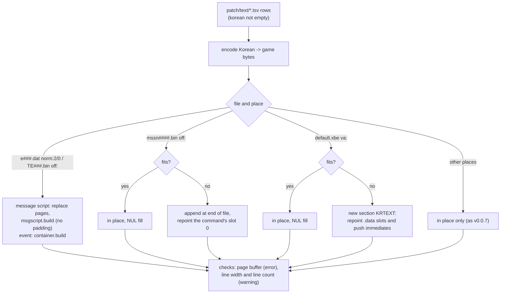

# 설계: 길이가 바뀌는 문장 재삽입 (issue #13, P5-2)

근거: [PLAN §5 P5](../PLAN.md), [설계 i011](20261021-i011-text-extract.md) §2·§4, 분석 [message-script.md](../analysis/message-script.md), [mission-files.md](../analysis/mission-files.md), [xbe-strings.md](../analysis/xbe-strings.md), [containers.md](../analysis/containers.md), [text-renderer.md](../analysis/text-renderer.md) §5.

## 1. 목표와 범위

* `patch/text/*.tsv`의 한국어가 **원문보다 길어도** 들어가게 한다. 번역 파일 형식과 추출 도구(v0.0.7)는 그대로 쓴다.
* 완료 기준(PLAN P5): ① 모든 문장을 원문 그대로 넣은 왕복이 원본과 같다. ② 길이가 다른 시험 문장이 깨지지 않는다(에뮬레이터 화면).
* 범위 밖(이 issue에서 하지 않음): **페이지 수 바꾸기**(§3.1), 번역(P6), US판 XBE 주소(P8).
* 가이드 [text-pipeline.md](../guides/text-pipeline.md) §4를 "된다"로 고친다(AI 없이 따라 할 수 있게).

## 2. 묶음별 방법

자리는 추출 도구가 만든 것을 그대로 쓴다(`file` + `where`). 도구는 파일 경로와 자리 종류로 방법을 고른다.

| 묶음 | 알아보는 법 | 들어가면 | 길면 |
|---|---|---|---|
| 이벤트 | `Media/Event/Event/e*.dat`, `norm:2/0+…` | 메시지 스크립트를 읽고, 자리가 페이지 시작과 맞는 페이지의 바이트를 한국어로 바꾼 뒤 `msgscript.build` → `container.build`. **덧채움 없이** 정확한 바이트로 다시 만든다 | 같은 방법(길이와 상관없다) |
| 대화 | `Media/Event/TalkEvent/TE*.bin`, `off:…` | 위와 같고 파일 전체를 다시 쓴다 | 같은 방법 |
| 미션 | `Media/Mission/mssn*.bin`, `off:…` | 그 자리를 칸 0으로 가리키는 문장 명령이 정확히 하나여야 한다. 원래 자리에 쓰고 NUL로 채운다(v0.0.7과 같다) | 파일 끝에 NUL 종료로 붙이고 그 명령의 칸 0 포인터를 새 위치로. 원래 바이트는 그대로 둔다(아무도 가리키지 않음) |
| XBE | `default.xbe`, `va:…` | 그 자리가 `xbetext`의 문자열 시작이어야 한다. 원래 자리에 쓰고 NUL로 채운다(v0.0.7과 같다) | 새 섹션 `KRTEXT`(§3.3)에 모아 쓰고, 그 문자열의 **`.data` 칸과 `push` 즉치 전부**를 새 주소로 |
| 그 밖 | 위에 해당하지 않는 자리 | v0.0.7과 같은 제자리 교체 | 멈춘다(길이를 바꿀 수 있는 형식이 아님) |

* 이벤트·대화는 늘 다시 만들므로 `pad` 열을 쓰지 않는다. 짧은 페이지 뒤에 공백이 남지 않는다(가운데 맞춤 창에서 줄이 밀리지 않는다). 그래서 P4 시험 문장의 `TE014.bin` 출력 MD5가 v0.0.7과 달라진다(다른 파일은 같다). [apply-patch.md](../guides/apply-patch.md) §3의 기대값을 고친다.
* 한 파일의 여러 줄은 한 번에 적용한다(읽기 한 번, 다시 쓰기 한 번).
* "들어가면"의 기준은 한국어 바이트 수 ≤ `orig_len`이다. XBE 문자열 뒤의 0바이트(정렬 여백)는 쓰지 않는다. 다음 자료의 0일 수도 있어서다.

## 3. 결정할 것과 근거

### 3.1 페이지 수는 바꾸지 않는다 (권장)

* 한국어에 `$r`(페이지 끝)이나 `$e`(메시지 끝)를 더하거나 빼면 **멈춘다**. 이벤트·대화 줄(한 페이지)에는 `$r`·`$e`가 없어야 하고, 미션 줄은 원문과 같은 순서·개수의 `$r`·`$e`를 가져야 한다. 분기·선택지 코드(`$p` `$b?` `$s` `$j` `$v`)를 새로 쓰는 것도 막는다.
* 이유: 페이지를 늘리면 머리의 페이지 수·페이지별 값(표시 시간으로 보임, 뜻 미확정)과 대화 분기 인자(페이지 번호, 추정)를 함께 고쳐야 하는데, 값을 정하는 규칙을 아직 화면으로 확인하지 못했다. 미션 명령 레코드에도 페이지 수로 보이는 값이 있는지 확정하지 못했다(조사 결과 상관이 뚜렷하지 않음).
* 한 페이지에는 원문 최대와 같은 3줄까지 들어가고(§3.4), 페이지 바이트 한도가 넉넉하다(이벤트 원문 최대 99바이트/한도 255). 한국어는 일본어와 글자 수가 비슷하므로 페이지를 나눌 일은 드물 것으로 본다. 필요해지면 따로 issue로 한다.

### 3.2 미션: 파일 끝에 붙이기

* 근거([mission-files §1](../analysis/mission-files.md)): 로더 `0x25DD0`이 파일 크기만큼 할당하고, 재배치 `0x4DB30`이 포인터를 파일 위치 + 버퍼 주소로 바꾼다. 파일 끝 뒤에는 아무 자료도 없으므로 붙여도 다른 위치가 바뀌지 않는다.
* 붙이는 문자열 사이에 정렬은 두지 않는다(바이트 문자열). 붙이는 순서는 줄 순서(파일 안 자리 순서)로 정해 같은 입력에서 같은 출력이 나오게 한다.

### 3.3 XBE: 새 섹션 `KRTEXT`

* 근거([xbe-strings §3](../analysis/xbe-strings.md)): `.rdata` 끝에 여백이 없고, `.data`의 뒤쪽은 실행 중에 쓰는 bss라 쓸 수 없다. 그래서 이미지 끝에 섹션 하나를 더한다(XboxImageXploder 같은 도구가 쓰는 일반적인 방법).
* 일본판 XBE 머리(확인됨): 머리 크기 `0x988`, 첫 섹션 원시 위치 `0x1000`(머리 뒤 여유 `0x678`바이트), 섹션 머리 표 `0x348`(11개 × 56바이트), 공유 페이지 참조 수 `u16`들이 `0x5B0`~`0x5C6`, 이미지 끝 VA `0x288620`, 파일 크기 `0x22D000`.
* 더하는 방법:
  1. 섹션 머리 표 12개를 머리 여유 자리(`0x988`부터, 4바이트 정렬)로 옮기고 `0x120`(섹션 머리 주소)을 고친다. 이어서 섹션 이름 `KRTEXT\0`과 새 공유 페이지 참조 수 두 개(0)를 둔다. 머리 크기(`0x108`)를 새 끝으로 고친다(`0x1000` 이하인지 확인).
  2. 새 섹션: VA = 이미지 끝을 `0x1000`으로 올린 값(`0x289000`), 원시 위치 = 파일 끝(`0x22D000`), 크기 = 문자열 바이트, 파일은 `0x1000` 단위로 0을 채운다. 깃발은 `.rdata`와 같은 `0x06`.
  3. 이미지 크기(`0x10C`)를 새 섹션 끝까지로.
  4. 문자열을 4바이트 정렬로 모아 쓰고, 옮긴 문자열마다 `xbetext`가 찾은 `.data` 칸과 `push` 즉치를 새 VA로 바꾼다(바꾸기 전 값이 원래 VA인지 확인).
  5. 바뀐 섹션(`.data`, `.text`, `.rdata`, 새 섹션)의 SHA-1 요약값을 다시 계산한다. 서명은 고치지 않는다(P4에서 Cxbx-Reloaded·xemu가 서명 없는 XBE를 실행).
* 옮긴 문자열의 원래 자리는 그대로 둔다(아무도 가리키지 않게 된다).
* 위험: 에뮬레이터가 섹션이 더해진 XBE를 받는지는 화면으로 확인한다(§5). 안 되면 대안은 기존 섹션 사이의 쓰지 않는 자리를 찾는 것인데, 이 issue에서는 하지 않는다.

### 3.4 화면 제한 검사

| 검사 | 기준 | 넘으면 |
|---|---|---|
| 페이지 버퍼 | 페이지 바이트 + 줄마다 5바이트(가운데 맞춤 `$xNNN`) + NUL < `0x100`([text-renderer §5](../analysis/text-renderer.md)) | **멈춘다**(메모리를 넘어 쓴다) |
| 줄 폭 | 렌더러 규칙의 픽셀 폭(2바이트 24, 공백 11.2, 1바이트는 표 `0x1F8640` 폭). 이벤트 528, 대화 456(원문 최대), 미션·XBE는 그 줄의 원문 최대 폭과 528 중 큰 값 | 경고 |
| 줄 수 | 이벤트·대화 3줄(원문 최대), 미션·XBE는 원문 줄 수와 3 중 큰 값 | 경고 |

* 경고는 자리와 값을 함께 출력한다. 경고가 있어도 출력은 만든다(번역자가 화면에서 판단한다).

## 4. 코드

| 모듈 | 내용 |
|---|---|
| `tools/jsrfkr/reinsert.py`(새로) | 줄을 파일별로 모아 §2의 방법으로 적용. 입력은 "자리 → 새 바이트"라서, 인코더를 거치지 않은 원문 바이트로도 돌릴 수 있다(왕복 시험) |
| `tools/jsrfkr/xbeedit.py`(새로) | XBE 섹션 더하기(§3.3), 섹션 요약값 다시 계산(새 섹션 포함) |
| `tools/jsrfkr/screen.py`(새로) | 줄 폭·줄 수·페이지 버퍼 검사(§3.4) |
| `tools/jsrfkr/xiso.py` | 파일이 커지면: 할당된 섹터 안이면 그대로 쓰고 디렉터리 항목의 크기만, 넘으면 이미지 끝에 붙이고 항목의 시작 섹터와 크기를 고친다 |
| `tools/patch.py` | 문장 단계를 `reinsert`로 바꾼다. XBE는 글리프 표 → 문장(제자리) → `xbe/*.json` → 새 섹션과 참조 → 요약값 순서 |
| `tools/check_reinsert.py`(새로) | 왕복 시험(§5의 1·2) |

* `textpatch`의 TSV 읽기·자리 해석·검사는 그대로 쓴다. `textpatch.apply`는 `reinsert`가 대신한다.

## 5. 검증

1. **원문 왕복**: 추출한 단위 2,276개 모두를 원문 바이트로 넣으면(인코더 없이) 네 묶음의 모든 파일이 원본과 바이트 단위로 같다.
2. **옮기기 왕복**: 미션·XBE 문자열을 "늘 옮기기"로 원문 바이트를 넣으면, 다시 읽은 모든 문장 명령의 칸 0과 모든 XBE 참조가 원래 바이트의 문자열을 가리키고, 붙인 부분·포인터·머리 밖의 바이트는 원본과 같다.
3. 단위 시험(게임 자료 없음): 합성 메시지 스크립트의 페이지 바꾸기, 미션 붙이기·포인터, XBE 섹션 더하기(머리 값, 요약값), xiso 파일 키우기, 화면 검사, `$r`·`$e` 수 검사.
4. 덤프: P4 시험 문장(`patch/poc/lines.tsv`) 출력 — `TE014.bin`만 MD5가 바뀌고 나머지는 v0.0.7과 같다.
5. **화면**: 새 시험 문장 `patch/poc/long.tsv`(이 저장소가 쓴 시험 문장, 번역 아님)로 각 묶음에서 원문보다 긴 한 줄씩(첫 미션 목표, 로보이 첫 대사, 일시정지 메뉴 "セーブ" 자리, 이벤트 한 페이지). Cxbx-Reloaded와 xemu에서 깨지지 않고 나오는지 사용자가 확인한다([emulator-check.md](../guides/emulator-check.md)에 볼 화면을 더한다). `--iso` 출력도 xemu에서 부팅한다.
6. 같은 입력 두 번 → 같은 출력. 커밋 전 `git status`에 `work/`, `out/`, `roms/`가 없다.
7. 가이드 §4의 명령을 적힌 그대로 실행해 같은 결과가 나온다.

## 6. 위험

* 섹션을 더한 XBE를 에뮬레이터·실기가 받지 않을 수 있다(화면 확인 전까지 **추정**). 실기는 서명 검사 때문에 이 프로젝트 전체가 아직 확인 대상이 아니다.
* HDD 캐시에 원본이 남아 있으면 커진 파일이 보이지 않는다(가이드에 이미 적음). 캐시 표가 파일 크기를 기억하는지는 화면 확인 때 본다.
* 페이지 수를 바꾸지 못하는 제한이 번역에 걸릴 수 있다. 걸리는 줄이 나오면 그때 issue를 연다.

---

# Design: reinserting text whose length changes (issue #13, P5-2)

Grounds: [PLAN §5 P5](../PLAN.md), [design i011](20261021-i011-text-extract.md) §2 and §4, analyses [message-script.md](../analysis/message-script.md), [mission-files.md](../analysis/mission-files.md), [xbe-strings.md](../analysis/xbe-strings.md), [containers.md](../analysis/containers.md), [text-renderer.md](../analysis/text-renderer.md) §5.

## 1. Goal and scope

* Make the Korean of `patch/text/*.tsv` fit **even when longer than the original**, keeping the translation file format and the extraction tool (v0.0.7) as they are.
* Done when (PLAN P5): ① a round trip putting every string back unchanged equals the original; ② test lines of other lengths do not break (emulator screen).
* Out of scope (not in this issue): **changing page counts** (§3.1), translation (P6), US XBE addresses (P8).
* §4 of the guide [text-pipeline.md](../guides/text-pipeline.md) becomes "works" (followable without AI).

(The diagram above: rows are encoded, then handled by file and place: message scripts rebuild pages without padding; mission strings go in place or are appended with slot 0 repointed; XBE strings go in place or into a new `KRTEXT` section with every reference repointed; other places stay in place only; then the screen checks run.)

## 2. Method per group

Places are the extraction tool's (`file` + `where`); the tool picks the method by file path and place kind.

| Group | Recognised by | Fits | Longer |
|---|---|---|---|
| event | `Media/Event/Event/e*.dat`, `norm:2/0+…` | parse the message script, replace the bytes of the page that starts at the place, `msgscript.build` → `container.build`; rebuilt with the exact bytes, **no padding** | the same (length does not matter) |
| talk | `Media/Event/TalkEvent/TE*.bin`, `off:…` | as above, rewriting the whole file | the same |
| mission | `Media/Mission/mssn*.bin`, `off:…` | exactly one text command must point at the place with slot 0; write in place and fill with NUL (as in v0.0.7) | append at the end of the file, NUL-terminated, and point that command's slot 0 at it; the old bytes stay (nothing points at them) |
| xbe | `default.xbe`, `va:…` | the place must be an `xbetext` string start; write in place and fill with NUL (as in v0.0.7) | gather into a new section `KRTEXT` (§3.3) and point **every `.data` slot and `push` immediate** of that string at the new address |
| other | places matching none of the above | in-place replacement as in v0.0.7 | stop (not a format whose lengths can change) |

* Events and talk are always rebuilt, so the `pad` column is unused there; no spaces are left after a shorter page (lines in centred windows do not shift). So the P4 test lines' output MD5 of `TE014.bin` changes from v0.0.7 (the other files stay the same); the expected values in [apply-patch.md](../guides/apply-patch.md) §3 are updated.
* All rows of a file are applied together (one read, one rewrite).
* "Fits" means Korean bytes ≤ `orig_len`. The zero bytes after an XBE string (alignment padding) are not used, since they might be zeros of the next data item.

## 3. Decisions and reasons

### 3.1 Page counts do not change (recommended)

* Adding or removing `$r` (end of page) or `$e` (end of message) in the Korean **stops** the tool: event and talk rows (one page each) must contain no `$r`/`$e`, and mission rows must have the same `$r`/`$e` sequence as the original. New branch or choice codes (`$p` `$b?` `$s` `$j` `$v`) are refused too.
* Why: more pages would mean fixing the header's page counts and per-page values (apparently display times, meaning unresolved) and the talk branch arguments (page numbers, inferred) together, and the rule for those values has not been checked on screen. Nor could a page-count value be settled in mission command records (no clear correlation in the survey).
* A page holds up to 3 lines, the original maximum (§3.4), and the page byte limit is roomy (event original maximum 99 bytes of 255). Korean runs to about as many characters as Japanese, so splitting pages should rarely be needed; if it is, it gets its own issue.

### 3.2 Missions: append at the end of the file

* Basis ([mission-files §1](../analysis/mission-files.md)): loader `0x25DD0` allocates the file's size and relocation `0x4DB30` turns pointers into file position + buffer address; nothing follows the end of the file, so appending moves no other position.
* No alignment between appended strings (byte strings). They are appended in row order (place order within the file), so the same input gives the same output.

### 3.3 XBE: a new section `KRTEXT`

* Basis ([xbe-strings §3](../analysis/xbe-strings.md)): `.rdata` has no slack at its end, and the back of `.data` is bss used at run time; so a section is added at the end of the image (the usual method, as tools such as XboxImageXploder do).
* The Japanese XBE header (confirmed): header size `0x988`, first section raw offset `0x1000` (`0x678` bytes free after the header), section header table at `0x348` (11 × 56 bytes), shared page reference counts (`u16`) at `0x5B0`–`0x5C6`, image end VA `0x288620`, file size `0x22D000`.
* Steps:
  1. Move the 12-entry section header table into the free header space (from `0x988`, 4-byte aligned) and fix `0x120` (section headers address); follow it with the name `KRTEXT\0` and two new shared page reference counts (0); set the header size (`0x108`) to the new end (checked to stay ≤ `0x1000`).
  2. The new section: VA = image end rounded up to `0x1000` (`0x289000`), raw offset = end of file (`0x22D000`), size = the string bytes, the file zero-filled to a `0x1000` multiple; flags `0x06` as for `.rdata`.
  3. Image size (`0x10C`) up to the new section's end.
  4. Write the strings 4-byte aligned, and change every `.data` slot and `push` immediate `xbetext` found for each moved string to the new VA (checking the old value is the original VA first).
  5. Recompute the SHA-1 digests of the changed sections (`.data`, `.text`, `.rdata`, the new one). The signature stays unfixed (Cxbx-Reloaded and xemu ran unsigned XBEs in P4).
* The old places of moved strings stay as they are (nothing points at them).
* Risk: whether emulators accept an XBE with an added section is checked on screen (§5). If not, the alternative is finding unused space between existing sections, which this issue does not do.

### 3.4 Screen-limit checks

| Check | Limit | Beyond it |
|---|---|---|
| page buffer | page bytes + 5 bytes per line (centring `$xNNN`) + NUL < `0x100` ([text-renderer §5](../analysis/text-renderer.md)) | **stop** (it would overrun memory) |
| line width | pixel width by the renderer's rules (double-byte 24, space 11.2, single-byte from table `0x1F8640`): events 528, talk 456 (original maxima); missions and XBE the larger of that line's original maximum width and 528 | warning |
| line count | events and talk 3 (original maximum); missions and XBE the larger of the original's line count and 3 | warning |

* Warnings print the place and the values; the output is still built (the translator judges on screen).

## 4. Code

| Module | Content |
|---|---|
| `tools/jsrfkr/reinsert.py` (new) | gathers rows per file and applies §2; its input is "place → new bytes", so it also runs on unencoded original bytes (round trip) |
| `tools/jsrfkr/xbeedit.py` (new) | adding an XBE section (§3.3), recomputing section digests (new section included) |
| `tools/jsrfkr/screen.py` (new) | line width, line count and page buffer checks (§3.4) |
| `tools/jsrfkr/xiso.py` | a grown file: within its allocated sectors, write it and change only the directory entry's size; beyond, append at the end of the image and fix the entry's start sector and size |
| `tools/patch.py` | the text step becomes `reinsert`; for the XBE: glyph table → text (in place) → `xbe/*.json` → new section and references → digests |
| `tools/check_reinsert.py` (new) | the round trips (§5 items 1 and 2) |

* `textpatch`'s TSV reading, place resolution and checks stay; `reinsert` takes over from `textpatch.apply`.

## 5. Verification

1. **Original round trip**: putting all 2,276 extracted units back as their original bytes (no encoder) leaves every file of the four groups byte-identical to the original.
2. **Move round trip**: putting the original bytes back with mission and XBE strings "always moved", every re-read slot 0 of the text commands and every XBE reference points at a string with the original bytes, and the bytes outside the appended part, pointers and header equal the original.
3. Unit tests (no game data): page replacement in a synthetic message script, mission append and pointers, adding an XBE section (header values, digests), growing a file in an xiso, the screen checks, the `$r`/`$e` count check.
4. Dump: the P4 test lines' (`patch/poc/lines.tsv`) output: only `TE014.bin`'s MD5 changes; the rest equal v0.0.7.
5. **Screen**: new test lines `patch/poc/long.tsv` (test lines written for this repository, not a translation), one longer-than-original line per group (the first mission objective, Roboy's first line, the pause-menu "セーブ" place, one event page). The user checks in Cxbx-Reloaded and xemu that they show unbroken ([emulator-check.md](../guides/emulator-check.md) gains the screens to look at); the `--iso` output also boots in xemu.
6. Same input twice → same output; before committing, `git status` shows no `work/`, `out/` or `roms/`.
7. The commands of the guide's §4, run as written, give the same results.

## 6. Risks

* Emulators or hardware may refuse an XBE with an added section (**inferred** until the screen check). Hardware is not yet a target for this project at all, because of the signature check.
* With stale originals in the HDD cache, grown files do not show (already in the guide); whether the cache table remembers file sizes is watched during the screen check.
* The fixed page count may get in the way of translation; if lines hit it, an issue is opened then.
