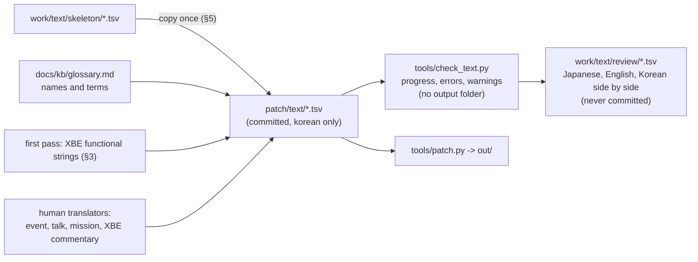

# 설계: 번역 준비 — 용어집, XBE 기능 문구 초벌 번역, 번역 도구와 지침 (issue #15, P6-0)

근거: [PLAN §5 P6](../PLAN.md), [guides/text-pipeline.md](../guides/text-pipeline.md)(v0.0.8), [analysis/xbe-strings.md](../analysis/xbe-strings.md), [설계 i013](20261021-i013-text-reinsert.md).

## 1. 목표와 범위

* 번역(P6)을 바로 시작하고 끝까지 갈 수 있게 준비한다. 사람이 이 저장소의 문서와 도구만으로(AI 없이) 번역·검사·패치를 할 수 있어야 한다.
* 이 issue에서 하는 것:
  1. **용어집** `docs/kb/glossary.md`(§2)
  2. **XBE 기능 문구의 초벌 번역**(§3)
  3. **번역 검사 도구** `tools/check_text.py`와 검토 표(§4)
  4. **뼈대를 `patch/text/`에 넣기**(§5)
  5. **번역 지침** `docs/guides/translation.md`와 사람 번역 issue 나누기, PLAN P6 갱신(§6)
* 하지 않는 것: **게임 대사의 번역**. 이벤트·대화·미션 안내, 그리고 XBE의 실황 대사(레이스·배틀 중 실황 67줄)는 사람 번역으로 남긴다. 대본은 저작물이고, 대사 전체를 옮기는 일은 AI 작업 원칙(원문 재현 금지)에 어긋나기 때문이다. 이름·메뉴·시스템 안내 같은 기능 문구와 용어는 표현이라기보다 기능이므로 초벌 번역한다.



## 2. 용어집 `docs/kb/glossary.md`

* 범위: 캐릭터, 팀(갱), 적·경찰, 장소(스테이지), 기술 이름(트릭)의 표기 원칙과 대표 예, 게임 용어(그래피티, 스프레이, GG 수첩 등), 문장 부호와 숫자 표기.
* 열: 일본어 표기(이름·용어만, 문장은 넣지 않는다), 영어판 표기(공개된 영어판 이름), 한국어 표기, 메모(근거·대안).
* 원칙:
  * 외래어(가타카나)는 영어판 이름을 기준으로 국립국어원 외래어 표기법에 가깝게 쓴다(예: ビート Beat → 비트).
  * 일본 고유 지명·이름은 국립국어원 일본어 표기법(장음 표기 안 함, 어두 거센소리 안 씀)을 따른다(예: ドーゲン坂 → 도겐자카).
  * 장소의 일반명사 부분은 번역한다(例: ～街 → ～ 거리, ～台 → ～다이처럼 고유명 일부면 그대로).
  * 저장소 문서 규칙상 용어집도 한국어 설명 뒤에 영어 설명을 둔다. 표 자체는 한 벌.
* 일본어 이름을 문서에 적는 것: AGENTS의 "추출한 원문 문장은 커밋하지 않는다"는 **문장**에 대한 규칙이다. 용어집에는 번역자가 찾을 수 있도록 고유명사·용어 낱말만 적는다(대사 문장은 적지 않는다). **승인 필요**.

## 3. XBE 기능 문구 초벌 번역

* 대상: `work/text/xbe.tsv` 651줄 중 다음(약 560줄).
  * 시스템 안내: 메모리 유닛, 저장·불러오기, 디스크·컨트롤러 안내.
  * 메뉴: 일시정지·리트라이·타이틀·차고 메뉴, 설정, 저장 위치 선택.
  * 그래피티 편집기: 조작 안내, 크기, 도구 이름.
  * 이름: 캐릭터·팀·적·장소·기술·그래피티 이름(용어집대로).
  * 트라이얼 목표와 힌트, 연습 메뉴 이름.
* 제외: 실황 대사(`va:0x1d0934`~`va:0x1d1b10`, `$r$e$r`로 끝나는 짧은 대사들), 전각 숫자 `０`~`９`·크기 글자 `Ｌ` `Ｍ` `Ｓ`처럼 바꿀 필요가 없는 줄(비워 둔다 = 원문 그대로).
* 지켜야 할 것(분석에서 나온 제약):
  * `%d` `%s`, `$n`, `$p` 같은 코드는 그대로.
  * **자리 표시 공백**: `あと　　ブロック`의 전각 공백 두 칸, `GRAFFITI     `의 공백처럼 게임이 실행 중에 채우는 자리는 **바이트 위치가 같게** 둔다(앞부분을 같은 바이트 수로 맞춘다). 코드가 고정 위치에 숫자를 써 넣을 수 있기 때문이다(**추정**).
  * **끝의 전각 공백 채움**(그래피티 편집기 안내 등): 원문 길이까지 전각 공백으로 채운다. 고정 폭 칸을 덮어 지우는 용도로 보인다(**추정**).
  * 여러 문자열이 한 메시지의 줄을 이루는 경우(저장 공간 부족 안내 등) 줄마다 뜻이 맞게 나눈다.
* 원문보다 길면 v0.0.8의 새 섹션 `KRTEXT`로 옮겨진다. 이 경로는 아직 화면 확인 전이므로(issue #13), 가능하면 원문 길이 안에서 번역하고, 몇 줄이 옮겨지는지 작업 로그에 적는다.
* 번역은 `patch/text/xbe.tsv`의 `korean` 칸에 넣는다. 사람이 나중에 고칠 수 있는 초벌이다.

## 4. 번역 검사 도구 `tools/check_text.py`

```text
python -I tools/check_text.py <덤프> [--text patch/text] [--review]
```

* 출력 폴더를 만들지 않고(2.4GB 복사 없음) 패치 도구와 같은 과정을 메모리에서 돈다: 글꼴 표 계산 → 인코딩 → 재삽입 → 화면 검사.
* 첫 오류에서 멈추지 않고 **모든 줄의 오류를 모아** 보고한다(파일별로 따로 적용).
* 출력: 묶음·파일별 진행률(번역한 줄/전체, 바이트), 서로 다른 한글 음절 수와 한도(1,158/1,327), 오류, 경고, 옮김·붙임 수.
* `--review`: `work/text/review/<묶음>.tsv`에 `file`, `where`, `ref`, `상태`(빈칸/됨/오류/경고), `japanese`, `english`, `korean`, `바이트`(한국어/원문), `메모`(오류·경고)를 나란히 쓴다. 원문이 들어 있으므로 `work/` 아래에만 쓴다. `work/text/<묶음>.tsv`(추출 결과)가 없으면 먼저 추출하라고 알린다.
* 끝나는 코드: 오류가 있으면 1. 번역자가 커밋 전에 돌린다.
* 코드: `patch.py`의 글꼴·인코딩 부분을 함수로 나눠 함께 쓴다(같은 결과를 보장).

## 5. 뼈대를 `patch/text/`에

* `work/text/skeleton/{event,talk,mission,xbe}.tsv`를 `patch/text/`로 복사해 커밋한다(원문 없음, 자리·해시만). v0.0.7 설계에서 미뤄 둔 일이다.
* `patch.py`의 기본 `--text`가 `patch/text`이므로 이제 기본 출력에 번역한 줄이 들어간다(이 issue에서는 XBE 초벌만).
* 번역한 줄이 건드리는 파일의 MD5는 `--update-manifest`로 `patch/manifest.json`에 더한다(XBE는 이미 있음).

## 6. 번역 지침과 issue 나누기

* `docs/guides/translation.md`(사람용, AI 없이): 작업 흐름(추출 → 복사된 `patch/text/` 채우기 → `check_text.py` → `patch.py` → 화면 → 커밋), 문체(캐릭터별 말투는 원문의 높임·반말을 따른다, 실황은 짧고 강하게 등 일반 원칙), 용어집 쓰기, 문장 부호(전각 `！` `？` `、` `…` `～`와 1바이트 공백·`,` `.`), 줄 폭·페이지 한도, 이름이 들어가는 자리, 검토 표 보는 법, 커밋 규칙(`patch/text/`와 `manifest.json`만).
* 사람 번역 issue(P6-1~): 묶음 단위로 나눈다. 미션(목표·안내, 문자열 495) / 대화(733 페이지) / 이벤트(397 페이지) / XBE 실황(67). 큰 묶음은 파일 범위로 더 나눌 수 있다. issue는 사용자가 번역자를 정할 때 만든다(이 issue에서는 목록만 PLAN에 적는다).
* PLAN P6 줄을 고친다: "번역(사람)" → "P6-0 준비(이 issue, AI 초벌은 기능 문구만) + P6-1~ 사람 번역(대사)".

## 7. 검증

1. 단위 시험(게임 자료 없음): `check_text`의 진행률 계산, 오류 모으기(파일별), 검토 표 열.
2. 덤프: `check_text.py`가 XBE 초벌을 오류 0으로 통과하고, 경고·옮김 수를 보고한다.
3. 덤프: `patch.py`(기본 `patch/text`)가 돌고, `check_reinsert.py`가 여전히 통과한다.
4. 자리 표시 공백과 코드: 바뀐 줄마다 `%`·`$` 코드와 자리 표시 공백의 바이트 위치가 원문과 같은지 도구로 확인한다.
5. 가이드의 명령을 적힌 그대로 실행한다. 커밋 전 `git status`에 `work/`, `out/`, `roms/`가 없다.
6. 화면 확인(메뉴·안내가 보이는지)은 issue #13의 화면 확인과 함께 사용자에게 부탁한다.

## 8. 위험

* 기능 문구와 대사의 경계: 메뉴 설명 중 말투가 있는 줄("…변경할 수 있지" 같은 차고 메뉴 설명)은 기능 문구로 보고 번역한다. 경계가 애매한 줄은 작업 로그에 적고 사람 검토를 받는다.
* 자리 표시 공백과 끝 공백 채움의 의미는 추정이다. 화면에서 숫자·이름이 어긋나면 고친다.
* 원문보다 긴 XBE 줄은 화면 확인 전인 새 섹션 경로를 탄다.

---

# Design: translation preparation — glossary, first-pass translation of XBE functional strings, translation tools and guidelines (issue #15, P6-0)

Grounds: [PLAN §5 P6](../PLAN.md), [guides/text-pipeline.md](../guides/text-pipeline.md) (v0.0.8), [analysis/xbe-strings.md](../analysis/xbe-strings.md), [design i013](20261021-i013-text-reinsert.md).

## 1. Goal and scope

* Prepare translation (P6) so it can start at once and run to the end; people must be able to translate, check and patch with this repository's documents and tools alone (no AI).
* In this issue:
  1. **Glossary** `docs/kb/glossary.md` (§2)
  2. **First-pass translation of the XBE's functional strings** (§3)
  3. **Translation check tool** `tools/check_text.py` and a review table (§4)
  4. **Skeletons into `patch/text/`** (§5)
  5. **Translation guide** `docs/guides/translation.md`, the split of human-translation issues, the PLAN P6 update (§6)
* Not in it: **translating the game's dialogue**. Events, talk, mission messages and the XBE's commentary lines (67 short lines during races and battles) are left for human translators: the script is a copyrighted work, and carrying the whole dialogue over conflicts with the AI working principle (no reproduction of the original). Functional strings and terms such as names, menus and system notices are function rather than expression, so they get a first pass.

(The diagram above: skeletons are copied once into `patch/text/`; the glossary and the first pass of XBE functional strings, then human translators, fill it; `check_text.py` checks without an output folder and writes review tables under `work/`; `patch.py` builds the output.)

## 2. Glossary `docs/kb/glossary.md`

* Scope: characters, teams (gangs), enemies and police, places (stages), the spelling rules for trick names with representative examples, game terms (graffiti, spray, the GG notebook, ...), punctuation and numbers.
* Columns: the Japanese form (names and terms only, never sentences), the English edition's form (the published English names), the Korean form, notes (grounds, alternatives).
* Rules:
  * Loanwords (katakana) follow the English edition's name, written close to the National Institute of Korean Language's loanword rules (for example ビート Beat → 비트).
  * Japanese proper names follow the Institute's Japanese transcription rules (no long vowels, no aspirated initials) (for example ドーゲン坂 → 도겐자카).
  * The common-noun part of a place name is translated (～街 → ～ 거리), unless it is part of the proper name.
  * Under the repository's documentation rules the glossary also has its Korean explanation followed by an English one; the table itself is single.
* Writing Japanese names in a document: the AGENTS rule "extracted original text is never committed" is about **sentences**; the glossary lists only proper nouns and term words so translators can find them (no dialogue sentences). **Needs approval.**

## 3. First-pass translation of XBE functional strings

* Target: of the 651 rows of `work/text/xbe.tsv`, about 560:
  * system notices: memory units, saving and loading, disc and controller notices;
  * menus: pause, retry, title and garage menus, settings, choosing where to save;
  * the graffiti editor: control hints, sizes, tool names;
  * names: characters, teams, enemies, places, tricks, graffiti (per the glossary);
  * trial objectives and hints, practice menu names.
* Left out: the commentary lines (`va:0x1d0934`–`va:0x1d1b10`, short lines ending in `$r$e$r`), and rows that need no change such as the full-width digits `０`–`９` and the size letters `Ｌ` `Ｍ` `Ｓ` (left empty = original kept).
* Constraints (from the analysis):
  * codes such as `%d` `%s`, `$n`, `$p` stay as they are;
  * **placeholder spaces**, such as the two full-width spaces of `あと　　ブロック` or the spaces after `GRAFFITI     `, which the game fills at run time, keep **the same byte position** (the part before them is matched in byte length), since code may write digits at a fixed position (**inferred**);
  * **trailing full-width space padding** (graffiti editor hints and the like) is kept up to the original length; it apparently overwrites a fixed-width box (**inferred**);
  * where several strings form the lines of one message (the not-enough-space notices and the like), each line keeps a sensible meaning of its own.
* Rows longer than the original move to v0.0.8's new section `KRTEXT`, a path not yet checked on screen (issue #13); so translations stay within the original length where possible, and the work log records how many rows move.
* The translations go into the `korean` column of `patch/text/xbe.tsv`, as a first pass people may revise.

## 4. Translation check tool `tools/check_text.py`

(Usage above.)

* Runs the patcher's steps in memory without an output folder (no 2.4 GB copy): glyph table, encoding, reinsertion, screen checks.
* Does not stop at the first error: **it collects the errors of every row** (applying each file on its own).
* Output: progress per group and file (translated rows / all, bytes), the number of distinct Hangul syllables against the limits (1,158/1,327), errors, warnings, the numbers moved and appended.
* `--review`: writes `work/text/review/<group>.tsv` with `file`, `where`, `ref`, status (empty / done / error / warning), `japanese`, `english`, `korean`, bytes (Korean/original), notes (errors and warnings) side by side; it holds original text, so it is written under `work/` only. Without `work/text/<group>.tsv` (the extraction output) it says to extract first.
* Exit code 1 when there are errors; translators run it before committing.
* Code: the font and encoding part of `patch.py` becomes a shared function (guaranteeing the same result).

## 5. Skeletons into `patch/text/`

* Copy `work/text/skeleton/{event,talk,mission,xbe}.tsv` into `patch/text/` and commit them (no original text, places and hashes only), the step deferred in the v0.0.7 design.
* `patch.py`'s default `--text` is `patch/text`, so the default output now carries the translated rows (only the XBE first pass in this issue).
* The MD5s of the files the translated rows touch are added to `patch/manifest.json` with `--update-manifest` (the XBE is already there).

## 6. Translation guide and issue split

* `docs/guides/translation.md` (for people, no AI): the workflow (extract → fill the copied `patch/text/` → `check_text.py` → `patch.py` → screen → commit), style (each character's speech follows the original's politeness levels, commentary short and punchy, and other general rules), using the glossary, punctuation (full-width `！` `？` `、` `…` `～` with single-byte space, `,` and `.`), line width and page limits, places where names go, reading the review table, commit rules (`patch/text/` and `manifest.json` only).
* Human-translation issues (P6-1 on), split by group: missions (objectives and messages, 495 strings) / talk (733 pages) / events (397 pages) / XBE commentary (67); large groups can be split further by file range. The issues are opened when the user picks translators (this issue only lists them in PLAN).
* The PLAN P6 row changes from "translation (people)" to "P6-0 preparation (this issue; the AI first pass covers functional strings only) + P6-1 on, human translation (dialogue)".

## 7. Verification

1. Unit tests (no game data): `check_text`'s progress counts, error collection (per file), review table columns.
2. Dump: `check_text.py` passes the XBE first pass with 0 errors and reports warnings and moves.
3. Dump: `patch.py` (default `patch/text`) runs, and `check_reinsert.py` still passes.
4. Placeholders and codes: for every changed row, a tool check that the `%` and `$` codes and the byte positions of placeholder spaces match the original.
5. The guide's commands run as written; before committing, `git status` shows no `work/`, `out/` or `roms/`.
6. The screen check (menus and notices showing) is requested from the user together with issue #13's.

## 8. Risks

* The line between functional strings and dialogue: menu descriptions with a speaking tone (garage menu descriptions and the like) count as functional and are translated; borderline rows are listed in the work log for human review.
* The meaning of placeholder spaces and trailing padding is inferred; if numbers or names land wrong on screen, they are fixed.
* XBE rows longer than the original take the new-section path, not yet checked on screen.
