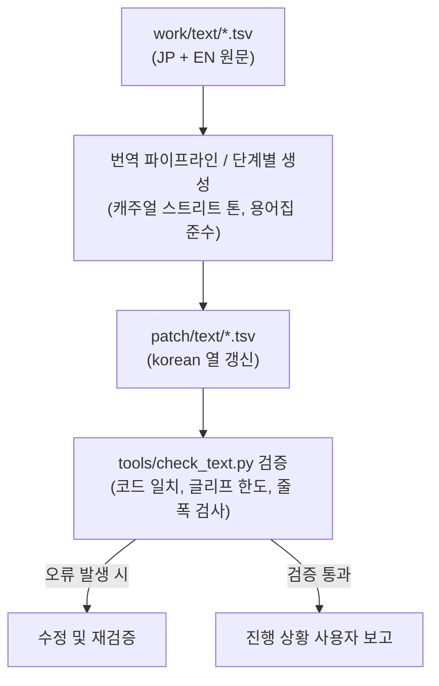

# 전체 게임 텍스트 번역 설계 (issue #17)

작성: 2026-10-22, issue #17.
근거: issue #15 번역 준비([설계 i015](../design/20261021-i015-translation-prep.md)), 용어집([glossary.md](../kb/glossary.md)), 번역자 가이드([translation.md](../guides/translation.md)).

## 1. 목적과 범위

`work/text/`에 추출된 원문(일본어 및 영어)을 바탕으로, `patch/text/` 내 대상 TSV 파일의 `korean` 열을 번역하여 완성한다.

* 대상 파일:
  * `xbe.tsv`: 651줄 중 미번역 107줄(DJ K 실황, 랭크 결과, 잔여 시스템 문구)
  * `event.tsv`: 이벤트 컷신 대사 397줄
  * `mission.tsv`: 미션 목표 및 무전/안내 495줄
  * `talk.tsv`: 거리 NPC 및 팀원 대화 733줄
* 총 대상: 1,732줄 (전체 2,276줄 중 기번역된 544줄 제외)
* 결과물은 `patch/text/*.tsv`의 `korean` 열을 갱신하며, TSV 구조(헤더, 탭 구분, `#` 주석)를 손상 없이 유지한다.

## 2. 번역 원칙 및 톤앤매너

1. **톤앤매너 (캐주얼 & 젊은 스트리트 감성)**:
   * JSRF의 독창적인 힙합, 롤러스케이트, 인라인, 그래피티 문화에 어울리는 젊고 힙한 구어체.
   * 번역투(직역체, 기계 번역 느낌)를 배제하고 자연스러운 한국어 스트리트 말투 사용.
   * 캐릭터별 어조 반영:
     * **DJ K**: 라디오 DJ 특유의 흥 넘치고 리듬감 있는 쇼맨십 말투 ("요 요 요! 도쿄의 스트리트 피플 모두 주목!", "비트 좀 올려볼까?!").
     * **GG 크루 (비트, 콘, 검, 요요 등)**: 십대 스케이터들의 당돌하고 톡톡 튀는 말투.
     * **경찰 / 롯카쿠 사설경비**: 고압적이고 딱딱하거나 거친 말투.
     * **라이벌 크루 (포이즌 잼, 노이즈 탱크, 러브 쇼커즈 등)**: 괴짜스럽거나 도발적인 말투.
2. **용어집 준수**:
   * `docs/kb/glossary.md`에 명시된 인명, 지명, 팀명, 기술명, 전각/반각 규칙 엄격 준수.
3. **제어 코드 및 형식 보존**:
   * `$n`(줄바꿈), `$r`(페이지 넘김), `$e`(메시지 종료), `$s`, `$a`, `$b`, `$c`, `$g`, `$p` 등 제어 코드의 순서와 개수를 원문과 일치시킨다.
   * `%d`, `%s` 등 포맷 지정자 보존.
   * 원문 공백 패딩 규칙 준수.
4. **글리프 및 폰트 제약 준수**:
   * KS X 1001 2,350자 완성형 한글 범위 내 사용.
   * 허용된 2바이트 기호 및 1바이트 ASCII만 사용.
   * 텍스트 렌더러의 한 줄 폭(픽셀) 및 줄 수 제약 고려.

## 3. 진행 단계 및 리포트 계획

파일별 또는 적정 묶음 단위로 순차 번역 및 검증을 진행하며, 단계마다 사용자에게 리포트한다.

1. **1단계: `xbe.tsv` 잔여분 (107줄)**:
   * DJ K 실황, 랭크/결과 화면 문구 등
   * `check_text.py` 검증 후 중간 보고
2. **2단계: `event.tsv` (397줄)**:
   * 핵심 스토리 컷신 대사
   * `check_text.py` 검증 후 중간 보고
3. **3단계: `mission.tsv` (495줄)**:
   * 미션 목표 및 안내
   * `check_text.py` 검증 후 중간 보고
4. **4단계: `talk.tsv` (733줄)**:
   * 거리 NPC 및 크루 대화
   * `check_text.py` 검증 후 최종 보고

---

# Design for Complete Game Text Translation (issue #17)

Written: 2026-10-22, issue #17.
Based on: issue #15 translation preparation ([design i015](../design/20261021-i015-translation-prep.md)), glossary ([glossary.md](../kb/glossary.md)), translator guide ([translation.md](../guides/translation.md)).

## 1. Purpose and Scope

Based on the original text (Japanese and English) extracted in `work/text/`, translate and complete the `korean` column of the target TSV files in `patch/text/`.

* Target files:
  * `xbe.tsv`: 107 untranslated rows out of 651 (DJ K commentary, rank results, residual system strings)
  * `event.tsv`: 397 event cutscene dialogue rows
  * `mission.tsv`: 495 mission objective and radio/guidance rows
  * `talk.tsv`: 733 street NPC and crew dialogue rows
* Total target: 1,732 rows (out of 2,276 total rows, excluding 544 already translated)
* Output updates the `korean` column of `patch/text/*.tsv`, preserving the TSV format intact (headers, tab delimiters, `#` comments).

## 2. Translation Principles and Tone

1. **Tone & Manner (Casual & Youthful Street Style)**:
   * Lively, hip spoken style matching JSRF's unique hip-hop, roller skating, inline, and graffiti culture.
   * Avoid stiff translationese; adopt natural Korean street phrasing.
   * Reflect character voices:
     * **DJ K**: Energetic radio DJ showmanship ("Yo yo yo! Tokyo street people, listen up!").
     * **GG Crew (Beat, Corn, Gum, Yoyo, etc.)**: Bold, witty teenage skaters.
     * **Police / Rokkaku Security**: Authoritarian, stiff, or harsh tone.
     * **Rival Crews (Poison Jam, Noise Tanks, Love Shockers, etc.)**: Eccentric or provocative taunts.
2. **Glossary Adherence**:
   * Strict adherence to proper names, places, teams, trick names, and fullwidth/halfwidth rules defined in `docs/kb/glossary.md`.
3. **Control Codes and Format Preservation**:
   * Preserve order and count of control codes (`$n`, `$r`, `$e`, `$s`, etc.).
   * Preserve format specifiers (`%d`, `%s`).
   * Adhere to space padding rules.
4. **Glyph and Font Constraints**:
   * Keep within KS X 1001 2,350 syllables.
   * Usable double-byte symbols and ASCII only.
   * Respect line width and line count limits.

## 3. Stages and Reporting Plan

Proceed sequentially by file, validating with `check_text.py` and reporting progress to the user at each stage.
