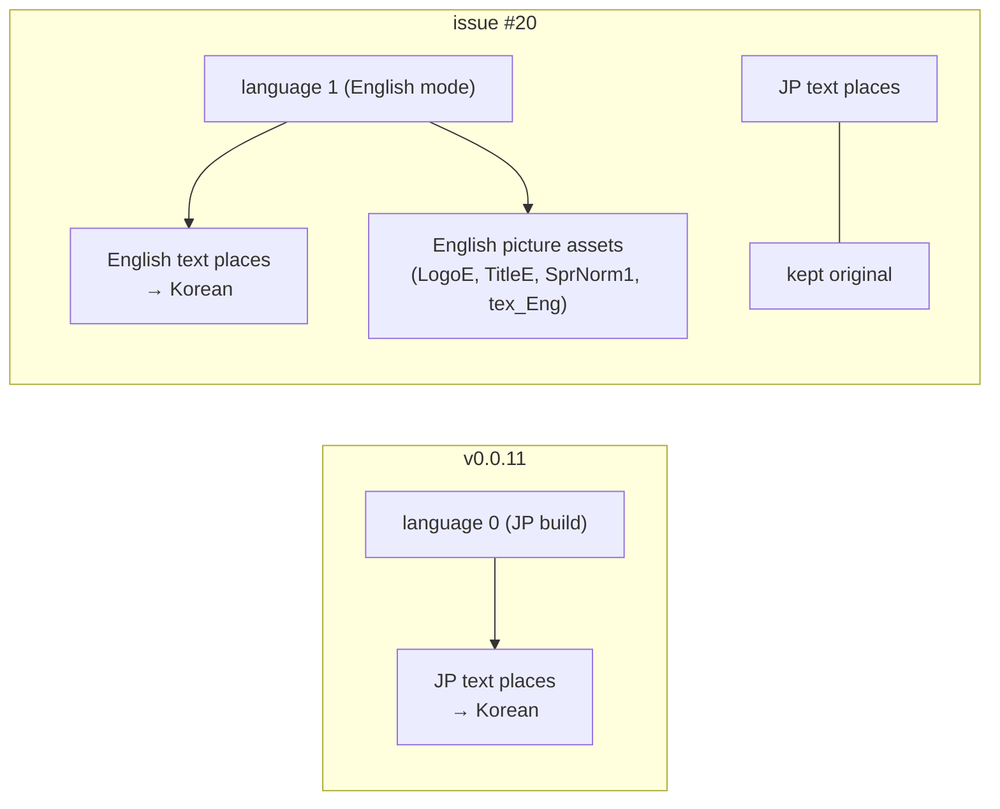

# 설계: 영문 모드 기반 한국어 패치 (issue #20, P6-2)

근거: reJSRF [language.md](https://github.com/nworkers/reJSRF/blob/main/docs/analysis/language.md)(언어 값, 다섯 언어 실행), [analysis/message-script.md](../analysis/message-script.md), [analysis/mission-files.md](../analysis/mission-files.md), [analysis/xbe-strings.md](../analysis/xbe-strings.md), [design i013](20261021-i013-text-reinsert.md)(재삽입).

## 1. 목표

* 지금(v0.0.11): 게임은 일본판(언어 0)으로 동작하고, 패치는 **일본어 문장 자리**를 한국어로 바꾼다.
* 바꾼 뒤: 게임은 **영어 모드(언어 1)**로 동작하고, 패치는 게임이 영어 모드에서 읽는 **영어 문장 자리**에 한국어를 쓴다. 일본어 자리는 원문 그대로 둔다.
* 기대 효과(사용자 요청의 이유, **추정**): 영어판 그림 자산(로고·타이틀·메뉴 글자 그림 `SprNorm1`·엔딩 `tex_Eng`·마크 목록 `List_eng`)을 쓰므로 한자 그림 글자가 화면에 남지 않는다. reJSRF는 US판 XBE(언어 1)로 동작하므로, 같은 `Media` 패치가 reJSRF에서도 그대로 한국어로 나온다.

## 2. 언어 값 (reJSRF에서 확인됨, 우리 바이너리로 다시 확인할 것)

| | US판 `default_eng.xbe` | 일본판 `default.xbe` |
|---|---|---|
| 언어 전역 | `0x1FC724`, `.data` 파일 자료 안, 값 **1** | `0x251F58`, `.data`의 bss(파일 자료 끝 `0x22FCB4` 뒤), 값 0 |
| 그 밖의 차이 | — | 코드·`.rdata`는 주소 이동을 빼면 같다(reJSRF §5·§6). 이번 조사에서 `.rdata`는 같은 주소에서 7바이트만 다르다 |

* 게임은 이 값을 대시보드 언어에서 가져오지 않는다. 실행 중에 바꾸면 안전하지 않고(값을 저장해 두는 객체가 있다) **처음부터 1이어야** 한다(reJSRF §7).

### 2.1 XBE를 영어 모드로 만드는 방법 (사용자 결정 1)

| 안 | 방법 | 코드 패치 | 장점 | 단점 |
|---|---|---|---|---|
| **A. 일본판 XBE + 언어 값 1** | `.data`의 파일 자료를 `0x251F5C`까지 늘려(그 사이는 0, 언어 값만 1) bss였던 언어 값을 초기값 1로 만든다. 뒤 섹션(`DOLBY` 등)의 원시 위치를 옮긴다 | 없음(자료·머리만) | 입력 XBE가 지금과 같다(일본판 MD5) | 원시 자료 약 136KB 증가, 섹션 원시 위치 이동(새 섹션 더하기와 같은 종류의 머리 수정). reJSRF는 일본판 빌드로만 실행 |
| **B. US판 XBE를 바탕으로** (권장) | 같은 디스크의 `default_eng.xbe`(MD5 `f4e366bf…`)를 바탕으로 패치하고 출력의 `default.xbe`로 둔다 | 없음 | 언어 값이 이미 1. XBE 구조를 언어 때문에 바꿀 필요가 없다. 출력 XBE를 reJSRF US 빌드가 그대로 실행한다(인증서로 US판을 알아본다) | 입력이 일본판 XBE에서 US판 XBE로 바뀐다(같은 디스크에 있다). `AGENTS.md`·README의 "일본판 `default.xbe`" 전제를 고쳐야 한다 |

* 두 안 모두 동작은 같을 것이다(빌드 차이가 언어 값뿐, reJSRF §6). 글리프 표(`0x1F7088`)와 부류 순번은 두 빌드에서 같은 주소·같은 바이트다(P2 확인).
* B에서도 글꼴 표·문장 패치 방식은 그대로다. `.data` 표 주소는 US판이 대부분 −0x20·−0x18·−0x8만큼 다르므로, XBE 자리는 US판 주소로 적는다.

## 3. 자산 언어 (사용자 결정 2)

영어 모드에서는 문장 말고도 언어별 자산이 영어판으로 바뀐다(reJSRF §2·§8).

| 자산 | 일본어 모드 | 영어 모드 | 이 패치에서 |
|---|---|---|---|
| 로고·타이틀·메뉴 글자 그림·엔딩·마크 목록 | `LogoJ`, `Title`, `SprNorm`, `tex_Jpn`, `List_jpn` | `LogoE`, `TitleE`, `SprNorm1`, `tex_Eng`, `List_eng` | 영어판을 쓴다(목표의 일부) |
| 음성 효과음 10개(`Sounds/SE/*_j.dat`: 경찰·보스·차고·행인 등) | `*_j.dat` | 영어판(`se_pple` 등) | **결정 필요**: (a) 영어 음성을 받아들인다, (b) 일본어 음성을 유지한다 — XBE의 파일 이름 문자열을 바꿔 영어 모드에서도 `*_j.dat`를 열게 한다(자료 패치) |
| 이벤트 영상의 음성 | 확인 필요 | 확인 필요 | 분석 단계에서 조사(`AGENTS.md`: 음성은 일본어 그대로 두는 것이 지금 범위) |

## 4. 문장: 영어 자리에 한국어 쓰기

기존 번역 `patch/text/*.tsv`(일본어 자리 기준, 2,276줄)는 **그대로 쓰고**, 도구가 같은 한국어를 영어 자리에 쓴다. 번역 파일을 다시 만들지 않는다.

### 4.1 이벤트·대화 (`e###.dat` 항목 `2/0`, `TE###.bin`)

* 메시지 스크립트는 언어 구간이 2개다(368개 모두, 확인됨). 언어 1 구간에는 페이지 수(필드 0), 필드 1~4, 페이지별 값, 분기 인자(`$bj` `$bo` `$s`, 그 언어 구간 안의 페이지 번호)가 따로 있다.
* 한국어는 일본어 구간의 페이지 구조(페이지 수, `$r`·`$e`·분기 코드)를 따른다(issue #13 규칙). 그래서 **언어 1 구간 = 일본어 구간의 구조(필드 0~4, 페이지별 값) + 한국어 페이지**로 다시 만든다. 분기 인자는 일본어 구간 기준 페이지 번호이므로 그대로 맞는다. 언어 0 구간은 원문 그대로 둔다.
* 영어 구간의 원래 페이지 구조(영어 문장의 페이지 수)는 쓰지 않는다.

### 4.2 미션 (`mssn####.bin`)

* 문장 명령마다 언어 칸 7개의 포인터가 있다. 칸 1 = 영어(확인됨). 한국어를 **칸 1이 가리키는 자리**에 쓴다: 원래 영어 문자열 길이 이하면 제자리, 길면 파일 끝에 붙이고 칸 1 포인터를 고친다(issue #13의 칸 0 방식을 칸 1로).
* 칸 0(일본어)은 원문 그대로 둔다.
* 확인할 것: 영어 모드에서 미션이 칸 1을 쓰는지(코드 또는 화면). 칸 1이 빈 명령(영어 문장 없음)이 있는지.

### 4.3 XBE 문자열 (분석 단계 필요)

* 영어 모드에서 게임은 `.data`의 언어별 표나 레코드에서 언어 1의 칸, 또는 언어를 비교해 고른 `push` 문자열을 쓴다. 그 영어 문자열(`.rdata`의 1바이트 문장)에 한국어를 쓰거나, 영어 칸이 한국어 문자열을 가리키게 해야 한다.
* 이번 조사(정적, **추정 포함**): 일본어 문자열 651개 가운데 `.data` 표 모양만으로 영어 짝이 하나로 정해지는 것은 **118개**다(일본어 k칸 뒤에 다른 언어 칸이 k의 배수로 이어지는 표 23개, 언어 4~6개). 266개는 한 칸짜리 레코드이고 근처에 영어 칸이 없다. 20개는 `push`로만 참조된다.
* 따라서 **분석 단계**를 먼저 둔다: 언어 값을 읽는 191곳(`mov ecx, 언어 객체` → getter)에서 표 주소와 인덱스 계산을 읽어, 일본어 문자열마다 영어 모드에서 대신 쓰이는 문자열(영어 짝)을 정한다. 결과는 `docs/analysis/xbe-strings.md`에 표로 남기고, 도구는 그 대응표(주소와 원문 해시만, 원문 없음)를 패치 데이터로 쓴다.
* 영어 짝이 없는 영어 문자열(영어 모드에서만 나오는 문장)이 있으면 새 번역 줄로 뼈대에 더한다.
* 쓰는 방법: 영어 짝의 **포인터 칸·`push` 즉치를 한국어 문자열로** 돌린다(issue #13의 옮기기와 같은 방식). 원래 영어 문자열은 그대로 둔다. 한국어 문자열은 지금처럼 일본어 자리(제자리 또는 `KRTEXT`)에 둔다.

### 4.4 글꼴

* 지금처럼 한국어 문장의 음절로 글리프 표를 만든다(A′). 영어 모드에서도 렌더러는 같은 함수(`0x3CF20`)로 그리고, 첫 바이트 `0x80`~`0x9F`면 2바이트 글리프로 그린다(P2, 언어 분기 없음 — **확인할 것**).
* 영어 모드의 줄 폭·줄바꿈 규칙이 일본어 모드와 다른지(언어를 비교하는 26곳 가운데 문장 배치에 관한 것) 분석 단계에서 본다.

## 5. 도구와 패치 데이터

* `tools/patch.py`: 새 동작이 기본이 된다(영어 자리에 쓰기). 지금 동작(일본어 자리)은 `--japanese-places`로 남겨 비교 시험에 쓴다(**제안**, 남길 필요가 없으면 없앤다).
* `patch/manifest.json`: 안 B면 대상 XBE를 US판(`default_eng.xbe`, `f4e366bf…`)으로. 출력 폴더의 `default.xbe`는 패치한 US판이다.
* `patch/text/*.tsv`: 열과 내용은 그대로. XBE 대응표는 새 파일(`patch/xbe-en.tsv` 등, 원문 없이 주소·해시만).

## 6. 단계

1. **분석**(코드 없음): 2.1의 안을 우리 바이너리로 다시 확인(언어 값, 두 빌드 차이), §4.3의 XBE 대응표, §4.2의 칸 1 사용, §4.4의 언어별 배치, §3의 음성 파일. 문서: `xbe-strings.md`, `mission-files.md`, `message-script.md`, `text-files.md`.
2. **구현**: 언어 1 구간 다시 만들기, 미션 칸 1, XBE 영어 짝 돌리기, (안 A면) `.data` 늘리기, (결정 2-b면) 음성 파일 이름.
3. **검증**: 아래 §7.

## 7. 검증

1. 단위 시험: 언어 1 구간을 일본어 구조로 다시 만들기(합성 스크립트), 미션 칸 1 붙이기, XBE 포인터 돌리기.
2. 왕복: 한국어 대신 **원래 영어 바이트**를 영어 자리에 다시 쓰면 파일이 원본과 같다. 그리고 "언어 1 구간 = 일본어 구조 + 일본어 원문"으로 만들면 영어 모드에서 일본어가 나와야 한다(화면, 정합성 확인용).
3. 정적: 모든 영어 칸·`push`가 한국어 문자열을 가리키는지, 일본어 자리 바이트가 원본과 같은지.
4. **화면**(Cxbx-Reloaded, xemu, reJSRF US 빌드): 부팅·타이틀(영어 그림), 메뉴·세이브 화면, 차고 대화, 미션 목표, 이벤트 자막이 한국어로 나오는지. 영어 문장이 남은 곳이 없는지. 음성(결정 2).
5. `git status`에 `roms/`, `out/`, `work/`가 없다.

## 8. 위험

* XBE 영어 짝을 다 찾지 못하면 영어 모드에서 일부 메뉴가 영어로 남는다. 분석 단계에서 남는 문자열 수를 세고, 화면 확인으로 보완한다.
* 영어 모드의 문장 배치(줄 폭, 자동 줄바꿈, 1바이트 비례 글꼴 전제)가 2바이트 한글과 맞지 않을 수 있다(**미확정**).
* 언어 1 구간을 일본어 구조로 바꾸면, 영어 구간을 따로 가리키는 다른 자료(이벤트 명령의 영어 페이지 수 등)가 있다면 어긋난다. 왕복 시험 2의 "일본어 원문을 영어 자리에" 화면으로 먼저 확인한다.
* 안 B는 프로젝트 전제(입력 = 일본판 XBE)를 바꾼다. `AGENTS.md`, README, PLAN, 가이드를 함께 고친다.

---

# Design: English-mode-based Korean patch (issue #20, P6-2)

Basis: reJSRF [language.md](https://github.com/nworkers/reJSRF/blob/main/docs/analysis/language.md) (the language value, runs in five languages), [analysis/message-script.md](../analysis/message-script.md), [analysis/mission-files.md](../analysis/mission-files.md), [analysis/xbe-strings.md](../analysis/xbe-strings.md), [design i013](20261021-i013-text-reinsert.md) (reinsertion).

## 1. Goal

* Now (v0.0.11): the game runs as the Japanese build (language 0), and the patch replaces the **Japanese text places** with Korean.
* After: the game runs in **English mode (language 1)**, and the patch writes Korean where the game reads its **English text** in that mode. The Japanese places keep the original.
* Expected benefits (the reason behind the request, **inferred**): the English picture assets (logo, title, menu lettering `SprNorm1`, ending `tex_Eng`, mark list `List_eng`) are used, so no kanji lettering stays on screen; and reJSRF runs the US XBE (language 1), so the same `Media` patch shows Korean in reJSRF as it is.

(The diagram above contrasts the two.)

## 2. The language value (confirmed in reJSRF; to be re-checked on our binaries)

(Table above: US `0x1FC724` in `.data` file data, value 1; Japanese `0x251F58` in `.data`'s bss past the file data end `0x22FCB4`, value 0; code and `.rdata` otherwise the same apart from relocation, `.rdata` differing in only 7 bytes at the same addresses in this survey.)

* The game does not take the value from the dashboard language. Changing it while running is unsafe (some objects keep it), so it must be **1 from the start** (reJSRF §7).

### 2.1 Making the XBE run in English mode (user decision 1)

| Option | Method | Code patch | For | Against |
|---|---|---|---|---|
| **A. Japanese XBE + language value 1** | extend `.data`'s file data to `0x251F5C` (zeros in between, only the language value 1), turning the bss language value into an initial 1; move the raw positions of the later sections (`DOLBY` and so on) | none (data and header only) | the input XBE stays as now (Japanese MD5) | about 136 KB more raw data and moved raw positions (the same kind of header edit as adding a section); reJSRF runs it only with its Japanese build |
| **B. Base on the US XBE** (recommended) | patch the same disc's `default_eng.xbe` (MD5 `f4e366bf…`) and put it in the output as `default.xbe` | none | the language value is already 1; no XBE structure change for the language; reJSRF's US build runs the output XBE as it is (it identifies the US build by certificate) | the input changes from the Japanese to the US XBE (on the same disc); the "Japanese `default.xbe`" premise in `AGENTS.md` and the README must change |

* Both should behave the same (the builds differ only in the language value, reJSRF §6). The glyph table (`0x1F7088`) and class first indexes are at the same addresses with the same bytes in both builds (P2).
* Under B the font and text patching stay as they are; `.data` table addresses differ in the US build mostly by −0x20, −0x18 or −0x8, so XBE places are written as US addresses.

## 3. Asset language (user decision 2)

In English mode the per-language assets change to the English ones as well as the text (reJSRF §2, §8).

| Asset | Japanese mode | English mode | In this patch |
|---|---|---|---|
| logo, title, menu lettering, ending, mark list | `LogoJ`, `Title`, `SprNorm`, `tex_Jpn`, `List_jpn` | `LogoE`, `TitleE`, `SprNorm1`, `tex_Eng`, `List_eng` | use the English ones (part of the goal) |
| ten voice sound effects (`Sounds/SE/*_j.dat`: police, boss, garage, pedestrians and so on) | `*_j.dat` | English (`se_pple` and so on) | **decision needed**: (a) accept English voices, (b) keep Japanese voices by changing the file-name strings in the XBE so English mode also opens `*_j.dat` (a data patch) |
| voices in event scenes | to be checked | to be checked | surveyed in the analysis step (`AGENTS.md`: keeping voices Japanese is the current scope) |

## 4. Text: Korean in the English places

The existing translations `patch/text/*.tsv` (keyed to Japanese places, 2,276 rows) are **used as they are**; the tool writes the same Korean into the English places. The translation files are not rebuilt.

### 4.1 Events and talk (`e###.dat` item `2/0`, `TE###.bin`)

* Message scripts have two language blocks (all 368, confirmed). Language 1 has its own page counts (field 0), fields 1–4, per-page values and branch arguments (`$bj` `$bo` `$s`, page numbers within the block).
* The Korean follows the Japanese block's page structure (page counts, `$r`, `$e`, branch codes; the issue #13 rules). So **language 1 is rebuilt as the Japanese block's structure (fields 0–4, per-page values) + the Korean pages**; the branch arguments are Japanese-block page numbers and stay right. Language 0 keeps the original.
* The English block's original page structure is not used.

### 4.2 Missions (`mssn####.bin`)

* Each text command has seven language-slot pointers; slot 1 = English (confirmed). The Korean goes **where slot 1 points**: in place when it fits the original English string, otherwise appended at the end of the file with slot 1 repointed (issue #13's slot-0 method applied to slot 1).
* Slot 0 (Japanese) keeps the original.
* To check: that English mode uses slot 1 (code or screen), and whether any command has an empty slot 1.

### 4.3 XBE strings (an analysis step first)

* In English mode the game takes language 1's slot from `.data` per-language tables or records, or a `push` string chosen by comparing the language. Korean has to go into that English string (a single-byte sentence in `.rdata`), or the English slot has to point to a Korean string.
* This survey (static, **partly inferred**): of the 651 Japanese strings, **118** have a single English partner from the `.data` table shape alone (23 tables where k Japanese slots are followed by other-language slots in a multiple of k, 4–6 languages). 266 are single-slot records with no English slot nearby; 20 are referenced only by `push`.
* So an **analysis step** comes first: from the 191 places that read the language (`mov ecx, <language object>` → getter), read the table addresses and index computations and settle, for each Japanese string, which string English mode uses instead (its English partner). The result goes into `docs/analysis/xbe-strings.md` as a table, and the tool reads that map (addresses and original hashes only, no original text) as patch data.
* English strings with no Japanese partner (text only English mode shows), if any, are added to the skeleton as new translation rows.
* Method: **repoint the English partner's pointer slots and `push` immediates to the Korean string** (the same as issue #13's moves); the original English string stays. The Korean strings stay where they are now (in place of the Japanese, or in `KRTEXT`).

### 4.4 Font

* The glyph table is built from the Korean syllables as now (A′). In English mode the renderer draws with the same function (`0x3CF20`) and draws a double-byte glyph when the first byte is `0x80`–`0x9F` (P2; no language branch — **to be checked**).
* Whether English mode lays text out differently (line width, wrapping; among the 26 places that compare the language) is examined in the analysis step.

## 5. Tool and patch data

* `tools/patch.py`: the new behaviour (English places) becomes the default; the current one (Japanese places) stays as `--japanese-places` for comparison tests (**proposal**; dropped if not needed).
* `patch/manifest.json`: under B the target XBE becomes the US one (`default_eng.xbe`, `f4e366bf…`); the output folder's `default.xbe` is the patched US XBE.
* `patch/text/*.tsv`: columns and content unchanged; the XBE map is a new file (`patch/xbe-en.tsv` or similar, addresses and hashes only, no original text).

## 6. Steps

1. **Analysis** (no code): re-check the options of 2.1 on our binaries (language value, build differences), the XBE map of §4.3, slot-1 use of §4.2, per-language layout of §4.4, voice files of §3. Documents: `xbe-strings.md`, `mission-files.md`, `message-script.md`, `text-files.md`.
2. **Implementation**: rebuilding language 1 blocks, mission slot 1, repointing XBE English partners, (option A) extending `.data`, (decision 2-b) voice file names.
3. **Verification**: §7.

## 7. Verification

1. Unit tests: rebuilding language 1 with the Japanese structure (synthetic script), appending mission slot 1, repointing XBE pointers.
2. Round trips: writing the **original English bytes** back into the English places gives the original files; and building "language 1 = Japanese structure + Japanese original" should show Japanese in English mode (a screen check of consistency).
3. Static: every English slot and `push` points to a Korean string; the Japanese places keep their original bytes.
4. **Screen** (Cxbx-Reloaded, xemu, reJSRF US build): boot and title (English pictures), menus and the save screen, garage talk, mission objectives and event subtitles in Korean; no English left; voices (decision 2).
5. `git status` shows no `roms/`, `out/` or `work/`.

## 8. Risks

* If not every XBE English partner is found, some menus stay English in English mode; the analysis counts what is left, and screen checks fill gaps.
* English-mode layout (line width, automatic wrapping, an assumption of single-byte proportional glyphs) may not suit double-byte Hangul (**unresolved**).
* If other data points at the English block separately (an English page count in event commands, say), giving language 1 the Japanese structure would break it; round trip 2's "Japanese original in the English place" screen check comes first.
* Option B changes the project premise (input = the Japanese XBE); `AGENTS.md`, the README, PLAN and the guides change with it.
