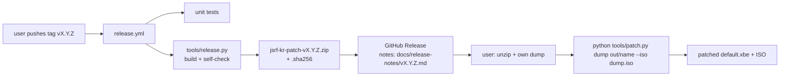

# 설계: GitHub Actions 릴리스와 배포 묶음 (issue #22, P9-1)

근거: [PLAN §5 P9, §7](../PLAN.md), [design i002](20261021-i002-patcher.md)(패치 도구), [design i020](20261023-i020-english-base.md)(영어 모드), [guides/apply-patch.md](../guides/apply-patch.md).

## 1. 목표

* GitHub Actions가 **배포 묶음**(zip)을 만들고 GitHub Release에 올린다.
* 묶음에는 패치 도구, 패치 데이터, 사용 설명서(usage), 출처가 적힌 설명서(라이선스, 서드파티 고지, 권리 고지)가 들어 있다.
* **묶음과 사용자의 덤프만으로** 패치된 `default.xbe`와 ISO를 만들 수 있다. 저장소를 받거나 다른 파일을 구할 필요가 없다.
* 게임 데이터(XBE, 자산, ISO), 원문, 패치된 결과물은 묶음에 넣지 않는다(`AGENTS.md`).



## 2. 묶음 구성

이름: `jsrf-kr-patch-v<VERSION>.zip`, 안의 최상위 폴더 `jsrf-kr-patch-v<VERSION>/`. 저장소와 같은 상대 경로를 지켜, 패치 도구가 고치지 않고 그대로 돈다(`jsrfkr.ROOT` = 묶음 폴더).

| 경로 | 내용 | 출처 |
|---|---|---|
| `README.md` | **사용 설명서**(한국어 + 영어): 필요한 것(Python, 덤프와 MD5), 사용법, 출력, 에뮬레이터에서 보기, 문제 해결, **출처·라이선스·권리 고지** | 새 파일 `release/README.md`(틀, 버전을 채움) |
| `LICENSE`, `THIRD_PARTY_NOTICES.md`, `VERSION` | 프로젝트 라이선스(MIT), 서드파티 고지, 버전 | 저장소 그대로 |
| `tools/patch.py` | 패치 도구 | 그대로 |
| `tools/jsrfkr/*.py` 등 | `patch.py`가 실제로 가져오는 모듈만(지금 24개: `jsrfkr` 18, `font` 5, `analysis` 2 — `modulefinder`로 정한다) | 그대로 |
| `patch/manifest.json`, `patch/xbe-en.tsv`, `patch/text/*.tsv`, `patch/xbe/` | 패치 데이터(원문 없음, 위치·해시·한국어·주소) | 그대로 |
| `patch/font/` | Do Hyeon 글꼴과 `OFL.txt`, `METADATA.pb`, `README.md` | 그대로(OFL은 글꼴과 함께 배포해야 한다) |

* 넣지 않는 것: `tests/`, `docs/`(설명은 묶음 `README.md`로), 분석·추출·검사 도구, `patch/poc/`(시험 문장), `roms/`·`out/`·`work/`.
* 묶음은 **결정적**으로 만든다: 파일 목록 정렬, zip 항목 시각 고정(1980-01-01), 같은 커밋이면 같은 zip 바이트. SHA-256을 `.sha256` 파일로 함께 올린다.

## 3. 묶음 만드는 도구 `tools/release.py`

```text
python -I tools/release.py <출력 폴더(out/ 아래)>        → jsrf-kr-patch-v<VERSION>.zip, .sha256
```

1. `VERSION`을 읽고, `--tag vX.Y.Z`가 주어지면 같은지 확인한다.
2. `modulefinder`로 `tools/patch.py`가 가져오는 저장소 안 모듈을 모은다. 표준 라이브러리 밖의 모듈(예: capstone)이 있으면 멈춘다.
3. §2의 데이터·문서 파일을 더하고, `release/README.md`의 `{version}`을 채운다.
4. zip을 결정적으로 쓴다.
5. **자체 점검**: zip을 임시 폴더에 풀고, 그 폴더만 경로로 삼아 `python -I tools/patch.py`(인자 없음 → 사용법 출력)와 모든 모듈 가져오기가 되는지, 묶음에 금지 파일(`.xbe`, `.iso`, `roms/` 등)이 없는지 본다.

## 4. 워크플로

| 파일 | 언제 | 하는 일 |
|---|---|---|
| `.github/workflows/ci.yml` | `main`으로의 push, PR | Python 3.12, 단위 시험(게임 자료 없이), `release.py`로 묶음을 만들어 **워크플로 산출물(artifact)**로 올린다 |
| `.github/workflows/release.yml` | 태그 `v*` push, 수동 실행(`workflow_dispatch`, 태그 입력) | 단위 시험 → `release.py --tag` → `gh release create`(본문은 `docs/release-notes/v<VERSION>.md`, zip과 `.sha256` 첨부). 이미 있는 릴리스면 파일만 다시 올린다 |

* 쓰는 액션: `actions/checkout@v4`, `actions/setup-python@v5`, `actions/upload-artifact@v4`. 릴리스는 러너에 있는 `gh`와 `GITHUB_TOKEN`(`permissions: contents: write`)으로 만든다. 서드파티 액션은 쓰지 않는다.
* 태그는 지금 규칙대로 로컬에서 만들고 **사용자가 push**한다(`AGENTS.md` Git 규칙). 태그 push가 곧 릴리스 승인이다.
* 저장소가 비공개라 릴리스도 비공개다. 공개 여부는 사용자 결정이다(PLAN §7).

### 4.1 릴리스 노트와 해결된 issue (추가 요구, 2026-10-23)

* GitHub Release 본문은 `docs/release-notes/v<VERSION>.md` 그대로다. 이 파일에는 규칙대로(`AGENTS.md` Git 규칙) **"해결된 issue" 표**(issue 링크, 내용, 커밋 ID)가 있다(v0.0.2~v0.0.12 모두).
* `release.py --tag`는 릴리스 노트가 있는지, 한국어 "### 해결된 issue"와 영어 "### Resolved issues" 절이 있는지, 각 절에 `https://github.com/<저장소>/issues/<번호>` 링크가 하나 이상 있는지 확인하고, 없으면 멈춘다. 그래서 해결된 issue가 없는 릴리스는 만들어지지 않는다.
* 묶음 안에도 같은 릴리스 노트를 `RELEASE_NOTES.md`로 넣는다.

## 5. 사용자 절차 (묶음 `README.md`의 핵심)

```text
1. Python 3.10 이상 설치
2. 묶음을 풀고 그 폴더에서:
   python -I tools/patch.py "<덤프 폴더>" out/jsrf-kr --iso "<같은 디스크의 xiso>"
3. 결과: out/jsrf-kr/ (패치된 게임 폴더, default.xbe 포함), out/jsrf-kr.iso
```

* 덤프: `default.xbe`(US판, MD5 `f4e366bfdceee551a09f42219c90d84e`)와 `Media/`. 다르면 도구가 아무것도 쓰지 않고 멈춘다.
* 출력은 묶음 폴더의 `out/` 아래여야 한다(지금 도구 규칙 그대로).

## 6. 검증

1. 로컬에서 `release.py` 두 번 → zip SHA-256이 같다(결정성).
2. 자체 점검(§3의 5) 통과.
3. **묶음 + 덤프로 패치**: zip을 저장소 밖 임시 폴더에 풀고 그 안의 `tools/patch.py`로 덤프를 패치 → 출력 `default.xbe`·xiso MD5가 저장소에서 만든 것(v0.0.12: `98c624a9…`, `841c9f67…`)과 같다.
4. CI: 워크플로 실행 결과(시험 통과, 산출물 생성)를 확인한다. 릴리스 워크플로는 사용자가 태그를 push한 뒤, 또는 수동 실행으로 확인한다.
5. 묶음 목록에 게임 데이터·원문이 없다(자체 점검 + 목록 검토).

## 7. 결정이 필요한 것

1. **실행 형태**: (권장) Python 스크립트 묶음 — 사용자가 Python 3.10+을 설치한다. 대안인 단일 실행 파일(PyInstaller 등)은 부트로더 라이선스(GPL + 예외)와 백신 오탐 문제가 있어 지금 규칙(`AGENTS.md` 라이선스)과 맞추기 어렵다.
2. **릴리스 시점**: (권장) 사용자가 태그를 push할 때만. 다음 머지(v0.0.13)부터 적용된다. 이미 있는 태그(v0.0.12 등)에 대해서는 수동 실행으로 만들 수 있다.

---

# Design: GitHub Actions releases and the distribution package (issue #22, P9-1)

Basis: [PLAN §5 P9, §7](../PLAN.md), [design i002](20261021-i002-patcher.md) (the patcher), [design i020](20261023-i020-english-base.md) (English mode), [guides/apply-patch.md](../guides/apply-patch.md).

## 1. Goal

* GitHub Actions builds a **distribution package** (zip) and uploads it to a GitHub Release.
* The package holds the patcher, the patch data, usage, and a document with sources (licenses, third-party notices, rights notice).
* **The package plus the user's dump** are enough to make the patched `default.xbe` and ISO; nothing else (no repository checkout) is needed.
* No game data (XBE, assets, ISO), original text or patched output goes into the package (`AGENTS.md`).

(The diagram above shows the tag → workflow → package → release → user flow.)

## 2. Package contents

Name `jsrf-kr-patch-v<VERSION>.zip` with the top folder `jsrf-kr-patch-v<VERSION>/`. The repository's relative paths are kept, so the patcher runs unchanged (`jsrfkr.ROOT` = the package folder).

| Path | Content | From |
|---|---|---|
| `README.md` | **the user guide** (Korean + English): requirements (Python, the dump and its MD5s), usage, outputs, running in emulators, troubleshooting, **sources, licenses and rights notice** | new template `release/README.md` (version filled in) |
| `LICENSE`, `THIRD_PARTY_NOTICES.md`, `VERSION` | project license (MIT), third-party notices, version | as in the repository |
| `tools/patch.py` | the patcher | as is |
| `tools/jsrfkr/*.py` and others | only the modules `patch.py` actually imports (24 now: 18 `jsrfkr`, 5 `font`, 2 `analysis`; found with `modulefinder`) | as is |
| `patch/manifest.json`, `patch/xbe-en.tsv`, `patch/text/*.tsv`, `patch/xbe/` | patch data (no original text: places, hashes, Korean, addresses) | as is |
| `patch/font/` | the Do Hyeon font with `OFL.txt`, `METADATA.pb`, `README.md` | as is (the OFL must ship with the font) |

* Left out: `tests/`, `docs/` (the package `README.md` explains), analysis/extraction/check tools, `patch/poc/` (test lines), `roms/`, `out/`, `work/`.
* The package is **deterministic**: sorted file list, fixed zip entry times (1980-01-01); the same commit gives the same zip bytes. A SHA-256 goes alongside as a `.sha256` file.

## 3. The packaging tool `tools/release.py`

(Command above.)

1. Read `VERSION`; with `--tag vX.Y.Z`, check that it matches.
2. Collect the repository modules `tools/patch.py` imports with `modulefinder`; stop if any module outside the standard library (capstone, say) is needed.
3. Add the data and document files of §2, filling `{version}` in `release/README.md`.
4. Write the zip deterministically.
5. **Self-check**: extract the zip to a temporary folder and, with only that folder on the path, check that `python -I tools/patch.py` (no arguments → usage) and every module import work, and that no forbidden file (`.xbe`, `.iso`, `roms/` …) is in the package.

## 4. Workflows

| File | When | What |
|---|---|---|
| `.github/workflows/ci.yml` | push to `main`, pull requests | Python 3.12, unit tests (no game data), build the package with `release.py` and upload it as a **workflow artifact** |
| `.github/workflows/release.yml` | push of a `v*` tag, manual run (`workflow_dispatch` with a tag input) | unit tests → `release.py --tag` → `gh release create` (body from `docs/release-notes/v<VERSION>.md`, zip and `.sha256` attached); for an existing release, only re-upload the files |

* Actions used: `actions/checkout@v4`, `actions/setup-python@v5`, `actions/upload-artifact@v4`; the release is made with the runner's `gh` and `GITHUB_TOKEN` (`permissions: contents: write`). No third-party actions.
* Tags are made locally as the rules say and **pushed by the user** (`AGENTS.md` Git rules); pushing a tag approves the release.
* The repository is private, so releases are private too; making them public is the user's decision (PLAN §7).

### 4.1 Release notes and resolved issues (added requirement, 2026-10-23)

* The GitHub Release body is `docs/release-notes/v<VERSION>.md` as it is; per the rules (`AGENTS.md` Git rules) that file has a **"resolved issues" table** (issue link, content, commit IDs), as all of v0.0.2–v0.0.12 do.
* `release.py --tag` checks that the release notes exist, that they have the Korean "### 해결된 issue" and English "### Resolved issues" sections, and that each section links at least one `https://github.com/<repo>/issues/<number>`; otherwise it stops, so no release is made without its resolved issues.
* The same notes go into the package as `RELEASE_NOTES.md`.

## 5. User procedure (the core of the package `README.md`)

(Block above: install Python 3.10+, unzip, run the patcher from that folder, get `out/jsrf-kr/` and `out/jsrf-kr.iso`.)

* The dump: `default.xbe` (US build, MD5 `f4e366bfdceee551a09f42219c90d84e`) and `Media/`; otherwise the tool stops without writing anything.
* The output must be under the package folder's `out/` (the current tool rule).

## 6. Verification

1. Run `release.py` twice locally → same zip SHA-256 (determinism).
2. The self-check (§3 item 5) passes.
3. **Patch with the package and the dump**: extract the zip to a temporary folder outside the repository and patch the dump with its `tools/patch.py` → the output `default.xbe` and xiso MD5s equal the repository-built ones (v0.0.12: `98c624a9…`, `841c9f67…`).
4. CI: check the workflow run (tests pass, artifact made). The release workflow is checked after the user pushes a tag, or by a manual run.
5. No game data or original text in the package list (self-check + list review).

## 7. Decisions needed

1. **Form**: (recommended) a package of Python scripts; users install Python 3.10+. The alternative, a single executable (PyInstaller and the like), brings a bootloader license (GPL + exception) and antivirus false positives that are hard to square with the current rules (`AGENTS.md` licensing).
2. **When to release**: (recommended) only when the user pushes a tag; it applies from the next merge (v0.0.13). Existing tags (v0.0.12 and so on) can be released with a manual run.
