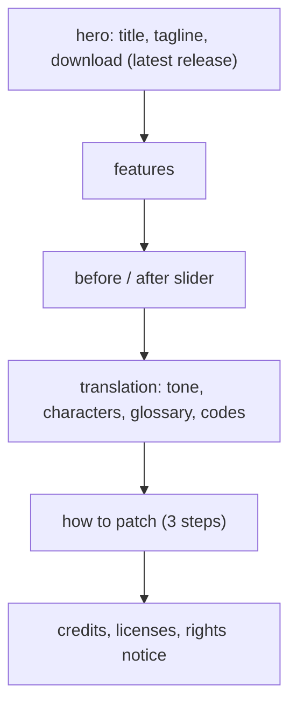

# 설계: 패치 소개 페이지 (issue #23, P9-2)

근거: [PLAN §7](../PLAN.md)(권리와 공개), [design i022](20261023-i022-release.md)(릴리스), [design i020](20261023-i020-english-base.md)(영어 모드), [kb/glossary.md](../kb/glossary.md), [작업 로그 i017](../work-logs/20261022-i017-text-translation.md)(번역).

## 1. 목표

* 패치를 소개하는 정적 웹 페이지를 GitHub Pages로 낸다.
* 테마: Jet Set Radio / Jet Set Radio Future의 분위기 — 힙합, 그래피티, 거리 문화. 굵은 원색, 스프레이 질감, 비스듬한 스티커·태그 같은 제목.
* 내용: 패치가 제공하는 기능, before / after 스크린샷, 번역의 특징, 사용법 요약과 내려받기(릴리스), 출처·권리 고지.

## 2. 구성

| 절 | 내용(근거) |
|---|---|
| 첫 화면 | 패치 이름, 한 줄 소개, 내려받기 단추(최신 릴리스), 버전 |
| 기능 | 화면 문장 전체 한국어(XBE 651 · 이벤트 397 · 미션 495 · 대화 733 = 2,276줄), 영어 모드 기반(영어판 그림·음성), 원문보다 긴 한국어도 들어감(페이지 다시 만들기, 미션 붙이기, XBE 새 섹션), 한글 글꼴 Do Hyeon(KS X 1001 907자 사용), 덤프 검증(MD5)·원본 바이트 없는 재생성, xiso 출력, reJSRF에서도 동작 |
| before / after | 같은 장면의 원본·패치 화면을 나란히(끌어서 비교하는 슬라이더). 세이브 화면, 일시정지 지도, 차고 대화(로보이), 미션 목표, 이벤트 자막 등 |
| 번역의 특징 | 번역투 없는 젊은 길거리 구어체, 인물·조직별 말투(DJ 프로페서 K, GG 크루, 경찰·롯카쿠, 라이벌 크루), 용어집 119개로 고유명사 통일(예: DJ 프로페서 K / DJ-K 구분), `$` 제어 코드·줄 폭 한도 지킴(검사 도구 오류·경고 0) |
| 사용법 | 묶음 풀기 → 덤프 준비(`default.xbe` US판 MD5) → `python -I tools/patch.py …` 한 줄 → 에뮬레이터·실기 |
| 출처·고지 | SEGA 권리 고지(비공식 팬 번역, 관계없음), 패치 도구 MIT, 글꼴 OFL, 게임 데이터 미포함 |

* 언어: 한국어가 본문, 각 절에 짧은 영어 요약.
* SEGA의 로고·공식 그림·공식 글꼴을 쓰지 않는다. 그래피티 장식은 CSS·SVG로 직접 만든다(공식 사이트처럼 보이지 않게, 팬 페이지임을 첫 화면과 바닥글에 밝힌다).

## 3. 기술

* 위치: `site/`(정적 HTML·CSS·소량의 JS, 빌드 단계 없음). `docs/`는 프로젝트 문서라 섞지 않는다.
* 글꼴: Google Fonts의 OFL 글꼴(예: 제목 Black Han Sans, 본문 Do Hyeon 또는 Noto Sans KR, 영문 장식 Permanent Marker). 외부 자원은 Google Fonts만.
* 배포: `.github/workflows/pages.yml` — `main`에 `site/**`가 바뀌어 push되면 `actions/upload-pages-artifact@v3` + `actions/deploy-pages@v4`. 내려받기 단추는 GitHub의 `releases/latest` 주소로 연결해 페이지를 고치지 않아도 최신 릴리스를 가리킨다.
* 접근성·모바일: 휴대폰 폭에서도 읽히게, 슬라이더는 키보드로도 움직이게, 색 대비를 지킨다.

## 4. 결정이 필요한 것

1. **스크린샷과 저장소 규칙**: `AGENTS.md`는 "화면 캡처는 게임 그림이라 커밋하지 않는다"고 한다. before / after를 페이지에 넣으려면 (a) `site/screenshots/`에 한해 예외로 커밋한다 — 규칙에 예외를 적는다, (b) 저장소에는 넣지 않고 페이지 배포 때만 다른 곳(사용자가 정한 비공개 저장소·릴리스 자산 등)에서 가져온다. 어느 쪽이든 공개되면 게임 그림이 배포되므로, 팬 번역 소개 목적의 최소한의 장면만 쓴다.
2. **스크린샷 출처**: 영어 모드 기준의 before(원본 영어판 화면)와 after(패치 화면) 짝이 필요하다. 사용자가 찍어 주거나(장면 목록을 드린다), 지금까지 받은 캡처(일본어 모드 시절 포함)를 쓸지.
3. **공개 범위**: 저장소가 비공개다. 비공개 저장소의 GitHub Pages는 유료 요금제(Pro/Team 이상)가 필요하고, 무료 요금제에서는 저장소를 공개해야 한다. 공개 여부는 PLAN §7의 사용자 결정이다(번역문은 원작의 2차적 저작물).

## 5. 검증

* 로컬에서 페이지를 열어 데스크톱·휴대폰 폭, 밝은·어두운 화면에서 확인한다(미리보기를 사용자에게 보여 준다).
* 링크(릴리스, 저장소, 고지 문서)가 맞는지, 외부 자원이 Google Fonts뿐인지.
* 워크플로 실행 뒤 Pages 주소에서 확인한다.

---

# Design: patch introduction page (issue #23, P9-2)

Basis: [PLAN §7](../PLAN.md) (rights and publication), [design i022](20261023-i022-release.md) (releases), [design i020](20261023-i020-english-base.md) (English mode), [kb/glossary.md](../kb/glossary.md), [work log i017](../work-logs/20261022-i017-text-translation.md) (translation).

## 1. Goal

* Publish a static web page introducing the patch on GitHub Pages.
* Theme: the spirit of Jet Set Radio / Jet Set Radio Future — hip-hop, graffiti, street culture; bold primary colours, spray textures, tilted sticker- and tag-like headings.
* Content: the patch's features, before/after screenshots, the translation's character, a short usage summary and download (releases), sources and rights notice.

(The diagram above shows the page's sections in order.)

## 2. Sections

(Table above: hero; features with their figures — 2,276 lines across XBE 651, events 397, missions 495, talk 733; English-mode base; Korean longer than the original fits; the Do Hyeon font with 907 KS X 1001 syllables; MD5-checked dumps and regeneration with no original bytes; xiso output; works in reJSRF — before/after slider of the same scenes; translation character — youthful street tone without translationese, per-character voices, a 119-entry glossary keeping names consistent, `$` control codes and line-width limits kept with 0 errors and warnings; usage; credits and notices.)

* Language: Korean body with a short English summary per section.
* No SEGA logos, official art or official fonts; the graffiti decoration is made with CSS and SVG (so it does not look like an official site; the hero and footer say it is a fan page).

## 3. Technology

* Location `site/` (static HTML, CSS, a little JS, no build step); kept apart from `docs/`, the project documents.
* Fonts: OFL fonts from Google Fonts (for example Black Han Sans for headings, Do Hyeon or Noto Sans KR for body text, Permanent Marker for Latin decoration); Google Fonts is the only external resource.
* Deployment: `.github/workflows/pages.yml` — on a push to `main` that changes `site/**`, `actions/upload-pages-artifact@v3` + `actions/deploy-pages@v4`. The download button links to GitHub's `releases/latest`, so it follows the newest release without page edits.
* Accessibility and mobile: readable at phone width, the slider works with the keyboard, colour contrast kept.

## 4. Decisions needed

1. **Screenshots and the repository rule**: `AGENTS.md` says "screen captures are game pictures and are not committed". To show before/after on the page, either (a) commit them under `site/screenshots/` as a written exception to the rule, or (b) keep them out of the repository and fetch them at deployment from elsewhere (a private store the user picks, release assets and so on). Either way, publishing distributes game pictures, so only the few scenes needed to introduce the fan translation are used.
2. **Screenshot source**: English-mode before (original English screens) and after (patched screens) pairs are needed — taken by the user (a scene list will be given), or reuse the captures received so far (some from the Japanese-mode builds).
3. **Visibility**: the repository is private. GitHub Pages for a private repository needs a paid plan (Pro/Team or higher); on the free plan the repository must be public. Publication is the user's decision under PLAN §7 (the translation is a derivative of the original).

## 5. Verification

* Open the page locally at desktop and phone widths, in light and dark settings (a preview is shown to the user).
* Links (release, repository, notice documents) right; Google Fonts the only external resource.
* After the workflow runs, check at the Pages address.
