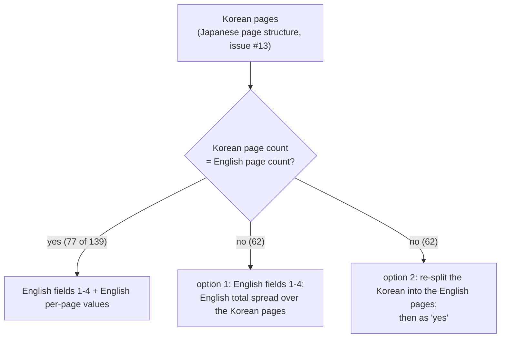

# 설계: 영어 모드 이벤트 자막 타이밍 (issue #26)

근거: [design i020](20261023-i020-english-base.md) §4, [analysis/message-script.md](../analysis/message-script.md), 사용자 보고(2026-10-23: 화면·대사와 자막이 어긋나고, 대사보다 자막이 먼저 끝난다).

## 1. 원인

* v0.0.12(#20)의 `tools/jsrfkr/english.py` `copy_language0()`는 메시지 스크립트의 영어 구간(언어 1)을 **일본어 구간의 복사본**으로 만든다. 페이지(한국어)뿐 아니라 필드 0~4와 페이지별 값까지 일본어 것을 쓴다.
* 영어 모드는 영어 음성·연출로 돈다. 그런데 시간 값은 일본어 판에 맞춘 것이라 어긋난다.
* 원본 이벤트 117개(메시지 139개)에서 두 언어의 값은 다르다(이번 조사, 정적):

| 항목 | 영어 ≠ 일본어 |
|---|---|
| 페이지 수(필드 0) | 62개(영어가 많음 58, 적음 4) |
| 페이지별 값의 합 | 영어/일본어 비율 중앙값 0.89, 범위 0.12~2.49 |
| 필드 4(30·60 단위, 시작 지연으로 보임) | 21개(예: `e024` 메시지 1: 37 대 80) |
| 필드 1 | 7개 |
| 필드 2·3 | 0개 |

* "필드 4 + 페이지별 값 합"으로 보면, 일본어가 60 이상 먼저 끝나는 메시지가 15개다. 가장 큰 것은 `e119`(2,123 대 4,090), `e281`(1,019 대 2,493), `e280`(985 대 2,139)이다. 값의 단위가 프레임(60fps)이면 `e119`는 자막이 약 33초 먼저 끝난다.
* 페이지별 값 = 페이지 표시 시간, 필드 4 = 시작 지연이라는 뜻은 **추정**이다. 화면 증상과 맞고 `$e` 페이지 값이 늘 0이라는 사실과도 맞지만, 값을 읽는 코드는 보지 않았다.
* 대화 이벤트(`TE###.bin`)도 언어별 값이 다르다(페이지 수 104개, 페이지별 값 107개). 하지만 페이지별 값이 대부분 30이고 버튼으로 넘기는 대화라, 보고된 증상과는 관계가 적어 보인다. 이번 범위에서 빼고 화면 확인만 한다(§5).
* 미션 문장 명령은 언어마다 문장 포인터만 따로 있고, 언어별 시간 값은 확인되지 않았다([mission-files](../analysis/mission-files.md)). 이번 범위 밖이다.

## 2. 안

### 안 1 (권장): 영어 시간에 맞춘다. 페이지 구조는 그대로 둔다

* 페이지는 지금처럼 한국어 페이지를 쓴다(일본어 페이지 수, #13 규칙). 대화 이벤트의 분기 인자도 그대로 맞는다.
* 필드 1~4는 **영어 구간 값**을 쓴다. 필드 0(페이지 수)은 한국어 페이지 수다.
* 페이지별 값:
  * 페이지 수가 영어와 같으면 **영어 값을 그대로** 쓴다(77개). 페이지 바뀌는 시점까지 영어판과 같아진다.
  * 다르면 **영어 값의 합을 한국어 페이지에 나눠 준다**(62개). 나누는 비율은 일본어 페이지별 값이다(한국어 페이지가 일본어 페이지의 번역이고, 일본어 값이 줄마다 길이를 반영한다). 정수로 나누고 남는 값은 앞 페이지부터 1씩 더해, 합이 영어와 정확히 같게 한다. `$e` 페이지는 0으로 둔다.
* 결과: 모든 메시지에서 자막이 시작하는 시점(필드 4)과 끝나는 시점(합)이 영어판과 같다. 페이지 수가 다른 62개는 중간에 페이지가 바뀌는 시점이 영어 음성과 조금 다를 수 있다.
* 기계적이고 번역문을 고치지 않는다.

### 안 2: 한국어를 영어 페이지 수로 다시 나눈다

* 페이지 수가 다른 62개 메시지의 한국어를 영어 페이지에 맞춰 다시 나눈다(번역 파일의 자리 구조가 바뀐다). 그 뒤로는 모든 메시지가 영어 구조를 그대로 쓴다.
* 페이지가 바뀌는 시점까지 영어 음성과 맞는다. 대신 번역 재배치(사람 또는 AI)와 검수가 필요하고, 번역 파일이 일본어 페이지 구조를 따른다는 지금 규칙(#13, #17)을 바꿔야 한다.

**제안**: 안 1로 지금 증상(먼저 끝남, 시작 어긋남)을 고친다. 화면에서 중간 어긋남이 거슬리는 메시지가 있으면, 그 메시지만 안 2로 다시 나누는 후속 issue를 연다.

## 3. 구현 (안 1)

* `tools/jsrfkr/english.py`: `copy_language0()` 대신 `korean_with_english_timing(data)`(가칭). 원본 영어 구간의 필드 1~4와 페이지별 값을 먼저 읽어 두고, 언어 1 = 한국어 페이지 + 위 규칙의 시간 값으로 다시 만든다.
* 이벤트(`e###.dat`)와 대화(`TE###.bin`)를 같은 함수로 처리하되, 대화는 이번에는 지금과 같게(일본어 시간 복사) 둔다. 옵션 하나로 나눈다.
* 언어 0 구간은 지금과 같다(일본어 원문 그대로).

## 4. 검증

1. 단위 시험(게임 자료 없음): 합성 스크립트로 같은 페이지 수(영어 값 그대로), 다른 페이지 수(합이 같고 비율대로, `$e` 0), 필드 1~4가 영어 값인지.
2. 덤프 전체: 이벤트 139개 메시지 모두 언어 1의 "필드 4 + 페이지별 값 합"이 원본 영어와 같다. 메시지 스크립트 368개가 다시 읽힌다(`msgscript.parse`).
3. 왕복: `--identity`와 기존 왕복 시험(`check_roundtrip.py`, 단위 시험 73개)이 그대로 통과한다.
4. 화면(사용자와 함께, Cxbx-Reloaded): 오프닝(`e000`, `e001`)과 `e024`, 가능하면 `e119`에서 자막 시작·끝이 영어 음성과 맞는지. 대화 이벤트 하나가 이전과 같은지.

## 5. 남는 것

* 값의 뜻(표시 시간, 시작 지연)을 코드로 확인하지 않았다. 화면 결과를 [message-script.md](../analysis/message-script.md)에 적는다.
* 대화 이벤트와 미션 무전의 시간은 화면에서 문제가 보이면 따로 다룬다.

---

# Design: English-mode cutscene subtitle timing (issue #26)

Grounds: [design i020](20261023-i020-english-base.md) §4, [analysis/message-script.md](../analysis/message-script.md), the user's report (2026-10-23: subtitles drift from picture and voice, and end before the line does).

## 1. Cause

* `copy_language0()` in `tools/jsrfkr/english.py` (v0.0.12, #20) makes the English block (language 1) of a message script **a copy of the Japanese block**: not only the (Korean) pages but fields 0–4 and the per-page values.
* English mode runs with English voice and staging, while these timing values were made for the Japanese version, so they drift.
* In the original 117 events (139 messages) the two languages differ (this survey, static):

| Item | English ≠ Japanese |
|---|---|
| page count (field 0) | 62 (English more 58, fewer 4) |
| sum of per-page values | median English/Japanese 0.89, range 0.12–2.49 |
| field 4 (30/60 steps, looks like a start delay) | 21 (for example `e024` message 1: 37 vs 80) |
| field 1 | 7 |
| fields 2, 3 | 0 |

* Counting "field 4 + sum of per-page values", 15 messages end at least 60 earlier in Japanese. The largest: `e119` (2,123 vs 4,090), `e281` (1,019 vs 2,493), `e280` (985 vs 2,139). If the unit is frames (60 fps), `e119`'s subtitles end about 33 s early.
* Per-page value = page display time and field 4 = start delay are **inferred**: they fit the symptoms and the `$e` pages' constant 0, but the code reading them has not been looked at.
* Talk events (`TE###.bin`) differ by language too (page counts 104, per-page values 107), but the values are mostly 30 and the pages advance by button, so they seem unrelated to the report. Out of scope; screen-checked only (§5).
* Mission text commands have only per-language text pointers; no per-language timing is known ([mission-files](../analysis/mission-files.md)). Out of scope.

## 2. Options

### Option 1 (recommended): English timing, page structure kept

* Pages stay the Korean pages (Japanese page counts, #13 rules); talk branch arguments stay right.
* Fields 1–4 take the **English block's values**; field 0 is the Korean page count.
* Per-page values:
  * same page count as English: **the English values as they are** (77); page changes match the English version too.
  * different: **the English total spread over the Korean pages** (62), in proportion to the Japanese per-page values (each Korean page translates a Japanese page, whose value reflects that line's length). Integer division, the remainder added 1 at a time from the first page so the sum equals the English total exactly; `$e` pages stay 0.
* Result: every message starts (field 4) and ends (sum) when the English version does. In the 62 with other page counts, page changes in between may differ a little from the English voice.
* Mechanical; the translation is not touched.

### Option 2: re-split the Korean into the English pages

* Re-split the Korean of the 62 messages to the English pages (the translation files' place structure changes); then every message uses the English structure as is.
* Page changes match the English voice too, but it needs re-layout of the translation (by people or AI) and review, and changes the current rule that translation files follow the Japanese page structure (#13, #17).

**Proposal**: fix the present symptoms (early end, shifted start) with option 1. If page changes in a message still jar on screen, open a follow-up issue to re-split only those messages (option 2).

## 3. Implementation (option 1)

* `tools/jsrfkr/english.py`: replace `copy_language0()` with `korean_with_english_timing(data)` (working name): read the original English block's fields 1–4 and per-page values first, then rebuild language 1 = Korean pages + the timing above.
* Events (`e###.dat`) and talk (`TE###.bin`) go through the same function, but talk keeps the present behaviour (Japanese timing copied) this time, chosen by one option.
* Language 0 stays as now (the Japanese original).

## 4. Verification

1. Unit tests (no game data): synthetic scripts for the same page count (English values as is), a different page count (same sum, proportional, `$e` 0), and fields 1–4 from English.
2. Whole dump: for all 139 event messages, language 1's "field 4 + sum of per-page values" equals the original English; all 368 message scripts parse again (`msgscript.parse`).
3. Round trip: `--identity` and the existing round-trip checks (`check_roundtrip.py`, the 73 unit tests) still pass.
4. Screen (with the user, Cxbx-Reloaded): the opening (`e000`, `e001`) and `e024`, and `e119` if reachable — subtitles start and end with the English voice; one talk event behaves as before.

## 5. Left open

* The values' meaning (display time, start delay) is not code-confirmed; the screen results go into [message-script.md](../analysis/message-script.md).
* Talk-event and mission-radio timing are taken up separately if the screen shows a problem.
