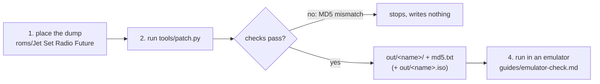

# 패치 적용하기

자기 덤프에 패치 도구를 돌려 한국어 패치된 게임 폴더(와 xiso)를 만드는 절차다. 근거는 [설계 i002](../design/20261021-i002-patcher.md)와 [작업 로그 i002](../work-logs/20261021-i002-patcher.md)다. 지금은 번역이 없으므로 기본 패치는 글리프 표와 `jetfont.dat`만 바꾼다. 새 표에는 한자 칸이 없으므로, 이 출력에서는 일본어 문장의 한자가 얼룩으로 나온다(가나는 그대로). 번역(P6)이 생기기 전까지 기본 출력은 시험용이다. 화면에서 한국어를 보려면 [개념 증명 시험 문장](../../patch/poc/lines.tsv)을 쓴다(§3). 번역 파일을 만드는 절차(추출 → 번역 → 재조합)는 [text-pipeline.md](text-pipeline.md)에 있다.



## 1. 준비

* Python 3.10 이상(외부 패키지 필요 없음).
* 일본판 디스크의 덤프: `default.xbe`(MD5 `d8490cdb75bd47b36c62effdf1461ae0`)와 `Media/` 전체. 저장소의 `roms/Jet Set Radio Future/`에 두면 Git이 무시한다.
* xemu용 출력이 필요하면 같은 디스크의 xiso(예: `roms/Jet Set Radio Future.iso`).
* 디스크 여유: 출력 폴더 약 2.4GB, xiso를 만들면 약 2.5GB 더.

## 2. 실행

```bash
python -I tools/patch.py "roms/Jet Set Radio Future" out/jsrf-kr --iso "roms/Jet Set Radio Future.iso"
```

* 입력 MD5가 하나라도 다르면 무엇이 다른지 알리고 아무것도 쓰지 않는다. 다른 판(US, PAL)이나 고친 파일은 받지 않는다.
* 출력 폴더는 `out/` 아래의 없거나 빈 폴더여야 한다. 다시 만들 때는 먼저 지운다.
* 끝에 바뀐 파일과 MD5가 나오고 `out/jsrf-kr/md5.txt`에 남는다. 같은 패치 데이터와 덤프면 늘 같은 MD5다.
* 디스크를 아끼려면 `--link`(바뀌지 않은 파일을 하드링크로). 이때 출력 폴더의 그 파일을 고치면 덤프도 바뀐다.

## 3. 시험 문장으로 화면 확인하기

```bash
python -I tools/patch.py "roms/Jet Set Radio Future" out/jsrf-kr-poc --text patch/poc/lines.tsv --iso "roms/Jet Set Radio Future.iso"
```

출력 MD5가 [작업 로그 i008](../work-logs/20261020-i008-poc.md) §3의 값과 같아야 한다(`default.xbe` `cbb44a1188af507cc37b4234e5d9b09e` 등). 다만 v0.0.8(issue #13)부터 대화 페이지를 공백 없이 다시 만들므로 `Media/Event/TalkEvent/TE014.bin`은 `ef4ad91efec7a607a2b984d3b32aabc8`이고, 그에 따라 xiso의 MD5도 다르다. 원문보다 긴 시험 문장은 [emulator-check.md](emulator-check.md) §5. 화면에서 볼 자리는 [emulator-check.md](emulator-check.md) §4다.

## 4. 실행해 보기

* xemu: `out/jsrf-kr.iso`를 DVD로.
* Cxbx-Reloaded: `out/jsrf-kr/default.xbe`.
* reJSRF(일본판 빌드): `rejsrf.exe out/jsrf-kr`.
* 에뮬레이터의 HDD 캐시에 원본 `Media`가 남아 있으면 패치가 보이지 않는다. 지우는 법은 [emulator-check.md](emulator-check.md) §2.

## 5. 문제가 생기면

| 메시지 | 뜻 |
|---|---|
| `input check failed: … MD5 … is not …` | 덤프 파일이 기대한 원본과 다르다. 다른 판이거나 고친 파일이다 |
| `not in the manifest` | 문장 패치가 건드리는 파일이 `patch/manifest.json`에 없다(패치 데이터를 만드는 쪽의 문제). `--update-manifest`로 채운다 |
| `original bytes do not match orig_sha1` | 그 자리의 원문이 패치 데이터가 기대한 것과 다르다 |
| `exists and is not an empty folder` | 출력 폴더를 지우고 다시 실행한다 |

---

# Applying the patch

How to run the patcher on your own dump to make a Korean-patched game folder (and xiso). It rests on [design i002](../design/20261021-i002-patcher.md) and [work log i002](../work-logs/20261021-i002-patcher.md). There is no translation yet, so the default patch changes only the glyph table and `jetfont.dat`. The new table has no kanji cells, so in this output the kanji of the Japanese text show as smudges (kana stay); until the translation (P6) exists, the default output is for testing only. To see Korean on screen, use the [proof-of-concept test lines](../../patch/poc/lines.tsv) (§3). The procedure for making the translation files (extract → translate → reassemble) is in [text-pipeline.md](text-pipeline.md).

(The diagram above shows the steps: place the dump, run the patcher, which stops on an MD5 mismatch or writes the output folder and xiso, then run it in an emulator.)

## 1. Preparation

* Python 3.10 or later (no external packages).
* A dump of the Japanese disc: `default.xbe` (MD5 `d8490cdb75bd47b36c62effdf1461ae0`) and all of `Media/`. Git ignores it under the repository's `roms/Jet Set Radio Future/`.
* For xemu output, the same disc's xiso (for example `roms/Jet Set Radio Future.iso`).
* Free disk: about 2.4 GB for the output folder, about 2.5 GB more with the xiso.

## 2. Run

(Command above.)

* If any input MD5 differs, it says which and writes nothing; other releases (US, PAL) and modified files are refused.
* The output must be an absent or empty folder under `out/`; delete it before rebuilding.
* It ends with the changed files and their MD5s, also kept in `out/jsrf-kr/md5.txt`; the same patch data and dump always give the same MD5s.
* To save disk, `--link` hard-links unchanged files; editing such a file in the output then edits the dump too.

## 3. Checking the screen with the test lines

(Command above.) The output MD5s must equal those in §3 of [work log i008](../work-logs/20261020-i008-poc.md) (`default.xbe` `cbb44a1188af507cc37b4234e5d9b09e` and so on), except that from v0.0.8 (issue #13) talk pages are rebuilt without padding, so `Media/Event/TalkEvent/TE014.bin` is `ef4ad91efec7a607a2b984d3b32aabc8` and the xiso's MD5 differs accordingly. Test lines longer than the original: [emulator-check.md](emulator-check.md) §5. The places to look at are in [emulator-check.md](emulator-check.md) §4.

## 4. Running it

* xemu: `out/jsrf-kr.iso` as the DVD.
* Cxbx-Reloaded: `out/jsrf-kr/default.xbe`.
* reJSRF (Japanese build): `rejsrf.exe out/jsrf-kr`.
* If an emulator's HDD cache still holds the original `Media`, the patch does not show; [emulator-check.md](emulator-check.md) §2 says how to clear it.

## 5. When something goes wrong

| Message | Meaning |
|---|---|
| `input check failed: … MD5 … is not …` | a dump file is not the expected original: another release or a modified file |
| `not in the manifest` | a file the text patch touches is missing from `patch/manifest.json` (a problem on the patch-data side); fill it with `--update-manifest` |
| `original bytes do not match orig_sha1` | the original text at that place is not what the patch data expects |
| `exists and is not an empty folder` | delete the output folder and run again |
