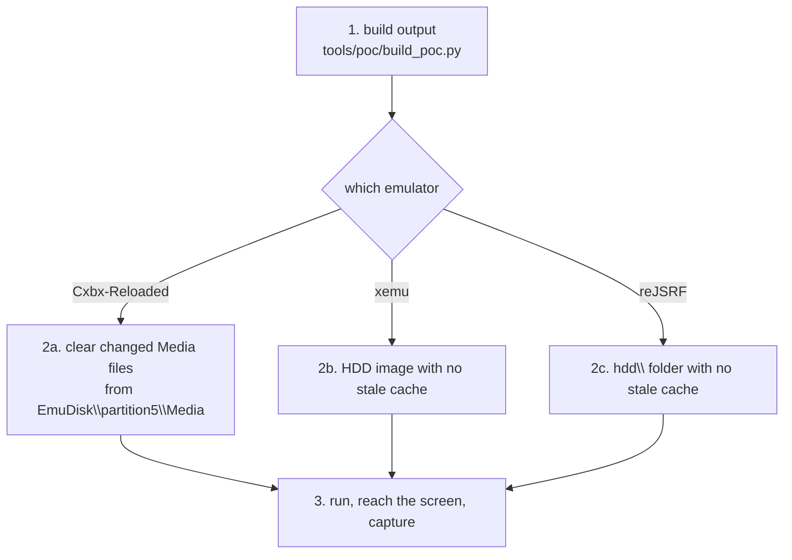

# 패치 결과를 에뮬레이터에서 확인하기

패치한 출력을 Cxbx-Reloaded, xemu, reJSRF에서 띄워 한국어가 화면에 나오는지 보는 절차다. 근거는 [설계 i008](../design/20261020-i008-poc.md), [작업 로그 i008](../work-logs/20261020-i008-poc.md), [analysis/text-files.md](../analysis/text-files.md)다. 지금은 개념 증명 도구(`tools/poc/build_poc.py`)의 출력을 대상으로 하고, P1 패치 도구가 생기면 그 출력으로 바꾼다.



## 1. 출력 만들기

```bash
python -I tools/poc/build_poc.py "roms/Jet Set Radio Future" "roms/Jet Set Radio Future.iso" out/poc
```

* 끝에 나오는 MD5를 적어 둔다. 같은 패치 데이터면 늘 같은 값이다.
* xemu가 ISO를 쓰고 있으면 먼저 끈다. 자세한 옵션은 [tools/poc/README.md](../../tools/poc/README.md).

## 2. HDD 캐시 지우기

게임은 `Media` 파일을 처음 읽을 때 HDD(`Z:\Media\…`)에 복사하고 그 뒤로는 캐시를 읽는다. **캐시에 원본이 남아 있으면 패치한 문장이 나오지 않는다.** 바꾼 파일만 캐시에서 빼면 게임이 디스크에서 다시 읽는다. `jetfont.dat`와 XBE 문자열은 캐시와 상관없다.

바꾼 `Media` 파일은 `out/poc/files/Media/` 아래에 있는 파일들이다(지금은 `Mission/mssn0110.bin`, `Event/TalkEvent/TE014.bin`).

### 2a. Cxbx-Reloaded

1. Cxbx-Reloaded를 끈다.
2. `<Cxbx 폴더>\EmuDisk\partition5\Media\` 아래에서 바꾼 파일과 같은 경로의 파일을 찾아 다른 폴더(예: `EmuDisk\cache-bak-<날짜>\`)로 옮긴다. 지우지 말고 옮겨 두면 되돌릴 수 있다. `Cache\*.tbl`은 그대로 둔다.

### 2b. xemu

캐시는 HDD 이미지(설정의 `hdd_path`, qcow2) 안에 생긴다. 이미지 안의 파일만 골라 지우는 방법은 아직 정하지 않았다(**미확정**). 지금은 다음 중 하나를 쓴다.

* 이 게임을 아직 실행하지 않은 HDD 이미지로 띄운다. 쓰던 이미지는 복사해 두고, xemu 설정의 `hdd_path`를 사본이나 새 이미지로 바꾼다.
* 처음 실행이 패치한 출력이었다면 같은 출력을 다시 볼 때는 그대로 둬도 된다. 출력을 다시 만들었다면 위의 방법을 쓴다.

### 2c. reJSRF

게임의 HDD는 실행한 현재 폴더의 `hdd\`(또는 `REJSRF_HDD_ROOT`)다. 그 아래 `Media\`에서 2a처럼 바꾼 파일을 옮긴다.

## 3. 실행

### Cxbx-Reloaded

1. `cxbx.exe`를 열고 `out/poc/rejsrf/default_jpn.xbe`(패치한 일본판 XBE)를 연다. Cxbx-Reloaded는 XBE가 있는 폴더를 `D:`로 쓴다.
2. 서명을 고치지 않은 XBE지만 그대로 실행된다.

### xemu

```text
xemu.exe -dvd_path "<저장소>\out\poc\jsrf-kr-poc.iso"
```

설정의 `dvd_path`를 바꾸지 않고 명령줄로 디스크를 준다. 서명을 고치지 않은 XBE지만 부팅된다.

### reJSRF (일본판 빌드)

reJSRF 저장소에서 일본판 빌드를 만든다([reJSRF 빌드 가이드](https://github.com/nworkers/reJSRF/blob/main/docs/guides/win32-setup-and-build.md) §4~5). 재컴파일 코드는 원본 일본판 XBE로 만든다.

```powershell
python scripts\recomp\regenerate.py --xbe "<저장소>\roms\Jet Set Radio Future\default.xbe"
scripts\build_win32_x86.bat -Configuration Release -Variant jp
build\win32_x86_jp\src\app\Release\rejsrf.exe "<저장소>\out\poc\rejsrf" --xbe default_jpn.xbe
```

reJSRF는 XBE를 MD5가 아니라 인증서로 알아보므로 패치한 XBE도 받는다. 입력은 게임패드, 없으면 키보드다(방향키, Enter = START, Z/X = A/B).

## 4. 확인할 화면

| 문장 | 화면 | 가는 법 |
|---|---|---|
| 뭐야、무슨 볼일？ | 차고 로보이 대사 | 차고에서 로보이에게 다가가 A |
| “도겐자카”를 그래피티로 칠해라！ | 일시정지 지도 화면 위쪽 목표 | 첫 미션(도겐자카) 중 START |
| 저장 | 일시정지 지도 화면 오른쪽 아래 | 차고나 미션 중 START |

* 볼 것: 한글이 나오는지, 칸 밖 번짐·잘림이 없는지, 기호(`、` `？` `“ ” ！`)와 공백이 맞는지.
* 화면 캡처는 게임 그림이므로 커밋하지 않는다. 결과는 작업 로그에 글로 적는다.

## 5. 원문보다 긴 문장 확인 (issue #13)

[patch/poc/long.tsv](../../patch/poc/long.tsv)는 묶음마다 원문보다 긴 시험 문장 한 줄이다. 이벤트·대화 페이지는 다시 만들어지고, 미션 문장은 파일 끝에 붙고, XBE 문자열은 새 섹션 `KRTEXT`로 옮겨진다. 정식 패치 도구로 만든다.

```bash
python -I tools/patch.py "roms/Jet Set Radio Future" out/jsrf-kr-long --text patch/poc/long.tsv --iso "roms/Jet Set Radio Future.iso"
```

* 출력 MD5(2026-10-21): `default.xbe` `b0b95c85b71a70fd638054997a1e640e`, `e000.dat` `9b629a939ab3612b088fea25c1f3afe2`, `TE014.bin` `757e044efee89fb1b6bed7f4e55fd087`, `mssn0110.bin` `665e7c6def6cf34b9368f8298b7b1067`, `jetfont.dat` `401a2efe5d3090672215d58945ba0f07`, xiso `80a4a3ee2ef50d5e23cf4b37f7fcdb8f`.
* 캐시에서 뺄 파일(§2): `Media/Event/Event/e000.dat`, `Media/Event/TalkEvent/TE014.bin`, `Media/Mission/mssn0110.bin`.
* 실행: Cxbx-Reloaded는 `out/jsrf-kr-long/default.xbe`, xemu는 `-dvd_path out/jsrf-kr-long.iso`.

| 시험 문장 | 화면 | 가는 법 | 확인할 것 |
|---|---|---|---|
| (부팅) | 경고·타이틀 화면 | 그냥 실행 | **섹션을 더한 XBE가 실행되는가** |
| 저장하기 | 일시정지 지도 화면 오른쪽 아래(§4의 "저장" 자리) | 차고나 미션 중 START | 새 섹션으로 옮긴 XBE 문자열 |
| 뭐야, 무슨 볼일이라도 있는 거야？ | 차고 로보이 첫 대사 | 차고에서 로보이에게 다가가 A | 대화 페이지 다시 만들기(원문 18바이트 → 33바이트) |
| “도겐자카”를 그래피티로 남김없이 칠해라！ | 일시정지 지도 화면 위쪽 목표 | 첫 미션(도겐자카) 중 START | 미션 파일 끝에 붙인 문자열 |
| 시부야 터미널. 사람도 차도 끝없이 오가는 / 거리의 한복판이다！(2줄) | `e000` 이벤트의 첫 자막 | 새 게임을 시작한 뒤 처음 나오는 이벤트로 보인다(**추정**) | 이벤트 페이지 다시 만들기(34 → 61바이트) |

* 볼 것: §4와 같다. 그리고 문장 끝이 잘리거나 뒤에 다른 글자가 붙지 않는지, 그 뒤의 대사·메뉴가 원래대로 이어지는지.
* 확인한 뒤 결과(보였다/안 보였다, 에뮬레이터와 판)를 알려 주면 작업 로그와 분석 문서에 적는다.

---

# Checking the patched output in an emulator

A procedure for running the patched output in Cxbx-Reloaded, xemu and reJSRF and seeing whether Korean appears on screen. It rests on [design i008](../design/20261020-i008-poc.md), [work log i008](../work-logs/20261020-i008-poc.md) and [analysis/text-files.md](../analysis/text-files.md). For now it targets the output of the proof-of-concept tool (`tools/poc/build_poc.py`); once the P1 patcher exists, it switches to that output.

(The diagram above shows the steps: build, clear the cache for the emulator used, run.)

## 1. Build the output

The command is above.

* Note the MD5s printed at the end; the same patch data always gives the same values.
* Close xemu first if it is using the ISO. Options are in [tools/poc/README.md](../../tools/poc/README.md).

## 2. Clear the HDD cache

The game copies a `Media` file to the HDD (`Z:\Media\…`) the first time it reads it and reads the cache afterwards. **If the cache still holds the original, the patched text does not appear.** Taking just the changed files out of the cache makes the game read them from the disc again. `jetfont.dat` and XBE strings are unaffected by the cache.

The changed `Media` files are those under `out/poc/files/Media/` (at present `Mission/mssn0110.bin` and `Event/TalkEvent/TE014.bin`).

### 2a. Cxbx-Reloaded

1. Close Cxbx-Reloaded.
2. Under `<Cxbx folder>\EmuDisk\partition5\Media\`, find the files at the same paths as the changed ones and move them to another folder (for example `EmuDisk\cache-bak-<date>\`). Moving rather than deleting keeps them restorable. Leave `Cache\*.tbl` as it is.

### 2b. xemu

The cache lives inside the HDD image (the `hdd_path` setting, qcow2). How to delete single files inside the image is not settled yet (**unresolved**). For now use one of these:

* Run with an HDD image on which the game has not run yet: copy the image in use and point xemu's `hdd_path` at the copy or at a fresh image.
* If the first run was already the patched output, looking at the same output again needs nothing; after rebuilding the output, use the previous method.

### 2c. reJSRF

The game's HDD is `hdd\` in the current folder of the run (or `REJSRF_HDD_ROOT`); move the changed files out of its `Media\` as in 2a.

## 3. Run

### Cxbx-Reloaded

1. Open `cxbx.exe` and load `out/poc/rejsrf/default_jpn.xbe` (the patched Japanese XBE); Cxbx-Reloaded uses the XBE's folder as `D:`.
2. The XBE's signature is not fixed, yet it runs.

### xemu

Give the disc on the command line (above) rather than changing the `dvd_path` setting. The unsigned XBE boots.

### reJSRF (Japanese build)

Build the Japanese variant in the reJSRF repository ([reJSRF build guide](https://github.com/nworkers/reJSRF/blob/main/docs/guides/win32-setup-and-build.md) §4–5), generating the recompiled code from the original Japanese XBE (commands above). reJSRF identifies an XBE by its certificate, not its MD5, so it accepts the patched XBE. Input is a gamepad, else the keyboard (arrows, Enter = START, Z/X = A/B).

## 4. Screens to check

| Line | Screen | How to get there |
|---|---|---|
| 뭐야、무슨 볼일？ | Roboy's line in the garage | walk up to Roboy in the garage and press A |
| “도겐자카”를 그래피티로 칠해라！ | the objective at the top of the pause map screen | START during the first mission (Dogenzaka) |
| 저장 | bottom right of the pause map screen | START in the garage or a mission |

* Look for: Hangul appearing, no ink outside cells or clipping, the symbols (`、` `？` `“ ” ！`) and spaces right.
* Screen captures are game pictures and are not committed; write the results in the work log.

## 5. Checking text longer than the original (issue #13)

[patch/poc/long.tsv](../../patch/poc/long.tsv) holds one test line longer than its original per group: event and talk pages are rebuilt, the mission string is appended at the end of its file, and the XBE string moves to the new section `KRTEXT`. Build it with the patcher (command above).

* Output MD5s (2026-10-21): `default.xbe` `b0b95c85b71a70fd638054997a1e640e`, `e000.dat` `9b629a939ab3612b088fea25c1f3afe2`, `TE014.bin` `757e044efee89fb1b6bed7f4e55fd087`, `mssn0110.bin` `665e7c6def6cf34b9368f8298b7b1067`, `jetfont.dat` `401a2efe5d3090672215d58945ba0f07`, xiso `80a4a3ee2ef50d5e23cf4b37f7fcdb8f`.
* Files to take out of the cache (§2): `Media/Event/Event/e000.dat`, `Media/Event/TalkEvent/TE014.bin`, `Media/Mission/mssn0110.bin`.
* Run: Cxbx-Reloaded with `out/jsrf-kr-long/default.xbe`; xemu with `-dvd_path out/jsrf-kr-long.iso`.

| Test line | Screen | How to get there | What it checks |
|---|---|---|---|
| (boot) | warning and title screens | just run | **whether the XBE with an added section runs** |
| 저장하기 | bottom right of the pause map screen (the "저장" place of §4) | START in the garage or a mission | an XBE string moved to the new section |
| 뭐야, 무슨 볼일이라도 있는 거야？ | Roboy's first line in the garage | walk up to Roboy and press A | a rebuilt talk page (18 → 33 bytes) |
| “도겐자카”를 그래피티로 남김없이 칠해라！ | the objective at the top of the pause map screen | START during the first mission (Dogenzaka) | a string appended to the mission file |
| 시부야 터미널. 사람도 차도 끝없이 오가는 / 거리의 한복판이다！ (2 lines) | the first subtitle of event `e000` | apparently the first event after starting a new game (**inferred**) | a rebuilt event page (34 → 61 bytes) |

* Look for: as in §4, plus no clipped endings or stray characters after the text, and the following lines and menus continuing as before.
* Report the results (shown or not, emulator and version) so they go into the work log and the analysis documents.
