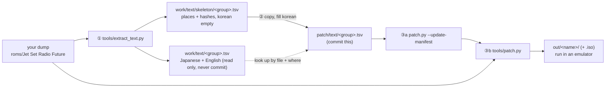

# 문장 번역 파이프라인: 추출 → 번역 → 재조합

AI 도움 없이 이 문서와 저장소의 도구만으로 한국어 문장 패치를 만드는 절차다. 위에서부터 차례로 따라 한다. 근거는 [설계 i011](../design/20261021-i011-text-extract.md)과 [작업 로그 i011](../work-logs/20261021-i011-text-extract.md)이고, 패치 도구 자체의 사용법은 [apply-patch.md](apply-patch.md)에 있다.

> **지금 되는 것과 아직 안 되는 것 (2026-10-21, issue #11 기준)**
> * 된다: ① 추출, ② 번역 파일 채우기, ③ 재조합 중 **원문 길이 이하의 한국어**(제자리 교체).
> * 아직 안 된다: 원문보다 긴 한국어, 페이지(`$r`)를 늘리거나 줄이기. 다음 issue(P5 재삽입)에서 생기며, 생기면 이 문서의 §4를 고친다.



## 0. 준비

1. Python 3.10 이상. 외부 패키지는 필요 없다. 명령은 모두 **저장소 루트**에서 `python -I`로 실행한다.
2. 일본판 디스크 덤프를 `roms/Jet Set Radio Future/`에 둔다(`default.xbe`와 `Media/`). Git은 이 폴더를 무시한다.
3. `default.xbe`의 MD5가 `d8490cdb75bd47b36c62effdf1461ae0`이어야 한다. 다르면 도구가 멈춘다(다른 판이나 고친 파일).

## 1. ① 추출

```bash
python -I tools/extract_text.py "roms/Jet Set Radio Future"
```

* 1분쯤 걸린다. 끝에 묶음별 개수가 나오고 `work/text/summary.txt`에도 남는다. 이 덤프에서는 다음과 같아야 한다(다르면 덤프나 도구가 다르다).

```text
event    files  117  records   117  units   397  bytes   18867  left out   139
talk     files  251  records   251  units   733  bytes   32038  left out   429
mission  files  196  records   674  units   495  bytes   34234  left out   179
xbe      files    1  records   651  units   651  bytes   14189  left out     0
total    units 2276, every place checked against the dump (2276)
```

* 만들어지는 파일(모두 `work/text/` 아래):

| 파일 | 내용 | 커밋 |
|---|---|---|
| `event.tsv` `talk.tsv` `mission.tsv` `xbe.tsv` | 단위마다 자리, 해시, **일본어 원문, 영어 원문** | **절대 안 함**(원문) |
| `skeleton/<묶음>.tsv` | 같은 단위의 자리와 해시만, `korean` 칸은 비어 있음 | 번역을 채운 뒤 `patch/text/`로 옮겨 커밋 |
| `summary.txt` | 위 개수 | 안 함 |

* 묶음:
  * `event`: 이벤트 장면 대사(`Media/Event/Event/e###.dat`), 한 줄 = 자막 한 **페이지**
  * `talk`: 차고 등에서 말을 거는 대화(`Media/Event/TalkEvent/TE###.bin`), 한 줄 = 한 페이지
  * `mission`: 미션 목표·안내(`Media/Mission/mssn####.bin`), 한 줄 = 문자열 하나
  * `xbe`: 메뉴·시스템·이름(`default.xbe`), 한 줄 = 문자열 하나
* `work/text/<묶음>.tsv`의 열: `file`, `where`(자리), `orig_len`(원문 바이트 수), `orig_sha1`(원문 해시), `pad`, `kind`, `ref`(구조 위치: `part 0 page 1`, `sec 0x184 rec 10 op 0xbf`, `refs 2 data + 0 code`), `japanese`, `english`. 이벤트·대화의 `english`는 같은 부분(part)의 영어 페이지 전체를 `$r`로 이은 것이라 일본어 한 페이지보다 길 수 있다.

## 2. ② 번역 파일 채우기

### 2.1 시작

1. 뼈대를 패치 데이터 폴더로 복사한다. 이미 번역이 있는 파일은 덮어쓰지 않는다.

```bash
cp -n work/text/skeleton/*.tsv patch/text/
```

2. `patch/text/<묶음>.tsv`를 UTF-8과 탭을 그대로 지키는 편집기(VS Code 등)로 연다. 표 계산 프로그램을 쓰면 해시나 `0x…` 값이 숫자로 바뀌지 않게 모든 열을 "텍스트"로 열고, UTF-8 탭 구분으로 저장한다.
3. 같은 묶음의 `work/text/<묶음>.tsv`를 옆에 연다. **두 파일의 줄 순서가 같다.** 확실히 맞추려면 `file`과 `where`가 같은 줄을 찾는다.

### 2.2 채우는 규칙

* `korean` 칸만 채운다. 다른 열은 고치지 않는다. 원문(일본어·영어)을 `patch/text/`에 옮겨 적지 않는다.
* **빈 `korean` = 번역 안 함**(원문 그대로). 일부만 채운 파일도 그대로 쓸 수 있다.
* `$` 코드는 원문의 것을 그대로, 같은 순서로 둔다.

| 코드 | 뜻 | 번역할 때 |
|---|---|---|
| `$n` | 줄바꿈 | 줄 수는 바꿔도 된다. 한 줄은 2바이트 글자 약 24자(581픽셀) 안 |
| `$r` | 페이지 끝 | 이벤트·대화 줄에는 없다(한 줄 = 한 페이지). **지금은 더 넣지 않는다.** 미션 줄 끝의 `$r$e$r`은 그대로 둔다 |
| `$e` | 메시지 끝 | 그대로 |
| `$c`N | 글자색(N = 0~7) | 색을 입힐 낱말 앞뒤로 옮겨도 된다. `$c1`(흰색)로 되돌리는 짝을 지킨다 |
| `$a` `$g`NN `$x`NNN | 자동 넘김, 남은 수, 가로 위치 | 그대로 |
| `%d` `%s` 등 | 게임이 채우는 값(XBE 일부) | 그대로 |

* 쓸 수 있는 글자: 한글은 KS X 1001 완성형 2,350자. 그 밖에는 새 글리프 표에 남는 기호·전각 숫자·전각 영대문자·가나, 1바이트 영문·숫자와 공백. 쓸 수 없는 글자가 있으면 ③에서 도구가 그 글자의 코드(`U+…`)를 알리고 멈춘다. 자세한 것은 [patch/text/README.md](../../patch/text/README.md).
* 서로 다른 한글 음절 수: 1,158자까지는 가나도 남는다. 1,327자까지는 도구가 가나 칸을 한글에 내주고(③의 출력 `kana kept: False`, 번역하지 않은 가나가 깨진다), 그보다 많으면 멈춘다.
* **길이(지금 한도)**: 한국어를 게임 바이트로 바꾼 길이가 `orig_len` 이하여야 한다. 한글 한 자 = 2바이트, 1바이트 공백·영문 = 1바이트, `$n` = 2바이트. 넘으면 ③에서 `Korean is N bytes, more than M`으로 멈춘다. 이때는 문장을 줄이거나 다음 issue(긴 문장 재삽입)를 기다린다.

## 3. ③ 재조합

1. 번역이 건드리는 파일의 원본 MD5를 매니페스트에 더한다(번역한 파일이 늘 때마다 다시 한다).

```bash
python -I tools/patch.py "roms/Jet Set Radio Future" --update-manifest
```

2. 패치된 게임 폴더를 만든다(`out/` 아래, 없거나 빈 폴더). xemu용 xiso가 필요하면 `--iso`, 디스크를 아끼려면 `--link`([apply-patch.md](apply-patch.md) §2).

```bash
python -I tools/patch.py "roms/Jet Set Radio Future" out/jsrf-kr --link
```

3. 확인:
   * `text: N untranslated rows (empty korean) left as the original`: 비워 둔 줄 수.
   * 번역한 자리마다 `<파일> <자리>: 한국어 바이트/원문 바이트`가 나온다.
   * 끝에 바뀐 파일과 MD5가 나오고 `out/jsrf-kr/md5.txt`에 남는다. 같은 덤프와 같은 `patch/text/`면 늘 같은 MD5다.
4. 에뮬레이터에서 본다: [emulator-check.md](emulator-check.md). **HDD 캐시에 남은 원본 `Media`를 먼저 지운다**(지우지 않으면 번역이 보이지 않는다).
5. 확인이 끝난 `patch/text/*.tsv`와 `patch/manifest.json`만 커밋한다. `git status`에 `work/`, `out/`, `roms/`가 나오지 않아야 한다.

### 3.1 도구 자체 확인 (선택)

번역을 시작하기 전에, 빈 뼈대가 아무것도 바꾸지 않는지 볼 수 있다.

```bash
python -I tools/patch.py "roms/Jet Set Radio Future" out/check-empty --link --text work/text/skeleton
```

`text: 2276 untranslated rows` 가 나오고, 바뀐 파일은 글꼴 두 개(`default.xbe`, `Media/Font/jetfont.dat`)뿐이어야 한다. 확인한 뒤 `out/check-empty`를 지운다.

## 4. 원문보다 긴 문장 (아직 안 됨)

* 다음 issue(P5 재삽입)에서 생긴다. 그 전까지는 원문 길이 안에서 번역한다.
* 그때 바뀔 것(예정): 이벤트·대화는 페이지를 다시 만들고 머리를 다시 계산, 미션은 파일 끝에 붙이고 포인터 수정, XBE는 새 자리로 옮기고 참조 수정. 번역 파일 형식(`patch/text/*.tsv`)은 그대로 쓰는 것을 목표로 한다.

## 5. 문제가 생기면

| 메시지 | 뜻과 할 일 |
|---|---|
| `MD5 … is not the Japanese default.xbe` | 덤프가 일본판 원본이 아니다 |
| `the output must be a folder under …work` | 추출 출력은 `work/` 아래만 된다(원문이 들어 있어서) |
| `original bytes do not match orig_sha1` | 그 자리의 원문이 번역 파일이 기대한 것과 다르다. 덤프가 다르거나, 열을 잘못 고쳤다 |
| `characters not in the glyph table: U+…` | 쓸 수 없는 글자다. 다른 글자로 바꾼다(§2.2) |
| `Korean is N bytes, more than M` | 원문 길이를 넘었다(§2.2 길이, §4) |
| `not in the manifest (run --update-manifest)` | §3의 1을 한다 |
| `… is also at …` | 같은 자리가 두 줄(또는 두 파일)에 있다. 하나만 남긴다 |
| `exists and is not an empty folder` | 출력 폴더를 지우고 다시 실행한다 |

---

# The text translation pipeline: extract → translate → reassemble

How to make the Korean text patch with this document and the repository's tools alone, without AI help. Follow it from the top. It rests on [design i011](../design/20261021-i011-text-extract.md) and [work log i011](../work-logs/20261021-i011-text-extract.md); the patcher's own usage is in [apply-patch.md](apply-patch.md).

> **What works now and what does not yet (2026-10-21, as of issue #11)**
> * Works: ① extraction, ② filling the translation files, and ③ reassembly for **Korean no longer than the original** (in-place replacement).
> * Not yet: Korean longer than the original, adding or removing pages (`$r`). These come with the next issue (P5 reinsertion), which updates §4 here.

(The diagram above: the dump goes through ① into `work/text/` (original text, never committed) and skeletons; ② copies a skeleton to `patch/text/` and fills `korean`; ③ updates the manifest and runs the patcher on the dump, giving `out/` to run in an emulator.)

## 0. Preparation

1. Python 3.10 or later, no external packages. Run every command from the **repository root** with `python -I`.
2. Put the Japanese disc dump in `roms/Jet Set Radio Future/` (`default.xbe` and `Media/`); Git ignores that folder.
3. `default.xbe` must have MD5 `d8490cdb75bd47b36c62effdf1461ae0`; otherwise the tools stop (another edition or a modified file).

## 1. ① Extract

(Command above.)

* Takes about a minute. The counts per group are printed at the end and kept in `work/text/summary.txt`; for this dump they must be as shown above (if not, the dump or the tool differs).
* Files written (all under `work/text/`):

| File | Content | Commit |
|---|---|---|
| `event.tsv` `talk.tsv` `mission.tsv` `xbe.tsv` | per unit: place, hash, **the Japanese and English originals** | **never** (original text) |
| `skeleton/<group>.tsv` | the same units with places and hashes only, `korean` empty | once filled, moved to `patch/text/` and committed |
| `summary.txt` | the counts above | no |

* Groups:
  * `event`: event scene dialogue (`Media/Event/Event/e###.dat`); one row = one subtitle **page**
  * `talk`: talks started in the garage and elsewhere (`Media/Event/TalkEvent/TE###.bin`); one row = one page
  * `mission`: mission objectives and guidance (`Media/Mission/mssn####.bin`); one row = one string
  * `xbe`: menus, system messages and names (`default.xbe`); one row = one string
* Columns of `work/text/<group>.tsv`: `file`, `where` (place), `orig_len` (original byte count), `orig_sha1` (original hash), `pad`, `kind`, `ref` (structural position: `part 0 page 1`, `sec 0x184 rec 10 op 0xbf`, `refs 2 data + 0 code`), `japanese`, `english`. For events and talk, `english` is all English pages of the same part joined with `$r`, so it can be longer than one Japanese page.

## 2. ② Fill the translation files

### 2.1 Starting

1. Copy the skeletons into the patch data folder without overwriting files that already hold translations (command above).
2. Open `patch/text/<group>.tsv` in an editor that keeps UTF-8 and tabs (VS Code and the like). In a spreadsheet, open every column as "text" so hashes and `0x…` values do not turn into numbers, and save as UTF-8 tab-separated.
3. Open the same group's `work/text/<group>.tsv` beside it. **Both files have the same row order**; to be sure, match rows by `file` and `where`.

### 2.2 Rules for filling

* Fill only the `korean` column; leave the others as they are. Never copy the originals (Japanese or English) into `patch/text/`.
* **An empty `korean` = not translated** (the original stays); a partly filled file works as it is.
* Keep the original's `$` codes, in the same order.

| Code | Meaning | When translating |
|---|---|---|
| `$n` | line break | the number of lines may change; keep a line within about 24 double-byte characters (581 px) |
| `$r` | end of page | not inside event or talk rows (one row = one page); **do not add any for now**; keep the `$r$e$r` at the end of mission rows |
| `$e` | end of message | keep |
| `$c`N | text colour (N = 0–7) | may move around the word it colours; keep the pair that returns to `$c1` (white) |
| `$a` `$g`NN `$x`NNN | auto-advance, remaining count, horizontal position | keep |
| `%d` `%s` and the like | values the game fills in (some XBE strings) | keep |

* Usable characters: the 2,350 KS X 1001 Hangul syllables; otherwise the symbols, full-width digits, full-width capitals and kana kept in the new glyph table, plus single-byte Latin letters, digits and space. On an unusable character the tool in ③ names its code (`U+…`) and stops; details in [patch/text/README.md](../../patch/text/README.md).
* Distinct Hangul syllables: up to 1,158 the kana stay; up to 1,327 the tool gives the kana cells to Hangul (③ prints `kana kept: False`, and untranslated kana break); beyond that it stops.
* **Length (the current limit)**: the Korean, converted to game bytes, must be at most `orig_len`: one Hangul syllable = 2 bytes, a single-byte space or Latin letter = 1, `$n` = 2. Otherwise ③ stops with `Korean is N bytes, more than M`; shorten the line or wait for the next issue (longer text).

## 3. ③ Reassemble

1. Add the original MD5s of the files the translation touches to the manifest (again whenever more files are translated) (first command above).
2. Build the patched game folder (under `out/`, missing or empty); add `--iso` for an xemu xiso and `--link` to save disk ([apply-patch.md](apply-patch.md) §2) (second command above).
3. Check:
   * `text: N untranslated rows (empty korean) left as the original`: the rows left empty.
   * Every translated place prints `<file> <place>: Korean bytes/original bytes`.
   * The changed files and MD5s are printed at the end and kept in `out/jsrf-kr/md5.txt`; the same dump and the same `patch/text/` always give the same MD5s.
4. Look at it in an emulator: [emulator-check.md](emulator-check.md). **Clear stale original `Media` from the HDD cache first** (otherwise the translation does not show).
5. Commit only the checked `patch/text/*.tsv` and `patch/manifest.json`; `git status` must not list `work/`, `out/` or `roms/`.

### 3.1 Checking the tools themselves (optional)

Before translating, you can see that the empty skeleton changes nothing (command above): it must print `text: 2276 untranslated rows`, and the only changed files must be the two font files (`default.xbe`, `Media/Font/jetfont.dat`). Delete `out/check-empty` afterwards.

## 4. Text longer than the original (not yet)

* Comes with the next issue (P5 reinsertion); until then, translate within the original length.
* What changes then (planned): event and talk pages are rebuilt with their headers recomputed, mission strings are appended with their pointers fixed, XBE strings move with their references fixed. The translation file format (`patch/text/*.tsv`) is meant to stay as it is.

## 5. When something goes wrong

| Message | Meaning and what to do |
|---|---|
| `MD5 … is not the Japanese default.xbe` | the dump is not the original Japanese build |
| `the output must be a folder under …work` | extraction writes only under `work/` (it holds original text) |
| `original bytes do not match orig_sha1` | the original at that place differs from what the translation file expects: another dump, or a column was edited by mistake |
| `characters not in the glyph table: U+…` | an unusable character; replace it (§2.2) |
| `Korean is N bytes, more than M` | longer than the original (§2.2 length, §4) |
| `not in the manifest (run --update-manifest)` | do step 1 of §3 |
| `… is also at …` | the same place is on two rows (or in two files); keep one |
| `exists and is not an empty folder` | delete the output folder and run again |
