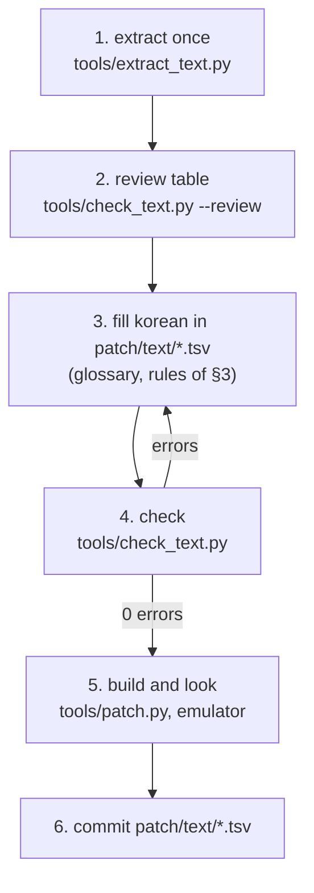

# 번역 작업 가이드 (번역자용)

이 저장소의 문서와 도구만으로(AI 없이) 게임 문장을 번역하고, 검사하고, 패치해서 확인하는 절차다. 도구 전체 흐름은 [text-pipeline.md](text-pipeline.md), 표기 기준은 [용어집](../kb/glossary.md)에 있다. 근거는 [설계 i015](../design/20261021-i015-translation-prep.md)다.

> **지금 상태 (2026-10-21, issue #15)**
> * `patch/text/`에 네 파일이 있다: `xbe.tsv`(메뉴·안내·이름, 기능 문구는 초벌 번역됨), `mission.tsv`, `talk.tsv`, `event.tsv`(대사, 비어 있음).
> * 대사(이벤트·대화·미션 안내, `xbe.tsv`의 실황 대사 67줄)는 사람이 번역한다. XBE 기능 문구 초벌도 사람이 검토해 고친다.



## 1. 준비 (한 번)

1. [text-pipeline.md](text-pipeline.md) §0의 준비(Python, 덤프 위치)를 한다.
2. 추출한다. `work/text/`에 원문이 든 표가 생긴다(커밋하지 않는다).

```bash
python -I tools/extract_text.py "roms/Jet Set Radio Future"
```

## 2. 검토 표 만들기

```bash
python -I tools/check_text.py "roms/Jet Set Radio Future" --review
```

* `work/text/review/<파일>.tsv`가 생긴다. 줄마다 다음이 나란히 있다.

| 열 | 뜻 |
|---|---|
| `file`, `where` | 자리(`patch/text/`의 같은 줄과 같다) |
| `ref` | 구조 위치. 이벤트·대화 `part 0 page 1`(같은 부분의 페이지가 한 장면), 미션 `sec … op 0xef`(`0xef` 목표, `0xbf`·`0xc0` 안내) |
| `status` | `empty`(안 함), `done`, `warning`, `error` |
| `orig_len`, `korean_len` | 원문·한국어 바이트 수 |
| `japanese`, `english` | 원문. 영어는 같은 부분 전체라 일본어 한 페이지보다 길 수 있다 |
| `korean` | 지금 번역 |
| `terms` | 이 줄의 용어와 용어집의 한국어 표기(예: `ドーゲン坂=도겐자카`) |
| `codes` | 이 줄이 지켜야 할 `$` 코드와 `%d` 같은 지정자, 순서대로 |
| `limits` | 한 페이지 줄 수와 한 줄 폭(픽셀) 한도 |
| `notes` | 오류·경고 내용 |

* 표 계산 프로그램으로 열 때는 UTF-8, 탭 구분, 모든 열을 텍스트로 연다. 이 파일은 읽기용이다. 번역은 §3처럼 `patch/text/`에 쓴다.

## 3. 번역하기

1. `patch/text/<파일>.tsv`를 연다(UTF-8과 탭을 지키는 편집기). `korean` 열만 채운다. 비워 둔 줄은 원문 그대로 나온다.
2. 규칙:
   * **용어**는 [용어집](../kb/glossary.md)대로 쓴다. 새 이름이 나오면 용어집에 먼저 더한다.
   * **코드**(`codes` 열)는 같은 순서로 모두 둔다. `$n`(줄바꿈)만 위치·개수를 바꿔도 된다. `$r` `$e`를 더하거나 빼면 도구가 멈춘다. 자세한 표는 [text-pipeline.md](text-pipeline.md) §2.2.
   * **줄 폭**: 이벤트는 한 줄 528픽셀, 대화는 456픽셀(한글 약 22자, 19자), 한 페이지 3줄. 넘으면 경고만 나오지만 화면에서 잘릴 수 있다.
   * **길이**: 원문보다 길어도 된다. 다만 페이지 하나가 너무 길면(약 200바이트) 도구가 멈춘다.
   * **이벤트 자막과 영어 음성**: 게임은 영어 모드로 돌아서, 패치 도구가 이벤트 자막을 영어판의 페이지 수와 시간에 맞춰 자동으로 다시 나눈다(issue #26). 번역은 지금처럼 일본어 페이지대로 쓰면 된다. 문장 끝, 쉼표, 연결 어미(-고, -서, -면) 뒤에서 나뉘므로, 한 문장을 너무 길게 이어 쓰지 않으면 자연스럽게 나뉜다.
   * **게임이 채우는 자리**: `%d` `%s`와, 원문에서 숫자나 이름이 들어갈 자리로 비워 둔 공백(예: 전각 공백 두 칸)은 **앞부분의 바이트 수를 원문과 같게** 둔다. 한글·전각 글자 = 2바이트, 영문·숫자·공백 = 1바이트.
   * **끝을 전각 공백으로 채운 원문**(그래피티 편집기 안내 등)은 번역도 원문 길이까지 전각 공백으로 채운다.
   * **문장 부호**: `！` `？` `…` `～` `「」` `“”`는 전각, 쉼표·마침표는 1바이트 `,` `.`. 쓸 수 있는 기호는 용어집 §7.
   * **글자**: 한글은 KS X 1001 완성형 2,350자만(예: `똠` `쌰` 같은 드문 글자는 안 될 수 있다). 쓸 수 없는 글자는 §4의 검사가 알려 준다.
3. **문체**:
   * 원문 높임법을 따른다. ＧＧ 멤버끼리와 DJ K는 반말, 시스템 안내는 "～하십시오"체.
   * 짧은 외침·실황은 짧고 힘 있게 옮긴다. 원문의 말장난은 뜻을 살려 우리말 말장난으로 바꿔도 된다.
   * 같은 장면(같은 파일, 같은 `part`)을 한꺼번에 번역하면 말투가 고르다.
   * 원문에 없는 설명을 덧붙이지 않는다.

## 4. 검사하기

```bash
python -I tools/check_text.py "roms/Jet Set Radio Future"
```

* 파일마다 `번역한 줄/전체`, 바이트, 옮김 수, 오류·경고 수가 나오고, 끝에 모든 오류와 경고가 줄 번호와 함께 나온다(`xbe.tsv:24 …`는 `patch/text/xbe.tsv`의 24번째 줄).
* `Hangul syllables: N`: 지금까지 쓴 서로 다른 한글 음절 수. 1,158자를 넘으면 번역하지 않은 가나가 깨진다. 1,327자를 넘으면 패치를 만들 수 없다. 넘을 것 같으면 드문 음절을 쉬운 말로 바꾼다.
* 오류가 0이 될 때까지 §3으로 돌아간다(끝 코드 1 = 오류 있음).

| 오류 | 고치는 법 |
|---|---|
| `characters not in the glyph table: U+…` | 그 글자를 다른 글자로(용어집 §7) |
| `page counts cannot change` | `$r` `$e`를 원문과 같게 |
| `overrun the 0x100-byte page buffer` | 그 페이지를 줄인다 |
| `original bytes do not match orig_sha1` | `file`·`where`·`orig_len`·`orig_sha1` 열을 고치지 않았는지 본다 |

## 5. 만들어서 보기

[text-pipeline.md](text-pipeline.md) §3을 따른다(매니페스트 갱신 → `patch.py` → 에뮬레이터, HDD 캐시를 먼저 지운다). 화면에서 볼 것: 줄이 화면이나 창 밖으로 나가지 않는지, 이름·숫자가 제자리에 들어가는지, 말투가 장면에 맞는지.

## 6. 커밋하기

* 커밋하는 것: `patch/text/*.tsv`, 새 파일을 건드렸다면 `patch/manifest.json`, 용어를 바꿨다면 `docs/kb/glossary.md`.
* 커밋하지 않는 것: `work/`(원문), `out/`(게임 자료), `roms/`. `git status`로 확인한다.
* 일의 단위는 issue다(P6-1부터: 미션, 대화, 이벤트, XBE 실황, [PLAN](../PLAN.md) §5). 커밋 제목 끝에 issue 번호를 붙인다(예: `대화 번역 TE000~TE050 (#16)`).

---

# Translation guide (for translators)

How to translate, check, patch and look at the game's text with this repository's documents and tools alone (no AI). The overall tool flow is in [text-pipeline.md](text-pipeline.md), the spelling standard in the [glossary](../kb/glossary.md); the grounds are [design i015](../design/20261021-i015-translation-prep.md).

> **Current state (2026-10-21, issue #15)**
> * `patch/text/` holds four files: `xbe.tsv` (menus, notices, names; the functional strings have a first pass), `mission.tsv`, `talk.tsv`, `event.tsv` (dialogue, empty).
> * Dialogue (events, talk, mission messages and the 67 commentary lines in `xbe.tsv`) is translated by people, who also review and revise the XBE first pass.

(The diagram above: extract once, make the review table, fill `korean` in `patch/text/`, check until there are no errors, build and look, commit.)

## 1. Preparation (once)

1. Do the preparation of [text-pipeline.md](text-pipeline.md) §0 (Python, the dump's place).
2. Extract (command above); the tables with the original text appear in `work/text/` (never committed).

## 2. Making the review table

(Command above.) It writes `work/text/review/<file>.tsv` with, per row: `file` and `where` (the place, as in the same row of `patch/text/`); `ref` (structural position: `part 0 page 1` for events and talk, where pages of the same part form one scene; `sec … op 0xef` for missions, `0xef` an objective, `0xbf`/`0xc0` a message); `status` (`empty`, `done`, `warning`, `error`); `orig_len` and `korean_len` (bytes); `japanese` and `english` (the originals; the English is the whole part, so it can be longer than one Japanese page); `korean` (the current translation); `terms` (the line's terms with the glossary's Korean forms, such as `ドーゲン坂=도겐자카`); `codes` (the `$` codes and specifiers such as `%d` the line must keep, in order); `limits` (lines per page and pixels per line); `notes` (errors and warnings). In a spreadsheet, open it as UTF-8, tab-separated, every column as text. It is for reading; translations go into `patch/text/` as in §3.

## 3. Translating

1. Open `patch/text/<file>.tsv` (an editor that keeps UTF-8 and tabs) and fill only the `korean` column; empty rows keep the original.
2. Rules:
   * **Terms** follow the [glossary](../kb/glossary.md); add a new name there first.
   * **Codes** (the `codes` column) all stay, in the same order; only `$n` (line break) may move or change in number. Adding or removing `$r` `$e` stops the tool; the full table is in [text-pipeline.md](text-pipeline.md) §2.2.
   * **Line width**: events 528 px per line, talk 456 px (about 22 and 19 Hangul), 3 lines per page; beyond that only a warning, but the line may be cut on screen.
   * **Length**: longer than the original is fine, but a page that is too long (about 200 bytes) stops the tool.
   * **Cutscene subtitles and the English voice**: the game runs in English mode, so the patcher re-splits event subtitles to the English version's page count and timing (issue #26). Keep translating page by page as in the Japanese; pages break after sentence ends, commas and connective endings (-고, -서, -면), so lines that do not run one sentence on too long split naturally.
   * **Places the game fills**: `%d` `%s`, and spaces the original leaves for a number or name (two full-width spaces, for example), keep **the same byte count before them** as the original; Hangul and full-width characters are 2 bytes, Latin letters, digits and spaces 1.
   * **Originals padded with full-width spaces at the end** (graffiti editor hints and the like): pad the translation to the original length the same way.
   * **Punctuation**: `！` `？` `…` `～` `「」` `“”` full-width; commas and full stops single-byte `,` `.`; usable symbols in glossary §7.
   * **Characters**: only the 2,350 KS X 1001 Hangul syllables (rare ones such as `똠` `쌰` may fail); the check in §4 reports unusable characters.
3. **Style**:
   * Follow the original's politeness levels: GG members among themselves and DJ K speak casually (반말); system notices use the formal "～하십시오".
   * Short shouts and commentary stay short and punchy; puns may become Korean puns that keep the sense.
   * Translating a whole scene (same file, same `part`) at once keeps the voices even.
   * Add no explanations the original does not have.

## 4. Checking

(Command above.)

* Per file: translated rows / all, bytes, moves, error and warning counts; then every error and warning with its line (`xbe.tsv:24 …` is line 24 of `patch/text/xbe.tsv`).
* `Hangul syllables: N`: the distinct Hangul syllables used so far. Beyond 1,158, untranslated kana break; beyond 1,327 no patch can be built; when close, replace rare syllables with simpler words.
* Go back to §3 until there are 0 errors (exit code 1 = errors). The table above maps the errors to fixes: replace unusable characters (glossary §7), keep `$r` `$e` as in the original, shorten an overlong page, and check that the `file`, `where`, `orig_len` and `orig_sha1` columns were not edited.

## 5. Building and looking

Follow [text-pipeline.md](text-pipeline.md) §3 (manifest update → `patch.py` → emulator, clearing the HDD cache first). On screen, look for lines leaving the screen or window, names and numbers landing in place, and voices fitting the scene.

## 6. Committing

* Commit `patch/text/*.tsv`, `patch/manifest.json` when new files were touched, and `docs/kb/glossary.md` when terms changed.
* Never commit `work/` (original text), `out/` (game data) or `roms/`; check with `git status`.
* Work is organised by issue (from P6-1: missions, talk, events, XBE commentary; [PLAN](../PLAN.md) §5); end commit titles with the issue number (for example `대화 번역 TE000~TE050 (#16)`).
