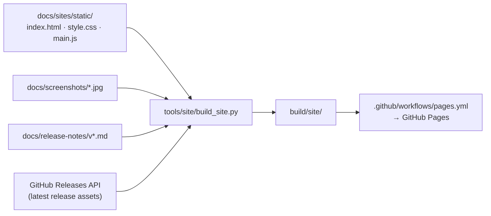

# 소개 사이트

<https://nworkers.github.io/JSRF-kr-patch/>의 원본이다. 설계는 [design i023](../design/20261023-i023-pages.md)에 있다.



| 경로 | 내용 |
|---|---|
| `static/index.html` | 페이지 본문(한국어 + 영어 요약). `{version}`, `<!-- DOWNLOADS -->`, `<!-- RELEASES -->`를 빌드 때 채운다 |
| `static/style.css` | 힙합·그래피티 테마. 글꼴은 Google Fonts(Black Han Sans, Do Hyeon, Gothic A1, Permanent Marker, 모두 OFL) |
| `static/main.js` | 전후 비교 슬라이더(끌기·방향키), 원본 언어(영어/일본어) 전환, 명령 탭 |
| `../screenshots/` | 비교 스크린샷. reJSRF로 캡처한다([README](../screenshots/README.md)) |

## 갱신되는 방법

* **내려받기 단추**: 빌드 때 최신 GitHub 릴리스의 묶음(Windows, Linux, Python)과 크기·SHA-256을 읽는다. 릴리스가 없으면 릴리스 페이지 링크를 보인다. Release 워크플로가 끝나면 Pages 워크플로가 이어서 돈다.
* **릴리스 타임라인**: `docs/release-notes/v*.md`의 한국어 절에서 요약과 해결된 issue를 읽는다(최근 8개).
* **스크린샷**: `docs/screenshots/`의 이미지를 `screenshots/`로 복사한다. 페이지가 쓰는 파일 이름은 `index.html`의 `data-before`·`data-after`·`data-before-src`에 있다.

## 로컬 빌드

```bash
python -I tools/site/build_site.py            # build/site/, 릴리스 API 사용
python -I tools/site/build_site.py --offline  # API 없이(릴리스 페이지 링크)
```

`build/site/index.html`을 브라우저로 연다. 처음 배포 전에 저장소 Settings → Pages의 원본을 "GitHub Actions"로 둔다.

---

# Introduction site

The source of <https://nworkers.github.io/JSRF-kr-patch/>; the design is [design i023](../design/20261023-i023-pages.md). (The diagram and table above show the inputs, the build script and the files: the page with fill markers, the hip-hop/graffiti stylesheet using OFL Google Fonts, the slider/switch/tab script, and the screenshots captured with reJSRF.)

## How it updates

* **Download buttons**: at build time the latest GitHub release's packages (Windows, Linux, Python) with sizes and SHA-256 are read; without a release the releases page is linked. The Pages workflow runs after the Release workflow.
* **Release timeline**: summaries and resolved issues from the Korean half of `docs/release-notes/v*.md` (the latest 8).
* **Screenshots**: `docs/screenshots/` is copied to `screenshots/`; the file names the page uses are in `index.html`'s `data-before`, `data-after` and `data-before-src`.

## Local build

(Commands above.) Open `build/site/index.html` in a browser. Before the first deployment, set the repository's Settings → Pages source to "GitHub Actions".
